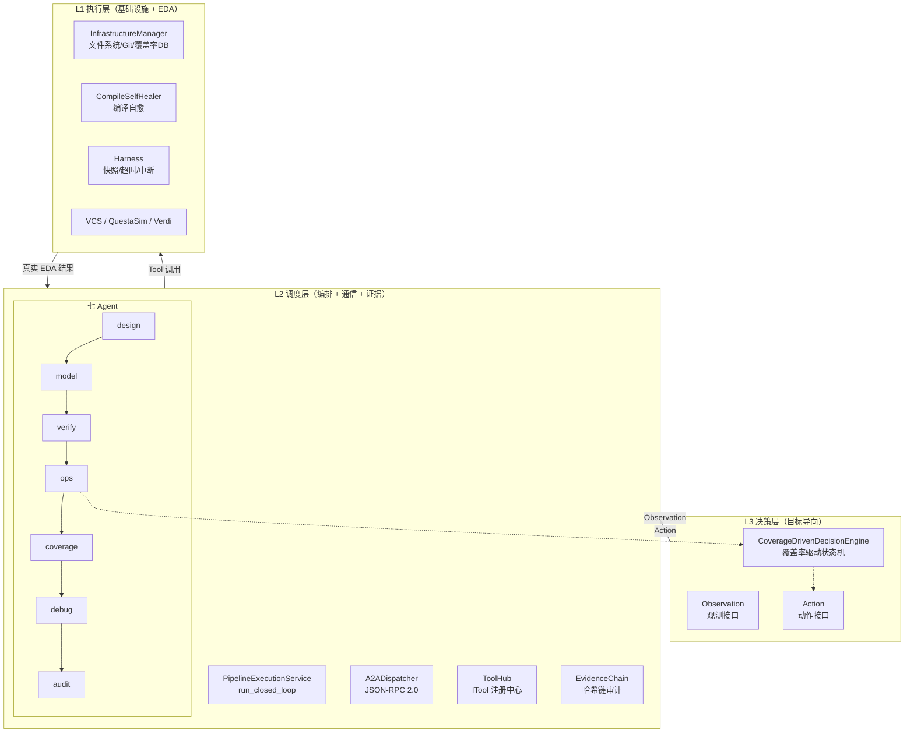
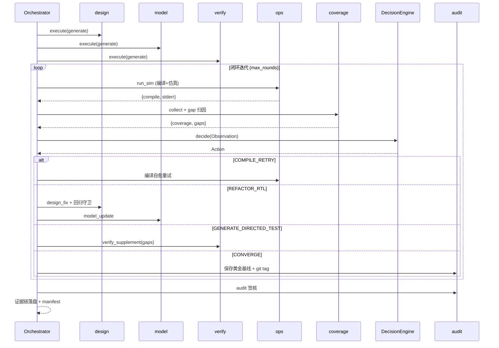
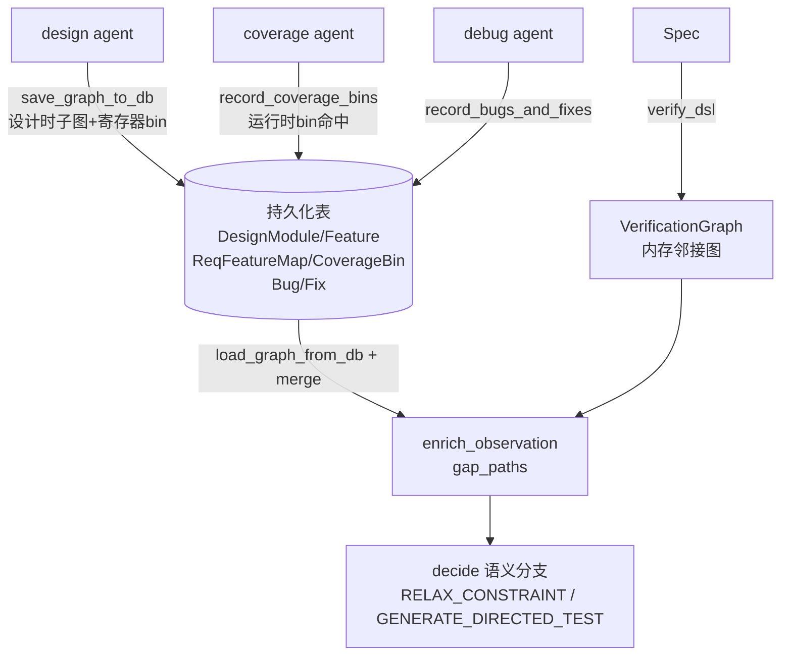

# AI 驱动芯片验证全栈闭环架构设计文档

> **SignOffAI 功能签核平台 · 架构深度分析**
> 分支：`develop_claude` · 文档日期：2026-08-16
> 核心理念：**可复现、可审计、可治理的 IC 验证 AI 签核平台**
>
> **验证声明**：本架构不是 PPT——V1 已跑通真实 EDA 闭环，V2/V3/V4 均已落地为可运行代码（见 [附录文件索引](#十七附录目录结构与文件索引)）；正在用真实 IP（I2C/UART）跑通完整签核案例，产出可审计证据链作为对外展示样本。

---

## 目录

1. [设计目标与核心理念](#一设计目标与核心理念)
2. [总体架构：三层 + 闭环](#二总体架构三层--闭环)
3. [七 Agent 体系详解](#三七-agent-体系详解)
4. [统一通信层：A2A / JSON-RPC / ToolHub](#四统一通信层a2a--json-rpc--toolhub)
5. [决策层：覆盖率驱动的 L3 状态机](#五决策层覆盖率驱动的-l3-状态机)
6. [执行层：基础设施与自愈引擎](#六执行层基础设施与自愈引擎)
7. [覆盖率数据层](#七覆盖率数据层)
8. [L4/L5 成长层：跨 Run 进化](#八l4l5-成长层跨-run-进化)
9. [证据链与可审计性设计](#九证据链与可审计性设计)
10. [质量守护与三条铁律](#十质量守护与三条铁律)
11. [数据流与闭环时序](#十一数据流与闭环时序)
12. [治理体系](#十二治理体系)
13. [关键设计决策与差异化壁垒](#十三关键设计决策与差异化壁垒)
14. [现状、技术债与演进路线](#十四现状技术债与演进路线)
15. [Knowledge Graph 认知层（V2 架构升级）](#十五knowledge-graph-认知层v2-架构升级)
16. [决策学习层与知识复用（V3/V4）](#十六决策学习层与知识复用v3--v4)
17. [附录：目录结构与文件索引](#十七附录目录结构与文件索引)

---

## V2/V3/V4 新特性速览

老读者只看这节即可：

| 版本 | 核心能力 | 章节 |
|------|---------|------|
| **V2 Knowledge Graph** | 语义溯源：需求→功能→模块→信号→bin→bug→fix 成图，gap 不再是「数字」而是「归因」 | [第十五章](#十五knowledge-graph-认知层v2-架构升级) |
| **V2 事件驱动** | L1 执行结果变异步事件（COVERAGE_UPDATED/BUG_DETECTED），KG 订阅更新世界模型 | [第十六章](#十六决策学习层与知识复用v3--v4) |
| **V3 决策学习层** | Decision Brain：规则（硬失败）+ RL Q-learning（软决策）并行，覆盖率 delta 当奖励 | [第十六章](#十六决策学习层与知识复用v3--v4) |
| **V4 跨项目 + marketplace** | 跨项目 bug/fix 语义复用 + 签核证据包导出/导入/合并 | [第十六章](#十六决策学习层与知识复用v3--v4) |

---

## 一、设计目标与核心理念

SignOffAI 不是一个"帮工程师写代码"的 AI 工具，而是一个**把 IC 验证工作流（规格分析 → RTL → UVM → 测试 → 回归 → 覆盖率 → 调试 → 签核）变成可编程、可治理、可审计的工程系统**。

### 1.1 四大价值支柱

| 价值 | 落地机制 | 关键代码 |
|------|----------|----------|
| **可复现** | 任意一步可用 `vagent dump` + 同一配置/脚本/种子重放；覆盖率数据库与 RTL 逐轮哈希固化 | `src/core/infrastructure.py` |
| **可审计** | 每阶段输出 `manifest.json` + `evidence_chain.json`，含哈希链、输入输出、决策理由 | `src/core/file_audit.py`、`src/core/evidence.py` |
| **可治理** | RBAC 权限、审批门控、Token 预算、三层质量守护、人工升级 | `src/infra/rbac.py`、`src/core/quality_guard.py` |
| **可交付** | 最终产出不是代码，而是**签核证据包**（manifest + 证据链 + 覆盖率数据库哈希 + git tag） | `src/core/manifest.py` |

### 1.2 三条工程原则（贯穿全部实现）

1. **LLM 只做"完形填空"，不决定整体结构** —— 骨架由 Jinja2 模板 / 规则引擎生成，LLM 只填充局部（如 `generate_gap_directed_seq` 中固定 sequence 类骨架，只让 LLM 反推驱动逻辑）。
2. **确定性优先，规则先行，LLM 兜底** —— 编译校验、覆盖率归因、错误分类全部是规则匹配；LLM 只在规则无法覆盖时介入。
3. **真实 EDA 是唯一真理** —— 任何 AI 生成的代码必须经过 `vlog`/`vsim` 的 PASS/FAIL 判定，AI 不自证正确（见 [第十章 铁律一](#102-铁律一-eda-是唯一真理)）。

---

## 二、总体架构：三层 + 闭环

SignOffAI 的运行时架构是一个 **L1/L2/L3 三层 + 覆盖率驱动闭环** 的体系。三层与"设计风格"（流水线 / 组合逻辑 / CDC）完全解耦——无论测什么 DUT，调度方式、通信协议、决策逻辑都不变；变的只是各 Agent 内部的领域知识（Prompt / 策略包）。



### 2.1 三层职责

| 层 | 职责 | 核心模块 | 是否受设计风格影响 |
|----|------|----------|--------------------|
| **L3 决策层** | 根据覆盖率/编译结果决定"加测 / 加种子 / 改 RTL / 改模型 / 收敛" | `decision_engine.py` | ❌ 目标驱动，与 DUT 类型无关 |
| **L2 调度层** | 多 Agent 编排、统一通信、证据链记录 | `execution.py`、`jsonrpc.py`、`tool_hub.py`、`file_audit.py` | ❌ 通信协议与调度逻辑通用 |
| **L1 执行层** | 文件系统/Git/覆盖率库三件套、EDA 编译仿真、编译自愈 | `infrastructure.py`、`compile_healer.py`、`harness.py` | ❌ EDA 对流水线与组合逻辑透明 |

> **关键结论（对应 new_arch 系列文档）**：架构是"通用调度引擎"，与设计风格解耦。适配流水线/低功耗/CDC 等新设计类型时，**无需重构任何调度代码**，只需把专业知识抽象为**策略包（Policy Pack）**（`/policies/pipeline/` 等），由主控按 `--design-style` 动态加载。

### 2.2 两条执行路径

当前代码库并存两条路径，是本项目"从线性流水线向目标导向闭环"演进的中间态：

| 路径 | 入口 | 特点 | 状态 |
|------|------|------|------|
| **线性流水线** | `PipelineExecutionService.run_pipeline()` | 13 阶段 `FULL_PHASES`，逐阶段 + 门禁 + 反馈回退 | 承载 `vagent verify`，但阶段角色仍指向旧 11-Agent 体系 |
| **目标导向闭环** | `PipelineExecutionService.run_closed_loop()` | 七 Agent + 决策层迭代，覆盖率达标收敛 | 新架构主路径，`architecture: closed_loop_7agents` |

---

## 三、七 Agent 体系详解

七 Agent 是旧 11/12 Agent 的**语义聚合**：每个 Agent 都是无状态、可反复调用的"微服务"，通过 `consumes`/`produces` 声明共享上下文契约，通过标准 `execute_task()` 接口被决策层驱动。

| Agent | Role | 语义聚合 | consumes | produces | 核心产出 |
|-------|------|----------|----------|----------|----------|
| **design** | 设计智能体 | spec + design + rtl | `spec` | `design_arch`(+`rtl`) | 架构分解 + RTL 文件 |
| **model** | 模型智能体 | 多语言参考模型 | `spec`,`design_arch` | `model` | C++/Python/SV/Verilog 参考模型 + 版本管理 |
| **verify** | 验证开发智能体 | uvm + test + assert | `spec`,`design_arch` | `tests` | UVM 环境 + 测试用例 + SVA + gap 定向激励 |
| **ops** | 运维调度智能体 | 编译 + 仿真 + 回归 | `env`,`tests` | `regression` | RegressionRunner 编译仿真结果 |
| **coverage** | 覆盖率智能体 | 覆盖率收集 + gap 分析 | `spec`,`regression` | `coverage` | 覆盖率指标 + 语义层 gap 向量 |
| **debug** | 调试智能体 | 失败根因分析 | `regression`,`tests`,`env` | `debug` | 五阶段诊断 + 信号级证据矩阵 |
| **audit** | 审计智能体 | qa + 签核 | `regression`,`coverage` | `report` | 签核判定 + `report.json` |

### 3.1 design — 设计智能体

`src/agents/design/main.py`

一条 `execute_task` 内完成三段真实工具链：

```
spec 文本 → analyze_specification() [spec_tools]
         → _build_func_hier() 架构分解（features → 功能层次树）
         → _generate_rtl() 模板生成 module 骨架（always_ff + case 分发）
```

- 评分公式：`min(50 + 文件数×15 + 寄存器数×2, 90)`，无 RTL 文件则 30 分。
- 输出同时写 `design_arch` 和 `rtl`（文件落盘到 `output/rtl/<module>.sv`）。

### 3.2 model — 模型智能体

`src/agents/model/main.py`

支持 **cpp / python / systemverilog / verilog** 四种参考模型模板渲染，并有独立的**版本管理**：

- 每次生成/更新写到 `<module>_vN/` 目录，旧版本并存不覆盖；
- `_mark_stable()` 维护 `stable` 指针文件；
- `action=rollback` 时回退到倒数第二个版本（比对失败导致模型回退的关键机制）；
- 评分：`min(50 + 操作数×5, 85)`。

> 模型是闭环中最"贵"也最易错的一环：RTL 是流水线（延迟可变），参考模型却常按顺序一拍一拍计算。比对失败时决策层会下发 `UPDATE_MODEL`（见 5.2），模型智能体据此 `+1` 出新版本并保留回滚点。

### 3.3 verify — 验证开发智能体

`src/agents/verify/main.py`

三合一（UVM + test + assert），并实现 **supplement 模式**（闭环定向激励）：

1. **UVM 环境**：`find_spec_yaml → jinja_render` 生成 8 文件环境骨架；
2. **测试用例**：`parse_test_points → map_policies_to_tests → build_scenario_yaml` 产出 `constraint.yaml`；
3. **SVA 断言**：`generate_sva_assertions` 落盘 `assertions/*_assertions.sv`；
4. **gap 定向激励**（`supplement=True`）：`_generate_gap_tests()` 按覆盖率 gap 生成 `*_gap_seq.sv`，注入到 random test 的 `run_phase`，并执行 **铁律一**——LLM 生成的 sequence 必须经 `vlog` 编译校验，不通过则 `_neutralize_gap_seq()` 回退为空实现。

### 3.4 ops — 运维调度智能体

`src/agents/ops/main.py`

关键设计是**文件系统发现优先于脆弱的上游 ctx 传递**：`_discover_env_name` / `_discover_agent_names` / `_discover_top_module` 从 `env/*_pkg.sv`、`agents/*/`、`bench/*_tb_top.sv` 反推环境结构，避免 Agent 间字段名耦合。

然后构造 `RegressionRunner`（`regression_framework` 适配器）执行真实 `vlog` 编译 + `vsim` 仿真，返回 `{compile, compile_errors, stderr, ...}`。

### 3.5 coverage — 覆盖率智能体

`src/agents/coverage/main.py`

三件事 + 两条铁律：

1. **收集**：`collect_real_coverage()` 从 QuestaSim ucdb 提取 line/branch/toggle/fsm；
2. **语义降维**：`build_coverage_gaps()` 把高维未覆盖 bin 压缩成**可决策的 gap 向量**，每个 gap 带归因：
   - `unreachable`：某 metric 覆盖率 0%（疑似死代码）；
   - `constraint`：信号约束限制了取值域，高位 toggle 必然未覆盖；
   - `unstimulated`：随机激励没覆盖到的剩余 bin；
3. **铁律二/三**：ucdb 计算 SHA256 固化版本（复现时回滚比对）；LLM 空洞分析只读降采样后的 text 汇总，**绝不读 ucdb**。

### 3.6 debug — 调试智能体

`src/agents/debug/main.py`

五阶段根因追踪管线（真实工具，非 Mock）：

```
Collect（仿真日志+编译日志）
  → Classify（12 类精细分类 + fingerprint 去重）
  → Locate（bisect 定位多失败）
  → Fix（auto_fix 模板匹配 → 应用 patch，最多 5 个独立错误）
  → Verify（重跑失败 case 验证）
```

亮点是 **Phase 2.5 信号级诊断**：对 mismatch 类错误，从日志提取 `dut/model/expected` 三方值，产出**证据矩阵**做根因分类，**替代"日志正则甩锅给 model"的粗糙做法**。LLM 只在规则无法修复时（`applied==0 且 unique>0`）才做深度假设分析。

### 3.7 audit — 审计智能体

`src/agents/audit/main.py`

质量审查 + 签核判定：`failed==0 且 coverage≥95` → `READY/APPROVED`，否则 `NEEDS_FIX/CONDITIONAL`，落盘 `report.json`。

---

## 四、统一通信层：A2A / JSON-RPC / ToolHub

### 4.1 A2A 调度器（Agent-to-Agent）

`src/core/jsonrpc.py`

基于 **JSON-RPC 2.0 传输层**，method 采用 A2A 标准语义：

| Method | 语义 |
|--------|------|
| `agents/discover` | 返回所有 Agent 的能力卡片（AgentCard） |
| `tasks/send` | 派任务给指定 Agent（改 Env/Model/RTL **统一走这个**，只是 `task.agent` 不同） |
| `tasks/get` / `tasks/cancel` | 查询 / 取消任务状态 |

核心设计：**无论"修改 Env"还是"修改 Model"，都是同一条 `tasks/send` 信道，`task.reason` 记录修改理由供证据链追溯。** 决策层下发的动作最终都归一化为对某个 Agent 的 `execute_task()` 调用。

### 4.2 Agent 标准契约

`src/core/agent_contract.py`

- `AgentRequest`：无状态标准化输入（`input` / `ctx` / `output_dir` / `params` / `fix`）；
- `AgentResponse`：标准化输出（`output` / `data` / `score` / `status`）；
- `AgentContext`：`execute_task` 内部跨方法传态，**替代 `self._xxx` 实例变量残留**，避免并发污染。

### 4.3 ToolHub + ITool 协议（对标 MCP）

`src/core/tool_hub.py` + `src/core/tool_protocol.py`

所有工具（内置 + 第三方 + 外部 CLI）实现统一 `ITool` 协议，五条原则：

1. **自描述**：`ToolManifest` 含名字/版本/输入输出 JSON Schema/风险等级/示例；
2. **可验证**：框架自动做 schema 校验（`validate_args_by_schema`）；
3. **可隔离**：`INLINE / SUBPROCESS / CONTAINER` 三种执行模式；
4. **可审计**：每次调用记录 `ToolCallRecord`（timestamp/args/result/elapsed/sandbox 决定）；
5. **可发现**：`PluginManager` 自动扫描，无需硬编码注册。

**风险分级**是个人级治理的关键：

| 风险 | 语义 | 审批模式 |
|------|------|----------|
| `safe` | 只读/无副作用 | 自动通过 |
| `write` | 写磁盘/改配置 | 终端确认 |
| `danger` | 删除/提权/杀进程 | 直接拦截 |

`ToolHub.invoke()` 的调用链是：**schema 校验 → sandbox 检查 → 执行 → 审计落盘**，任何一环失败都有审计记录。

---

## 五、决策层：覆盖率驱动的 L3 状态机

`src/core/decision_engine.py`

决策层 = **目标函数（覆盖率目标）+ 反馈信号（gap 向量）+ 动作空间（8 动作）+ 优化算法（当前为规则，可换 LLM）**。

与执行层通过标准 JSON 解耦：`Observation`（观测接口）→ 决策引擎 → `Action`（动作接口）。

### 5.1 八种决策动作

| 动作 | 触发条件 | 优先级 | 目标 Agent | 语义 |
|------|----------|--------|-----------|------|
| `COMPILE_RETRY` | 编译失败 | **最高** | ops | 触发自愈，编译不过后面全废 |
| `UPDATE_MODEL` | 比对失败（model mismatch） | 高 | model | 更新参考模型（+1 版本） |
| `RETRY_ENV` | 测试失败 | 高 | ops | 环境自愈/重试 |
| `EXPAND_SEEDS` | 覆盖率连续 N 轮增长 < 1% | 中 | ops | 扩种重跑回归 |
| `REFACTOR_RTL` | 不可达/死代码 | 高 | design | 重构 RTL + 联动更新 model |
| `RELAX_CONSTRAINT` | 约束型 gap | 高 | verify | 放宽 transaction 约束 |
| `GENERATE_DIRECTED_TEST` | 未激励 gap | 高 | verify | 按 gap 生成定向激励 |
| `CONVERGE` | 覆盖率 ≥ 目标 | 低 | — | 收敛签署 |

决策优先级：**环境失败 > 覆盖率停滞 > 覆盖率空洞 > 死代码 > 达标收敛**。

### 5.2 gap 语义降维是决策精准的关键

传统"覆盖率低 → 盲目补测"被替换为**按 gap 归因分流**（`build_coverage_gaps` 输出的 reason）：

```
unreachable   → REFACTOR_RTL       （不是补测能解决的，必须改设计）
constraint    → RELAX_CONSTRAINT   （人为约束限制了取值，放宽即提升）
unstimulated  → GENERATE_DIRECTED_TEST（激励不足，定向补测）
```

这使 L3 决策从"看数字"进化到"看原因"，是闭环收敛效率的核心提升点。

> **V2 增强**：在 reason 分流之上，Knowledge Graph 提供更高一层的**语义溯源**（`gap_paths`）——reason 只回答「为什么没覆盖」，语义路径回答「这是哪个需求的哪个信号、已有哪个测试」。`decide()` 优先走语义分支，再退回 reason 分流。见 [第十五章](#十五knowledge-graph-认知层v2-架构升级)。

### 5.3 黄金基线与回归守卫

`src/core/golden_baseline.py`

- **黄金基线**：覆盖率首次达标时打包 `rtl/env/agents/bench/inputs` 为 `golden.tar.gz`；
- **回归守卫 `GuardianAgent`**：决策层执行 `REFACTOR_RTL` 前，强制跑 golden 用例集，**< 100% 通过则拒绝本次设计修改**——防止"为了补覆盖率把已通过的功能改坏"。

---

## 六、执行层：基础设施与自愈引擎

### 6.1 InfrastructureManager —— L1 三件套

`src/core/infrastructure.py`

"可复现、可审计、可追溯"的根基是三个基础设施的统一管理：

| 基础设施 | 管理方式 | 复现机制 |
|----------|----------|----------|
| **文件系统** | 工作区（可丢弃）vs 归档区 `.signoffai/`（持久） | 目录布局标准化 |
| **Git 仓库** | 源码版本化，覆盖率达标打 tag；产物不进 git | `version_manifest.json` 用哈希关联 tag ↔ 产物 |
| **覆盖率数据库** | 几十 GB 的 `.ucdb/.vdb` 不进 git，硬链接归档 | 每轮 SHA256 固化，复现时回滚比对 |

`verify_reproducible()` 提供一键复现校验：比对当前 `merged.ucdb` 与归档哈希、RTL 与版本清单。

### 6.2 CompileSelfHealer —— 编译失败自愈

`src/core/compile_healer.py`

编译失败是比覆盖率不达标更紧急的问题。自愈引擎做两件事：

1. **错误分类**（10 类）：`FILE_NOT_FOUND / SYNTAX_ERROR / UNDEFINED_SIGNAL / PORT_MISMATCH / ENV_ISSUE / LICENSE_ISSUE / TOOL_VERSION / MEMORY_ISSUE / TIMEOUT / UNKNOWN`；
2. **自愈策略**：文件缺失→搜索补 filelist；未定义信号→顶部加 `logic` 声明（真实文件编辑）；环境缺失→自动 set 环境变量；License→指数退避重试（靠重试不靠修复）；语法错误→交给 LLM 或人工。

### 6.3 Harness —— 执行安全带

`src/core/harness.py`

借鉴 Claude Code 的 Harness 概念，做 phase 级（比 tool_call 级更粗）保护：

- **快照**：每 phase 前 snapshot ctx + 文件哈希清单；
- **超时**：`asyncio.wait_for` 超时抛 `HarnessTimeout`；
- **中断恢复**：`.harness_pause` / `.harness_abort` 标记文件，人工创建即暂停/终止；
- **退避重试**：指数退避（`backoff_base=2.0`）重试；
- **人工干预检测**：文件快照 diff 检测人工是否在 phase 间改了代码。

### 6.4 StepExecutor —— 阶段执行引擎

`src/core/step_executor.py`

内层确定性的阶段执行：`条件求值 → 状态快照 → Agent 调用 + 重试 + 回滚 → Diff 追踪 → 结果写回 → ctx 清理`。支持 `test`/`assert` 并行对执行（独立 ctx 副本）。

### 6.5 LLM 调用基础设施与工具隔离（借鉴 claw-code harness 工程化）

借鉴 Claude Code 开源镜像 [claw-code](https://github.com/deepelementlab/clawcode) 的 harness 工程化——它值得学的是"把 LLM 调用 / 工具 / 权限 / 记忆这些横切关注点做成可靠、可预算、可隔离的层"，而非产品形态。四个优化收敛到 L1：

| 优化 | 模块 | 价值 |
|------|------|------|
| **集中式 Query Engine** | `src/core/query_engine.py` | token 预算 + 响应缓存 + 超时重试 + provider 降级 + 审计，让"LLM 填空"可预算、可预测 |
| **跨 run 经验库** | `src/core/debug_experience.py` + `coverage_experience.py` | 调试根因（confidence 阈值 + fail_count 教训）与 gap 归因校准（unreachable 黑名单 + 动作有效性），sqlite 持久化到 `.signoffai/` |
| **工具 Stdio 进程隔离** | `src/core/tool_subprocess.py` + `tool_worker.py` | EDA 工具封装成独立进程（stdin/stdout JSON），崩溃不拖垮主流程，对应 MCP Stdio 传输 |
| **权限会话缓存** | `tool_system.py` 的 `Sandbox.session_approvals` | 同一次 run 内批准过的 write 工具不再重复询问，跨 run 不保留保证安全 |

> **明确不借鉴 claw-code 的**：Rust 重写（IC 验证瓶颈在 EDA 工具不在 Python 编排）、ULTRAPLAN 远程规划（CLAUDE.md 禁止 Web/云端）、Swarm 动态子代理（IC 验证固定流程用七 Agent 流水线更可审计）、provider-agnostic 多模型切换（IC 验证要确定性，多模型破坏可复现）。

### 6.6 策略包（Policy Pack）—— 设计风格驱动的差异化核心

`src/core/policy_pack.py` + `/policies/`

这是与 Claude Code **明确差异化**的一层。Claude Code 的 Skill/Plugin 是"通用技巧"（按任务关键词匹配加载自由文本），而 SignOffAI 的**策略包承载"设计风格验证知识"**（流水线/CDC/UPF），**按 `--design-style` 驱动加载**，是验证领域特有的三层差异化：

| 层 | Claude Code | SignOffAI 策略包 |
|----|------------|------------------|
| 命名 | Skill / Plugin | 策略包（Policy Pack）|
| 语义 | 通用技巧（自由文本 SKILL.md）| 结构化验证知识（test_scenarios / coverage_bins / assertion_templates / compile_options）|
| 机制 | 按任务匹配加载 | 按 `--design-style` 加载（`load("pipeline")`）|

```
/policies/
  ├── baseline/     # 默认策略（通用组合逻辑）
  ├── pipeline/     # 流水线：背压/前递/Flush/冒险检测场景 + Valid/Ready 覆盖点
  └── low_power/    # 低功耗：UPF/电源域切换/门控时钟/电平转换
```

接入：`run_closed_loop(..., design_style="pipeline")` → verify agent 注入 `prompt_hints/test_scenarios/coverage_bins` 到 spec，ops agent 加载 `compile_options`。**零代码重构，一键切换设计风格**。原照搬 Claude Code 的 `skills.py`/`plugins.py` 通用层已删除，统一到策略包。

### 6.7 驾驭层 —— 预算 / 熔断 / 干预 / 真回滚 / 虚拟文件系统

`src/core/governor.py` + `harness.py` + `virtual_fs.py` + `file_editor.py`

驾驭自主智能体的核心不是"更强的限制"，而是"看得见 → 停得住 → 回得去 → 管得住 → 查得清"：

| 能力 | 模块 | 语义 |
|------|------|------|
| **资源预算** | `governor.ResourceBudget` | token / 时间 / EDA 调用次数，超预算拒绝继续 |
| **熔断器** | `governor.CircuitBreaker` | 某动作连续失败 3 次 → 熔断（暂停 + 升级人工）|
| **细粒度干预** | `governor.Intervention` | 指令文件 `.harness_cmd`（pause/skip/step/override_action）|
| **审批门控** | `approval_gate.ask()` | 高风险动作（REFACTOR_RTL/UPDATE_MODEL）前人工审批 |
| **升级人工** | `EscalationConsole.ask()` | 熔断/预算耗尽时升级，retry（复位熔断）/ abort |
| **真回滚** | `harness.snapshot/restore` | 快照备份关键源文件，restore 真正恢复（不只检测）|
| **虚拟文件系统** | `virtual_fs.VirtualFileSystem` | 覆盖层 + 事务（begin/commit/rollback）+ 快照 + 变更追踪 |
| **精确文件编辑** | `file_editor.edit_file/apply_patch` | old_string 唯一匹配才替换（冲突检测），unified diff 应用 |

闭环接入：`run_closed_loop` 里 `governor.before_action(action)` 检查（熔断/预算/干预），`after_action(action, success)` 反馈（覆盖率提升=成功）；`approval_gate` 接进高风险动作分支；`EscalationConsole` 接进熔断分支。

### 6.8 Planning 阶段 —— 长周期任务规划

`src/core/planning.py`

覆盖率驱动闭环缺的"计划"在这里补上：不是"裸奔冲 target"，而是**跑之前有规划（目标分解 + 里程碑）、跑之中有进度（每轮对比）、跑之后有预测（收敛判断）**：

| 能力 | 语义 |
|------|------|
| **统一覆盖率目标** | `get_coverage_target()` 从 `Settings.verification.coverage_target` 读（消除散落 8 处硬编码 95）|
| **目标分解** | `CoveragePlanner._build_milestones()`：非线性里程碑（边际递减，前期快后期慢）|
| **进度跟踪** | `check_progress(round, coverage)`：对比里程碑，落后则告警 |
| **收敛预测** | `predict_convergence(history)`：按提升速率预测还差几轮 + 是否停滞 |

闭环接入：开头 `planner` 生成计划（写进 phases），每轮 `check_progress + predict_convergence`，结果写进 manifest 的 `planning` 字段（计划 vs 实际，可审计）。

### 6.9 功能覆盖率模型 —— 语义验证目标（代码覆盖率之外）

`src/agents/coverage/functional_coverage.py` + `env_cov.sv.j2` + `collect_real_coverage.py`

代码覆盖率（line/branch/toggle）只能回答"**代码被执行了吗**"，功能覆盖率（covergroup bin 命中）才能回答"**功能场景被验证了吗**"——这是 IC 验证的本质区别。功能覆盖率模型完整闭环：

```
① FunctionalCoveragePointGenerator（coverage Agent）→ 从 spec 提取功能点 → 语义 bin
   （如 opcode 的 add/sub/mul 各一个 bin，而非 32 位自动 bin）
② env_cov 模板（verify Agent）→ 环境级采样骨架（transaction 字段 → coverpoint + cross）
③ 策略包 coverage_bins → 语义化 cross 桥接（valid_ready_combination → cross）
④ 收集（vcover -cvg）→ functional_pct（covergroup bin 命中），与代码覆盖率并列
```

设计决策：**不开新 Agent**——功能覆盖率点的生成集成在 coverage Agent 内（`FunctionalCoveragePointGenerator` 子模块），因为"覆盖率点的生成、收集、分析、gap 归因"天然属于同一生命周期，拆开反而引入跨 Agent 通信和证据链分裂。

---

## 七、覆盖率数据层

覆盖率闭环除了"看覆盖率"和"做决策"，还缺一层**数据驱动**的底座。本章三块能力共同补齐：**覆盖地图（定位层）→ Exclude 机制（允许放弃）→ 用例状态库（动态 portfolio）**。跨 run 的 L4/L5 成长进化单独成章（见 [第八章](#八l4l5-成长层跨-run-进化)）。

### 7.1 覆盖地图（CoverageMap）—— 定位层

`src/core/coverage_map.py`

自动驾驶靠 GPS + 高精地图精确知道"我在哪条车道的哪个位置"；SignOffAI 靠覆盖地图精确知道"哪个 bin 命中、哪个 bin 没命中、缺口在验证空间的哪个坐标"。

与 gap 向量（reason 维度的**粗定位**）的区别：覆盖地图是 **bin 级精确坐标**——不是"constraint 缺口"，而是"`opcode[31:16]` 的 toggle 未命中"。

| 能力 | 语义 |
|------|------|
| `build(nested_cov, toggle_details, functional_detail)` | 聚合代码/功能/toggle 覆盖成 `{bins, covered, total, coverage, uncovered_bins}` |
| `_METRIC_PURPOSE` 映射 | `line/statement→functional`、`branch/condition→protocol`、`toggle/fsm→corner`（对应 L0 验证目标） |
| `locate_uncovered(map, purpose)` | 按 purpose 过滤未覆盖 bin，供决策层精准补漏 |

coverage Agent 每轮产出 `coverage_map`，决策层据此从"看百分比"进化到"看坐标"。

### 7.2 Exclude 机制（允许放弃）—— 四步闭环

`src/core/exclude_registry.py`

"允许放弃"与"确保不漏测"**同等重要**。100% 覆盖率在真实芯片几乎不可能——总有死代码（`if(0)` 分支）、tie-off 信号、规格不要求测的场景。强行追最后 1% 花费十倍时间却毫无意义。所以"放弃"必须工程化：**有据可查地放弃，而不是假装覆盖**。

四步闭环：

```
① 自动发现  Coverage/Debug 报告"某覆盖点持续 0% 且归因是结构性死代码"
            （coverage Agent 把多次 refactor 仍 0% 的 unreachable 点筛入
              calibration.blacklisted_gaps；run_closed_loop 的 _discover_excludes 自动提议）
② 归因分类  unreachable（结构死代码）/ excluded_by_design（规格不测）/ not_worth_it（成本高）
③ 审计门控  Exclude 记录带 approver（工程师签名）+ audit_hash（sha256 哈希链，接证据链）
④ 动态调规  有效覆盖率 = coverage / (total - excluded)，决策层按有效覆盖率判断收敛
```

| 要素 | 实现 |
|------|------|
| 状态机 | `proposed → approved / rejected`（sqlite 持久化到 `.signoffai/exclude_registry.db`） |
| 哈希链 | `audit_hash = sha256(record + prev_hash)`，审批即入链，可追溯"为什么当时放弃了" |
| 调规公式 | `effective_coverage_from_map(map)`：已批准点从分母剔除，返回 `{excluded, effective_total, effective_coverage}` |
| CLI | `vagent exclude propose/approve/reject/list/effective` + `vagent coverage exclude` |
| 闭环接入 | 决策层 `Observation.coverage` 改喂**有效覆盖率**，CONVERGE/停滞判断不再追已放弃的死代码 |
| 签核阻断 | `vagent signoff checklist` 检测待审批 Exclude，未闭环则标红阻断 |

> 设计要点：只有"多次重构仍 0%"的 unreachable 点才**自动提议**放弃；"规格不测 / 成本高"由工程师经 CLI **手动提议**——自动发现保守，人工归因兜底。

### 7.3 用例状态库（TestcaseRegistry）—— 动态 portfolio

`src/core/testcase_registry.py`

用例管理从"写死的一堆 case"进化到"**数据驱动的动态组合**"：不同规划目标下优先跑什么用例，由覆盖率反馈动态决定。

| 能力 | 语义 |
|------|------|
| `register_from_spec(spec)` | 从 spec 场景分解注册用例（sqlite `testcase_registry` 表） |
| `optimize_portfolio(by_purpose, round)` | 按覆盖率反馈调 purpose 权重（边际增益驱动） |
| `get_priority_order()` | 动态权重排序：哪个用例当前边际价值最高先跑谁 |
| `score_effectiveness()` / `deprecate_low_value()` | 用例成效评分 + 低价值用例退役 |

默认 portfolio 配比：`functional 0.55 / protocol 0.20 / performance 0.15 / corner 0.10`。闭环每轮 `testcase_reg.optimize_portfolio(by_purpose, round)` 用 `{functional_pct, branch_pct, toggle_pct}` 反馈，让下一轮优先级向当前缺口最大的 purpose 倾斜。

---

## 八、L4/L5 成长层：跨 Run 进化

L1-L3 是"运行时"（单次 run 内的闭环），L4-L5 是"成长时"（跨 run 的知识累积）。**成长性 = 经验的可累积、可蒸馏、可迁移**，而非"更强的 LLM"——这是 SignOffAI 区别于"让 LLM 自我进化"的本质定位。

### 8.1 L4 记忆层：跨 Run 经验累积（sqlite 持久化）

`src/core/debug_experience.py` + `src/core/coverage_experience.py`

两个 sqlite 经验库持久化到 `.signoffai/`，跨 run 累积：

| 经验库 | 存储内容 | 反馈机制 |
|--------|----------|----------|
| `debug_experience` | 错误指纹 → 根因 + 修复 | confidence + fail_count 教训机制（失败降置信，成功升） |
| `coverage_experience` | gap 归因校准 | reason_accuracy + action_effectiveness + unreachable 黑名单 |

关键字段与方法：

- `record_round(round, action, reason, gap_reasons, prev_cov, final_cov, unreachable_dims)`：闭环每轮把上一轮决策动作的成效（delta 覆盖率）作为反馈信号写入；
- `action_effectiveness()`：`{trials, improve_rate, avg_delta}` 量化每个决策动作的有效性；
- `reason_accuracy()`：每个 gap 归因（unreachable/constraint/unstimulated）的改善率与置信度；
- `get_blacklist()`：多次 refactor 仍 0% 的 unreachable dimension 进黑名单——这是 [Exclude 自动发现](#72-exclude-机制允许放弃四步闭环) 与 coverage 归因校准（`calibration.blacklisted_gaps`）的数据源。

### 8.2 L5 进化层：三条蒸馏通道

`src/core/distillation.py`（`DistillationOrchestrator`）+ `src/core/growth.py`

蒸馏本质：**把 LLM 一次性的推理结果，转化为确定性的规则/模板/策略**，下次直接查表命中，无需 LLM 参与。

| 通道 | 蒸馏方向 | 门槛 | 落地消费方 |
|------|----------|------|-----------|
| `debug_to_fix` | 成熟调试经验 → FIX_TEMPLATES | 成功 ≥3 次且置信 ≥80% | `auto_fix` 查表命中，跳过 LLM |
| `gap_to_policy` | 有效 gap 模式 → 策略包 coverage_bins | 改善率 ≥50% 且 ≥1 次 | `policy_pack._apply_growth` 追加进策略包 |
| `decision_weight` | 有效动作 → 决策优先级权重 | 尝试 ≥2 次且改善率 ≥50% | `decision_engine._with_experience` 降级无效动作 |

蒸馏流程（闭环）：`scan()（三通道扫描）→ _validate()（去重）→ 落盘 registry.json →（--apply）_grayscale_apply() 灰度上线 → 回归失败则 rollback()`。

运行时读取接口（消费方合并固化能力）：

- `get_live_templates()` → `auto_fix` 合并修复模板
- `get_live_policy_bins()` → `policy_pack` 合并 coverage_bins
- `get_live_weights()` → `decision_engine` 读取动作权重

### 8.3 关键设计原则：确定性优先，经验只做"增强"

这是 L4/L5 与"让 LLM 自我进化"的本质区别：

| 原则 | 设计 |
|------|------|
| **规则先行** | 决策逻辑保持确定性，经验只降级/增强，**不拍板**（`_with_experience` 让无效动作降级，而非让经验直接决策） |
| **阈值门槛** | 无效判定：尝试 ≥2 且改善率 ≤30%；蒸馏门槛：稳定 ≥3 次 |
| **半自动固化** | 蒸馏需显式 `vagent distill run --apply` 触发，可 `rollback` 回滚（registry.json 记录 live/rolled_back） |
| **跨项目迁移** | `lookup_experience_by_category` 按领域语义（category）而非 fingerprint 检索——项目 A 的"前递失效"经验迁移到项目 B 同类问题 |

> 一句话：**L4 记住"什么有效"，L5 把"有效"固化成"下次直接命中"**——越用越懂，但每一步都可追溯、可回滚。

---

## 九、证据链与可审计性设计

证据链是 SignOffAI **最核心的差异化壁垒**——通用 AI 工具无法做到的领域专用证据链。

### 9.1 三层证据体系

| 层级 | 实现 | 防篡改手段 |
|------|------|-----------|
| **哈希链** | `file_audit.py` 的 `FileAuditTrail` | 每条记录 hash = `sha256(文件+内容hash+diff+理由+agent+前一hash)` |
| **五层领域证据** | `evidence.py` 的 `EvidenceCollector` | 需求→设计→验证→执行→签核，每层检查项有 constraint |
| **运行清单** | `manifest.py` 的 `ManifestBuilder` | 阶段输入 hash + 产物清单 + 覆盖率版本固化 |

### 9.2 文件级审计链（统一证据链支柱）

`src/core/file_audit.py`

无论修改了什么文件（RTL/Env/Model/TB），都记录 **文件路径 + git diff + 修改理由 + 修改者 + SHA256**，形成不可篡改的哈希链。`verify()` 逐条重算哈希校验完整性。

### 9.3 五层领域证据链

`src/core/evidence.py`

| 层 | 语义 | 关键检查项 |
|----|------|-----------|
| 1 需求层 | MD → 需求树 | 规格完整性、需求-测试映射 |
| 2 设计层 | 需求树 → RTL 信号 | RTL 信号映射、寄存器映射 |
| 3 验证层 | 需求树 → UVM 用例 | P0/P1/P2/P3 用例覆盖 |
| 4 执行层 | 仿真执行 | scoreboard mismatched==0、SVA failures==0、时序/反压 |
| 4.5 功能覆盖 | Covergroup/Coverpoint/Cross | 覆盖率 + 空洞统计 |
| 5 签核层 | 门限判定 | 覆盖率门限、回归通过率、证据完整性 |

`signoff_ready` 判定：P0 空洞必须为 0、功能覆盖率 ≥ 80%、除执行层外所有层 `failed==0`。

---

## 十、质量守护与三条铁律

### 10.1 QualityGuard —— 三层兜底

`src/core/quality_guard.py`

这是 SignOffAI 从"7→8+"的核心：**不是靠 LLM 更聪明，而是 LLM 失败时有兜底。**

```
Layer 1 确定性校验（validate_spec/design/uvm/test/regress）
  → 失败
Layer 2 自动回退（规则/模板替代 LLM）
  → 失败
Layer 3 人机协作（终端交互升级：retry / accept_fallback / skip / abort）
```

`report()` 输出 `llm_dependency_pct`（直接通过占比），量化系统对 LLM 的依赖程度。

### 10.2 铁律一：EDA 是唯一真理

LLM 生成的代码**必须经真实 EDA（`vlog`）编译校验返回 0/1**，阻断"AI 自说自话"。不通过则回退为空实现（见 `verify/main.py` 的 `_verify_compilation` / `_neutralize_gap_seq`）。

### 10.3 铁律二：覆盖率数据库版本固化

每轮 ucdb 计算 SHA256 并归档（硬链接 + 哈希），复现时可回滚比对（`infrastructure.archive_coverage` + `coverage_db_history`）。

### 10.4 铁律三：LLM 只读降采样文本

LLM 空洞分析只读 text 汇总（<1KB 的语义降采样），**绝不读几十 GB 的 ucdb**——既省 token 又避免 LLM 被高维数据带偏。

---

## 十一、数据流与闭环时序

### 11.1 七 Agent 闭环主流程



### 11.2 关键数据流

```
spec.md
  → design  产出 design_arch + rtl/
  → model   产出 model/<module>_vN/（多版本）
  → verify  产出 agents/ env/ assertions/ inputs/yaml/constraint.yaml
  → ops     编译仿真 → regression
  → coverage ucdb → 覆盖率 + gap 向量（语义降维）
  → [decision] 按 gap 归因分流，回退到 verify/ops/design/model
  → audit   report.json + 签核判定
  → 证据链 evidence_chain.json + manifest.json + golden.tar.gz + git tag
```

### 11.3 编译失败 vs 覆盖率不达标的处理差异

| 问题 | 优先级 | 处理 |
|------|--------|------|
| 编译失败 | **最高**（后面全废） | `COMPILE_RETRY` → `CompileSelfHealer` → 3 次仍败则终止 |
| 覆盖率停滞 | 中 | `EXPAND_SEEDS` 扩种重跑 |
| 覆盖率空洞 | 高 | 按 gap reason 分流（改 RTL / 放宽约束 / 定向测试） |

---

## 十二、治理体系

`execution.py` 的 `_governance` 汇总五类治理信息：

| 治理维度 | 实现 | 说明 |
|----------|------|------|
| **审批门控** | `src/core/approval.py` | `interactive/auto/threshold` 三模式，高风险阶段（UVM/regress_cov/qa）强制审批 |
| **Token 预算** | `LLMTracerCallback` | 全程追踪 token 用量，限额 200k |
| **质量守护** | `QualityGuard.report()` | 通过/回退/升级统计 |
| **执行安全带** | `Harness.summary()` | 快照数、人工干预检测 |
| **输入哈希链** | `_input_hashes` | 每阶段输入 md5，审计输入变化 |
| **RBAC** | `src/infra/rbac.py` | `pipeline.execute` 权限检查 |

---

## 十三、关键设计决策与差异化壁垒

### 13.1 与通用 AI 工具的本质差异

| 能力 | SignOffAI | 通用 AI 工具 |
|------|-----------|--------------|
| 集成真实 EDA | ✅ 每个 Tool 独立 schema + 风险分级 | ❌ 只能调 bash |
| 输出可复现 artifact | ✅ manifest + hash + 覆盖率 DB 固化 | ❌ 只输出文本 |
| 支持签核决策 | ✅ 证据链 + 签核判定 + 证据包导出 | ❌ 只能辅助写代码 |
| 个人级治理 | ✅ RBAC + 审计 + 审批 + Token 预算 | ❌ 无 |
| 领域语义 | ✅ 理解 UVM/覆盖率/VCS 命令行 | ❌ 缺乏领域深度 |

### 13.2 四大架构支柱（不可动摇）

对应 new_arch 系列文档的核心结论——所有反馈修改（改 RTL / 改 Env / 改 Model）都依赖四个不变支柱：

1. **统一通信层**：无论改什么，走同一套 JSON-RPC 信道；
2. **统一证据链**：无论改什么文件，记录 `git diff + 理由 + hash`；
3. **统一决策层**：只判断"覆盖率低 / 比对失败"，不关心 DUT 具体逻辑；
4. **统一执行层**：EDA 工具链封装为可复现 Tool。

### 13.3 LLM 的"完形填空"定位

| 环节 | 谁决定结构 | LLM 只填什么 |
|------|-----------|-------------|
| RTL 生成 | Jinja2 模板骨架 | 无（规则生成 case 分支） |
| 参考模型 | 模板渲染 | 无（规则生成 switch） |
| gap 定向激励 | sequence 类骨架（代码固定） | 只填 body 里"驱动哪些 input 制造 output 翻转"的因果反推 |
| 错误诊断 | 12 类规则分类 | 只在规则无法修复时做假设分析 |

---

## 十四、现状、技术债与演进路线

### 14.1 当前重构状态（诚实评估）

代码库正处于**从"线性流水线"向"目标导向闭环"演进的中间态**。最近一轮死代码清理已解决大部分历史债：

| 现象 | 状态 |
|------|------|
| `run_pipeline` 的 `FULL_PHASES` 旧角色（spec/rtl/uvm/test/assert/regress_cov/qa/report） | ✅ 已加 legacy 标注 + 旧角色→七 Agent 映射注释 |
| `src/web/` 残留引用 | ✅ 已清（execution/cli/domain_registry 的 `src.web.*` 全删，`web` 命令改提示） |
| `src/infra/architecture.py` 旧"六层"模型 | ✅ 已标记 [DEPRECATED] |
| `closed_loop.py` / `checkpoint.py` / `deepseek_config.py` / `doc_serializer.py` / `container.py` | ✅ 已删（0 引用死模块） |
| `experience_store.py`（JSON 版经验库） | ✅ 已删，统一到 `debug_experience` + `coverage_experience`（sqlite） |
| 照搬 Claude Code 的 `skills.py` / `plugins.py` 通用层 | ✅ 已删，统一到策略包（Policy Pack） |

**已彻底退役**：

- `run_pipeline`（旧 13 阶段线性流水线）✅ 已退役——`vagent verify` 已切 `run_closed_loop`（`commands.py` verify 入口直接调 `run_closed_loop`），`run_pipeline` 方法已删除，`src/` 内残留引用（注释 + docstring）已清理；仅 `abandoned/web/`（死代码）还残留引用，随 `abandoned/` 删除一并消失。
- `src/agents/_legacy/` ✅ 已删除。

**仍待决策 / 清理**：

- `abandoned/`（7.6M，含旧 `web/` 前端 + `dvsim` 适配器）git 删除未 commit。

### 14.2 演进路线（已落地里程碑）

以下能力已从路线图落地为可运行代码（非 PPT）：

| 里程碑 | 落地内容 |
|--------|----------|
| **策略包** | `/policies/` + `policy_pack.py` 加载器 + `run_closed_loop(design_style=...)`，零代码重构切换设计风格（见 6.6） |
| **覆盖率数据层** | 覆盖地图（bin 级定位层）+ Exclude 四步闭环（允许放弃）+ 用例动态 portfolio（见 [第七章](#七覆盖率数据层)） |
| **L4/L5 成长** | debug/coverage 经验库（sqlite）+ 三条蒸馏通道（debug→fix / gap→policy / decision→weight）（见 [第八章](#八l4l5-成长层跨-run-进化)） |
| **驾驭层** | 预算 / 熔断 / 干预 / 真回滚 / 虚拟文件系统 / 精确编辑（见 6.7） |
| **Planning** | 统一覆盖率目标 + 非线性里程碑 + 收敛预测（见 6.8） |
| **Knowledge Graph 认知层（V2）** | 验证语义图（需求→功能→模块→信号→bin→测试→bug→fix）+ DSL 建图 + BFS 溯源 + 设计时/运行时分层持久化 + 决策语义分支（见 [第十五章](#十五knowledge-graph-认知层v2-架构升级)） |
| **决策学习层（V3）** | Decision Brain：规则（硬失败）+ RL Q-learning（软决策）并行，覆盖率 delta 当 reward（见 [第十六章](#十六决策学习层与知识复用v3--v4)） |
| **跨项目复用 + marketplace（V4）** | 跨项目 bug/fix 语义检索 + 签核证据包导出/导入/合并（见 [第十六章](#十六决策学习层与知识复用v3--v4)） |

剩余未闭环项：`run_pipeline` 已彻底退役（见 14.1），`abandoned/`（旧 `web/` + `dvsim`）git 删除待 commit。

---

## 十五、Knowledge Graph 认知层（V2 架构升级）

> V2 的核心升级：在 L1/L2/L3 之上加一层**验证知识图**，把「需求 → 功能 → RTL 模块 → 信号 → 覆盖率 bin → 测试 → bug → fix」这条验证语义链显式建模成**可遍历的图**，作为 Decision Engine 的 Observation 语义来源。决策层从此不再「看覆盖率数字」，而是「看这个未覆盖 bin 属于哪个需求/功能，已有哪个测试，该放宽约束还是补测」。

### 15.1 为什么需要这一层

V1 的决策层（见 [第五章](#五决策层覆盖率驱动的-l3-状态机)）已经能按 gap reason 分流（unreachable / constraint / unstimulated），但 `Observation.gaps` 是**扁平的 reason 向量**——它知道「这个 gap 是 constraint 型」，但**不知道**「这个 gap 是 REQ_GEMM_001 的 acc_value[15] toggle，已有 gemm_overflow_test」。所以只能泛泛地「GENERATE_DIRECTED_TEST」，说不出来精准建议。

V2 的 Knowledge Graph 补上了这条**语义溯源链**：

```
coverage agent 发现: acc_value[15] toggle missing
    ↓ trace_uncovered（图遍历）
REQ_GEMM_001 ← GEMM_MAC ← mac_array ← acc_value[15] ← overflow_corner ← gemm_overflow_test
    ↓
决策: RELAX_CONSTRAINT（因为已有 gemm_overflow_test，是约束过紧，不是没测）
```

### 15.2 节点 / 边 Schema

`src/layers/l3_decision/knowledge/schema.py`

| 节点类型 | 含义 | 对应持久化表 |
|----------|------|-------------|
| `Requirement` | 需求条目（REQ_xxx） | `doc_requirements` / ReqFeatureMap.req_id |
| `Feature` | 功能点 | `design_features` |
| `Module` | RTL 模块 | `design_modules` |
| `Signal` | 信号 | `design_modules.signals`（JSON） |
| `CoverageBin` | 覆盖率 bin | `coverage_bin_records` |
| `Test` | 测试用例 | `feature_testpoint_map` |
| `Bug` / `Fix` | 缺陷 / 修复 | `verification_bugs` / `verification_fixes` |

| 边类型 | 方向 | 含义 |
|--------|------|------|
| `implements` | Requirement → Feature | 需求由功能点实现 |
| `rtl` | Feature → Module | 功能点映射到 RTL 模块 |
| `signal` | Module → Signal | 模块包含信号 |
| `coverage` | Signal/Module → CoverageBin | 信号/模块被 bin 覆盖 |
| `test` | CoverageBin/Feature → Test | bin/功能由测试激励 |
| `affects` | Bug → Signal/Feature | 缺陷影响信号/功能 |
| `resolves` | Fix → Bug | 修复解决缺陷 |

### 15.3 数据来源：Verification DSL + 自动推断

`src/tools/spec_tools/verify_dsl.py`

两种模式（`build_graph_from_spec` 自动检测）：

1. **显式 DSL**：spec 含 `requirements/features/modules/signals/coverage_bins/tests/relations`，`VerificationGraph.from_spec` 直接建图；
2. **自动推断**：从 spec.json 的 `interfaces[].protocol`（→模块）、`interfaces[].name`（→信号）、`features`（→功能，按关键词匹配模块）、`registers`（→bin），推断 `implements/rtl/signal/coverage` 边。

> **诚实定位：KG 建图是「半自动」，不是「全自动」**。真实复杂 IP（PCIe/DDR 控制器）的 Spec 常常不完整或二义，`Requirement → Signal → Bin` 的完美映射很难全自动提取。所以落地方式是**人机协作**：AI 从 Spec/RTL 提建议（Propose）→ 工程师通过 CLI 确认/修正（Approve）→ 图落库。自动推断覆盖的是「协议清晰、命名规范」的常见场景（如 apb_uart 这种），复杂 IP 需要人工介入。

### 15.4 溯源查询

`src/layers/l3_decision/knowledge/query.py`

`trace_uncovered(graph, signal, bin, metric)` 用 **BFS 上游找最近同类节点**（不依赖固定边链顺序，鲁棒处理 bin 直接挂 module 或挂 signal 两种情况），返回：

```json
{"requirement": "REQ_GEMM_001", "feature": "GEMM_MAC", "module": "mac_array",
 "signal": "acc_value[15]", "bin": "overflow_corner", "test": "gemm_overflow_test",
 "suggestion": "RELAX_CONSTRAINT"}
```

`_suggest` 规则：**已有测试没命中 → RELAX_CONSTRAINT（约束过紧）；有语义归属无测试 → GENERATE_DIRECTED_TEST；无语义归属 → INVESTIGATE**。

### 15.5 持久化：设计时 / 运行时分层

`src/layers/l3_decision/knowledge/persistence.py`

| 函数 | 写入方 | 内容 |
|------|--------|------|
| `save_graph_to_db` | design agent | 设计时子图（module/signal/feature/requirement + 寄存器 bin） |
| `record_coverage_bins` | coverage agent | 运行时 bin 命中状态（code/toggle，upsert 跟踪进度） |
| `record_bugs_and_fixes` | debug agent | bug（affects 信号）+ fix（resolves bug） |
| `load_graph_from_db` | decision 层 | 载回完整图（设计时 + 运行时） |

**关键设计**：设计时数据（需求/功能/模块/信号）与运行时数据（bin 命中/bug/fix）分层持久化——设计时子图不随 run 变，运行时子图逐 run 更新。图是内存邻接图，现有 SQLAlchemy 表是持久化真相源。

### 15.6 决策层接入：语义分支

`src/layers/l3_decision/decision_engine.py`

`Observation` 新增 `gap_paths` 字段；`enrich_observation`（async）优先 spec 建全图、DB 合并跨 run 数据，再 `find_gap_contexts` 溯源。`decide()` 在规则分流前先跑 `_decide_from_semantics`：

```
gap_paths 有 RELAX_CONSTRAINT 建议 → RELAX_CONSTRAINT（已有测试约束过紧）
gap_paths 有 GENERATE_DIRECTED_TEST → GENERATE_DIRECTED_TEST（无测试）
gap_paths 空/INVESTIGATE            → 退回原规则分流（reason 维度）
```

### 15.7 数据流



---

## 十六、决策学习层与知识复用（V3 / V4）

> V3/V4 在 V2 的语义地基上继续往上长：V3 让**决策从「专家规则」进化到「规则 + 强化学习并行」**；V4 让**验证知识从「单项目经验」变成「跨项目可复用资产」**。

### 16.1 V3 决策学习层：Decision Brain（规则 + RL 并行）

`src/layers/l3_decision/brain/`

把决策拆成两类，用不同的引擎：

| 决策类型 | 引擎 | 确定性 |
|----------|------|--------|
| **硬失败**（编译错/比对错/环境失败） | Rule Engine | 确定性（错了就是错了） |
| **软决策**（覆盖率 gap 下哪个动作提升最大） | RL Policy（Q-learning） | 学习 |

三个组件：

| 组件 | 文件 | 作用 |
|------|------|------|
| State Encoder | `brain/state_encoder.py` | Observation → 离散语义状态 `cov:bucket\|reason\|sugg`（把 gap_paths 语义归因编码进状态） |
| RL Policy | `brain/rl_policy.py` | 表格 Q-learning：5 软动作 + ε-greedy + JSON 持久化 |
| Decision Brain | `brain/decision_brain.py` | 硬失败走规则，软决策走 RL；冷启动回退规则语义决策；reward = 覆盖率 delta |

```
Observation
    │
DecisionBrain
    ├─ 硬失败？ ──► Rule Engine（COMPILE_RETRY / UPDATE_MODEL / RETRY_ENV）
    └─ 软决策 ──► RL Policy（Q-learning，学「哪类 gap 用哪个动作提升最大」）
                     │ 冷启动（无经验）→ 回退规则语义决策
                     └─ Action
```

学习信号：**覆盖率 delta**（本轮 functional − 上轮 functional）当 reward，逐轮 Q 更新，跨 run JSON 持久化。

> 当前是「轻量 Q-learning」先跑通闭环；验证收益后再升级 DQN（神经网络近似 Q 函数）。这是对的工程顺序——先证明「学习有用」，再上复杂模型。

> **诚实挑战 1：RL 的冷启动与奖励噪声**。IC 验证的覆盖率提升高度非线性（前 10 轮可能暴涨、后 50 轮停滞），覆盖率 delta 作为奖励信号噪声很大，Q 表可能难收敛。应对策略：① 冷启动阶段**完全回退规则引擎**（不采 RL），等 Q 表有足够样本（>100 轮）后再逐步增加 RL 决策权重；② 奖励函数用**平滑增量**（多轮滑动平均，非单轮 delta），降低噪声。

### 16.2 V4 跨项目知识复用 + 签核证据 marketplace

`src/layers/l3_decision/knowledge/cross_project.py` + `marketplace.py`

| 能力 | 文件 | 作用 |
|------|------|------|
| 跨项目复用 | `cross_project.py` | 按 category 查其它项目的同类 bug + 修复（项目 B 遇到 model_mismatch → 复用项目 A 的 saturate 修复） |
| 签核证据包 | `marketplace.py` | `export`（KG + 覆盖率 + bug/fix → JSON）→ `load` → `merge` 到新项目 |

跨项目复用把「知识」从 fingerprint 维度（单点经验）提升到**语义维度**（category/feature/signal），用 KG 的节点/边做检索。签核证据包则把整个验证图 + 证据打包成可跨项目迁移的资产。

> **诚实挑战 2：跨项目复用的边界条件**。Bug Fix 复用的前提是两个项目的代码风格、模块命名、验证环境高度相似，直接按 `category` 检索可能误用。应对策略：加**复用置信度门控**——只有 KG 子图相似度（信号名编辑距离、模块层次结构）> 80% 时才自动注入修复模板；否则仅作为「参考建议」展示给工程师，不自动应用。

---

## 十七、附录：目录结构与文件索引

### 17.1 核心文件索引

| 文件 | 职责 |
|------|------|
| `src/core/execution.py` | Pipeline 执行服务（线性 + 闭环两路径） |
| `src/core/decision_engine.py` | L3 覆盖率驱动决策引擎（8 动作） |
| `src/core/agent_contract.py` | Agent 标准契约（Request/Response/Context） |
| `src/core/jsonrpc.py` | A2A 风格 JSON-RPC 2.0 调度器 |
| `src/core/tool_hub.py` / `tool_protocol.py` | 统一工具注册中心 + ITool 协议 |
| `src/core/compile_healer.py` | 编译失败自愈（10 类错误） |
| `src/core/golden_baseline.py` | 黄金基线 + 回归守卫 |
| `src/core/quality_guard.py` | 三层质量兜底 + 三条铁律 |
| `src/core/harness.py` | 快照/超时/中断/退避重试 |
| `src/core/step_executor.py` | 阶段执行引擎 + 声明式 Pipeline |
| `src/core/infrastructure.py` | L1 基础设施三件套 |
| `src/core/file_audit.py` | 文件级证据链（git diff + 理由 + 哈希） |
| `src/core/evidence.py` | 五层领域证据链 |
| `src/core/manifest.py` | 运行清单 + 证据包导出 |
| `src/core/query_engine.py` | 集中式 LLM 查询引擎（token 预算 + 缓存 + 降级 + 审计） |
| `src/core/debug_experience.py` / `coverage_experience.py` | 跨 run 经验库（sqlite：调试根因教训 + gap 归因校准） |
| `src/core/tool_subprocess.py` / `tool_worker.py` | 工具 Stdio 进程隔离（MCP Stdio 风格） |
| `src/core/policy_pack.py` | 策略包加载器（design-style 驱动，差异化核心） |
| `src/core/run_repository.py` | run 数据访问层（output 目录磁盘扫描，CLI 查询用） |
| `src/core/governor.py` | 驾驭层（资源预算 + 熔断器 + 细粒度干预）|
| `src/core/planning.py` | Planning 阶段（统一覆盖率目标 + 里程碑 + 收敛预测）|
| `src/core/coverage_map.py` | 覆盖地图（bin 级定位层：metric→purpose 映射 + 未覆盖 bin 定位）|
| `src/core/exclude_registry.py` | Exclude 状态库（允许放弃四步闭环：发现→归因→审计→调规）|
| `src/core/testcase_registry.py` | 用例状态库（场景分解 + 动态 portfolio + 边际增益优化）|
| `src/core/virtual_fs.py` | 虚拟文件系统（覆盖层 + 事务 + 快照 + 变更追踪）|
| `src/core/file_editor.py` | 精确文件编辑（edit_file 冲突检测 + apply_patch）|
| `src/core/distillation.py` | Agent 自主蒸馏流水线（L5 进化：经验 → 能力）|
| `src/core/growth.py` | L4/L5 成长层（决策效果 + 经验蒸馏 + 跨项目迁移）|
| `src/layers/l3_decision/knowledge/schema.py` | **V2** KG 节点/边 schema（Requirement/Feature/Module/Signal/CoverageBin/Test/Bug/Fix） |
| `src/layers/l3_decision/knowledge/graph.py` | **V2** 验证图（纯 Python 邻接表 + from_spec/merge） |
| `src/layers/l3_decision/knowledge/query.py` | **V2** 语义溯源（trace_uncovered BFS 上游 + find_gap_contexts） |
| `src/layers/l3_decision/knowledge/persistence.py` | **V2** 图持久化（save/load/record_bins/record_bugs_fixes，设计时/运行时分层） |
| `src/tools/spec_tools/verify_dsl.py` | **V2** 验证 DSL（显式 relations + spec.json 自动推断建图） |
| `src/layers/l4_memory/persistence/models.py` | **V2** 新增 CoverageBinRecord / VerificationBug / VerificationFix 三张运行时语义表 |
| `src/layers/l3_decision/knowledge/cross_project.py` | **V4** 跨项目 bug/fix 语义复用查询 |
| `src/layers/l3_decision/knowledge/marketplace.py` | **V4** 签核证据包导出/导入/合并 |
| `src/layers/l3_decision/brain/state_encoder.py` | **V3** Observation → 离散语义状态编码 |
| `src/layers/l3_decision/brain/rl_policy.py` | **V3** 表格 Q-learning 策略（5 软动作 + ε-greedy） |
| `src/layers/l3_decision/brain/decision_brain.py` | **V3** Decision Brain（规则硬失败 + RL 软决策并行） |
| `src/layers/l2_orchestration/communication/verification_events.py` | **V2/V3** 验证事件桥（COVERAGE_UPDATED/BUG_DETECTED/DECISION_MADE 发布器 + 订阅者） |
| `src/layers/l1_infrastructure/verification_os.py` | **V2** L1 执行机器门面（CompileManager/RegressionManager/EdaScheduler/CoverageCollector/WaveManager） |
| `src/agents/coverage/functional_coverage.py` | 功能覆盖率点生成器（spec 语义 → covergroup）|
| `src/core/base.py` | Agent 基类（LLM 工厂 + ctx 契约 + 重试） |
| `src/cli/commands.py` | `vagent` CLI（业务命令 + 23 命令组） |

### 17.2 Agent 目录

```
src/agents/
  ├── design/     # 设计智能体（spec+design+rtl）
  ├── model/      # 模型智能体（多语言参考模型+版本管理）
  ├── verify/     # 验证开发智能体（uvm+test+assert+gap激励）
  ├── ops/        # 运维调度智能体（编译+仿真+回归）
  ├── coverage/   # 覆盖率智能体（收集+gap归因）
  ├── debug/      # 调试智能体（五阶段根因追踪）
  └── audit/      # 审计智能体（qa+签核）
```

### 17.3 工具层

```
src/tools/
  ├── uvm_tools/        # UVM 环境生成（Jinja2 模板 + 子工具）
  ├── regression_tools/ # 回归框架（YAML→脚本→执行→报告）+ ITool 封装（regression_tool.py）
  ├── testcase_tools/   # 测试用例生成器
  ├── assertion_tools/  # SVA 断言
  ├── coverage_tools/   # 覆盖率收集 + gap 归因
  ├── debug_tools/      # 调试工具（分类/指纹/bisect/auto_fix/信号级诊断）
  ├── spec_tools/       # 规格解析
  ├── doc_tools/        # 文档生成
  ├── cmodel_tools/     # C 参考模型 + DPI 编译
  └── lib/              # 通用库（编译/覆盖率/波形结构化/LLM refine）
```

### 17.4 策略包目录

```
policies/
  ├── baseline/         # 默认策略（通用组合逻辑）
  ├── pipeline/         # 流水线：背压/前递/Flush/冒险检测 + Valid/Ready 覆盖点
  └── low_power/        # 低功耗：UPF/电源域切换/门控时钟/电平转换
```

---

> **一句话总结**：SignOffAI 通过 **L1 基础设施 + L2 七 Agent 调度 + L3 覆盖率决策 + L4 记忆 / L5 蒸馏 + Knowledge Graph 认知层（V2）** 的多层闭环架构，配合 **统一通信（A2A/JSON-RPC）、统一证据链（哈希链 + 五层领域证据）、统一质量守护（三层兜底 + 三条铁律）**，把 IC 验证从"手工作坊"演变为"可复现、可审计、可治理、可进化"的工程平台。它的壁垒不在"AI 多聪明"，而在 **领域知识的工程化、工具链的深度集成、证据链的系统化、经验的跨 Run 进化、验证语义的知识图谱化**。
这套架构已经具备了与 Siemens Fuse、ChatDV 等竞品对标的基本面，并且在 "签核证据链"、"领域语义驱动的决策层" 和 "跨 Run 的 L4/L5 成长" 三个方向上有独特深度。

它最大的优势不是"比 Claude Code 更聪明"，而是 "比 Claude Code 更懂芯片验证——更懂覆盖率、更懂 UVM、更懂签核、更懂怎么让老板签字"。

建议下一步：选一个真实 IP（如 I2C 或 UART），用真实 EDA 工具跑通完整闭环，用实战结果验证这套架构的工程可行性，同时产出一份真实的证据链报告作为对外展示的"签核案例"。