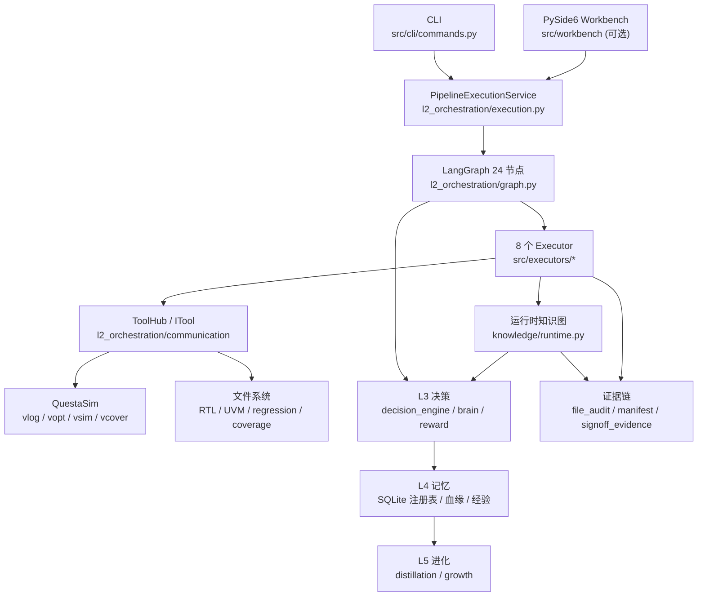

# SignOffAI 代码架构（当前实现）

> 基线：2026-10-29
>
> 全量单测：**1028 passed / 2 skipped**；工作台 **715 passed**
>
> 端到端实测：`output_e2e_guards2_jiang_20261029_232435`，**272/272 PASS**，计划覆盖率 **95.23%**，签核 **PASS_WITH_CAVEAT / CONDITIONAL**；证据包 `verify` / `replay` 均通过

本文描述**代码现在怎么组织**，不是愿景文档。所有路径以仓库根 `D:\SignOffAI` 为基准。

---

## 1. 系统边界

SignOffAI 是一个**个人级 CLI 验证平台**：

- 入口：`python -m src.cli.commands`（唯一正式交付入口）
- 桌面工作台：`python -m src.workbench`（PySide6，可选；**不开发 Web UI / Dashboard / SSE**）
- 输入：
  - `spec.md`（设计阶段生成 RTL），或
  - `--rtl <dir>`（现成 RTL，自动跳过 design/model）
  - `specs/<module>/casemodel.yaml`（人工 case 模型，优先于 front 草稿）
  - `specs/<module>/signoff_policy.yaml`（模块签核策略）
- 输出：一次 run 目录（RTL / UVM 环境 / 回归 / 覆盖率 / 签核证据包）
- 依赖：QuestaSim（`vlog/vopt/vsim/vcover`）、Python 3.11

**核心设计原则：**

| 原则 | 落点 |
|---|---|
| 真实 EDA 是唯一真理 | RTL/UVM 必须过 `vlog`；仿真判据来自 `vsim` 日志 |
| 失败响亮 | 没 RTL、没 log、没 `mismatched=0`、没证据，都不算 pass |
| `None ≠ False` | “判不了”与“判不过”分开；不拿空值冒充通过 |
| 单一主键 | 测试点 `tp_id` 贯穿建模 → 用例 → 覆盖 → 回归 → 签核 |
| 证据可校验 | 文件哈希、manifest、`package_hash`、离线回放 |
| 不静默降级 | 缺模型/缺模板/缺注入点 → 显式报错或 caveat |

---

## 2. 总览图



---

## 3. 五层架构

| 层 | 职责 | 关键模块 | 依赖方向 |
|---|---|---|---|
| **L1 基础设施** | EDA 调用、输出目录、哈希、归档、Reference Finder | `layers/l1_infrastructure/`：`infrastructure.py`、`eda_backend.py`、`coverage_backend.py`、`output_config.py`、`layout.py`、`reference_finder.py` | 最底层，不依赖上层 |
| **L2 编排** | LangGraph、执行器运行时、ToolHub、状态/运行时、证据、治理 | `layers/l2_orchestration/`：`graph.py`、`execution.py`、`runtime.py`、`state.py`、`routers.py`、`stages.py`、`executors/`（base/registry）、`communication/`、`evidence/`、`governance/`；8 个 executor 实现在 `src/executors/` | 依赖 L1 |
| **L3 决策** | 覆盖率驱动决策、动作选择、粗连续奖励、知识图谱（设计时 + 运行时） | `layers/l3_decision/`：`decision_engine.py`、`reward.py`、`brain/`、`knowledge/`（`schema/graph/query/persistence/runtime`） | 依赖 L1/L2 的契约 |
| **L4 记忆** | 用例库、IP 库、模型库、排除规则、血缘、经验统计 | `layers/l4_memory/`：`testcase_registry.py`、`ip_registry.py`、`model_registry.py`、`lineage.py`、`coverage_experience.py`、`debug_experience.py` | 可被 L2/L3/L5 调用 |
| **L5 进化** | 经验蒸馏、规则生长 | `layers/l5_evolution/`：`distillation.py`、`growth.py` | 依赖 L4 |

**分层守卫**：`src/layers/_bootstrap.py` 在 CLI 启动时检查 import 方向；测试 `tests/test_layer_direction.py` 用 AST 扫描，防止 L1 反向依赖 L2+。

---

## 4. 24 节点闭环

拓扑定义在 `src/layers/l2_orchestration/graph.py` 的 `NODE_FUNCS`。节点分成两族：

### 4.1 pure（12 个，不烧 token）

```text
pure/lifecycle.py   init  finalize
pure/rounds.py      env_arch_check  round_bump
pure/converge.py    decide  governor  governor_retry  record_decision
pure/approval.py    approval
pure/apply.py       apply_converge  apply_relax  apply_expand_seeds
```

确定性逻辑：决策、治理、审批、轮次、收尾。**这一族里不可能调 LLM。**

### 4.2 agent（12 个，经 `_run_agent` 调 executor）

```text
agent/build.py      front  design  model  verify
agent/run.py        ops  coverage  debug_functional
agent/fix.py        apply_compile_retry  refactor_rtl  apply_update_model  apply_directed_test
agent/signoff.py    audit
```

每个节点只做三件事：选哪个 executor、给什么参数、结果怎么落状态；
质量校验 / 证据链 / 熔断计数统一在 `runtime._run_agent`，不在节点里重复。

### 4.3 主流程

```text
init → front → design → model → verify → env_arch_check → round_bump
round_bump → ops
ops ├─ eda_missing        → audit
    ├─ awaiting_approval  → audit
    ├─ compile_fail       → decide
    ├─ functional_fail    → debug_functional → decide
    └─ run_coverage       → coverage → decide
decide → governor → {proceed | override → approval → record_decision → 动作分支}
                    {retry → round_bump}
                    {abort → audit}
动作分支 → round_bump（或 converge/abort → audit）
audit → finalize → END
```

- **所有回边在 `round_bump` 收口**，轮次预算在这里统一判定。
- **人工节点**：`approval` 通过 LangGraph `interrupt()` + checkpoint 实现；`vagent resume` 用 `Command(resume=...)` 推图，不是 `update_state`。
- **运行时对象**：`Runtime`（`runtime.py`）持有上下文、客户端、审计链；`PipelineState`（`state.py`）是图状态。

### 4.4 结构护栏（把“人记住的不变量”变成代码检查）

系统跑通后，以下四处最容易因“成功带来的复杂度增长”而变脆；现在都有
**结构性检查**，不靠注释或记性：

| 不变量 | 实现 | 失败方式 |
|---|---|---|
| verify 7 步的数据依赖 | `src/executors/verify/steps_dag.py` | import 期拓扑校验（缺失/成环）；执行期前置未跑 → `StepOrderError` |
| State 字段归属 | `state.PHASE_OWNERS` + `STATE_CONTRACTS`；`graph._guarded_node` | 启动期字段存在性校验；运行期越权写关键字段 → warning（不改变 reducer 行为） |
| 硬失败 vs 软建议 | `decision_engine.hard_action()` / `soft_action()`；`DecisionBrain` 显式先调 hard | 硬失败（编译/比对/回归）结构上到不了 RL |
| 工具角色映射 | `ToolHub.validate_registry()` + CLI 启动一行汇总 | 空映射未在 `EXECUTORS_WITHOUT_HUB_TOOLS` 登记 → 启动 `exit 2` |
| LLM 协议猜测 | `find_spec_yaml` 对“非规格显式声明的单端口协议组”回退 generic | 一个猜测不会劫持整份 spec（否则生成错误 agent、DUT_CHK 求值 X） |
| 签核结论可复现 | Tier A + `replay/recipe.json` v2 | `tests/test_signoff_reproducible.py` 重算并与 `report.json` 比对；证据漂移会失败 |

原则：**查询与构建分离、配置与代码分离、硬规则与软策略分离**。这些护栏
只加检查、不加节点，不改变已跑通的拓扑。

---

## 5. 八个 Executor

注册表：`src/layers/l2_orchestration/executors/registry.py`；每个 executor 实现 `execute_task()`。

| Executor | 职责 | 关键产出 |
|---|---|---|
| `front` | spec/RTL 分析、用例库登记、case 模型草稿 | `spec.json`、测试点、用例库条目 |
| `design` | IP 拆解、RTL 生成、顶层连线、vlog 门禁、结构预检 | `rtl/*.sv`、`design_arch`、`precheck` |
| `model` | 参考模型（优先 SQL `ModelRegistry`，兼容 golden） | `models.yaml` / 模型 SV、`placeholder` 标记 |
| `verify` | UVM 生成、测试点分解、约束、覆盖率计划、回归 YAML | `env/`、`agents/`、`inputs/yaml/`、`coverage/` |
| `ops` | 分级回归调度、tag 过滤、失败分类 | `regression_run/`、`regression_stages.json` |
| `coverage` | 编译/仿真/覆盖率收集、计划覆盖率合并、TP 矩阵、种子多样性、粗连续奖励、运行时知识图 | `sim/coverage/`、`tp_matrix.json`、`seed_diversity.json`、`sim_reward.json`、`knowledge_graph.json` |
| `debug` | 错误分类、指纹、自动修复、重跑验证、经验回写 | `docs/debug_stats.json`、修复记录 |
| `audit` | 硬门禁、软 caveat、TP 汇总、签核证据包 | `report.json`、`signoff_evidence.json`、`signoff_evidence/` |

### 5.1 audit 的三态判定

```text
硬门禁不过                         → NEEDS_FIX   → REJECTED
硬门禁过 + 存在未被接受的 caveat   → PASS_WITH_CAVEAT → CONDITIONAL
硬门禁过 + 无有效 caveat           → READY       → APPROVED
```

- 硬门禁：回归全过、覆盖率 ≥ target、RTL 真实、基线存在（策略要求时）。
- 软 caveat：约束只部分生效、TP 未命中、ucdb 零命中、关联硬边断、`backend_args`、无 verified 参考模型等。
- **参考模型是否硬门禁由 `signoff_policy.yaml` 的 `require_ref_model` 决定**；默认是 caveat，不是阻断。

---

## 6. 工具层

### 6.1 协议

`src/layers/l2_orchestration/communication/tool_protocol.py`

- `ITool`：`manifest` / `execute` / `check_health` / `validate_input`
- `ToolManifest`：名称、版本、JSON Schema、风险等级、执行模式、依赖、示例
- `ToolResult`：
  - `success`
  - **`verified_by`：`eda | llm | none`** —— 把“EDA 验过”与“LLM 自述”在类型上分开
  - `evidence_ref`、`returncode`
- `ToolRisk`：`safe / write / danger`；未知值 **fail-closed → DANGER**
- `ToolAuditor`：内存 + `docs/tool_receipts.jsonl` 追加写，回执带 `verified_by`

### 6.2 ToolHub

`communication/tool_hub.py`

- 统一 `call_tool(name, args)`：schema 校验 → sandbox → execute → 审计回执
- `EXECUTOR_TOOL_MODULES`：执行器角色的工具白名单（一处维护）
- **不回退全量工具**：角色映射为空 = 声明不用工具
- **启动期校验**：`ToolHub.validate_registry()` 要求 8 个 executor 全登记；
  空映射必须同时出现在 `EXECUTORS_WITHOUT_HUB_TOOLS`（`front/model/audit`），
  否则 CLI 启动 `exit 2`。启动时 stderr 打一行
  `[tool-registry] front=none · design=spec · …`，不污染 `--json` 的 stdout。

### 6.3 工具板块（生成 / 检查分开）

单一真相：`src/tools/boards.py`，由 `tests/test_tools_boards.py` 钉住。

| 板块 | 职责 | 包 |
|---|---|---|
| **generation** | 产生产物 | `casemodel_tools`、`uvm_tools`、`isa_gen_tools`、`cmodel_tools`、`scmodel_tools`、`doc_tools` |
| **checking** | 只读/判定 | `assertion_tools`、`debug_tools`、`coverage_tools`、`spec_tools` |
| **execution** | 跑 EDA/回归 | `regression_tools` |
| **flow** | 签核/血缘/趋势 | `flow_tools`、`trend_tools` |
| **integration** | 对外集成 | `ide_tools` |
| **common** | 共享底层 | `lib` |

物理目录与板块一一对应：

```text
src/tools/generation/    casemodel_tools  uvm_tools  isa_gen_tools
                         cmodel_tools     scmodel_tools  doc_tools
src/tools/checking/      assertion_tools  debug_tools  coverage_tools  spec_tools
src/tools/execution/     regression_tools
src/tools/flow/          flow_tools       trend_tools
src/tools/integration/   ide_tools
src/tools/common/        lib
```

`uvm_tools` 内部也已把检查工具移到
`generation/uvm_tools/checking/`
（`tool_check_compile/static/env_arch/loopback/health/quality_report`），
生成主体留在 `tool_uvm / tool_find_spec_yaml / tool_jinja_render`。

**Native Skills**：工具知识不只留在代码里。`coverage_tools` 与
`casemodel_tools` 已提供 `SKILL.md`（何时用 / 不要用 / 正确调用 / 常见错误 /
日志看什么 / 产物），给 LLM 与人都能直接读；由 `tests/test_tools_skills.py` 钉住骨架。

### 6.4 工具包

| 包（按物理路径） | 职责 |
|---|---|
| `checking/spec_tools` | spec 分析、DSL、知识图 |
| `generation/casemodel_tools` | case 模型 → TP IR → 覆盖率计划 → 约束 |
| `generation/uvm_tools` | UVM 环境/agent/test/sequence 生成、YAML schema |
| `execution/regression_tools` | 回归框架、分级、后端档案、sim modes |
| `checking/coverage_tools` | UCDB/HTML/报告、coverstore materialize |
| `checking/debug_tools` | 日志分类、指纹、autofix |
| `checking/assertion_tools` | 断言（当前流水线不生成 SVA） |
| `generation/isa_gen_tools` | NPU ISA DSL → IR → 32bit 编码 / 张量 / manifest |
| `flow/flow_tools` | signoff/lineage/compare 等流程 API |
| `generation/doc_tools` / `flow/trend_tools` / `generation/cmodel_tools` / `generation/scmodel_tools` | 文档、趋势、C/Python 参考模型 |

---

## 7. Case 建模 → 测试点 IR（方法学核心）

目录：`src/tools/generation/casemodel_tools/`

### 7.1 单一主键 `tp_id`

一条测试点 = `TP-<对象>-<维度>-<取值>`，贯穿：

```text
case 模型 → TP IR → 属性 test 类 → 约束 → 回归任务 → 覆盖仓 → tp_matrix → 签核证据
```

### 7.2 框架

`casemodel_tools/framework/`

| 模块 | 职责 |
|---|---|
| `contracts.py` | `Stage` 抽象、`PipelineContext`、`Registry`、`StageRecord` |
| `model.py` | `Realization` / `Execution` / `TestPoint` 稳定形状 |
| `stages.py` | `DecomposeStage` → `TraceStage` → `RealizeStage` → `ExecuteStage` |
| `realization.py` | `REALIZATIONS` 注册表；四种内置实现 |
| `constraints.py` | `CONSTRAINT_COMPILERS` 注册表；stimulus 赋值编译 |
| `pipeline.py` | `MethodologyPipeline`、manifest（阶段/计数/IR sha256） |
| `serialize.py` | 唯一的 testpoints YAML 序列化（manifest 哈希与落盘字节一致） |

### 7.3 四种 realization

| kind | 含义 | 落地方式 |
|---|---|---|
| `stimulus` | 取值落到事务字段 | 属性 test set `<field>_int`，sequence 约束该字段 |
| `sequence` | 多条事务的时序/组合 | `realization.sequences.<取值>` 给逐笔值；test 写 `<field>_seq_*` |
| `observe` | DUT 内部量/输出，无输入引脚 | 只采覆盖，标 `OBSERVE_ONLY` |
| `backdoor` | 内部状态注入 | `uvm_hdl_force(path, value)` → 采样 → release |

**新增 kind 不需要改核心阶段**：注册一个 `RealizationStrategy` 即可。

### 7.4 产物

| 文件 | 内容 |
|---|---|
| `coverage/testpoints.yaml` | TP IR（人读） |
| `coverage/testpoints.json` | TP IR（机器读） |
| `coverage/methodology.json` | 阶段、计数、输入、IR sha256 |
| `coverage/coverage_plan.yaml` | 覆盖点/bin/cross/批次/种子/需求追溯 + `constraint_backing` |
| `coverage/tp_matrix.json` | TP × 覆盖仓 × 命中状态 |
| `coverage/constraint_status.json` | 约束逐条生效状态 |
| `coverage/association_report.json` | 三模型关联断点 |
| `coverage/sim_reward.json` | 编译 / 回归 / 覆盖率三层合成的粗连续奖励 |
| `coverage/knowledge_graph.json` | 运行时知识图（gap → bin/test/version/fix，带 sha256） |

---

## 8. UVM 生成与回归

### 8.1 verify 内部顺序（不能乱）

```text
_write_coverage_plan
  → find_spec_yaml（会清空 inputs/yaml/uvm/）
  → _write_coverage_dut_channel
  → _write_env_cov_bins
  → _write_constraint_yaml
  → _write_association_report
  → jinja_render
```

顺序错一步的典型表现：env_cov 未生成、约束没进渲染、覆盖率静默退回自动分箱。

**顺序不再是注释约定**：`src/executors/verify/steps_dag.py` 把这 7 步声明成
`deps/inputs/outputs/why` 的数据 DAG。import 期跑拓扑校验（缺依赖/成环直接
失败），执行期由 `StepRecorder` 在每步后 `mark()`，前置没跑就抛
`StepOrderError`。`find_spec_yaml` 会清空 `inputs/yaml/uvm/`，所以
`dut_channel → env_cov_bins → constraint_yaml → association_report`
全部显式挂在它下游。

### 8.2 生成物

```text
<run>/
├─ agents/<agent>/            # agent / driver / monitor / seq_item / sequence
├─ env/                       # env / scoreboard / coverage / cons / seqs / tests
├─ bench/                     # tb_top / 接口
├─ inputs/yaml/               # regression.yaml / constraint.yaml / models.yaml
├─ inputs/filelists/          # filelist.f / loopback filelist
└─ coverage/                  # testpoints / tp_matrix / 计划 / 关联报告
```

### 8.3 regression.yaml：后端特定 + 语义字段

`regression.yaml` 由
`generation/uvm_tools/tool_find_spec_yaml/generators/regression_gen.py`
（`find_spec_yaml` 的一部分）生成，**每个后端一份**。当前 Questa：

```yaml
simulator: questa
tests:
  - name: npu_type_test
    build: build_npu_sched_dut
    count: 18
    run_cmd: 'vsim ... {{ MODE_OPTS | default("") }} {{ PLUSARGS }} ; [ -s sim_vsim.log ] && ...'
```

参数分三类：

| 类别 | 例子 | 规则 |
|---|---|---|
| 后端方言 | `+UVM_TESTNAME`、`+ntb_random_seed`、`-cm`、`-qwavedb` | 由后端生成，**plusargs 不许手写** |
| 测试语义 | `+preload=`、`+tensor_manifest=`、`+cfg_mode=` | `plusargs` 原样透传 |
| 逃生口 | `-voptargs=+acc` | `backend_args`，audit 记 caveat |

**关键守卫：**

- `backend_profiles.py` 的 `BACKEND_RESERVED` 数据表；命中 → `ConfigError`
- `{{ PLUSARGS }}` 是唯一注入点，必须在判据链 `;` 之前
- `plusargs` 里禁止 `{{ SEED }}`，种子只从 `seeds` 出
- `plusarg_matrix` 保留旧的“每个 plusarg 一条用例”语义

### 8.4 分级回归

- 级：`loopback → p0 → p1 → p2 → p3`
- 每级按 tag 筛用例；**每级 build 目录只生成本级用例**
- loopback 全过后可停在人工节点（`WAITING_APPROVAL`）
- 结果：`regression_stages.json`

### 8.5 生成层拆分（进行中）

```text
src/tools/generation/uvm_tools/generation/
├─ parsing/      # YAML/spec → 内部数据（不渲染、不写文件）
├─ models.py     # Artifact / RegressionCase / CoveragePlanSpec / ConstraintSpec / EnvSpec
├─ render/       # 只做 Jinja2；render_checked 在渲染前校验 ctx key
└─ generators/
   ├─ env_gen.py          # 环境产物门面（内部仍调 UVMGenerator）
   ├─ coverage_gen.py     # coverage_plan.yaml
   ├─ constraint_gen.py   # constraint_status.json + coverage_plan 标注
   └─ regression_gen.py   # regression.yaml / 种子 / 分级 tag / TP 回归任务
```

- `find_spec_yaml/main.py` 已把回归产物整段搬到 `generators/regression_gen.py`
  （主文件 2059 → 1469 行），并保留同名 re-export。
- `VerifyExecutor` 的覆盖率计划、约束状态、coverage plan 标注已改调
  `generation.generators`。
- `render_checked()` 是“模板声明 key、渲染前校验”的结构化守卫，用来替代
  “ctx 缺 key → 静默渲染成 TODO 空壳”。
- **仍未完成**：`gen_uvm.py`（3780 行）的 agent/env/bench 解析与渲染还留在原文件，
  `env_gen` 目前只是稳定门面；后续按 parsing → models → render → generators 继续搬。

### 8.6 真 pass 判据

一条用例算 PASS 必须同时满足：

1. `sim_vsim.log` 存在且非空；
2. 没有 `UVM_ERROR : [1-9]` / `UVM_FATAL : [1-9]` / `FATAL ERROR` / `Errors: [1-9]`；
3. 日志里有 `mismatched=0`（SCB 真的做了比对）。

---

## 9. 覆盖率与闭环

### 9.1 两个覆盖率口径

| 口径 | 来源 | 用途 |
|---|---|---|
| `single_test_pct` | 覆盖率阶段单跑一条 test | 对照 |
| `plan_pct` | 回归逐用例 `cov/*/questa.db` 合并 | **签核门禁** |

- 合并：`vcover merge -inputs cmdfile` → `sim/coverage/plan_merged.ucdb`
- 输入清单：`coverage/plan_merge_manifest.json`（相对路径 + 大小 + mtime + merged ucdb sha256）
- 单个 `questa.db` 不能直接读功能覆盖：`materialize_ucdb()` 先 `vcover merge "<store>:<test>"`

### 9.2 TP 矩阵状态

`HIT / MISS / OBSERVED / UNOBSERVED / BACKDOOR_HIT / BACKDOOR_MISS / UNMAPPED`

- 可激励、后门、观测三栏分开；后门命中不冒充激励覆盖
- `UNMAPPED` = 覆盖仓在报告里找不到（模型漂移），不是“没命中”

### 9.3 种子多样性

`coverage/seed_diversity.json`：

- 按 seed 分组合并回归库；
- 比较命中 bin 集合：`stable_bins` / `variable_bins` / `union_bins`；
- `None`（没分析）/ `False`（种子不改变分布）/ `True`（存在种子敏感 bin）。

### 9.4 粗连续奖励（`l3_decision/reward.py`）

EDA 是黑盒：只有 `vlog` 返回码、`vsim` Errors、`ucdb` hitrate。奖励如果只有
0/1，平台期时策略没有方向。`compute_sim_reward()` 把三层合成 0..1：

```text
compile    0.25   编译通过 + 错误/警告数（秒级反馈）
regression 0.35   通过率 + 挂死数（分钟级）
coverage   0.40   计划覆盖率 + TP 命中率 + 种子多样性（更慢）
```

- 结果落 `coverage/sim_reward.json`，并进 `Observation.sim_reward`；
- `weakest` 指出最弱的一层，供决策层判断“往哪使劲”；
- **权重可按模块配置**：`signoff_policy.yaml` 的 `reward_weights`
  （compile / regression / coverage）覆盖默认值；缺项补默认、非法值回退并在
  `weight_issues` 说明，始终归一化到总和 1（不改变 0..1 量纲）；
- **不是求解器**，但比二值信号多了方向感。

### 9.5 决策动作

`decide()` 是**两阶段**：`hard_action()`（编译 / 比对 / 功能回归失败，确定性、
`source=rule_hard`）→ 没有硬失败才进 `soft_action()`（停滞 / 语义归因 / 约束 /
死代码 / 收敛，`source=rule|terminal`）。`DecisionBrain` 显式先调 `hard_action`，
RL 只可能出现在软阶段。动作全集：

`FIX_COMPILE_bug`、`FIX_MODEL_bug`、`FIX_FUNCTIONAL_bug`、`FIX_PROTOCOL_bug`、`FIX_RESET_bug`、`FIX_CDC_bug`、`FIX_DEADCODE_bug`、`EXPAND_SEEDS`、`RELAX_CONSTRAINT`、`GENERATE_DIRECTED_TEST`、`CONVERGE`

动作全集只在 `decision_engine.ALL_ACTIONS` 维护一份。动作经 `guardian/governor`
检查后进入对应 `apply_*` 节点，再回到 `round_bump`；`CONVERGE` 是确定性终态。

每个动作带 `source`（`rule_hard / rule / rl_suggested / rl_overridden / terminal`），
L4 `coverage_experience` 按 `(action_type, source)` 分桶；L5 蒸馏只拿
`rl_suggested` 且真正生效的样本，避免“建议过但没采纳”的幸存者偏差。

### 9.6 运行时知识图（`l3_decision/knowledge/runtime.py`）

设计时子图（`build_graph_from_spec`）回答“需求 → 功能 → 模块 → 信号 → bin →
测试”。运行时再补**本轮因果**，只读已有产物，不跑 EDA、不调 LLM：

```text
GAP ──covered_by→ coverage_bin / test
GAP ──affects→    requirement
GAP ──regressed_in→ rtl_version   （database/lineage.db）
GAP ──fixed_by→   fix             （docs/debug_stats.json）
BUG ──causes→     GAP
FIX ──resolves→   BUG
```

- **GAP 的判定**：`coverage/tp_matrix.json` 中 `MISS / UNOBSERVED / BACKDOOR_MISS /
  UNMAPPED` 且带 `tp_id` 的行；`HIT / OBSERVED` 不建缺口。
- **落盘**：`coverage/knowledge_graph.json`（`schema` + `sha256` + `summary` +
  `gaps` + 全图），同一份输入重复构建哈希稳定 —— 证据包用它绑定图身份。
- **查询**：`trace_gap(graph, tp_id=… | bin=…)` 返回该缺口的
  test / bin / requirement / rtl_version / fix / bug 六类确定性归因。
- **决策消费**：`n_decide` 用 `enrich_observation_history()` 把 `history` 挂到
  `Observation.gap_paths`，`_semantic_reason()` 因此能写出
  “`op.bin_zero@历史版本v7（曾由 relax_op_zero 修复）`”—— 历史进归因，但不进
  模型推理。
- **证据消费**：audit 把图摘要（路径 / sha256 / 节点边数 / 缺口数）写进 v1
  `signoff_evidence.json` 与 v2 manifest，`coverage/knowledge_graph.json` 随
  `execution/` 段进包；工作台签核页展示同一组数字。

这是**查询层**，不是新的推理层：没有 Neo4j / networkx，也没有 LLM 直接遍历图。

---

## 10. 证据链与治理

### 10.1 文件级审计链

`l2_orchestration/evidence/file_audit.py`

- 每条记录：文件、git diff、理由、修改者、内容 sha256、前序 hash、seq
- `verify_persisted()` 能发现：`index_gap` / `hash_broken` / `tail_truncated`
- 人工编辑用 `agent = human:<name>`，同样进哈希链

### 10.2 运行 manifest / dump

`l2_orchestration/evidence/manifest.py`

- 从 execution trace 重建阶段、工具调用、文件哈希
- 附加：功能覆盖点声明、ucdb/波形身份、签核证据包身份
- `vagent dump <session> -o evidence.zip` 导出

### 10.3 签核证据包 v2

`l2_orchestration/evidence/signoff_package.py`

```text
<run>/signoff_evidence/
├─ manifest.json      # 结论 + 版本绑定 + 逐文件 sha256 + package_hash
├─ inputs/            # spec / case 模型 / 约束 / 覆盖计划 / 模型装配单 / 签核策略
├─ execution/         # 回归报告 / 覆盖率 / TP 矩阵 / 合并清单 / 种子多样性
│                     # / 粗连续奖励 / 运行时知识图 / 回执
├─ verdict/           # signoff_evidence.json / caveats.json / 文件审计链
└─ replay/
   ├─ replay.py       # 不 import SignOffAI，仅标准库
   └─ recipe.json     # Tier A / Tier B 边界
```

命令：

```bash
vagent evidence verify  <run>/signoff_evidence
vagent evidence replay  <run>/signoff_evidence
vagent evidence compare <pkg-a> <pkg-b>
```

- Tier A：不跑 EDA，重算三态判定
- Tier B：需要 EDA 时重跑（只记录 recipe，不自动执行）

`replay/recipe.json` 是 **v2 结构化 schema**（`validate_recipe()` 校验）：

```json
{
  "schema": "signoff_replay_recipe_v2",
  "tier_a": {"requires_eda": false, "command": "python replay/replay.py",
              "inputs": [...], "checks": ["file_sha256", "verdict_recompute", ...]},
  "tier_b": {"requires_eda": true, "eda_tools": ["vsim", "vcover"],
              "steps": [{"name": "regression", "command_source": "...",
                         "expected_artifacts": [...]}]}
}
```

未来写自动化 replay runner 时直接消费字段，不用反推 Python 实现。

### 10.4 治理

| 机制 | 落点 |
|---|---|
| 模块签核策略 | `specs/<module>/signoff_policy.yaml` |
| caveat 机器码 | `caveats.json` / `report.json` |
| 审批绑定证据哈希 | `<run>/approvals.jsonl`（append-only）+ `approval.json` 最新视图 + `vagent approval --run` |
| 血缘基线强制 | `database/lineage.db` + evidence |
| 参考模型门禁 | `models.yaml` 的 `source.status == verified` |
| 仅点状 LLM | `src/tools/common/lib/llm_call.py` 唯一漏斗 + `docs/llm_audit.jsonl` |

**Caveat 码：**

`CONSTRAINT_PARTIAL / CONSTRAINT_INACTIVE / UCDB_NO_BINS / CG_DUT_ZERO / ASSOCIATION_HARD_EDGE / TP_UNMAPPED / TP_TRACE_INCOMPLETE / TP_MISSED / MODEL_UNAVAILABLE / BASELINE_MISSING / BACKEND_ARGS_USED`

---

## 11. 数据与存储

所有运行期 SQLite 统一在 **`database/`**（不进 git，只保留 `.gitkeep`）：

| 库 | 路径 | 内容 |
|---|---|---|
| 主库 | `database/ic_verification.db` | bug、项目、知识图谱；**回归趋势 `runs` / `task_details`**（唯一真相） |
| 用例库 | `database/testcase_registry.db` | 跨 run 用例、优先级、RTL 版本绑定 |
| IP 库 | `database/ip_registry.db` | 复用 RTL / IP 缓存 |
| 模型库 | `database/model_registry.db` | TLM 1.0 参考模型、版本、状态、证据 |
| 血缘 | `database/lineage.db` | RTL 版本、run 绑定、基线、bug↔版本 |
| 排除规则 | `database/exclude_registry.db` | 覆盖率排除 |
| 经验/统计 | `database/{coverage_experience,debug_experience,rule_stats,hint_stats}.db` | 跨 run 经验与规则命中 |
| 检查点 | `<run>/docs/checkpoints.sqlite` | LangGraph 中断/恢复 |

- 另有 `database/reference_finder_cache.db`（Reference Finder 缓存）。
- 连接统一开 **WAL + busy_timeout**：工作台与 CLI 可同时读，写冲突时等待而不是立刻报错。
- 路径解析统一走 `config/paths.py`；`SIGNOFFAI_HOME` 可把运行期根目录指到仓库外
  （pip 安装后不会写进 site-packages）。`TREND_DB` 是 `MAIN_DB` 的兼容别名，
  **趋势不再有第二份库**。

---

## 12. 工作台（可选，非 Web）

`src/workbench/` 是 PySide6 桌面应用：

- `app.py` / `bootstrap.py` / `bus.py`
- `modules/`：`agent_output`、`audit`、`coverage`、`debug`、`design`、`flow`、`ide`、`model`、`ops`、`verify`
- 签核页同时展示：门禁、六层证据链、**证据包 v2**（哈希 / caveat / 计划与单测覆盖率 / 种子多样性 / **粗连续奖励** / **运行时知识图规模** / 参考模型与基线 / 审批 / Freeze / 回放命令）
- 与 CLI/流水线通过文件契约（run 目录、manifest、evidence）解耦，**不共享内存 state**
- 波形：`.wlf` → `vsim -view`；`qwavedb` → Visualizer + 按需 `vopt -designfile`
- 覆盖率：先 `materialize_ucdb()` 再开 Visualizer

---

## 13. 扩展点

| 想加什么 | 改哪里 | 不需要改 |
|---|---|---|
| 新 CLI 命令组 | `src/cli/cmd_<domain>.py` + 在 `commands.py` 末尾的导入列表注册 | 其它命令组 |
| 新 LangGraph 节点 | `nodes/` + `graph.py` 的 `NODE_FUNCS` + 边表 + `stages.py` | executor 内部 |
| 新 executor | `src/executors/<role>/main.py` + `@register_executor` | 图拓扑（除非要接节点） |
| 新工具 | 实现 `ITool` + 注册到 ToolHub | 调用方 |
| 新工具包 | 放对应板块目录（`generation/checking/execution/flow/integration/common`）+ 在 `src/tools/boards.py` 登记 | 其它工具包 |
| 新 realization | 注册 `RealizationStrategy` | `stages.py` |
| 新约束来源 | 注册 `ConstraintCompiler` | `build_constraint` |
| 新 EDA 后端 | `execution/regression_tools/backend_profiles.py` 加字典条目（保留键 + `run_cmd_template`） | 框架类 |
| 新 caveat | audit 里 `_caveat(code, msg)` + 策略文件按码接受 | 三态判定 |
| 新签核证据字段 | `signoff_package.py` 的 `SECTION_FILES` + audit 的 v2 manifest | 回放脚本（若不需要重算） |
| 新运行时因果边 | `knowledge/schema.py` 加 `EdgeType` + `runtime.build_runtime_graph()` 建边；需要进决策就补 `trace_gap` | 图存储与证据包 |
| 新奖励层 | `l3_decision/reward.py` 的权重与分量；同步 `tests/test_sim_reward.py` | 决策动作空间 |

---

## 14. 测试与质量门禁

```bash
python -m pytest tests/ -q                            # 1028 passed / 2 skipped
python -m pytest src/tools/generation/casemodel_tools/tests -q   # case 建模 + 框架
python -m pytest src/tools/generation/isa_gen_tools/tests -q     # ISA 工具
python -m pytest src/workbench/tests -q               # 715 passed
```

关键守卫：

| 测试 | 防什么 |
|---|---|
| `test_layer_direction.py` | 分层反向依赖 |
| `test_tool_risk.py` | 有副作用的工具被标 SAFE |
| `test_no_undefined_names.py` | 拆文件漏 import |
| `test_plusargs_semantics.py` | 后端方言混进 plusargs、种子双出处、缺注入点 |
| `test_env_cov_bins_wiring.py` | 覆盖 bin 落盘时机、约束策略名、`mismatched=0` 判据 |
| `test_audit_evidence.py` | 签核证据字段、三态、seed diversity |
| `test_staged_regression.py` | 分级 tag 过滤 / 每级只生成本级用例 |
| `test_ref_model_wiring.py` | predictor 不是空壳、走真生成器 |
| `test_coverage_coverstore.py` | coverstore 必须 `vcover merge store:test` |
| `test_runtime_graph.py` | 缺口只从 MISS 类状态建；因果边/哈希稳定；决策读到历史；图与奖励进证据包 |
| `test_sim_reward.py` | 空输入不冒充通过；权重与最弱层口径 |
| `test_tools_boards.py` | 工具物理目录与板块单一真相一致 |
| `test_tools_skills.py` | Native Skills（`SKILL.md`）骨架不丢 |
| `test_verify_steps_dag.py` | verify 7 步依赖声明 / 拓扑序 / 前置未跑即失败 |
| `test_decision_phases.py` | 硬失败不被软策略/RL 覆盖；软阶段才允许语义归因 |
| `test_state_contracts.py` | 关键 State 字段的写入者契约；越权写入留痕 |
| `test_tool_registry.py` | 空工具映射必须显式登记“不用工具” |
| `test_signoff_reproducible.py` | Tier A 重算结论 = report；证据漂移必失败 |
| `test_cli_common.py` | 退出码/helper 只有一处定义且 re-export 一致 |
| `test_protocol_grouping.py` | 单端口 LLM 猜测不能劫持整份 spec；显式协议仍保留 |

---

## 15. 当前边界（诚实标注）

- **不可达声明未实现**：0 命中仍标 `SUSPECT`，不从覆盖率分母剔除。
- **没有 verified TLM 1.0 参考模型**：`ModelRegistry` 里 `apb_uart` 仍是 `draft`；签核挂 `MODEL_UNAVAILABLE`，但默认不阻断。
- **只有 Questa 后端模板完整**；VCS / Verilator / Icarus 有保留键表，`run_cmd_template` 未实现，调用时明确报错。
- **测试语义 plusargs 还没有生成源**：schema/透传/校验已通，等 ISA/场景侧产出 `+preload` 等参数。
- **单机串行回归**：不适合大团队/大规模并行；个人级定位。
- **不开发 Web UI**：所有交付走 CLI；桌面工作台是可选外壳。
- **奖励信号是“粗连续”**：没有求解器内部状态（slack/DRC/IR），只能从
  `vlog/vsim/ucdb` 榨近似；不要把它当 Cadence 级的 RL 信号。
- **知识图是查询层，不是推理层**：`runtime.py` 只把已有产物连成确定性因果链，
  没有 Neo4j / networkx，也不让 LLM 直接遍历或改写图；LLM 只读 `gap_paths` 的
  摘要（`_semantic_reason`）。
- **auth.py 是可选 API 面**：CLI 不 import 它，FastAPI/PyJWT 放在 `api` extra；
  核心安装不再为未使用的认证代码付依赖成本。

---

## 16. 快速文件地图

```text
.
├─ config/                      设置（settings.py）与统一路径（paths.py）
├─ database/                    运行期 SQLite（不进 git，只留 .gitkeep）
├─ specs/<module>/              RTL + casemodel.yaml + signoff_policy.yaml
├─ src/
│  ├─ cli/                      CLI / REPL
│  │  ├─ commands.py            **入口 + 子命令组注册 + 剩余命令**
│  │  ├─ common.py              退出码 + 无状态 helper（唯一定义）
│  │  ├─ cmd_verify.py          init / verify / multi / plan
│  │  ├─ cmd_signoff.py         signoff 命令组
│  │  ├─ cmd_regression.py      regression 命令组
│  │  ├─ cmd_coverage.py        coverage 命令组
│  │  ├─ cmd_casemodel.py       case-model 命令组
│  │  ├─ cmd_evidence.py        evidence 命令组（人工链 + 签核包）
│  │  ├─ cmd_config.py          config 命令组
│  │  ├─ output.py              OutputAdapter / 公共选项
│  │  └─ repl.py                交互式 REPL
│  ├─ layers/
│  │  ├─ _bootstrap.py          分层守卫
│  │  ├─ l1_infrastructure/     EDA / 输出 / 哈希 / Reference Finder
│  │  ├─ l2_orchestration/      LangGraph / executors / tools / evidence
│  │  ├─ l3_decision/           决策（hard/soft 两阶段）/ 奖励 / 知识
│  │  │                         schema / graph / query / persistence / runtime
│  │  ├─ l4_memory/             SQLite 注册表 / 血缘 / 经验
│  │  └─ l5_evolution/          蒸馏 / 生长
│  ├─ executors/                8 个 executor
│  │  └─ verify/steps_dag.py   verify 7 步依赖声明 + 执行期顺序记录器
│  ├─ tools/                    领域工具包（按板块物理分目录）
│  │  ├─ generation/            casemodel / uvm / isa / cmodel / doc
│  │  ├─ checking/              assertion / debug / coverage / spec
│  │  ├─ execution/             regression
│  │  ├─ flow/                  signoff / lineage / trend
│  │  ├─ integration/           IDE bridge
│  │  ├─ common/                lib（哈希 / LLM / filelist / doc intake）
│  │  └─ boards.py              板块单一真相
│  └─ workbench/                PySide6 桌面工作台（可选）
├─ tests/                       主测试套件
├─ output_<run>/                一次运行的产物
└─ ARCHITECTURE.md              本文
```
