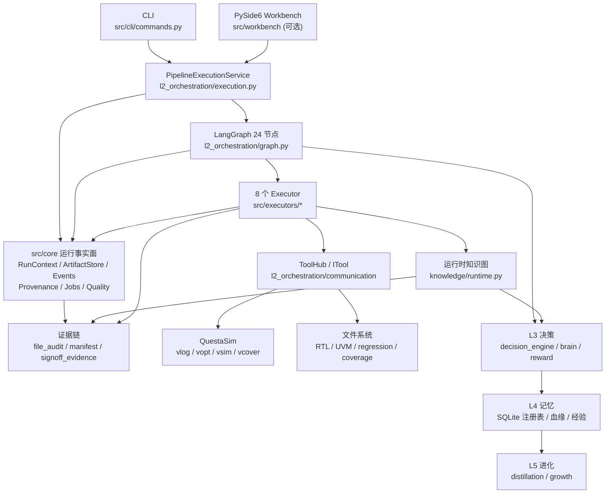

# SignOffAI 代码架构（当前实现）

> 基线：2026-10-31
>
> 全量单测：**1204 passed / 2 skipped**；工作台 **721 passed**
>
> UVM 端到端实测：`output_e2e_code_plan_jiang_20261030_233908`，**272/272 PASS**，功能计划覆盖率 **95.23%**，代码覆盖率单测 **70.9%** / DUT 计划 **75.8%**，签核 **PASS_WITH_CAVEAT / CONDITIONAL**；证据包 `verify` / `replay` 均通过；StimulusPlan 47 可激励 / 16 不适用；round_manifest 1 轮 × 63 条
>
> SoC 参考工程实测：`examples/open_npu_soc`，`soc run` **2/2 PASS**（`mismatched=0`，2075 ns），输出 `output_soc_v01_release_jiang_20261031_193929`；`signoff_evidence/` 24 个文件（输入/RTL/golden/回归/波形），`soc evidence` 校验通过
>
> **Architecture 2.0 基线**：`src/core/` 运行事实面（RunContext / ArtifactStore / EventStore / Provenance DAG / Job Runtime / Decision Evaluation / Verification Quality Gate）已落地；**Verification Intelligence 第一层**（归因完整率、四个工程指标、增量计划、Run Diff、LocalStrategy→JobSupervisor）已接入。新增单测 `tests/core/` 83 条 + UVM IR 5 条 + Job Runtime 集成 4 条 + 合成 run 集成 1 条。

本文描述**代码现在怎么组织**，不是愿景文档。所有路径以仓库根 `D:\SignOffAI` 为基准。

---

## 1. 系统边界

SignOffAI 是一个**个人级 CLI 验证平台**：

- 入口：`python -m src.cli.commands`（唯一正式交付入口）
- 桌面工作台：`python -m src.workbench`（PySide6，可选；**不开发 Web UI / Dashboard / SSE**）
- 输入：
  - `spec.md`（设计阶段生成 RTL），或
  - `--rtl <dir>`（现成 RTL，自动跳过 design/model）
  - `specs/<module>/casemodel.yaml`（人工 case 模型，优先于 front 草稿）
  - `specs/<module>/signoff_policy.yaml`（模块签核策略）
- 输出：一次 run 目录（RTL / UVM 环境 / 回归 / 覆盖率 / 签核证据包）
- 依赖：QuestaSim（`vlog/vopt/vsim/vcover`）、Python 3.11

**核心设计原则：**

| 原则 | 落点 |
|---|---|
| 真实 EDA 是唯一真理 | RTL/UVM 必须过 `vlog`；仿真判据来自 `vsim` 日志 |
| 失败响亮 | 没 RTL、没 log、没 `mismatched=0`、没证据，都不算 pass |
| `None ≠ False` | “判不了”与“判不过”分开；不拿空值冒充通过 |
| 单一主键 | 测试点 `tp_id` 贯穿建模 → 用例 → 覆盖 → 回归 → 签核 |
| 证据可校验 | 文件哈希、manifest、`package_hash`、离线回放 |
| 不静默降级 | 缺模型/缺模板/缺注入点 → 显式报错或 caveat |

**Architecture 2.0 的四个横向基础能力**（不推翻五层，只补齐底座）：

| 能力 | 解决什么 | 落点 |
|---|---|---|
| **RunContext** | 一次 run 的身份/输出根/父 run 只有一处来源；重入不再重新生成 | `src/core/runtime/run_context.py` |
| **ArtifactStore** | 产物索引与内容寻址分离；SHA256 是内容身份，大文件不复制 | `src/core/runtime/artifacts.py` |
| **Provenance DAG** | 回答「这个 bin 是哪条 test/seed/哪版 RTL 来的」；缺 per-test 数据只标 weak | `src/core/provenance/` |
| **EventStore** | 执行事实的单一追加日志；由 RunJournal 镜像，不复制第二套过程日志 | `src/core/runtime/events.py` |

另外两项横向能力：**Job Runtime**（`src/core/jobs/`，EDA 进程生命周期/进程树回收/命令白名单）与
**Verification Quality Gate + Decision Evaluation**（`src/core/verification/`、`src/core/decision/`）。

### 1.1 三类工程服务 = CLI 工作流，不是三套独立软件

客户看到的三种使用场景，共用**同一个正式入口**与**同一条执行链路**：

```text
python -m src.cli.commands
        │
        ├─ verify                  UVM 自动化验证
        ├─ optimize-regression     回归效率优化
        ├─ coverage-closure        Coverage Closure
        └─ metrics / incremental / diff runs   工程指标与增量/对比
```

| 场景 | CLI 入口 | 复用链路 | 产物 |
|---|---|---|---|
| UVM 自动化验证 | `vagent verify --spec spec.md --rtl ./rtl --config casemodel.yaml` | LangGraph → front/design/model/verify/ops/coverage → EDA → evidence | run 目录 + 证据包 |
| 回归效率优化 | `vagent optimize-regression --project ./project --history ./runs --policy signoff_policy.yaml [--execute]` | 历史分析（core）→ `InfrastructureManager.run_regression`（已有执行器）→ `compare_reports` | `optimize/plan.json`、`optimize/result.json` |
| Coverage Closure | `vagent coverage-closure --coverage ./output_x/coverage --target 98 [--execute]` | 缺口分析（core）→ `PipelineExecutionService` 现有闭环 → `run_diff` | `closure/plan.json`、`closure/result.json` |

**架构原则**：CLI 只接任务/参数；编排归 LangGraph；分析决策归 Agent / `src/core`；
确定性执行归 Executor / `InfrastructureManager`；EDA 归 Job Runtime；所有结果落
Evidence。**不为三类服务各写一套引擎**；`optimize-regression` / `coverage-closure`
只是对同一套基础设施的工作流编排。

`verify` 同时给 spec 与 `--rtl` 时：RTL 当 DUT、spec 当分析/参考模型输入、
跳过 design；`--config` 把 case 模型复制到 run 的 `inputs/casemodel.yaml`。

### 1.2 参考 SoC 工程（Open NPU SoC v0.1）

`examples/open_npu_soc/` 是用来证明「SignOffAI 能验证真实 SoC」的样板工程：

```text
CPU/NICE 命令 → DMA → Banked SRAM → INT8 GEMM → IRQ → golden 比较
```

- v0.1 参考 TB 用 `rtl/cpu/nice_cmd_sequencer.sv` 固定 NICE 命令时序；
  E203 NICE 适配器/固件文件已落地，但 **E203 路径未实跑**（M1）；
- 现有 `vagent soc check/golden/run` 是薄适配层：`run` 复用
  `InfrastructureManager.run_regression`，不另造执行引擎；
- 回归 YAML、golden 向量、自检 TB、spec/verification plan 都在工程内；
- **实测（2026-10-31）**：`soc check` 输入齐全；`soc run` **2/2 PASS**，
  `gemm_8x8` 日志 `mismatched=0` / `PASS`，仿真结束于 2075 ns；
- `soc run` 通过工程适配层（`src/cli/soc_adapter.py`）落
  `RunContext` / `EventStore` / `ArtifactStore`，并生成
  `soc/soc_run.json` 与 `signoff_evidence/`（`soc_evidence_v1`）；
- 波形：`regression.yaml` 用 `-qwavedb` 落
  `<test>/waves/gemm_8x8.db`，`soc wave <run>` 用 Visualizer 打开；
  波形里能看到 `start → dma_load → gemm_start → gemm_done → dma_store → irq/done`；
- 常用命令：`soc report <run>`（摘要）、`soc evidence <run>`（24 个文件逐哈希校验）、
  `soc wave <run>`（qwave.db → Visualizer）；`run` 的回归 exit code 仍是
  **唯一 PASS/FAIL 判据**；
- **Workbench 业务线**：`soc.overview / soc.architecture / soc.verification /
  soc.signoff` 四页，复用 `soc.*` 只读工具；运行按钮显式调 `soc.run`，
  不复制回归/波形/证据页面；
- **运行历史**：`RunRepository.discover_runs()` 在没有
  `docs/manifest.json` 时读 `soc/soc_run.json`，把 SoC run 以
  `kind=soc`、`state=completed/failed` 列入 `flow.runs`（不再要求 UVM run）；
- **边界**：SoC 证据包是工程级事实（输入/RTL/golden/回归/波形），
  **不是 UVM 的 v2 三态签核证据包**；E203 路径需要 RISC-V 工具链和 E203 TB，
  未在本机实跑。

详见 [`examples/open_npu_soc/README.md`](examples/open_npu_soc/README.md)。

---

## 2. 总览图



---

## 3. 五层架构

| 层 | 职责 | 关键模块 | 依赖方向 |
|---|---|---|---|
| **core 横切底座** | 运行身份 / 产物索引 / 事件事实 / 血缘 / Job 进程 / 决策评估 / 质量门 | `src/core/`：`runtime/`、`provenance/`、`jobs/`、`decision/`、`verification/` | **只用标准库**，不 import `src.layers`（`tests/core/test_core_is_stdlib_only.py` 守卫） |
| **L1 基础设施** | EDA 调用、输出目录、哈希、归档、Reference Finder | `layers/l1_infrastructure/`：`infrastructure.py`、`eda_backend.py`、`coverage_backend.py`、`output_config.py`、`layout.py`、`reference_finder.py` | 最底层，不依赖上层 |
| **L2 编排** | LangGraph、执行器运行时、ToolHub、状态/运行时、证据、治理 | `layers/l2_orchestration/`：`graph.py`、`execution.py`、`runtime.py`、`state.py`、`routers.py`、`stages.py`、`executors/`（base/registry）、`communication/`、`evidence/`、`governance/`；8 个 executor 实现在 `src/executors/` | 依赖 L1 |
| **L3 决策** | 覆盖率驱动决策、动作选择、粗连续奖励、知识图谱（设计时 + 运行时） | `layers/l3_decision/`：`decision_engine.py`、`reward.py`、`brain/`、`knowledge/`（`schema/graph/query/persistence/runtime`） | 依赖 L1/L2 的契约 |
| **L4 记忆** | 用例库、IP 库、模型库、排除规则、血缘、经验统计 | `layers/l4_memory/`：`testcase_registry.py`、`ip_registry.py`、`model_registry.py`、`lineage.py`、`coverage_experience.py`、`debug_experience.py` | 可被 L2/L3/L5 调用 |
| **L5 进化** | 经验蒸馏、规则生长 | `layers/l5_evolution/`：`distillation.py`、`growth.py` | 依赖 L4 |

**分层守卫**：`src/layers/_bootstrap.py` 在 CLI 启动时检查 import 方向；测试 `tests/test_layer_direction.py` 用 AST 扫描，防止 L1 反向依赖 L2+。

---

## 4. 24 节点闭环

拓扑定义在 `src/layers/l2_orchestration/graph.py` 的 `NODE_FUNCS`。节点分成两族：

### 4.1 pure（12 个，不烧 token）

```text
pure/lifecycle.py   init  finalize
pure/rounds.py      env_arch_check  round_bump
pure/converge.py    decide  governor  governor_retry  record_decision
pure/approval.py    approval
pure/apply.py       apply_converge  apply_relax  apply_expand_seeds
```

确定性逻辑：决策、治理、审批、轮次、收尾。**这一族里不可能调 LLM。**

### 4.2 agent（12 个，经 `_run_agent` 调 executor）

```text
agent/build.py      front  design  model  verify
agent/run.py        ops  coverage  debug_functional
agent/fix.py        apply_compile_retry  refactor_rtl  apply_update_model  apply_directed_test
agent/signoff.py    audit
```

每个节点只做三件事：选哪个 executor、给什么参数、结果怎么落状态；
质量校验 / 证据链 / 熔断计数统一在 `runtime._run_agent`，不在节点里重复。

### 4.3 主流程

```text
init → front → design → model → verify → env_arch_check → round_bump
round_bump → ops
ops ├─ eda_missing        → audit
    ├─ awaiting_approval  → audit
    ├─ compile_fail       → decide
    ├─ functional_fail    → debug_functional → decide
    └─ run_coverage       → coverage → decide
decide → governor → {proceed | override → approval → record_decision → 动作分支}
                    {retry → round_bump}
                    {abort → audit}
动作分支 → round_bump（或 converge/abort → audit）
audit → finalize → END
```

- **所有回边在 `round_bump` 收口**，轮次预算在这里统一判定。
- **人工节点**：`approval` 通过 LangGraph `interrupt()` + checkpoint 实现；`vagent resume` 用 `Command(resume=...)` 推图，不是 `update_state`。
- **运行时对象**：`Runtime`（`runtime.py`）持有上下文、客户端、审计链；`PipelineState`（`state.py`）是图状态。
- **执行事实面**：入口（`run_closed_loop` / `_stream_run`）在确定最终 `output_root` 后建
  `RunContext` + `EventStore` + `ArtifactStore` + `JobSupervisor`，挂到 `Runtime`；
  `hydrate_runtime` 在断点重入时兜底重建。`_stream_run` 的 `_emit` 把 RunJournal 事件
  **镜像一次**进 `docs/events.jsonl` —— 节点里不再重复写 `stage.*`。
  `n_finalize` 构建/刷新 `docs/provenance.jsonl` 与 `docs/verification_quality.json`，
  并把 `run.finished`、`provenance.built`、`quality.gate` 落进事实日志。

### 4.4 结构护栏（把“人记住的不变量”变成代码检查）

系统跑通后，以下四处最容易因“成功带来的复杂度增长”而变脆；现在都有
**结构性检查**，不靠注释或记性：

| 不变量 | 实现 | 失败方式 |
|---|---|---|
| verify 7 步的数据依赖 | `src/executors/verify/steps_dag.py` | import 期拓扑校验（缺失/成环）；执行期前置未跑 → `StepOrderError` |
| State 字段归属 | `state.PHASE_OWNERS` + `STATE_CONTRACTS`；`graph._guarded_node` | 启动期字段存在性校验；运行期越权写关键字段 → warning（不改变 reducer 行为） |
| 硬失败 vs 软建议 | `decision_engine.hard_action()` / `soft_action()`；`DecisionBrain` 显式先调 hard | 硬失败（编译/比对/回归）结构上到不了 RL |
| 工具角色映射 | `ToolHub.validate_registry()` + CLI 启动一行汇总 | 空映射未在 `EXECUTORS_WITHOUT_HUB_TOOLS` 登记 → 启动 `exit 2` |
| LLM 协议猜测 | `find_spec_yaml` 对“非规格显式声明的单端口协议组”回退 generic | 一个猜测不会劫持整份 spec（否则生成错误 agent、DUT_CHK 求值 X） |
| 签核结论可复现 | Tier A + `replay/recipe.json` v2 | `tests/test_signoff_reproducible.py` 重算并与 `report.json` 比对；证据漂移会失败 |
| 编译失败不跑 test | `Scheduler` 的 `_run_test_task()` | build 失败时 test 直接标 fail 且不执行，避免旧 work library 跑出假结果（`test_scheduler_build_failure.py`） |

原则：**查询与构建分离、配置与代码分离、硬规则与软策略分离**。这些护栏
只加检查、不加节点，不改变已跑通的拓扑。

### 4.5 复杂度预算与“守卫的守卫”

**文件行数 / 函数圈复杂度**由 `config/architecture_guard.py` 执行：

- `config/architecture_budget.yaml`：> 1500 行必须登记（`reason` + `plan`），
  > 2000 行失败；登记文件**只能变小不能变大**。
- `config/complexity_baseline.json`：现有 > 20 的函数进债务清单；
  新函数超阈值、或已登记函数复杂度增长 → 失败。
- `python -m config.architecture_guard` 是 CI 入口。

**变异测试** `scripts/mutation_guards.py` 故意改坏 7 条核心守卫，再跑对应
测试；测试必须失败（mutant killed），否则说明守卫没被测到：

| mutant | 守卫 | 对应测试 |
|---|---|---|
| `decision_hard_overridden` | 硬失败优先 | `test_decision_phases` |
| `steps_dag_missing_dependency` | 7 步依赖 | `test_verify_steps_dag` |
| `plusargs_reserved_allowed` | 后端保留键 | `test_plusargs_semantics` |
| `file_audit_hash_skipped` | 证据链哈希 | `test_human_edit_evidence` |
| `state_contract_wrong_owner` | State 写入者 | `test_state_contracts` |
| `tool_registry_empty_allowed` | 工具映射完整性 | `test_tool_registry` |
| `source_terminal_accepts_anything` | `source` 转移契约 | `test_source_transitions` |

当前 **7/7 killed**。新增守卫必须在 `MUTATIONS` 里有一条“改坏它会红”的
mutant；`tests/test_mutation_guards.py` 钉住目标片段仍然唯一存在。

---

## 5. 八个 Executor

注册表：`src/layers/l2_orchestration/executors/registry.py`；每个 executor 实现 `execute_task()`。

| Executor | 职责 | 关键产出 |
|---|---|---|
| `front` | spec/RTL 分析、用例库登记、case 模型草稿 | `spec.json`、测试点、用例库条目 |
| `design` | IP 拆解、RTL 生成、顶层连线、vlog 门禁、结构预检 | `rtl/*.sv`、`design_arch`、`precheck` |
| `model` | 参考模型（优先 SQL `ModelRegistry`，兼容 golden） | `models.yaml` / 模型 SV、`placeholder` 标记 |
| `verify` | UVM 生成、测试点分解、约束、覆盖率计划、回归 YAML | `env/`、`agents/`、`inputs/yaml/`、`coverage/` |
| `ops` | 分级回归调度、tag 过滤、失败分类 | `regression_run/`、`regression_stages.json` |
| `coverage` | 编译/仿真/覆盖率收集、计划覆盖率合并、TP 矩阵、种子多样性、粗连续奖励、运行时知识图 | `sim/coverage/`、`tp_matrix.json`、`seed_diversity.json`、`sim_reward.json`、`knowledge_graph.json` |
| `debug` | 错误分类、指纹、自动修复、重跑验证、经验回写 | `docs/debug_stats.json`、修复记录 |
| `audit` | 硬门禁、软 caveat、TP 汇总、签核证据包 | `report.json`、`signoff_evidence.json`、`signoff_evidence/` |

### 5.1 audit 的三态判定

```text
硬门禁不过                         → NEEDS_FIX   → REJECTED
硬门禁过 + 存在未被接受的 caveat   → PASS_WITH_CAVEAT → CONDITIONAL
硬门禁过 + 无有效 caveat           → READY       → APPROVED
```

- 硬门禁：回归全过、覆盖率 ≥ target、RTL 真实、基线存在（策略要求时）。
- 软 caveat：约束只部分生效、TP 未命中、ucdb 零命中、关联硬边断、`backend_args`、无 verified 参考模型等。
- **参考模型是否硬门禁由 `signoff_policy.yaml` 的 `require_ref_model` 决定**；默认是 caveat，不是阻断。

### 5.2 Verification Quality Gate（`docs/verification_quality.json`）

签核 PASS 可能在五种方式上名不副实，因此 audit 在组装签核/证据包**之前**写一份
五维报告（`verification_quality_v1`）：

| 维度 | 看什么 | 典型 `warn` |
|---|---|---|
| `functional` | 回归 passed/failed/total、TP 命中/UNMAPPED | 全过但 TP 零命中 |
| `coverage` | `functional_pct` / `overall_pct` / 计划合并清单 / 目标 | 低于目标 10% 以内 |
| `model` | `models.yaml` 的 `status: verified` / `placeholder` | 占位草稿 |
| `structural` | `round_manifest`、文件变更链自校验 | 缺文件变更链 |
| `evidence` | provenance / events / tool receipts / per-test sidecar | 只有 weak 血缘、无 per-test 数据 |

**只报告、不阻断**：不新增 caveat code，不参与 `hard_ok`；`unknown` 绝不折算成
pass（`None ≠ False`）。报告随证据包 `verdict/` 段收走，并作为 facts 写进
`signoff_evidence.json` 与 v2 manifest 的 `architecture_v2`。

---

## 6. 工具层

### 6.1 协议

`src/layers/l2_orchestration/communication/tool_protocol.py`

- `ITool`：`manifest` / `execute` / `check_health` / `validate_input`
- `ToolManifest`：名称、版本、JSON Schema、风险等级、执行模式、依赖、示例
- `ToolResult`：
  - `success`
  - **`verified_by`：`eda | llm | none`** —— 把“EDA 验过”与“LLM 自述”在类型上分开
  - 汇总时 `aggregate_verified_by()`：全 EDA → `eda`；EDA+LLM → **`mixed`**；
    全 LLM → `llm`；全 none → `none`。签核证据的 `tool_receipts.aggregate`
    用这个结论，不把 LLM 自述混进 EDA 背书
  - `evidence_ref`、`returncode`
- `ToolRisk`：`safe / write / danger`；未知值 **fail-closed → DANGER**
- `ToolAuditor`：内存 + `docs/tool_receipts.jsonl` 追加写，回执带 `verified_by`

### 6.2 ToolHub

`communication/tool_hub.py`

- 统一 `call_tool(name, args)`：schema 校验 → sandbox → execute → 审计回执
- `EXECUTOR_TOOL_MODULES`：执行器角色的工具白名单（一处维护）
- **不回退全量工具**：角色映射为空 = 声明不用工具
- **启动期校验**：`ToolHub.validate_registry()` 要求 8 个 executor 全登记；
  空映射必须同时出现在 `EXECUTORS_WITHOUT_HUB_TOOLS`（`front/model/audit`），
  否则 CLI 启动 `exit 2`。启动时 stderr 打一行
  `[tool-registry] front=none · design=spec · …`，不污染 `--json` 的 stdout。

### 6.3 工具板块（生成 / 检查分开）

单一真相：`src/tools/boards.py`，由 `tests/test_tools_boards.py` 钉住。

| 板块 | 职责 | 包 |
|---|---|---|
| **generation** | 产生产物 | `casemodel_tools`、`uvm_tools`、`isa_gen_tools`、`cmodel_tools`、`scmodel_tools`、`doc_tools` |
| **checking** | 只读/判定 | `assertion_tools`、`debug_tools`、`coverage_tools`、`spec_tools` |
| **execution** | 跑 EDA/回归 | `regression_tools` |
| **flow** | 签核/血缘/趋势 | `flow_tools`、`trend_tools` |
| **integration** | 对外集成 | `ide_tools` |
| **common** | 共享底层 | `lib` |

物理目录与板块一一对应：

```text
src/tools/generation/    casemodel_tools  uvm_tools  isa_gen_tools
                         cmodel_tools     scmodel_tools  doc_tools
src/tools/checking/      assertion_tools  debug_tools  coverage_tools  spec_tools
src/tools/execution/     regression_tools
src/tools/flow/          flow_tools       trend_tools
src/tools/integration/   ide_tools
src/tools/common/        lib
```

`uvm_tools` 内部也已把检查工具移到
`generation/uvm_tools/checking/`
（`tool_check_compile/static/env_arch/loopback/health/quality_report`），
生成主体留在 `tool_uvm / tool_find_spec_yaml / tool_jinja_render`。

**Native Skills**：工具知识不只留在代码里。`coverage_tools` 与
`casemodel_tools` 已提供 `SKILL.md`（何时用 / 不要用 / 正确调用 / 常见错误 /
日志看什么 / 产物），给 LLM 与人都能直接读；由 `tests/test_tools_skills.py` 钉住骨架。

### 6.4 工具包

| 包（按物理路径） | 职责 |
|---|---|
| `checking/spec_tools` | spec 分析、DSL、知识图 |
| `generation/casemodel_tools` | case 模型 → TP IR → 覆盖率计划 → 约束 |
| `generation/uvm_tools` | UVM 环境/agent/test/sequence 生成、YAML schema |
| `execution/regression_tools` | 回归框架、分级、后端档案、sim modes |
| `checking/coverage_tools` | UCDB/HTML/报告、coverstore materialize |
| `checking/debug_tools` | 日志分类、指纹、autofix |
| `checking/assertion_tools` | 断言（当前流水线不生成 SVA） |
| `generation/isa_gen_tools` | NPU ISA DSL → IR → 32bit 编码 / 张量 / manifest |
| `flow/flow_tools` | signoff/lineage/compare 等流程 API |
| `generation/doc_tools` / `flow/trend_tools` / `generation/cmodel_tools` / `generation/scmodel_tools` | 文档、趋势、C/Python 参考模型 |

### 6.5 Job Runtime 与命令白名单（`src/core/jobs/`）

`ToolHub` 负责工具治理，**不负责长时间 EDA 进程的生命周期**。`JobSupervisor` 单独管：

- `JobSpec` / `JobResult`：命令、cwd、超时、purpose、stdout/stderr 哈希；
- 超时杀**整棵进程树**：Windows 优先 Job Object（`KILL_ON_JOB_CLOSE`），失败退回
  `taskkill /F /T`，再退回 `wmic ParentProcessId`；POSIX 用 `killpg(SIGTERM/SIGKILL)`；
- stdout/stderr 落 `<run>/.signoffai/jobs/`，哈希并可进 CAS（`artifacts/cas/`）；
- `job.started` / `job.finished` / `job.denied` 进 `docs/events.jsonl`；
- `CommandPolicy`：`SIGNOFFAI_CMD_ALLOWLIST=monitor|enforce|off`（**默认 monitor**），
  拦不认识的工具与越界路径；`ToolHub.invoke` 与 `ToolSandbox.check_permission`
  对「参数里夹命令」的调用使用同一规则（`scan_tool_args`）。

`LocalStrategy` 已接入：`Runtime` 在 run 入口把 `JobSupervisor` 绑到回归框架
（module-global，单进程串行）；`SIGNOFFAI_JOB_RUNTIME=off` 可退回原始
`subprocess.run`。没绑定 supervisor 时行为与从前逐字节一致。

---

## 7. Case 建模 → 测试点 IR（方法学核心）

目录：`src/tools/generation/casemodel_tools/`

### 7.1 单一主键 `tp_id`

一条测试点 = `TP-<对象>-<维度>-<取值>`，贯穿：

```text
case 模型 → TP IR → 属性 test 类 → 约束 → 回归任务 → 覆盖仓 → tp_matrix → 签核证据
```

### 7.2 框架

`casemodel_tools/framework/`

| 模块 | 职责 |
|---|---|
| `contracts.py` | `Stage` 抽象、`PipelineContext`、`Registry`、`StageRecord` |
| `model.py` | `Realization` / `Execution` / `TestPoint` 稳定形状 |
| `stages.py` | `DecomposeStage` → `TraceStage` → `RealizeStage` → `ExecuteStage` |
| `realization.py` | `REALIZATIONS` 注册表；四种内置实现 |
| `constraints.py` | `CONSTRAINT_COMPILERS` 注册表；stimulus 赋值编译 |
| `pipeline.py` | `MethodologyPipeline`、manifest（阶段/计数/IR sha256） |
| `serialize.py` | 唯一的 testpoints YAML 序列化（manifest 哈希与落盘字节一致） |

### 7.3 四种 realization

| kind | 含义 | 落地方式 |
|---|---|---|
| `stimulus` | 取值落到事务字段 | 属性 test set `<field>_int`，sequence 约束该字段 |
| `sequence` | 多条事务的时序/组合 | `realization.sequences.<取值>` 给逐笔值；test 写 `<field>_seq_*` |
| `observe` | DUT 内部量/输出，无输入引脚 | 只采覆盖，标 `OBSERVE_ONLY` |
| `backdoor` | 内部状态注入 | `uvm_hdl_force(path, value)` → 采样 → release |

**新增 kind 不需要改核心阶段**：注册一个 `RealizationStrategy` 即可。

### 7.4 产物

| 文件 | 内容 |
|---|---|
| `coverage/testpoints.yaml` | TP IR（人读） |
| `coverage/testpoints.json` | TP IR（机器读） |
| `coverage/methodology.json` | 阶段、计数、输入、IR sha256 |
| `coverage/coverage_plan.yaml` | 覆盖点/bin/cross/批次/种子/需求追溯 + `constraint_backing` |
| `coverage/tp_matrix.json` | TP × 覆盖仓 × 命中状态 |
| `coverage/constraint_status.json` | 约束逐条生效状态 |
| `coverage/association_report.json` | 三模型关联断点 |
| `coverage/sim_reward.json` | 编译 / 回归 / 覆盖率三层合成的粗连续奖励 |
| `coverage/knowledge_graph.json` | 运行时知识图（gap → bin/test/version/fix，带 sha256） |
| `coverage/stimulus_plan.json` | StimulusPlan IR（两个激励后端的公共前置层，带 sha256） |
| `coverage/plan_consistency.json` | TP IR / StimulusPlan / constraint_backing 同源校验（issues / unconstrained） |

### 7.5 激励后端：generated 与 player 并存

**决策：保持两个后端，不互相替代。**

```text
TP IR ──► StimulusPlan IR（framework/stimulus_plan.py，确定性 + sha256）
              ├─ generated（默认、当前唯一可执行）
              └─ player   （可选、第一版限定 stimulus/sequence、单 agent、静态 plan）
```

| 后端 | 状态 | 边界 |
|---|---|---|
| `generated` | **可用**，默认 | 编译期检查 + 标准 UVM 调试路径；接受 stimulus / sequence / backdoor |
| `player` | **plan 可生成，runtime 未实现** | 只接受 stimulus / sequence、单 agent；`ensure_backend_executable()` 显式报错，**不静默退回 generated** |

约束（player 落地前必须满足）：

- per-DUT adapter 由**生成器**从 `realization.field` 产出，不让 LLM 手写；
- 事务计数不符 / 少发 / 多发 / plan 漂移 → `UVM_FATAL`；
- plan + seed + PlaybackLog 一起进证据包；
- 同一 TP 的 generated vs player 事务序列（字段/顺序/周期）一致性测试通过后，
  才允许扩大 player 的使用范围。

当前 verify 会把 plan 落到 `coverage/stimulus_plan.json` 并随证据包收走；
generated 仍按原路径执行。

---

## 8. UVM 生成与回归

### 8.1 verify 内部顺序（不能乱）

```text
_write_coverage_plan
  → find_spec_yaml（会清空 inputs/yaml/uvm/）
  → _write_coverage_dut_channel
  → _write_env_cov_bins
  → _write_constraint_yaml
  → _write_association_report
  → jinja_render
```

顺序错一步的典型表现：env_cov 未生成、约束没进渲染、覆盖率静默退回自动分箱。

**顺序不再是注释约定**：`src/executors/verify/steps_dag.py` 把这 7 步声明成
`deps/inputs/outputs/why` 的数据 DAG。import 期跑拓扑校验（缺依赖/成环直接
失败），执行期由 `StepRecorder` 在每步后 `mark()`，前置没跑就抛
`StepOrderError`。`find_spec_yaml` 会清空 `inputs/yaml/uvm/`，所以
`dut_channel → env_cov_bins → constraint_yaml → association_report`
全部显式挂在它下游。

### 8.2 生成物

```text
<run>/
├─ agents/<agent>/            # agent / driver / monitor / seq_item / sequence
├─ env/                       # env / scoreboard / coverage / cons / seqs / tests
├─ bench/                     # tb_top / 接口
├─ inputs/yaml/               # regression.yaml / constraint.yaml / models.yaml
├─ inputs/filelists/          # filelist.f / loopback filelist
└─ coverage/                  # testpoints / tp_matrix / 计划 / 关联报告
```

### 8.3 regression.yaml：后端特定 + 语义字段

`regression.yaml` 由
`generation/uvm_tools/tool_find_spec_yaml/generators/regression_gen.py`
（`find_spec_yaml` 的一部分）生成，**每个后端一份**。当前 Questa：

```yaml
simulator: questa
tests:
  - name: npu_type_test
    build: build_npu_sched_dut
    count: 18
    run_cmd: 'vsim ... {{ MODE_OPTS | default("") }} {{ PLUSARGS }} ; [ -s sim_vsim.log ] && ...'
```

参数分三类：

| 类别 | 例子 | 规则 |
|---|---|---|
| 后端方言 | `+UVM_TESTNAME`、`+ntb_random_seed`、`-cm`、`-qwavedb` | 由后端生成，**plusargs 不许手写** |
| 测试语义 | `+preload=`、`+tensor_manifest=`、`+cfg_mode=` | `plusargs` 原样透传 |
| 逃生口 | `-voptargs=+acc` | `backend_args`，audit 记 caveat |

**关键守卫：**

- `backend_profiles.py` 的 `BACKEND_RESERVED` 数据表；命中 → `ConfigError`
- `{{ PLUSARGS }}` 是唯一注入点，必须在判据链 `;` 之前
- `plusargs` 里禁止 `{{ SEED }}`，种子只从 `seeds` 出
- `plusarg_matrix` 保留旧的“每个 plusarg 一条用例”语义

### 8.4 分级回归

- 级：`loopback → p0 → p1 → p2 → p3`
- 每级按 tag 筛用例；**每级 build 目录只生成本级用例**
- loopback 全过后可停在人工节点（`WAITING_APPROVAL`）
- **build 失败 → 依赖它的 test 不执行**：直接标 `fail`，不用旧 work library
  跑出假 pass/fail；这是 SoC 例子实测暴露后补的守卫
- 结果：`regression_stages.json`

### 8.5 生成层拆分（进行中）

```text
src/tools/generation/uvm_tools/generation/
├─ parsing/      # YAML/spec → 内部数据（不渲染、不写文件）
├─ models.py     # Artifact / RegressionCase / CoveragePlanSpec / ConstraintSpec / EnvSpec
├─ render/       # 只做 Jinja2；render_checked 在渲染前校验 ctx key
└─ generators/
   ├─ env_gen.py          # 环境产物门面（内部仍调 UVMGenerator）
   ├─ coverage_gen.py     # coverage_plan.yaml
   ├─ constraint_gen.py   # constraint_status.json + coverage_plan 标注
   └─ regression_gen.py   # regression.yaml / 种子 / 分级 tag / TP 回归任务
```

- `find_spec_yaml/main.py` 已把回归产物整段搬到 `generators/regression_gen.py`
  （主文件 2059 → 1469 行），并保留同名 re-export。
- `VerifyExecutor` 的覆盖率计划、约束状态、coverage plan 标注已改调
  `generation.generators`。
- `render_checked()` 是“模板声明 key、渲染前校验”的结构化守卫，用来替代
  “ctx 缺 key → 静默渲染成 TODO 空壳”。
- **统一 UVM IR 已定义、迁移未完成**：`generation/ir/uvm_ir.py` 提供
  `UVMAgentIR / UVMEnvIR / UVMTestIR / UVMConnectionIR` 与 `validate_ir()`，
  `EnvSpec.to_uvm_ir()` 把已有字段映射进去；**不渲染、不改变现有产物字节**。
  `gen_uvm.py`（~3305 行）的 agent/env/bench 解析与渲染仍留在原文件，
  `generation/render/region_injector.py`（pragma custom 注入）、
  `generation/render/file_ops.py`（签名判定 / 清理 / 生成报告 / merge 备份）、
  `generation/render/templates.py`（模板注册表）与
  `generation/render/jinja_renderer.py`（Jinja 渲染器 + 属性过滤器）已搬走
  （`gen_uvm` 继续 re-export）；`env_gen` 目前只是稳定门面。后续按
  parsing → IR → render → generators 继续搬。

### 8.6 真 pass 判据

一条用例算 PASS 必须同时满足：

1. `sim_vsim.log` 存在且非空；
2. 没有 `UVM_ERROR : [1-9]` / `UVM_FATAL : [1-9]` / `FATAL ERROR` / `Errors: [1-9]`；
3. 日志里有 `mismatched=0`（SCB 真的做了比对）。

---

## 9. 覆盖率与闭环

### 9.1 两个覆盖率口径

| 口径 | 来源 | 用途 |
|---|---|---|
| `single_test_pct` | 覆盖率阶段单跑一条 test | 对照 |
| `plan_pct` | 回归逐用例 `cov/*/questa.db` 合并 | **签核门禁（功能覆盖率）** |

代码覆盖率另有两个对照口径（都**不是**签核门禁）：

| 口径 | 来源 | 说明 |
|---|---|---|
| `code_single_pct` | `sim/coverage/merged.ucdb` | 单条 coverage test 的 DUT 代码覆盖 |
| `code_plan_pct` | `plan_dut_code.ucdb` | 回归 DUT 用例库合并（排除 loopback 层次），回答“回归实际覆盖了 DUT 多少代码” |

loopback TB 与 DUT TB 层次不同，`vcover merge` 会报 `Design hierarchy mismatch`；
所以代码覆盖率**按层次分开合并**，功能覆盖率仍按 `plan_merged.ucdb` 合并。
`line` / `toggle` / `fsm` 是否出现在报告里由编译 `+cover` 决定 —— 缺席记在
`metrics_absent`，不当作 0% 参与平均。

- 合并：`vcover merge -inputs cmdfile` → `sim/coverage/plan_merged.ucdb`
- 输入清单：`coverage/plan_merge_manifest.json`（相对路径 + 大小 + mtime + merged ucdb sha256）
- 单个 `questa.db` 不能直接读功能覆盖：`materialize_ucdb()` 先 `vcover merge "<store>:<test>"`

### 9.2 TP 矩阵状态

`HIT / MISS / OBSERVED / UNOBSERVED / BACKDOOR_HIT / BACKDOOR_MISS / UNMAPPED`

- 可激励、后门、观测三栏分开；后门命中不冒充激励覆盖
- `UNMAPPED` = 覆盖仓在报告里找不到（模型漂移），不是“没命中”

### 9.3 种子多样性

`coverage/seed_diversity.json`：

- 按 seed 分组合并回归库；
- 比较命中 bin 集合：`stable_bins` / `variable_bins` / `union_bins`；
- `None`（没分析）/ `False`（种子不改变分布）/ `True`（存在种子敏感 bin）。

### 9.4 粗连续奖励（`l3_decision/reward.py`）

EDA 是黑盒：只有 `vlog` 返回码、`vsim` Errors、`ucdb` hitrate。奖励如果只有
0/1，平台期时策略没有方向。`compute_sim_reward()` 把三层合成 0..1：

```text
compile    0.25   编译通过 + 错误/警告数（秒级反馈）
regression 0.35   通过率 + 挂死数（分钟级）
coverage   0.40   计划覆盖率 + TP 命中率 + 种子多样性（更慢）
```

- 结果落 `coverage/sim_reward.json`，并进 `Observation.sim_reward`；
- `weakest` 指出最弱的一层，供决策层判断“往哪使劲”；
- **权重可按模块配置**：`signoff_policy.yaml` 的 `reward_weights`
  （compile / regression / coverage）覆盖默认值；缺项补默认、非法值回退并在
  `weight_issues` 说明，始终归一化到总和 1（不改变 0..1 量纲）；
- **不是求解器**，但比二值信号多了方向感。

### 9.5 决策动作

`decide()` 是**两阶段**：`hard_action()`（编译 / 比对 / 功能回归失败，确定性、
`source=rule_hard`）→ 没有硬失败才进 `soft_action()`（停滞 / 语义归因 / 约束 /
死代码 / 收敛，`source=rule|terminal`）。`DecisionBrain` 显式先调 `hard_action`，
RL 只可能出现在软阶段。动作全集：

`FIX_COMPILE_bug`、`FIX_MODEL_bug`、`FIX_FUNCTIONAL_bug`、`FIX_PROTOCOL_bug`、`FIX_RESET_bug`、`FIX_CDC_bug`、`FIX_DEADCODE_bug`、`EXPAND_SEEDS`、`RELAX_CONSTRAINT`、`GENERATE_DIRECTED_TEST`、`CONVERGE`

动作全集只在 `decision_engine.ALL_ACTIONS` 维护一份。动作经 `guardian/governor`
检查后进入对应 `apply_*` 节点，再回到 `round_bump`；`CONVERGE` 是确定性终态。

每个动作带 `source`（`rule_hard / rule / rl_suggested / rl_overridden / terminal`），
L4 `coverage_experience` 按 `(action_type, source)` 分桶；L5 蒸馏只拿
`rl_suggested` 且真正生效的样本，避免“建议过但没采纳”的幸存者偏差。

`SOURCE_ACTION_RULES` 钉住 **source ↔ 动作**：`terminal` 只能配 `CONVERGE`，
`rule_hard` 只能配硬失败/改 RTL 族，RL 不能认领编译/模型或终态动作。
`record_decision` 记账时校验，非法组合 warning；mutation `source_terminal_*`
保证这条守卫自身被测到。

### 9.6 运行时知识图（`l3_decision/knowledge/runtime.py`）

设计时子图（`build_graph_from_spec`）回答“需求 → 功能 → 模块 → 信号 → bin →
测试”。运行时再补**本轮因果**，只读已有产物，不跑 EDA、不调 LLM：

```text
GAP ──covered_by→ coverage_bin / test
GAP ──affects→    requirement
GAP ──regressed_in→ rtl_version   （database/lineage.db）
GAP ──fixed_by→   fix             （docs/debug_stats.json）
BUG ──causes→     GAP
FIX ──resolves→   BUG
```

- **GAP 的判定**：`coverage/tp_matrix.json` 中 `MISS / UNOBSERVED / BACKDOOR_MISS /
  UNMAPPED` 且带 `tp_id` 的行；`HIT / OBSERVED` 不建缺口。
- **落盘**：`coverage/knowledge_graph.json`（`schema` + `sha256` + `summary` +
  `gaps` + 全图），同一份输入重复构建哈希稳定 —— 证据包用它绑定图身份。
- **查询**：`trace_gap(graph, tp_id=… | bin=…)` 返回该缺口的
  test / bin / requirement / rtl_version / fix / bug 六类确定性归因。
- **决策消费**：`n_decide` 用 `enrich_observation_history()` 把 `history` 挂到
  `Observation.gap_paths`，`_semantic_reason()` 因此能写出
  “`op.bin_zero@历史版本v7（曾由 relax_op_zero 修复）`”—— 历史进归因，但不进
  模型推理。
- **证据消费**：audit 把图摘要（路径 / sha256 / 节点边数 / 缺口数）写进 v1
  `signoff_evidence.json` 与 v2 manifest，`coverage/knowledge_graph.json` 随
  `execution/` 段进包；工作台签核页展示同一组数字。

这是**查询层**，不是新的推理层：没有 Neo4j / networkx，也没有 LLM 直接遍历图。

**查询契约版本**：`schema.QUERY_CONTRACT = gap_trace_v1`，同时写进
`knowledge_graph.json` 与 `trace_gap()` 返回值。新增 `EdgeType` 不改变已有
返回键（测试钉住）；改已有键才升版本。

### 9.7 决策成效评估（`decision/evaluations.jsonl`）

Reward 只回答「往哪使劲」，不回答「这次动作到底有没有用」。`decision_eval_v1`
把**期望 vs 实际**钉进证据：

```json
{"schema":"decision_eval_v1","run_id":"…","round":3,
 "action":{"action_type":"GENERATE_DIRECTED_TEST","reason":"TP_MISSED","source":"rule"},
 "expected":{"plan":{"scope":"directed","needs_human":false},"must_hit_bins":["TP-…"]},
 "actual":{"prev_coverage":50.0,"coverage":52.0,"new_hits":1,"lost_hits":0,
           "tests_failed":0,"tests_failed_prev":0,"compile_ok":true},
 "status":"EFFECTIVE","reason":"覆盖率 +2.00；新增命中 1 个 TP；无回归",
 "confidence":"strong","inputs_available":{"coverage":true,"tp_matrix":true}}
```

- 期望在 `n_record_decision` 捕获（`verification_plan(action_type)` + TP 缺口快照）；
- 实际在下一轮 `n_coverage` 计算（覆盖率 delta、TP 命中变化、回归失败数、编译状态）；
- 状态只有四种：`EFFECTIVE / INEFFECTIVE / REGRESSED / UNCERTAIN`；
  **输入缺失或动作交人工 → UNCERTAIN**，不拿"看起来变好"冒充有效；
- 按 `(run_id, round, action)` 幂等；现有 `CoverageExperienceStore.record_round`
  不变，新记录是**附加事实**。

### 9.8 覆盖率归因链与完整率（`coverage/attribution.json`）

用户要的链：

```text
Coverage Bin → TP ID → Test Name → Seed → StimulusPlan → RTL Hash
```

`src/core/provenance/report.py` 把它压成可计量报告（`coverage_attribution_v1`）：

| 字段 | 含义 |
|---|---|
| `hit_bins` | 本轮命中的 bin 数（MISS/UNMAPPED 不进） |
| `with_tp` / `with_test` / `with_seed` / `with_stimulus_plan` / `with_rtl` | 各段存在的 bin 数 |
| `complete_chain` | 五段齐全的 bin 数 |
| `attribution_rate` | `complete_chain / hit_bins` |
| `test_seed_rate` | 同时有 test 与 seed 的比例 |
| `exact_rate` / `weak_rate` | `hit_by`（有 per-test sidecar）与 `attributed_by`（只有合并 ucdb）的比例 |

Provenance DAG 同时补两条边：`test → stimulus_plan`（`executed_with`）与
`test → rtl_dir`（`executed_against`，RTL 聚合成一个快照节点）。**weak 不冒充
exact**：没有 `coverage/per_test_bins.json` 时 `test_seed_rate` 仍可 100%，
但 `exact_rate` 为 0、`weak_rate` 为 1。

### 9.9 四个工程指标（`docs/engineering_metrics.json`）

不再只数单测；看验证效率真的有没有提升：

| 指标 | 数据来源 | 缺数据时 |
|---|---|---|
| 回归总耗时 + 相对基线下降 | `regression_run/**/report.json` 的 `total_time` / `tasks[].elapsed`；基线用 `--baseline` | `null`，不写 0 |
| 增量预计节省 | `incremental/plan.json` 的 selected/all + 基线每用例耗时 | `available:false` |
| 归因完整率 | `coverage/attribution.json` | 现场构建（只读） |
| Agent 决策有效率 | `decision/evaluations.jsonl`：EFFECTIVE / (EFFECTIVE+INEFFECTIVE+REGRESSED) | `null`；UNCERTAIN 不进分母 |

CLI：`vagent metrics show -o <run> [--baseline <run>]`（`--json` 机器读）。
指标写进 `docs/engineering_metrics.json`，也进签核报告的 `architecture_v2`。

### 9.10 增量验证与 Run Diff（Verification Intelligence）

链路已经打通到**计划**，不是口号：

```text
RTL diff（按内容哈希） → 依赖分析 → 受影响用例 → 预计节省
```

- `coverage/test_dependencies.json`（`test_dependencies_v1`）声明 test → RTL 文件；
  也接受 `regression.yaml` 的 `file_pattern`。
- **没有依赖映射就保守跑全量**，`confidence=conservative_all`、节省为 0 ——
  绝不因为"算不出来"静默缩小范围。
- `vagent incremental plan --baseline <run> --current <run>` 写
  `incremental/plan.json`；`vagent verify --incremental-from <run>` 让 ops 在
  回归前生成计划并按选中用例过滤（`confidence=mapped` 才过滤）。
- 质量门 `functional` 维度在"增量只跑 X/Y"时给 `warn`，签核范围不静默缩小。
- `vagent diff runs --baseline <run> --current <run>` → `docs/run_diff.json`：
  覆盖率/TP/回归耗时/决策有效率/归因完整率/RTL 变化的并排 delta。

**未实现**：增量**编译**（当前仍走框架的共享 work library 增量编译，不是本层
控制）、按依赖图做 finer-grained 选择性编译；这些是 P2 路线图。

---

## 10. 证据链与治理

### 10.1 文件级审计链

`l2_orchestration/evidence/file_audit.py`

- 每条记录：文件、git diff、理由、修改者、内容 sha256、前序 hash、seq
- `verify_persisted()` 能发现：`index_gap` / `hash_broken` / `tail_truncated`
- 人工编辑用 `agent = human:<name>`，同样进哈希链

### 10.2 运行 manifest / dump

`l2_orchestration/evidence/manifest.py`

- 从 execution trace 重建阶段、工具调用、文件哈希
- 附加：功能覆盖点声明、ucdb/波形身份、签核证据包身份
- `vagent dump <session> -o evidence.zip` 导出

### 10.3 签核证据包 v2

`l2_orchestration/evidence/signoff_package.py`

```text
<run>/signoff_evidence/
├─ manifest.json      # 结论 + 版本绑定 + 逐文件 sha256 + package_hash
├─ inputs/            # spec / case 模型 / 约束 / 覆盖计划 / 模型装配单
│                     # / 签核策略（含 effective_policy.yaml 生效视图）
│                     # / StimulusPlan
├─ execution/         # 回归报告 / 覆盖率 / TP 矩阵 / 合并清单 / 种子多样性
│                     # / 粗连续奖励 / 运行时知识图 / plan_consistency
│                     # / round_manifest（轮次 × 用例 × plan 哈希）/ 回执
│                     # / docs/events.jsonl（执行事实）
│                     # / docs/provenance.jsonl + provenance_summary.json（血缘 DAG）
│                     # / coverage/attribution.json（归因完整率）
│                     # / docs/engineering_metrics.json（四个工程指标）
│                     # / incremental/plan.json（增量计划，存在才收）
│                     # / docs/run_diff.json（run diff，存在才收）
│                     # / decision/evaluations.jsonl（决策成效）
├─ verdict/           # signoff_evidence.json / caveats.json / 文件审计链
│                     # / docs/verification_quality.json（五维质量门）
└─ replay/
   ├─ replay.py       # 不 import SignOffAI，仅标准库
   └─ recipe.json     # Tier A / Tier B 边界
```

命令：

```bash
vagent evidence verify  <run>/signoff_evidence
vagent evidence replay  <run>/signoff_evidence
vagent evidence compare <pkg-a> <pkg-b>
```

- Tier A：不跑 EDA，重算三态判定；同时校验 `effective_policy.policy_hash`
  与 `round_manifest`（per-test plan/entry 哈希不漂移）
- Tier B：需要 EDA 时重跑（只记录 recipe，不自动执行）

**轮次事实表**：`coverage/round_manifest.json`（`round_manifest_v1`）由
`round_bump` / `n_audit` 落盘，逐轮记录
`{round, backend, test_name, tp_id, status, plan_sha256, entry_sha256,
playback_log_sha256, pass_criteria}`。run 级 manifest 回答“这次 run 有哪些
文件”，round_manifest 回答“第 N 轮第 M 条用例用了哪份 plan”——player 落地后
两者不能互相替代。

`replay/recipe.json` 是 **v2 结构化 schema**（`validate_recipe()` 校验）：

```json
{
  "schema": "signoff_replay_recipe_v2",
  "tier_a": {"requires_eda": false, "command": "python replay/replay.py",
              "inputs": [...], "checks": ["file_sha256", "verdict_recompute", ...]},
  "tier_b": {"requires_eda": true, "eda_tools": ["vsim", "vcover"],
              "steps": [{"name": "regression", "command_source": "...",
                         "expected_artifacts": [...]}]}
}
```

未来写自动化 replay runner 时直接消费字段，不用反推 Python 实现。

### 10.4 治理

| 机制 | 落点 |
|---|---|
| 模块签核策略 | `config/signoff_policy/_default.yaml` 全局默认 + `specs/<module>/signoff_policy.yaml` 模块覆盖；`load_policy(strict=True)` 校验 schema / 未知键 / 类型 / reward_weights，非法即失败；`policy_hash` 进证据包 |
| caveat 机器码 | `caveats.json` / `report.json` |
| 审批绑定证据哈希 | `<run>/approvals.jsonl`（append-only）+ `approval.json` 最新视图 + `vagent approval --run` |
| 血缘基线强制 | `database/lineage.db` + evidence |
| 参考模型门禁 | `models.yaml` 的 `source.status == verified` |
| 仅点状 LLM | `src/tools/common/lib/llm_call.py` 唯一漏斗 + `docs/llm_audit.jsonl` |

### 10.5 LLM 输出治理

`tools/common/lib/llm_call.py` 仍是唯一漏斗；现在每次调用**必须显式声明契约**：

| 机制 | 行为 |
|---|---|
| `output_schema` | keyword-only 必填。缺失 → `query_engine` 拒绝调用，审计 `schema_missing`，输出不落盘、不进 pipeline |
| 输出校验 | `output_format="json"` 先解析再过 `jsonschema`；不过 → `schema_invalid`，**不缓存、不返回** |
| `prompt_version` | 必填，进审计并参与缓存键；prompt 版本变则缓存自动失效 |
| 缓存 | 只缓存通过 schema 的输出；键 = 消息 + prompt 版本 + schema 哈希 + 输出格式 |
| `failure_policy` | 显式 `fallback`（返回空串，调用方走确定性回退）或 `fail_fast`（抛 `LLMContractError`）；未知值直接报错 |
| 审计 | `docs/llm_audit.jsonl` 增 `prompt_version` / `schema_hash` / `failure_policy` / `output_format` / `validation` |

调用点现有四类契约：`TEXT_SCHEMA`（根因分析）、`CODE_SCHEMA`（RTL / sequence /
修复文件）、`JSON_OBJECT_SCHEMA`（协议分类）。

**Caveat 码：**

`CONSTRAINT_PARTIAL / CONSTRAINT_INACTIVE / UCDB_NO_BINS / CG_DUT_ZERO / ASSOCIATION_HARD_EDGE / PLAN_INCONSISTENT / TP_UNMAPPED / TP_TRACE_INCOMPLETE / TP_MISSED / MODEL_UNAVAILABLE / BASELINE_MISSING / BACKEND_ARGS_USED`

### 10.6 Architecture 2.0 运行事实面

这一层不新增节点、不改变三态判定，只把「这次 run 发生过什么、产物从哪来」
变成可打包、可重算的事实。

| 文件 | schema | 内容 |
|---|---|---|
| `<run>/docs/events.jsonl` | `events_v1` | run/stage/decision/approval/coverage 由 RunJournal 镜像；job/tool/artifact/provenance/quality 由产生者各写一次 |
| `<run>/docs/provenance.jsonl` | `provenance_dag_v1` | 节点（artifact/tp/test/bin/seed/decision_obj）与边（derived_from/realizes/aggregates/hit_by/attributed_by/seed_derived/evaluated） |
| `<run>/docs/provenance_summary.json` | — | 规模、置信度分布、未归因 bin、说明 |
| `<run>/docs/verification_quality.json` | `verification_quality_v1` | 五维质量门（见 §5.2） |
| `<run>/decision/evaluations.jsonl` | `decision_eval_v1` | 决策期望 vs 实际（见 §9.7） |
| `<run>/coverage/attribution.json` | `coverage_attribution_v1` | Bin→TP→test→seed→plan→RTL 完整率（见 §9.8） |
| `<run>/docs/engineering_metrics.json` | `engineering_metrics_v1` | 四个工程指标（见 §9.9） |
| `<run>/incremental/plan.json` | `incremental_plan_v1` | 增量计划（见 §9.10） |
| `<run>/docs/run_diff.json` | `run_diff_v1` | 两次运行的验证智能对比 |
| `<run>/artifacts/artifacts.json` | `artifact_index_v1` | 产物索引；内容寻址对象在 `artifacts/cas/<sha[:2]>/<sha>` |

**血缘的诚实规则**（这是这一层最要紧的设计）：

- `bin → test` 只有在存在 per-test 覆盖率 sidecar
  （`coverage/per_test_bins.json`）时才标 `hit_by`（**exact**）；
- 只有合并 ucdb 时，按 `round_manifest` 的 TP→test 计划映射标
  `attributed_by`（**weak**）—— 它表示「计划里这条 test 本该实现它」，
  **不**表示「它真的命中了」。**不能把合并覆盖率的功劳算到某条 test 上**；
- `MISS / UNOBSERVED / UNMAPPED` 一律不建命中边；
- `seed → test` 从回归目录名 `_seed_<n>` 得到；bin→seed 只在 bin→test 为 exact 时有意义，
  否则 summary 明确写「seed 级归因不可用」。

**确定性**：节点/边排序后写入，JSONL 不含时间戳；同一输入重复构建得到同一串字节，
可被 `round_manifest` 式复现校验。跨 run 的 SQLite 索引是 roadmap，不冒充已实现。

**进包时点**：`docs/events.jsonl` 在 audit 组装证据包时被收走；finalize 之后还会
追加 `run.finished` 等收尾事实。离线校验以**包内快照**为准，run 目录里的文件更全。

---

## 11. 数据与存储

所有运行期 SQLite 统一在 **`database/`**（不进 git，只保留 `.gitkeep`）：

| 库 | 路径 | 内容 |
|---|---|---|
| 主库 | `database/ic_verification.db` | bug、项目、知识图谱；**回归趋势 `runs` / `task_details`**（唯一真相） |
| 用例库 | `database/testcase_registry.db` | 跨 run 用例、优先级、RTL 版本绑定 |
| IP 库 | `database/ip_registry.db` | 复用 RTL / IP 缓存 |
| 模型库 | `database/model_registry.db` | TLM 1.0 参考模型、版本、状态、证据 |
| 血缘 | `database/lineage.db` | RTL 版本、run 绑定、基线、bug↔版本 |
| 排除规则 | `database/exclude_registry.db` | 覆盖率排除 |
| 经验/统计 | `database/{coverage_experience,debug_experience,rule_stats,hint_stats}.db` | 跨 run 经验与规则命中 |
| 检查点 | `<run>/docs/checkpoints.sqlite` | LangGraph 中断/恢复 |

- 另有 `database/reference_finder_cache.db`（Reference Finder 缓存）。
- 连接统一开 **WAL + busy_timeout**：工作台与 CLI 可同时读，写冲突时等待而不是立刻报错。
- 路径解析统一走 `config/paths.py`；`SIGNOFFAI_HOME` 可把运行期根目录指到仓库外
  （pip 安装后不会写进 site-packages）。`TREND_DB` 是 `MAIN_DB` 的兼容别名，
  **趋势不再有第二份库**。
- **Architecture 2.0 的事实文件是 run-local 的**：`docs/events.jsonl`、
  `docs/provenance.jsonl`、`decision/evaluations.jsonl`、`artifacts/artifacts.json`
  都跟着 run 目录走（能打包、能换机器、离线可读），**不新增跨 run SQLite**。
  跨 run 的血缘/事件索引是 roadmap；目前需要跨 run 对账时按 SHA256 匹配。

---

## 12. 工作台（可选，非 Web）

`src/workbench/` 是 PySide6 桌面应用（详细结构见
[`src/workbench/ARCHITECTURE.md`](src/workbench/ARCHITECTURE.md)）：

- `app.py` / `bootstrap.py` / `bus.py`
- `modules/`：`agent_output`、`audit`、`coverage`、`debug`、`design`、`flow`、`ide`、`model`、`ops`、`verify`、`service`（三个工程服务入口）、`soc`（SoC 参考工程：总览 / 架构 / 验证工作区 / 签核）
- **工程服务入口**：`project.overview` / `project.management` + `soc.*`（SoC 参考工程）+ `service.uvm` / `service.regression` / `service.coverage` 都是普通 `ModuleBase` 模块，只做导航/编排（打开已有模块、调 `pipeline.start` / `soc.run`、生成 core 计划），不另造引擎；导航分域为「项目 → 客户工程（SoC / 工程服务）→ 设计时 → 工程工作区 → 运行时 → 平台配置」
- 签核页同时展示：门禁、六层证据链、**证据包 v2**（哈希 / caveat / 计划与单测覆盖率 / 种子多样性 / **粗连续奖励 + 权重** / **运行时知识图规模** / 参考模型与基线 / 审批 / Freeze / **recipe v2 与 Tier B EDA 依赖** / 回放命令）
- 签核页工具栏新增 **「校验证据包」**：调 `evidence.check_package`（纯读），展示完整性、Tier A 重算、recipe 校验结果
- 决策轨迹页新增 **「来源」**（硬规则 / 规则 / RL 采纳 / RL 被退回 / 终态）与 **「奖励」**（每轮 `sim_reward.total` + 最弱层）两列
- GUI 的工具调用走 `bridge/catalog.py` 白名单；工具注册表启动摘要只在 CLI（GUI 不需要 bootstrap 全量工具）
- 与 CLI/流水线通过文件契约（run 目录、manifest、evidence）解耦，**不共享内存 state**
- 波形：`.wlf` → `vsim -view`；`qwavedb` → Visualizer + 按需 `vopt -designfile`
- 覆盖率：先 `materialize_ucdb()` 再开 Visualizer

---

## 13. 扩展点

| 想加什么 | 改哪里 | 不需要改 |
|---|---|---|
| 新 CLI 命令组 | `src/cli/cmd_<domain>.py` + 在 `commands.py` 末尾的导入列表注册 | 其它命令组 |
| 新 LangGraph 节点 | `nodes/` + `graph.py` 的 `NODE_FUNCS` + 边表 + `stages.py` | executor 内部 |
| 新 executor | `src/executors/<role>/main.py` + `@register_executor` | 图拓扑（除非要接节点） |
| 新工具 | 实现 `ITool` + 注册到 ToolHub | 调用方 |
| 新 GUI 工具 | `src/workbench/bridge/catalog.py` 加 `ToolBinding` + 模块 `tool.name` | CLI / 流水线 |
| 新工具包 | 放对应板块目录（`generation/checking/execution/flow/integration/common`）+ 在 `src/tools/boards.py` 登记 | 其它工具包 |
| 新 realization | 注册 `RealizationStrategy` | `stages.py` |
| 新约束来源 | 注册 `ConstraintCompiler` | `build_constraint` |
| 新 EDA 后端 | `execution/regression_tools/backend_profiles.py` 加字典条目（保留键 + `run_cmd_template`） | 框架类 |
| 新 caveat | audit 里 `_caveat(code, msg)` + 策略文件按码接受 | 三态判定 |
| 新签核证据字段 | `signoff_package.py` 的 `SECTION_FILES` + audit 的 v2 manifest | 回放脚本（若不需要重算） |
| 新运行时因果边 | `knowledge/schema.py` 加 `EdgeType` + `runtime.build_runtime_graph()` 建边；需要进决策就补 `trace_gap` | 图存储与证据包 |
| 新奖励层 | `l3_decision/reward.py` 的权重与分量；同步 `tests/test_sim_reward.py` | 决策动作空间 |
| 新事件类型 | `src/core/runtime/events.py` 加常量 + 一个产生者；不要在节点里重复写 `stage.*` | RunJournal 镜像路径 |
| 新血缘边 | `src/core/provenance/schema.py` 的 `EDGE_TYPES` + `graph.py` 建边；改语义才升 `SCHEMA` | 已有节点 id / 查询 |
| 新质量维度 | `src/core/verification/quality.py` 的 `DIMENSIONS` + 一个 `_dimension()` | 签核三态（本阶段只报告） |
| 新受控工具 | `src/core/jobs/allowlist.py` 的 `DEFAULT_TOOLS` | JobSupervisor / ToolHub |
| 新 Job 输出 | `src/core/jobs/outputs.py` 的 `OutputSpec`（name/path/kind/required） | 执行层 |
| 新依赖映射 | `coverage/test_dependencies.json`（test → RTL files）或 regression.yaml 的 `file_pattern` | 增量引擎 |
| 新工程指标 | `src/core/metrics/engineering.py` 的 `_collect()` + 一个字段 | CLI / 证据包 |
| 新 Run Diff 字段 | `src/core/incremental/run_diff.py` 的 `compare_runs()` | 已落盘指标 |
| 新工程服务 | `src/cli/cmd_services.py` 加命令 + 复用 `InfrastructureManager` / `PipelineExecutionService` | 已有 Agent/Executor/Core |

---

## 14. 测试与质量门禁

```bash
python -m pytest tests/ -q                            # 1204 passed / 2 skipped
python -m pytest tests/core -q                        # Architecture 2.0 核心（83 条）
python -m pytest src/tools/generation/casemodel_tools/tests -q   # case 建模 + 框架
python -m pytest src/tools/generation/isa_gen_tools/tests -q     # ISA 工具
python -m pytest src/workbench/tests -q               # 721 passed
python -m config.architecture_guard                   # 行数 / 圈复杂度预算
python scripts/mutation_guards.py                     # 7 条核心守卫变异测试
```

关键守卫：

| 测试 | 防什么 |
|---|---|
| `test_layer_direction.py` | 分层反向依赖 |
| `test_tool_risk.py` | 有副作用的工具被标 SAFE |
| `test_no_undefined_names.py` | 拆文件漏 import |
| `test_plusargs_semantics.py` | 后端方言混进 plusargs、种子双出处、缺注入点 |
| `test_env_cov_bins_wiring.py` | 覆盖 bin 落盘时机、约束策略名、`mismatched=0` 判据 |
| `test_audit_evidence.py` | 签核证据字段、三态、seed diversity |
| `test_staged_regression.py` | 分级 tag 过滤 / 每级只生成本级用例 |
| `test_ref_model_wiring.py` | predictor 不是空壳、走真生成器 |
| `test_coverage_coverstore.py` | coverstore 必须 `vcover merge store:test` |
| `test_runtime_graph.py` | 缺口只从 MISS 类状态建；因果边/哈希稳定；决策读到历史；图与奖励进证据包 |
| `test_sim_reward.py` | 空输入不冒充通过；权重与最弱层口径 |
| `test_tools_boards.py` | 工具物理目录与板块单一真相一致 |
| `test_tools_skills.py` | Native Skills（`SKILL.md`）骨架不丢 |
| `test_verify_steps_dag.py` | verify 7 步依赖声明 / 拓扑序 / 前置未跑即失败 |
| `test_decision_phases.py` | 硬失败不被软策略/RL 覆盖；软阶段才允许语义归因 |
| `test_state_contracts.py` | 关键 State 字段的写入者契约；越权写入留痕 |
| `test_tool_registry.py` | 空工具映射必须显式登记“不用工具” |
| `test_signoff_reproducible.py` | Tier A 重算结论 = report；证据漂移必失败 |
| `test_cli_common.py` | 退出码/helper 只有一处定义且 re-export 一致 |
| `test_protocol_grouping.py` | 单端口 LLM 猜测不能劫持整份 spec；显式协议仍保留 |
| `test_architecture_invariants.py` | 24 节点 / 8 executor / 板块 / 动作 / caveat / 文档计数一致 |
| `test_mutation_guards.py` | 变异目标片段仍唯一存在（防止变异测试悄悄失效） |
| `test_llm_governance.py` | 无 schema 拒绝、JSON 校验、prompt 版本失效缓存、fail-fast |
| `test_stimulus_plan.py` | plan sha256 稳定；player 限制与“runtime 未实现”显式报错 |
| `test_signoff_policy.py` | 策略 schema/未知键/类型/reward_weights 校验与 policy_hash |
| `test_round_facts.py` | 轮次×用例×plan/entry/播放日志哈希；轮 0 不落盘；漂移可检测 |
| `test_plan_consistency.py` | TP/plan/constraint_backing 同源；dangling/unconstrained 分类 |
| `test_source_transitions.py` | `source` ↔ 动作合法组合；terminal/RL 不能乱认领 |
| `test_interrupt_round_budget.py` | approval proceed 不重入 round_bump；轮次只由 round_bump 收口 |
| `test_verified_by_propagation.py` | EDA/LLM 汇总规则；混合必须是 `mixed`，不能冒充 EDA |
| `test_code_coverage_plan.py` | DUT 代码覆盖率合并排除 loopback、merge spec 正确 |
| `test_scheduler_build_failure.py` | build 失败时 test 不执行，防止旧 work library 假结果 |
| `test_soc_adapter.py` | SoC 工程校验；RunContext/Artifact/Event/证据包；波形定位 |
| `test_soc_run_repository.py` | 无 manifest 的 SoC run 仍进入运行历史；detail 可读 |
| `tests/core/test_core_is_stdlib_only.py` | `src/core` 不反向依赖 layers/langgraph/pydantic |
| `tests/core/test_provenance_attribution.py` | weak/exact 血缘规则；MISS/UNMAPPED 不建命中边；确定性重建 |
| `tests/core/test_jobs_supervisor.py` | 超时杀进程树、非零退出、白名单 deny/monitor |
| `tests/core/test_decision_eval.py` | 四种成效状态、幂等、汇总 |
| `tests/core/test_verification_quality.py` | 五维、unknown 不折算 pass、写文件 |
| `tests/test_uvm_ir.py` | UVM IR 映射与结构校验 |
| `tests/test_arch_v2_integration.py` | 合成 run：血缘/质量/决策/证据包一次跑通 |
| `tests/core/test_incremental.py` | RTL 内容 diff、依赖映射、保守全量、节省估算、run diff |
| `tests/core/test_engineering_metrics.py` | 四指标、缺数据为 null、基线下降比例 |
| `tests/core/test_optimize.py` | 历史状态/种子分析、flaky/failing、低边际只在精确归因时跳过、前后对比 |
| `tests/core/test_closure.py` | 缺口/目标差距、动作分类、UNMAPPED 审计、无数据显式说明 |
| `tests/test_job_runtime_integration.py` | LocalStrategy→JobSupervisor、关闭开关回退、executor 产物进 ArtifactStore |
| `src/workbench/tests/test_service_modules.py` | 服务入口无输入告警、Coverage 计划落盘、项目总览渲染、`run.selected` 订阅 |

---

## 15. 当前边界（诚实标注）

- **不可达声明未实现**：0 命中仍标 `SUSPECT`，不从覆盖率分母剔除。
- **没有 verified TLM 1.0 参考模型**：`ModelRegistry` 里 `apb_uart` 仍是 `draft`；签核挂 `MODEL_UNAVAILABLE`，但默认不阻断。
- **只有 Questa 后端模板完整**；VCS / Verilator / Icarus 有保留键表，`run_cmd_template` 未实现，调用时明确报错。
- **测试语义 plusargs 还没有生成源**：schema/透传/校验已通，等 ISA/场景侧产出 `+preload` 等参数。
- **单机串行回归**：不适合大团队/大规模并行；个人级定位。
- **不开发 Web UI**：所有交付走 CLI；桌面工作台是可选外壳。
- **奖励信号是“粗连续”**：没有求解器内部状态（slack/DRC/IR），只能从
  `vlog/vsim/ucdb` 榨近似；不要把它当 Cadence 级的 RL 信号。
- **知识图是查询层，不是推理层**：`runtime.py` 只把已有产物连成确定性因果链，
  没有 Neo4j / networkx，也不让 LLM 直接遍历或改写图；LLM 只读 `gap_paths` 的
  摘要（`_semantic_reason`）。
- **player 激励后端只有 plan，没有 runtime**：`stimulus_plan.json` 可生成，
  `ensure_backend_executable("player")` 显式报错；generated 仍是唯一可执行后端。
- **Architecture 2.0 已落地 / 仍开放**：产物级 provenance DAG
  （`docs/provenance.jsonl`，`provenance_dag_v1`）与五维质量门已落地；
  bin 级 test/seed 溯源在缺少 per-test 覆盖率时**只标 weak**（`attributed_by`），
  不冒充精确归因；工具 sandbox 路径/命令白名单已接入，但**默认 monitor**
  （`SIGNOFFAI_CMD_ALLOWLIST=enforce` 才拦），且尚未覆盖所有生产工具调用；
  run 生命周期自动清理仍未落地（`vagent prune` 已有手动入口）。
- **命令白名单默认 monitor**：越界命令会被记进 `job.denied`（status=monitor），
  但不拦；要拦得显式设 `SIGNOFFAI_CMD_ALLOWLIST=enforce`。
- **UVM 生成器尚未迁到统一 IR**：`generation/ir/` 已定义契约与校验，
  `gen_uvm.py` 的解析/渲染仍在原文件；IR 迁移是 P1 路线图。
- **增量回归依赖映射尚未自动生成**：当前依赖
  `coverage/test_dependencies.json` 或 regression.yaml 的 `file_pattern`；
  没有映射时保守跑全量，不会假装省了时间。
- **增量编译尚未实现**：RTL diff 只决定"跑哪些用例"；编译仍由回归框架的
  共享 work library 处理，不是本层的选择性编译。
- **回归优化未做种子级调度**：`optimize-regression` 给出执行顺序与
  "精确归因下可跳过"的低边际用例；按 seed 重排/裁剪不在本层（会改生成的
  regression.yaml，风险更高）。
- **三类工程服务不是独立引擎**：`optimize-regression` / `coverage-closure`
  只是 CLI 工作流；执行复用现有 `InfrastructureManager` 与
  `PipelineExecutionService`，不维护第二套仿真/收敛引擎。
- **SoC 证据包不是 v2 三态签核**：`vagent soc run` 已落
  RunContext/EventStore/ArtifactStore 与 `soc_evidence_v1`（输入/RTL/golden/
  回归/波形），但没有 UVM 的 TP 矩阵、caveat 与三态 verdict；这三项属于
  `verify` 的 UVM 路径（或后续 SoC 适配）。
- **E203 NICE 路径未实跑**：`examples/open_npu_soc` 的 E203 适配器/固件文件
  已落地，但本机只验证了参考 TB 路径；E203 TB 需要 RISC-V 工具链。
- **边界表同源**：`config/known_limitations.py` 是 §15 的代码真相；
  `test_architecture_invariants.py` 校验文档包含每条，player runtime 落地时
  必须同步改 `status` 与文档。
- **auth.py 是可选 API 面**：CLI 不 import 它，FastAPI/PyJWT 放在 `api` extra；
  核心安装不再为未使用的认证代码付依赖成本。

---

## 16. 快速文件地图

```text
.
├─ config/                      设置（settings.py）/ 路径（paths.py）
│  ├─ architecture_budget.yaml  行数预算 + 大文件登记（reason/plan）
│  ├─ complexity_baseline.json  圈复杂度债务基线
│  ├─ architecture_guard.py     预算检查入口
│  └─ known_limitations.py      §15 边界表的代码真相
├─ scripts/
│  ├─ mutation_guards.py        6 条核心守卫的变异测试
│  └─ check_architecture.py     （可选 CI 包装）
├─ database/                    运行期 SQLite（不进 git，只留 .gitkeep）
├─ specs/<module>/              RTL + casemodel.yaml + signoff_policy.yaml
├─ src/
│  ├─ core/                     **横向底座（标准库，不 import layers）**
│  │  ├─ runtime/               RunContext / ArtifactStore / EventStore
│  │  ├─ provenance/            DAG schema / builder / exact-vs-weak attribution
│  │  ├─ jobs/                  JobSpec / Supervisor / allowlist / outputs
│  │  ├─ decision/              decision_eval_v1
│  │  └─ verification/          verification_quality_v1（五维质量门）
│  ├─ cli/                      CLI / REPL
│  │  ├─ commands.py            **入口 + 子命令组注册 + 剩余命令**
│  │  ├─ common.py              退出码 + 无状态 helper（唯一定义）
│  │  ├─ cmd_verify.py          init / verify / multi / plan
│  │  ├─ cmd_signoff.py         signoff 命令组
│  │  ├─ cmd_regression.py      regression 命令组
│  │  ├─ cmd_coverage.py        coverage 命令组
│  │  ├─ cmd_casemodel.py       case-model 命令组
│  │  ├─ cmd_evidence.py        evidence 命令组（人工链 + 签核包）
│  │  ├─ cmd_config.py          config 命令组
│  │  ├─ cmd_soc.py             SoC 参考工程 check / golden / run / report / evidence / wave
│  │  ├─ soc_adapter.py         SoC → RunContext/Event/Artifact/证据包适配层
│  │  ├─ cmd_services.py        工程服务：optimize-regression / coverage-closure
│  │  ├─ output.py              OutputAdapter / 公共选项
│  │  └─ repl.py                交互式 REPL
│  ├─ layers/
│  │  ├─ _bootstrap.py          分层守卫
│  │  ├─ l1_infrastructure/     EDA / 输出 / 哈希 / Reference Finder
│  │  ├─ l2_orchestration/      LangGraph / executors / tools / evidence
│  │  │                         （含 round_facts 轮次事实表）
│  │  ├─ l3_decision/           决策（hard/soft 两阶段）/ 奖励 / 知识
│  │  │                         schema / graph / query / persistence / runtime
│  │  ├─ l4_memory/             SQLite 注册表 / 血缘 / 经验
│  │  └─ l5_evolution/          蒸馏 / 生长
│  ├─ executors/                8 个 executor
│  │  └─ verify/steps_dag.py   verify 7 步依赖声明 + 执行期顺序记录器
│  ├─ tools/                    领域工具包（按板块物理分目录）
│  │  ├─ common/lib/code_coverage_plan.py  DUT 代码覆盖率回归合并口径
│  │  ├─ flow/flow_tools/evidence_summary.py  recipe/StimulusPlan 摘要
│  │  └─ generation/casemodel_tools/framework/
│  │       stimulus_plan.py      plan IR + 双后端能力表
│  │       plan_consistency.py   三份真相同源校验
│  │  ├─ generation/            casemodel / uvm / isa / cmodel / doc
│  │  ├─ checking/              assertion / debug / coverage / spec
│  │  ├─ execution/             regression
│  │  ├─ flow/                  signoff / lineage / trend
│  │  ├─ integration/           IDE bridge
│  │  ├─ common/                lib（哈希 / LLM / filelist / doc intake）
│  │  └─ boards.py              板块单一真相
│  └─ workbench/                PySide6 桌面工作台（可选）
├─ examples/open_npu_soc/       SoC 参考工程（RTL / TB / golden / regression）
├─ tests/                       主测试套件
├─ output_<run>/                一次运行的产物
└─ ARCHITECTURE.md              本文
```

---

## 17. Architecture 2.0 路线图（已实现 vs 计划）

**已实现（截至 2026-10-31）**：参考 SoC 工程 v0.1 参考 TB 路径实测
（`soc run` 2/2 PASS）；RunContext、ArtifactStore、EventStore、Provenance DAG、
Coverage 归因完整率、Decision Evaluation、Verification Quality Gate、
Job Runtime + 命令白名单、`LocalStrategy` 接入 JobSupervisor、
UVM IR 契约与校验、增量计划（RTL diff → 依赖 → 受影响用例）、
Run Diff、四个工程指标、证据包接入、三类 CLI 工程服务工作流
（verify / optimize-regression / coverage-closure）。

**下一阶段（Architecture 2.0 → Verification Intelligence）**：

| 阶段 | 目标 | 状态 |
|---|---|---|
| P1 收口 | `gen_uvm.py` 按 parsing → UVM IR → render → generators 迁移 | **进行中**：IR/校验已落地，主体仍在原文件 |
| P2 增量验证 | 依赖映射自动生成；增量**编译**；按 seed 级优化调度 | **部分**：计划/选择/估算/`--incremental-from`/`optimize-regression` 已通，自动依赖、增量编译、种子级调度未做 |
| P3 智能选择 | 基于历史 TP/bin/seed 选择高价值测试；Unreachable TP Analyzer | **地基**：归因链与完整率已通 |
| P4 多后端 | VCS / Verilator 适配；跨 run 血缘/事件索引；run 自动清理 | 未开始 |
| P5 治理升级 | 质量门从"只报告"升级为可配置硬门禁（需新增 caveat code 并同步 `EXPECTED_CAVEATS`） | 未开始 |

**工程指标口径**（见 §9.9）：回归总耗时下降、增量节省、归因完整率、
决策有效率。缺数据写 null / `available:false`，不拿 0 冒充。

**不要做的事**：为覆盖率收敛速度与 EDA 巨头硬拼；本项目的第一定位是
**可复现·可审计·可治理的签核证据链 + 个人级治理**（见 `CLAUDE.md` §九）。


有优势，而且已经有了一定的技术壁垒。但目前的优势主要在工程架构和验证流程整合上，还没有完全转化为客户愿意付费、竞争对手难以复制的商业优势。

我对 SignOffAI 的判断是：它已经不只是一个简单的 AI 生成 UVM 代码的工具，而是在向一个 AI 驱动的 IC 验证工程平台发展。

但要区分三个层次。
1. 目前已经形成的优势
维度	你的工程优势	我的判断
架构	CLI、Workbench、Core、Agent、Executor 分层	较强
执行体系	Job Runtime、RunContext、ArtifactStore	较强
可追溯性	EventStore、Provenance DAG、Evidence	较强
自动化	LangGraph、多个 Executor、ToolHub	有基础
验证生成	Spec 分析、UVM IR、UVM Generator	待验证
覆盖率闭环	Coverage Analyzer、StimulusPlan、Coverage Decision	待打通
商业交付	客户项目、真实芯片验证、长期运行	尚未证明

我认为最值得重视的不是 Agent 数量，也不是 GUI，而是以下三个东西。

第一，验证过程可追溯。

传统 AI 工具通常强调生成代码，而你的架构还考虑了：
- 每次 Run 的运行上下文；
- 输入、输出和中间产物；
- 任务执行事件；
- 产物之间的来源关系；
- 决策结果；
- Evidence 验证和 Replay。
这意味着未来不仅能回答“AI 生成了什么”，还能回答：

为什么生成、依据是什么、运行结果是什么、结果能否复现。

这对芯片验证非常重要。

第二，你正在构建验证闭环，而不只是代码生成。

真正有价值的流程应该是：
Spec / RTL 输入

验证计划与 UVM 生成

仿真与回归执行

失败分析与 Coverage 分析

定向测试、覆盖率收敛与 Evidence

这是目标闭环，不代表所有环节目前都已完整实现。
如果最后能够实现 Coverage 缺口自动分析、定向测试生成、仿真验证和覆盖率提升，这会比单纯的 UVM 生成器更有竞争力。

第三，CLI 和 Workbench 的设计方向正确。

你没有把工程做成一个单纯的聊天界面，而是保留了 CLI 正式执行入口、Workbench 工程操作入口，以及流水线产物作为数据依据。

这更接近真正的 EDA 工程软件，而不是一个 AI Demo。
2. 目前还没有形成的优势
这里我反而想给你泼一点冷水。

目前有三个关键问题：
1. 生成质量还没有被真实项目证明。 能生成 UVM，不等于能在不同客户的 RTL、协议和验证环境中稳定工作。
2. Coverage Closure 还需要真实闭环证明。 能分析 Coverage，不等于能自动把 Coverage 提升上去。
3. Evidence 的价值需要客户认可。 有完整证据链是架构优势，但必须证明它能降低调试成本、缩短交付周期或减少验证风险。
特别是第三点：你的系统内部测试通过率高，不等于客户芯片验证成功率高。

所以我不会现在就把它评价成成熟的 AI Sign-Off 产品。
3. 我认为真正值得建立的竞争壁垒
我建议未来不要把核心竞争力定位为：
- 多 Agent；
- LangGraph；
- 自动生成 UVM；
- GUI 功能丰富；
- 接入多少 EDA 工具。
这些都可以被其他团队逐步复制。

应该把核心竞争力定位为：

芯片验证知识 + 自动化执行闭环 + 可复现证据链 + 真实项目数据积累。

其中最难复制的是长期积累的真实验证数据：
- 什么样的 Spec 缺陷容易导致什么样的验证遗漏；
- 什么样的 Stimulus 能触发特定功能；
- 哪类 Coverage Bin 难以覆盖；
- 哪类仿真失败是真正的 DUT Bug；
- 哪些修改导致回归结果变化；
- 哪些证据足以支撑工程签核。
这些数据和经验逐渐积累起来，才会成为 SignOffAI 长期的壁垒。
4. 我建议下一阶段只做三件事
优先级	工作	验收目标
P0	DMA/AXI 真实项目试点	从输入到仿真报告完整交付
P1	Coverage Closure 闭环	缺口分析→定向测试→仿真→覆盖率变化
P2	Evidence 与 Replay	客户能够复现结果并审查证据

尤其建议选择一个 DMA 或 AXI IP，做一个有对照组的 Benchmark：
- 传统人工验证流程；
- SignOffAI 辅助验证流程。
对比生成时间、回归时间、功能覆盖率、Bug 检出数量、失败定位时间和复现能力。

如果 SignOffAI 能在不降低 Bug 检出能力、不牺牲覆盖率的前提下，明显减少验证工程师的工作量，你就有了真正的商业竞争力。

5. 最终判断
SignOffAI 的当前定位
有技术优势
但商业优势仍需真实客户项目验证。

我对它的评价：
- 架构方向：正确。
- 技术整合：有一定深度。
- 工程化程度：明显超过简单的 AI UVM 生成工具。
- 核心能力：还需要真实项目验证。
- 商业化：可以开始小型 IP 项目试点。

我还有一个比较重要的建议：

不要再急着增加 Agent，也不要继续大量扩充 GUI。

现在更应该把已有的能力压到一个真实 DMA/AXI 项目上，证明它能够交付。

你现在最需要的不是让 SignOffAI 看起来更强，而是让它在一个真实芯片验证项目中表现得确实更强。