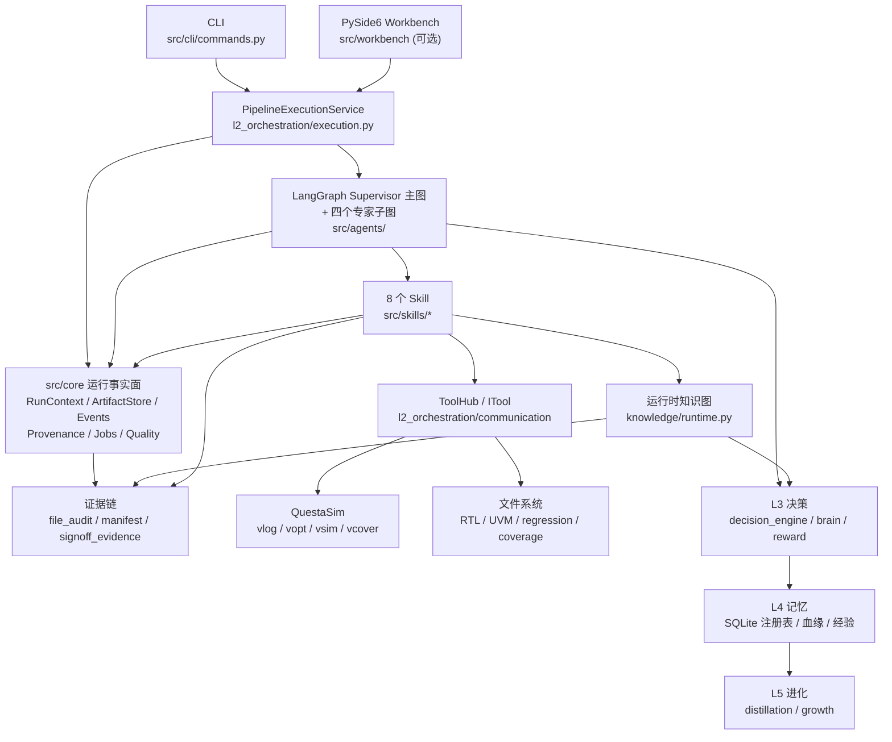

# SignOffAI 代码架构（当前实现）

> 基线：2026-11-10
>
> 全量单测：**1182 passed / 4 skipped**（本机，2026-11-10）；工作台 **692 passed**（`QT_QPA_PLATFORM=offscreen`，2026-11-10）。
>
> 历史 UVM 端到端实测：`output_e2e_v3_10_jiang_20261104_215130`（3.0 全量接线后）曾记录分级回归 **273/273 PASS**、功能计划覆盖率 **95.23%**、签核 **PASS_WITH_CAVEAT / CONDITIONAL**；**该 run 目录当前不在本工作区，不能作为当前 HEAD 的可复核证据**。Case View / 证据包的历史数字同样只作背景。
>
> 历史 SoC 参考工程：`examples/open_npu_soc` 曾记录 `soc run` 两条用例 PASS（参考 TB `gemm_8x8` + E203 C `gemm_8x8_c`），输出 `output_soc_design_jiang_20261031_223611`；**该 run 目录当前不在本工作区**，需在装 Questa 的机器上重跑。
>
> **Architecture 2.0 基线**：`src/core/` 运行事实面（RunContext / ArtifactStore / EventStore / Provenance DAG / Job Runtime / Decision Evaluation / Verification Quality Gate）已落地；**Verification Intelligence 第一层**（归因完整率、四个工程指标、增量计划、Run Diff、LocalStrategy→JobSupervisor）已接入。新增单测 `tests/core/` 89 条 + UVM IR 10 条 + Job Runtime 集成 4 条 + 合成 run 集成 1 条。

本文描述**代码现在怎么组织**，不是愿景文档。所有路径以仓库根为基准。

---

## 1. 系统边界

SignOffAI 是一个**个人级 CLI 验证平台**：

- 入口：`python -m src.cli.commands`（唯一正式交付入口）
- 桌面工作台：`python -m src.workbench`（PySide6，可选；**不开发 Web UI / Dashboard / SSE**）
- 输入：
  - `spec.md`（设计阶段生成 RTL），或
  - `--rtl <dir>`（现成 RTL，自动跳过 design/model）
  - `specs/<module>/`（VPlan 项目：`data/*.csv` + `cases/*.yaml`）
  - `specs/<module>/signoff_policy.yaml`（模块签核策略）
- 输出：一次 run 目录（RTL / UVM 环境 / 回归 / 覆盖率 / 签核证据包）
- 依赖：QuestaSim（`vlog/vopt/vsim/vcover`）、Python 3.11

**核心设计原则：**

| 原则 | 落点 |
|---|---|
| 真实 EDA 是唯一真理 | RTL/UVM 必须过 `vlog`；仿真判据来自 `vsim` 日志 |
| 失败响亮 | 没 RTL、没 log、没 `mismatched=0`、没证据，都不算 pass |
| `None ≠ False` | “判不了”与“判不过”分开；不拿空值冒充通过 |
| 单一主键 | 测试点 `tp_id` 贯穿建模 → 用例 → 覆盖 → 回归 → 签核 |
| 证据可校验 | 文件哈希、manifest、`package_hash`、离线回放 |
| 不静默降级 | 缺模型/缺模板/缺注入点 → 显式报错或 caveat |

**Architecture 2.0 的四个横向基础能力**（不推翻五层，只补齐底座）：

| 能力 | 解决什么 | 落点 |
|---|---|---|
| **RunContext** | 一次 run 的身份/输出根/父 run 只有一处来源；重入不再重新生成 | `src/core/runtime/run_context.py` |
| **ArtifactStore** | 产物索引与内容寻址分离；SHA256 是内容身份，大文件不复制 | `src/core/runtime/artifacts.py` |
| **Provenance DAG** | 回答「这个 bin 是哪条 test/seed/哪版 RTL 来的」；缺 per-test 数据只标 weak | `src/core/provenance/` |
| **EventStore** | 执行事实的单一追加日志；由 RunJournal 镜像，不复制第二套过程日志 | `src/core/runtime/events.py` |

另外两项横向能力：**Job Runtime**（`src/core/jobs/`，EDA 进程生命周期/进程树回收/命令白名单）与
**Verification Quality Gate + Decision Evaluation**（`src/core/verification/`、`src/core/decision/`）。

### 1.1 三类工程服务 = CLI 工作流，不是三套独立软件

客户看到的三种使用场景，共用**同一个正式入口**与**同一条执行链路**：

```text
python -m src.cli.commands
        │
        ├─ verify                  UVM 自动化验证
        ├─ optimize-regression     回归效率优化
        ├─ coverage-closure        Coverage Closure
        └─ metrics / incremental / diff runs   工程指标与增量/对比
```

| 场景 | CLI 入口 | 复用链路 | 产物 |
|---|---|---|---|
| UVM 自动化验证 | `vagent vplan execute specs/<module> --sim-mode cov` | LangGraph → front/design/model/verify/ops/coverage → EDA → evidence | run 目录 + 证据包 |
| 回归效率优化 | `vagent optimize-regression --project ./project --history ./runs --policy signoff_policy.yaml [--execute]` | 历史分析（core）→ `InfrastructureManager.run_regression`（已有执行器）→ `compare_reports` | `optimize/plan.json`、`optimize/result.json` |
| Coverage Closure | `vagent coverage-closure --coverage ./output_x/coverage --target 98 [--execute]` | 缺口分析（core）→ `PipelineExecutionService` 现有闭环 → `run_diff` | `closure/plan.json`、`closure/result.json` |

**架构原则**：CLI 只接任务/参数；编排归 LangGraph；分析决策归 Agent / `src/core`；
确定性执行归 Executor / `InfrastructureManager`；EDA 归 Job Runtime；所有结果落
Evidence。**不为三类服务各写一套引擎**；`optimize-regression` / `coverage-closure`
只是对同一套基础设施的工作流编排。

`verify` 同时给 spec 与 `--rtl` 时：RTL 当 DUT、spec 当分析/参考模型输入、
跳过 design；VPlan 项目会被挂到 run 的 `inputs/vplan/`。

### 1.2 参考 SoC 工程（Open NPU SoC v0.1）

`examples/open_npu_soc/` 是用来证明「SignOffAI 能验证真实 SoC」的样板工程。两条路径共用
`tb/tb_soc_top.sv`：

```text
参考路径: TB 预装 A/B → nice_cmd_sequencer → DMA → Banked SRAM → INT8 GEMM → golden 比较
E203 路径: E203 CPU 执行 C → NICE custom3 → u_npu_top/u_nice_disp → ICB 读写 DTCM → INT8 GEMM
```

**NPU 是子系统级 IP**（`npu/`），不是 CPU 内的 NICE core：

```text
tb_soc_top
 └─ u_e203_tb_top (E203 tb_top)
    └─ u_e203_soc_top
       └─ u_e203_subsys_top
          ├─ u_e203_subsys_main      # E203 CPU 子系统
          │    └─ u_e203_cpu_top → u_e203_cpu → u_e203_core
          └─ u_npu_top               # 与 u_e203_subsys_main 同级
               └─ u_nice_disp        # npu/nice_disp/e203_nice_npu_adapter.sv
                    └─ u_gemm        # npu/npu/int8_gemm.sv
```

- **接口上引**：`e203_cpu.v → e203_cpu_top.v → e203_subsys_main.v →
  e203_subsys_top.v` 把 NICE 请求/响应/ICB 主口引到子系统边界，并在
  `e203_subsys_top` 例化 `npu_top`。只改这 4 个文件，CPU/NICE 协议本身不变；
- **ICB 主口**：适配器用 `nice_icb_*` 作为 master，经 CPU 的 LSU 仲裁
  （CPU AGU + NICE，NICE 优先）后按地址译码到 ITCM / DTCM / BIU。当前只发
  DTCM 地址（desc/A/B/C），一次一笔、word 粒度、无 burst；
- **数据流**：C 程序在 DTCM 里放 descriptor/A/B/C；`u_nice_disp` 读 6 个
  descriptor 字、16+16 个 A/B 字，GEMM 后写 64 个 C 字；CPU 轮询 STATUS；
- **NICE 编码受 E203 解码约束**：`instr[13]`=rs1en、`instr[14]`=rdwen（即
  func3 的 bit1/bit2）；START func3=2、STATUS func3=4、ACK func3=0；
- **C 用例编译**：`vlog +acc -linedebug` → `vopt -designfile design.bin
  -linedebug +acc -o tb_soc_top_opt` → `vsim tb_soc_top_opt
  -qwavedb=+signal+memory=4096,4+class+wavefile=...`；
  - `+acc`：保留信号；`-linedebug` + `design.bin`：Visualizer hierarchy
    可看源码；
  - `+memory=4096,4`：数组（`u_gemm.a/b/c`、`a_buf/b_buf/c_buf`、`desc`、
    `c_words`）进波形，否则打开时报 `Memory ... is not logged`；
  - E203 `tb_top` 的 `$value$plusargs` 与 `$readmemh` 是两个 time-0 initial，
    开 `+acc` 后顺序会变；在 vsim cwd 放一份 `.verilog` 兜底镜像；
- **回归 YAML**：`build_soc`（参考）+ `build_e203_c`（E203）两个 build，
  `gemm_8x8` + `gemm_8x8_c` 两条用例；`soc run` 一次跑完 4 个任务；
- **实测（2026-10-31）**：`soc check` 输入齐全；`soc run` 4/4 PASS；
  参考路径 `mismatched=0` / 2075 ns，C 路径 `TEST_PASS`；
- `soc run` 通过工程适配层（`src/cli/soc_adapter.py`）落
  `RunContext` / `EventStore` / `ArtifactStore`，并生成
  `soc/soc_run.json` 与 `signoff_evidence/`（`soc_evidence_v1`，27 个文件）；
- **波形/源码**：`regression.yaml` 用 `-qwavedb` 落
  `<test>/waves/*.db` 与 `design.bin`；`soc wave <run> [--test gemm_8x8_c]`
  把 `-designfile design.bin -wavefile <db>` 一起交给 Visualizer；
  `soc wave` 也认 C-only run（`c_run.json` → `e203/waves/*.db`）；
- **常用命令**：`soc report <run>`（摘要）、`soc evidence <run>`（27 个
  文件逐哈希校验）、`soc wave <run>`、`soc c-cases` / `soc c-run`；
  `run` 的回归 exit code 仍是 **唯一 PASS/FAIL 判据**；
- **业务模式切换**：Workbench 工具栏「业务：全部 / SoC / IP」只切换导航树里的
  团队业务线（SoC 模式收起 IP 团队，IP 模式收起 SoC 团队，共享专业模块不变），
  选择持久化到 QSettings `business/mode`；
- **SoC C 用例**：`sw/cases.yaml` + `src/cli/soc_c_runner.py`；`soc c-cases` /
  `soc c-run --case C-GEMM-8X8` 用 RISC-V 工具链编 C、用 Questa 跑 E203
  bare-metal；判据是 E203 TB 的 `TEST_PASS`/`TEST_FAIL`（C 先写 DTCM，经
  NICE ICB 读写，INT8 GEMM 结果再与 C golden 逐元素比较）；
- **团队业务线**：`spec/ip_manifest.yaml` 把 IP 的 team/owner/version/status
  与 RTL 列成契约；
  - **SoC 团队**：`soc.overview / soc.architecture / soc.verification /
    soc.c_cases / soc.signoff`（C 用例页：`sw/cases.yaml` 清单、按用例编译
    运行、打开对应 qwave.db；run 选择器与运行历史都认 `c_run.json`）；
  - **IP 团队**：`ip.catalog / ip.workspace / ip.signoff`；
  - IP 级验证：`ip run` 按 `spec/ip_verification_plan.yaml` 的 tests 跑；
    `ip status` **优先该 IP 自己的 IP run**（其次才回退 SoC run），
    `ip_evidence/<ip>.json` 引用来源 run；`ip release-build` 生成带哈希的
    发布包 `spec/ip_releases/<ip>.json`，SoC 签核页展示消费绑定（见 §1.3）；
  - 两套页面共用工程事实与 `soc.*` / `ip.*` 只读工具，不复制回归/波形/证据页面；
- **运行历史**：`RunRepository.discover_runs()` 在没有
  `docs/manifest.json` 时读 `soc/soc_run.json`、`ip/ip_run.json` 或
  `c_run.json`，分别以 `kind=soc / ip / soc_c`、`state=completed/failed`
  列入 `flow.runs`；
- **边界**：SoC 证据包是工程级事实（输入/npu RTL/golden/回归/波形），
  **不是 UVM 的 v2 三态签核证据包**；E203 路径需要 RISC-V 工具链和 Questa，
  已在本机实测 `C-GEMM-8X8` 通过。

详见 [`examples/open_npu_soc/README.md`](examples/open_npu_soc/README.md)。

### 1.3 IP 与 SoC 两条业务线：两套 CDV + 发布契约

两条业务线模拟真实公司里的**供应方 / 消费方**，不是同一个流程的两个入口；
方法学不同，覆盖率**分账、不相加**。

| | IP 团队（供应方） | SoC 团队（消费方） |
|---|---|---|
| 验证对象 | IP 内部：微架构 / 协议 / 状态机 / 边界与异常 | 集成：跨 IP 数据流 / 配置组合 / 启动-中断序列 |
| CDV 口径 | 功能覆盖点 + 断言 + 代码覆盖（`methodology: ip_cdv`） | 集成场景覆盖；IP 内部覆盖直接引用，**不重算** |
| 交付物 | `spec/ip_releases/<ip>.json`（`ip_release_v1`，带 sha256） | run 里的 `consumed_ips` + 证据包 |
| 通过判据 | tests / evidence / testpoints（必需），coverage（M2 前参考） | 集成回归 PASS + 消费的发布包绑定正常 |
| 失败语义 | 不发布，或带 waiver 发布 | 未发布 / 版本漂移 → `MISSING` / `STALE` / `NOT_RELEASED` |

**发布契约**（`src/cli/soc_adapter.py`）：

- `build_ip_release(root, ip_id)`：准则没过也写包，但 `released=false`，
  `blocking` 列出卡住的准则 —— 发布与否是人的决定，不是工具替人拍板；
- 包的 `coverage` 在独立 IP TB（M2）落地前是
  `{measured: false, functional_pct: null, basis: soc_subset}`：
  **None ≠ 0**，不拿 SoC 的覆盖率冒充 IP 覆盖；
- `soc_ip_binding(root)` 把清单里每个 IP 绑到发布包上，状态
  `OK / STALE（RTL hash 变了）/ MISSING（清单说 released 但没包）/
  NOT_RELEASED（被准则拦住）/ UNRELEASED（清单本来就没发布）`；
- 每次 SoC run 的 `soc/soc_run.json` 记录 `consumed_ips`，SoC 签核页直接
  显示绑定异常数。

**CLI**：`vagent ip release-build --ip <id>` / `ip release-check --ip <id>` /
`ip binding`。工作台 IP 工作区有「生成发布包」，IP 发布检查页显示准则逐条状态。

**IP run 不冒充 SoC run**：IP run 也会写 `soc/soc_run.json`，所以
`list_soc_runs` 先认 `ip/ip_run.json`、`latest_soc_run` 只取 `kind=soc`、
`ip_status` 优先该 IP 自己的 ip_run —— 供应方的结论不再由消费方的 run 定义。

### 1.3 应用服务层与契约层（Architecture 2.1）

主链路不变，只把「入口编排」和「数据契约」收口：

```text
CLI / PySide6 Workbench
        │
        ▼
src/app/services/              # 应用服务 facade（CLI/Workbench 共用）
  verify_service / optimize_regression_service / coverage_closure_service
  soc_service / ip_service
        │
        ▼
LangGraph / PipelineExecutionService / InfrastructureManager
        │
        ▼
Executors / ToolHub / JobSupervisor / EDA
        │
        ▼
Run-local facts + EvidenceEnvelope
RunContext / EventStore / ArtifactStore / Provenance / Quality / DecisionEval
        ▲
        │
src/core/contracts/            # schema 版本 / JSONL / 事件注册 / envelope / 质量词汇
```

**边界**：

- CLI 只做参数解析与输出，`cmd_services.py` / `cmd_soc.py` / `cmd_verify.py`
  调 `src.app.services`；**CLI 不 import `PipelineExecutionService`**
  （`tests/test_service_boundary.py` 用 AST 扫描钉住）。
- Workbench 的 service/soc/ip 页面通过 `bridge/catalog.py` 调同一组 app service；
  GUI 的异步线程边界是 `run_service`，与 CLI 共用同一份
  `VerifyRequest`（`verify_request.py`）：输出目录 / VPlan 挂载 / 全量开关 /
  增量基线 / 审批通道**只有一处实现**。
- `VerifyRequest.prepare()` 落 `docs/run_config.json`（`run_config_v1`）：记录
  生效值、来源（cli/gui/service）与当前 `SIGNOFFAI_*` 环境变量 —— 回答
  "这一轮到底用了什么配置"。
- `src/app` 可以调 L1–L5；L1–L5 **不反向依赖** app；
- `src/core/contracts` 只用标准库，不 import layers。

### 1.4 EvidenceEnvelope（基础段 + domain profile）

证据包不再各写一套顶层形状，但**不强行统一 verdict**：

```text
EvidenceEnvelope = identity + inputs + execution + verdict + replay + hashes
UVM profile   = uvm_signoff_v2     （保留三态 / caveat / TP 矩阵）
SoC profile   = soc_evidence_v1    （verdict 写 soc_regression；uvm_verdict=not_applicable）
IP profile    = ip_release_v1      （不拿 SoC 覆盖率冒充 measured/verified）
```

版本常量在 `src/core/contracts/versions.py`；envelope 构建/校验在
`src/core/contracts/evidence.py`。UVM v2 与 SoC 证据包都带 `profile` +
`envelope` 段，原有 `files` / `package_hash` 兼容视图保留。

---

## 2. 总览图



---

## 3. 五层架构

| 层 | 职责 | 关键模块 | 依赖方向 |
|---|---|---|---|
| **app 应用服务** | CLI/Workbench 共用的业务编排 facade；不造第二套引擎 | `src/app/services/`：`verify`、`optimize_regression`、`coverage_closure`、`soc`、`ip` | 依赖 L1–L5；被 CLI/Workbench 调用 |
| **core 横切底座** | 运行身份 / 产物索引 / 事件事实 / 血缘 / Job 进程 / 决策评估 / 质量门 | `src/core/`：`runtime/`、`provenance/`、`jobs/`、`decision/`、`verification/` | **只用标准库**，不 import `src.layers`（`tests/core/test_core_is_stdlib_only.py` 守卫） |
| **L1 基础设施** | EDA 调用、输出目录、哈希、归档、Reference Finder | `layers/l1_infrastructure/`：`infrastructure.py`、`eda_backend.py`、`coverage_backend.py`、`output_config.py`、`layout.py`、`reference_finder.py` | 最底层，不依赖上层 |
| **L2 编排** | LangGraph、执行器运行时、ToolHub、状态/运行时、证据、治理 | `src/agents/`：Supervisor + 四个专家子图；`layers/l2_orchestration/`：`execution.py`、`runtime.py`、`state.py`、`stages.py`、`communication/`、`evidence/`、`governance/`；8 个阶段 skill 实现在 `src/skills/`，base/registry 在 `layers/l2_orchestration/skills/` | 依赖 L1 |
| **L3 决策** | 覆盖率驱动决策、动作选择、粗连续奖励、知识图谱（设计时 + 运行时） | `layers/l3_decision/`：`decision_engine.py`、`reward.py`、`brain/`、`knowledge/`（`schema/graph/query/persistence/runtime`） | 依赖 L1/L2 的契约 |
| **L4 记忆** | 用例库、IP 库、模型库、排除规则、血缘、经验统计 | `layers/l4_memory/`：`testcase_registry.py`、`ip_registry.py`、`model_registry.py`、`lineage.py`、`coverage_experience.py`、`debug_experience.py` | 可被 L2/L3/L5 调用 |
| **L5 进化** | 经验蒸馏、规则生长 | `layers/l5_evolution/`：`distillation.py`、`growth.py` | 依赖 L4 |

**分层守卫**：`src/layers/_bootstrap.py` 在 CLI 启动时检查 import 方向；测试 `tests/test_layer_direction.py` 用 AST 扫描，防止 L1 反向依赖 L2+。

---

## 4. Agentic orchestration（`src/agents/`）

旧的 24 节点单图、`build_legacy_closed_loop_graph()` 和
`SIGNOFFAI_SUPERVISOR=off` 回滚路径已删除。当前只有一个入口：

```text
src/agents/
├── supervisor/     graph.py / state.py / routing.py
├── design/         graph.py / loop.py / tools.py
├── verify/         graph.py / loop.py
├── debug/          graph.py / loop.py
├── coverage/       graph.py / loop.py / tools.py
├── runtime/        tool_loop.py / nodes/ / guards.py
└── gates/          audit.py / human.py
```

### 4.1 Supervisor 主图（9 个节点）

```text
START → init → supervisor
  supervisor ──design──► design_expert ──► supervisor
  supervisor ──verify──► verify_expert ──► supervisor
  supervisor ──debug──► debug_expert ──► supervisor
  supervisor ──coverage──► coverage_expert ──► supervisor
  supervisor ──human_review──► human_review ──► supervisor
  supervisor ──audit──► audit_gate ──► finalize → END
```

`supervisor` 只读状态、只写路由字段；`init / audit_gate / finalize` 是纯代码；
`human_review` 在 Debug 连续返工 ≥5 次时 `interrupt()`。

### 4.2 术语：Skill vs Executor

- **Skill**：面向 agent 的阶段能力包，目录 `src/skills/<role>/`；
- **Executor**：Skill 的**实现基类/历史注册名**（`BaseExecutor`、
  `ExecutorRegistry`），不是旧 24 节点架构；
- **Agent**：带循环/预算/工具的专家，不直接操作 EDA；
- **Gate**：纯代码门禁。

完整术语表见 [`docs/AGENT_GLOSSARY.md`](docs/AGENT_GLOSSARY.md)。
本轮选择“快速止血”：保留 `Executor` 类名，不破坏外部 import；目录与 agent
侧统一用 skill。

### 4.3 四个专家子图

| 子图 | 内部 | 循环/工具 |
|---|---|---|
| `design_expert` | front → design → design_agent → model | design_agent 可选工具循环 |
| `verify_expert` | verify → verify_agent → env_arch_check | verify_agent 可选 UVM 工具循环 |
| `debug_expert` | round_bump → ops → agent_loop → debug_functional | 失败回环；agent_loop 可选 |
| `coverage_expert` | coverage → coverage_agent → decide → governor → approval → 动作 | 非 CONVERGE 交回主图 |

`SIGNOFFAI_AGENT_LOOP=on` 是总开关；单专家可用
`SIGNOFFAI_DESIGN_LOOP` / `SIGNOFFAI_VERIFY_LOOP` /
`SIGNOFFAI_COVERAGE_LOOP` 覆盖。默认 off，确定性 executor 仍是兜底。

### 4.4 运行时与事实面

- `Runtime`（`runtime.py`）持有上下文、客户端、审计链；`PipelineState`
  （`state.py`）是图状态。
- `_run_agent` 用 `_rebuild_ctx(state, role)` 生成 `task["ctx"]`，只保留该专家
  声明的键，避免把完整流水线状态塞给每个 executor。
- 入口（`run_closed_loop` / `_stream_run`）在确定最终 `output_root` 后建
  `RunContext` + `EventStore` + `ArtifactStore` + `JobSupervisor`，挂到
  `Runtime`；`hydrate_runtime` 在断点重入时兜底重建。
- `n_finalize` 构建/刷新 `docs/provenance.jsonl` 与
  `docs/verification_quality.json`，并把 `run.finished`、`provenance.built`、
  `quality.gate` 落进事实日志。

### 4.5 结构护栏（把“人记住的不变量”变成代码检查）

系统跑通后，以下四处最容易因“成功带来的复杂度增长”而变脆；现在都有
**结构性检查**，不靠注释或记性：

| 不变量 | 实现 | 失败方式 |
|---|---|---|
| verify 8 步的数据依赖 | `src/skills/verify/steps_dag.py` | import 期拓扑校验（缺失/成环）；执行期前置未跑 → `StepOrderError` |
| State 字段归属 | `state.PHASE_OWNERS` + `STATE_CONTRACTS`；`graph._guarded_node` | 启动期字段存在性校验；运行期越权写 `tests/coverage/audit/result` → **硬失败**（`SIGNOFFAI_STATE_CONTRACT=warn` 退回告警），其余字段 → warning |
| 硬失败 vs 软建议 | `decision_engine.hard_action()` / `soft_action()`；`DecisionBrain` 显式先调 hard | 硬失败（编译/比对/回归）结构上到不了 RL |
| 工具角色映射 | `ToolHub.validate_registry()` + CLI 启动一行汇总 | 空映射未在 `EXECUTORS_WITHOUT_HUB_TOOLS` 登记 → 启动 `exit 2` |
| LLM 协议猜测 | `find_spec_yaml` 对“非规格显式声明的单端口协议组”回退 generic | 一个猜测不会劫持整份 spec（否则生成错误 agent、DUT_CHK 求值 X） |
| 签核结论可复现 | Tier A + `replay/recipe.json` v2 | `tests/test_signoff_reproducible.py` 重算并与 `report.json` 比对；证据漂移会失败 |
| 编译失败不跑 test | `Scheduler` 的 `_run_test_task()` | build 失败时 test 直接标 fail 且不执行，避免旧 work library 跑出假结果（`test_scheduler_build_failure.py`） |

原则：**查询与构建分离、配置与代码分离、硬规则与软策略分离**。这些护栏
只加检查、不加节点，不改变已跑通的拓扑。

### 4.6 复杂度预算与“守卫的守卫”

**文件行数 / 函数圈复杂度**由 `config/architecture_guard.py` 执行：

- `config/architecture_budget.yaml`：> 1500 行必须登记（`reason` + `plan`），
  > 2000 行失败；登记文件**只能变小不能变大**。**当前 `watched` 为空** ——
  原来超线的 `gen_uvm.py` / `flow_tools/api.py` / `vplan/runtime/coverage.py` /
  `cli/commands.py` 已拆到 1500 行以下，`_tools_old.py` / `pipeline_docs.py`
  确认无调用方后已删除。
- **基线已重置（2026-11-01）**：拆分/删除后的旧债务条目全部作废，
  `complexity_baseline.json` 按当前代码重新生成（97 条，全部 > 20）。
  这 97 条是**新结构的起点**，不再作为"历史欠账"逐条偿还；
  新函数超阈值仍然会红。
- `config/complexity_baseline.json`：现有 > 20 的函数进债务清单；
  新函数超阈值、或已登记函数复杂度增长 → 失败。
- `python -m config.architecture_guard` 是 CI 入口。

**变异测试** `scripts/mutation_guards.py` 故意改坏 9 条核心守卫，再跑对应
测试；测试必须失败（mutant killed），否则说明守卫没被测到：

| mutant | 守卫 | 对应测试 |
|---|---|---|
| `decision_hard_overridden` | 硬失败优先 | `test_decision_phases` |
| `steps_dag_missing_dependency` | 8 步依赖 | `test_verify_steps_dag` |
| `plusargs_reserved_allowed` | 后端保留键 | `test_plusargs_semantics` |
| `file_audit_hash_skipped` | 证据链哈希 | `test_human_edit_evidence` |
| `state_contract_wrong_owner` | State 写入者 | `test_state_contracts` |
| `tool_registry_empty_allowed` | 工具映射完整性 | `test_tool_registry` |
| `source_terminal_accepts_anything` | `source` 转移契约 | `test_source_transitions` |
| `scb_pass_anchor_loosened` | 判据锚定 `[SCB_DUT]`/`Scoreboard:` | `test_per_sb_scoreboard` |
| `scoreboard_rules_guessed` | SB 归属不猜 | `test_per_sb_scoreboard` |

当前 **9/9 killed**。新增守卫必须在 `MUTATIONS` 里有一条“改坏它会红”的
mutant；`tests/test_mutation_guards.py` 钉住目标片段仍然唯一存在。


---

### 4.7 工作区分区：main / staging / proposal / gate

通用循环与签核平面**物理隔离**：循环再自由，也只能写 staging；main 只由
`gate.promote` 写入。两区之间唯一的通道是 Proposal，且必须过 Gate。

```text
┌──────────────────────────────────────────────────────┐
│ main/        签核过的内容（read-only, 只有 promote 写） │
└──────────────────────────────────────────────────────┘
          ▲ promote（过 gate + 人工门）
          │
┌──────────────────────┐   ┌───────────────────────────┐
│ gate/                │◄──│ proposals/                │
│ 确定性检查 / 批准 / 账本 │   │ 变更 + 证据 + open_questions│
└──────────────────────┘   └───────────────────────────┘
                                      ▲
┌──────────────────────────────────────────────────────┐
│ staging/     可写 / 可跑 / 可丢弃（通用 agent loop）   │
└──────────────────────────────────────────────────────┘
```

源码目录与分区一一对应：

```text
src/workspace/
├─ zones.py              # 四区路径、路径隔离、指纹/差异
├─ resources.py          # 项目只读视图：rtl/verification/coverage/env/spec/model
├─ main/reader.py        # main 只读视图（没有写方法）
├─ staging/
│  ├─ tools.py           # read/list/search/write(仅 staging)/run_shell(cwd=staging)
│  └─ loop.py            # 兼容门面 → harness
├─ harness/              # 显式状态机 + 回填 + 压缩 + 会话（对齐 DeepSeek Harness）
│  ├─ state.py session.py backfill.py context.py
│  ├─ goal.py plan.py permissions.py tools.py
│  ├─ jobs.py skills.py subagent.py events.py
│  └─ harness.py         # 驱动循环
├─ proposal/schema.py    # proposal_v1：changed_files + evidence + open_questions
└─ gate/
   ├─ checks.py          # schema / 基线 / 差异 / 证据 / open_questions
   ├─ runner.py          # GateReport + 人工批准
   └─ promote.py         # **唯一**写 main：备份 + 原子写 + ledger
```

边界契约：

- **main ↔ staging**：沙箱没有写 main 的 API；越区路径（`../`、绝对路径、
  `main/`）在 `zones.py` 直接拒绝。出错代价 = 丢一个 staging 目录。
- **项目只读视图**：harness 通过 `project_map/read_project_file/search_project`
  （`resources.py`）读整个项目——RTL、验证代码、覆盖率数据、环境配置、spec、
  C/SystemC 模型；`.env`/凭据/私钥不可读，二进制（`.ucdb` 等）只给元数据。
  视图只读，写仍只能落 `staging/`；项目根在 `workspace init --project-root`
  时记入 `.harness/workspace.json`，`workspace resources` 可单独查看清单。
- **proposal 是窄接口**：结构固定（变更 + 证据 + 待决问题），Gate 能机械校验，
  审计能回放。`open_questions` 非空 → `human_required`，必须人工批准。
- **gate 留在确定性平面**：默认检查 + 可注入的领域钩子（契约/回归/覆盖率阈值）；
  模型只“提议”，不“批准”。
- **promote 可回滚**：覆盖/删除前备份到 `gate/backups/<id>/`，每次提升追加
  `gate/ledger.jsonl`（谁提议、什么证据、谁批的）。

Proposal 字段（`proposal_v1`，`src/workspace/proposal/schema.py`）：

| 字段 | 含义 |
|---|---|
| `proposal_id` / `task` / `status` | 身份 / 任务 / `draft→submitted→accepted/rejected→promoted` |
| `base.main_fingerprint` | 提议基于的 main 指纹；main 变了必须 rebase |
| `changed_files[]` | `{path: "staging/...", action: add/modify/delete, sha256}` |
| `evidence.before/after` | 变更前后的可量化结论（覆盖率/回归/行为） |
| `evidence.commands[]` | `{cmd, exit_code, log}`；至少一条 `exit_code=0` |
| `evidence.logs[]` | `staging/...` 下的真实日志 |
| `evidence.reasoning_trace` | 为什么这么改（审计可回放） |
| `open_questions[]` | 循环主动交还的不确定点 → 人工门必看 |

Gate 默认检查（`src/workspace/gate/checks.py`）：

| 检查 | 判据 |
|---|---|
| `proposal_schema` | 字段齐全、路径/哈希合法、日志存在 |
| `main_baseline` | `base.main_fingerprint` == 当前 main |
| `changed_files` | proposal 申报的变更 == staging 当前差异（防夹带） |
| `evidence_commands` | 至少一条 `exit_code=0`；非 0 命令 → warn（人工确认） |
| `evidence_logs` | 日志存在且在 `staging/` 内 |
| `subgoals` | 分解过的提案：未完成子目标 → fail；blocked → warn + 人工门 |
| `open_questions` | 非空 → `human_required` |

`workspace gate --profile eda` 追加：

| 检查 | 判据 |
|---|---|
| `eda_regression` | `regression_stages.status == PASS` 且 `failed == 0` |
| `eda_coverage` | `functional_pct >= target`（target 未声明 → warn + 人工门） |
| `eda_evidence_files` | 证据文件存在且 sha256 匹配 |
| `eda_contracts` | 证据里有契约义务计数 |

领域检查（契约 / 分级回归 / 覆盖率阈值 / 签核）通过
`workspace gate --check module:callable` 注入，返回同样的
`{name,status,severity,detail}` 结构；任何 `fail + block` 都会挡住 promote。
`promote` 还要求：`ok == true`；`human_required` 时必须有 `approved`；main 基线
未变化（除非显式 `--force`，账本记 `forced=true`）。

### 4.8 Agent harness：状态机、回填、恢复

`staging/loop.py` 只是兼容门面；真正的循环在 `src/workspace/harness/`，
能力对齐 DeepSeek Harness 的插件面：

| DSH 能力 | 本实现 |
|---|---|
| `goal` + `goal-round-driver` | `goal.py`：goal → rounds；提案不合法/步数用尽 → 下一轮，最多 `max_rounds` |
| 目标分解 + ReAct | `harness.py`：首次决策可给 `subgoals`；每个子目标一轮 reason→act→observe；`complete_subgoal(summary)` 必须有工具证据，`block_subgoal(reason)` 变成 open_question；`react.reason/act/observe` 事件 |
| EDA 证据 | `harness/domain.py`：`run_verify`（调 vplan execute）、`collect_evidence`（读回归/覆盖率/缺口/契约 + sha256）、`compare_evidence`（前后 delta）、`export_evidence`（优先打包 `<run>/signoff_evidence/`，否则结构化证据；固定时间戳 + `export_manifest.json`，落 staging）；`run_verify --export` 自动导出；`coverage_gap_decomposer` 把 closure actions 拆成子目标；`gate/domain_checks.py::eda_evidence` 裁决 |
| `plan-mode` | `plan.py` + `HarnessConfig.plan_first` / `require_plan_approval`：第一次响应必须带 `plan`，可暂停等人工批准 |
| `compaction-basic` / `tool-result-pruner` / `token-meter` | `context.py`：token 估算、旧 tool 结果裁剪、超预算 compaction |
| `session` / `session-projection` | `session.py`：messages / working / usage / pending / projection；`.harness/sessions/<id>.{json,events.jsonl}` 可恢复 |
| `tools` / `tool-*` | `staging/tools.py` + `harness/tools.py`：read/list/search/write/delete/str_replace/run_shell/todo/skill/job/subagent；项目只读视图 `project_map/read_project_file/search_project`（`resources.py`） |
| `tool-ask-user` + 权限 | `permissions.py` + `ask_user`：plan/命令可暂停等 `workspace resume --approve` |
| `jobs-local` | `jobs.py`：后台命令 `job_start/job_output/job_kill`，日志在 `staging/.jobs/` |
| `skill-filesystem` | `skills.py`：`.skills/*.md` 发现、读全文、注入 system prompt |
| `subagent` / `subagent-control` | `subagent.py`：受限子 harness（同 staging、独立 session、禁止再派子 agent） |
| `agent-tool-presentation` / 事件 | `events.py`：`state/decision/tool.call/tool.result/compaction/proposal` JSONL + 可选 UI sink |

状态机（合法转移在 `state.py` 里，非法转移直接抛错）：

```
NEW → PLANNING → ACTING → OBSERVING → PLANNING …  （循环）
              ├→ AWAITING_PLAN → PLANNING         （plan 审批）
              ├→ PAUSED        → PLANNING/ACTING  （ask_user / 命令审批）
              └→ PROPOSING → DONE | BLOCKED | CANCELLED | FAILED
```

**结果回填**（`backfill.py`）不是“把工具结果拼进字符串”：
每次工具调用写入 assistant `tool_calls`，结果写入 tool message，同时更新
`working`（changed_files / evidence.commands/logs / reads / todos / subagents /
jobs / open_questions）—— 下一轮 LLM 看到的是消息，Gate 看到的是工作状态。

会话恢复：`workspace resume <root> <session_id> --approve/--deny|--answer`
从磁盘加载状态（含 pending 动作）继续；事件日志继续追加，序号不重置。
没有 LLM key 时 `workspace loop` 返回 `blocked / LLM_UNAVAILABLE`，不伪造轨迹。

未纳入（保留扩展点）：MCP client、web 工具、workflow-worker；它们接在
`tools.py` 的 ToolSpec 注册表和 `_execute_tool` 分发上即可。

CLI：

```bash
python -m src.cli.commands workspace init <root> [--from <baseline>]
python -m src.cli.commands workspace loop <root> --task "补一个边界用例" \
    [--plan] [--require-plan-approval] [--require-exec-approval] \
    [--max-rounds 2] [--max-tokens 200000] [--no-subagent] \
    [--goal coverage --target 95 --project <staging> --evidence <run>]
python -m src.cli.commands workspace propose <root> --task "手工修边界" \
    --before "coverage 82%" --after "coverage 94%" --reasoning "..." \
    --run "sim ..." [--open-question "..."] [--eda-run <run>] [--target 95]
python -m src.cli.commands workspace sessions <root>
python -m src.cli.commands workspace resume <root> <session_id> \
    [--approve|--deny] [--answer "..."] [--plan "..."]
python -m src.cli.commands workspace gate <root> <proposal_id> [--check module:callable] [--profile eda]
python -m src.cli.commands workspace approve <root> <proposal_id> --by <name>
python -m src.cli.commands workspace promote <root> <proposal_id> --by <name>
```

没有 LLM key 时 `workspace loop` 如实返回 `blocked / LLM_UNAVAILABLE`，
不会伪造轨迹；有 key 时仍走 `src/tools/common/lib/llm_call.py` 的同一个漏斗
（预算 / 缓存 / 审计 / schema 校验）。

---

## 5. 八个 Skill

注册表：`src/layers/l2_orchestration/skills/registry.py`；每个 executor 实现 `execute_task()`。

| Executor | 职责 | 关键产出 |
|---|---|---|
| `front` | spec/RTL 分析、dplan 契约抽取、VPlan bootstrap、用例库登记 | `spec.json`、`inputs/dplan/`、`docs/specs/` + `data/*.csv` + `cases/*.yaml`（裸 spec） |
| `design` | IP 拆解、RTL 生成、顶层连线、vlog 门禁、结构预检 | `rtl/*.sv`、`design_arch`、`precheck` |
| `model` | 参考模型（优先 SQL `ModelRegistry`，兼容 golden） | `models.yaml` / 模型 SV、`placeholder` 标记 |
| `verify` | UVM 生成、测试点分解、约束、覆盖率计划、回归 YAML | `env/`、`agents/`、`inputs/yaml/`、`coverage/` |
| `ops` | 分级回归调度、tag 过滤、失败分类 | `regression_run/`、`regression_stages.json` |
| `coverage` | 编译/仿真/覆盖率收集、计划覆盖率合并、TP 矩阵、种子多样性、粗连续奖励、运行时知识图 | `sim/coverage/`、`tp_matrix.json`、`seed_diversity.json`、`sim_reward.json`、`knowledge_graph.json` |
| `debug` | 错误分类、指纹、自动修复、重跑验证、经验回写 | `docs/debug_stats.json`、修复记录 |
| `audit` | 硬门禁、软 caveat、TP 汇总、签核证据包 | `report.json`、`signoff_evidence.json`、`signoff_evidence/` |

### 5.1 audit 的三态判定

```text
硬门禁不过                         → NEEDS_FIX   → REJECTED
硬门禁过 + 存在未被接受的 caveat   → PASS_WITH_CAVEAT → CONDITIONAL
硬门禁过 + 无有效 caveat           → READY       → APPROVED
```

- 硬门禁：回归全过、覆盖率 ≥ target、RTL 真实、基线存在（策略要求时）。
- 软 caveat：约束只部分生效、TP 未命中、ucdb 零命中、关联硬边断、`backend_args`、无 verified 参考模型等。
- **参考模型是否硬门禁由 `signoff_policy.yaml` 的 `require_ref_model` 决定**；默认是 caveat，不是阻断。

### 5.2 Verification Quality Gate（`docs/verification_quality.json`）

签核 PASS 可能在五种方式上名不副实，因此 audit 在组装签核/证据包**之前**写一份
五维报告（`verification_quality_v1`）：

| 维度 | 看什么 | 典型 `warn` |
|---|---|---|
| `functional` | 回归 passed/failed/total、TP 命中/UNMAPPED | 全过但 TP 零命中 |
| `coverage` | `functional_pct` / `overall_pct` / 计划合并清单 / 目标 | 低于目标 10% 以内 |
| `model` | `models.yaml` 的 `status: verified` / `placeholder` | 占位草稿 |
| `structural` | `round_manifest`、文件变更链自校验 | 缺文件变更链 |
| `evidence` | provenance / events / tool receipts / per-test sidecar | 只有 weak 血缘、无 per-test 数据 |

**只报告、不阻断**：不新增 caveat code，不参与 `hard_ok`；`unknown` 绝不折算成
pass（`None ≠ False`）。报告随证据包 `verdict/` 段收走，并作为 facts 写进
`signoff_evidence.json` 与 v2 manifest 的 `architecture_v2`。

---

## 6. 工具层

### 6.1 协议

`src/layers/l2_orchestration/communication/tool_protocol.py`

- `ITool`：`manifest` / `execute` / `check_health` / `validate_input`
- `ToolManifest`：名称、版本、JSON Schema、风险等级、执行模式、依赖、示例
- `ToolResult`：
  - `success`
  - **`verified_by`：`eda | llm | none`** —— 把“EDA 验过”与“LLM 自述”在类型上分开
  - 汇总时 `aggregate_verified_by()`：全 EDA → `eda`；EDA+LLM → **`mixed`**；
    全 LLM → `llm`；全 none → `none`。签核证据的 `tool_receipts.aggregate`
    用这个结论，不把 LLM 自述混进 EDA 背书
  - `evidence_ref`、`returncode`
- `ToolRisk`：`safe / write / danger`；未知值 **fail-closed → DANGER**
- `ToolAuditor`：内存 + `docs/tool_receipts.jsonl` 追加写，回执带 `verified_by`

### 6.2 ToolHub

`communication/tool_hub.py`

- 统一 `call_tool(name, args)`：schema 校验 → sandbox → execute → 审计回执
- `EXECUTOR_TOOL_MODULES`：执行器角色的工具白名单（一处维护）
- **不回退全量工具**：角色映射为空 = 声明不用工具
- **启动期校验**：`ToolHub.validate_registry()` 要求 8 个 executor 全登记；
  空映射必须同时出现在 `EXECUTORS_WITHOUT_HUB_TOOLS`（`front/model/audit`），
  否则 CLI 启动 `exit 2`。启动时 stderr 打一行
  `[tool-registry] front=none · design=spec · …`，不污染 `--json` 的 stdout。

### 6.3 工具板块（生成 / 检查分开）

单一真相：`src/tools/boards.py`，由 `tests/test_tools_boards.py` 钉住。

| 板块 | 职责 | 包 |
|---|---|---|
| **generation** | 产生产物 | `uvm_tools`、`isa_ir_tools`、`cmodel_tools` |
| **checking** | 只读/判定 | `assertion_tools` |
| **execution** | 跑 EDA/回归 | 空（`regression_tools` 已迁到 `src/layers/l2_orchestration/`） |
| **flow** | 趋势 | `trend_tools` |
| **integration** | 对外集成 | `ide_tools` |
| **humanview** | 人读视图（测试点 / Case / 覆盖率 / SVA / SCB） | `aivm_ir`、`case_ir`、`covg_ir`、`sva_ir`、`scb_ir` |
| **common** | 共享底层 | `lib` |

物理目录与板块的当前状态：

```text
src/tools/generation/    uvm_tools        isa_ir_tools     cmodel_tools
src/tools/checking/      assertion_tools
src/tools/execution/     （板块占位；regression_tools 已迁到 layers/l2）
src/tools/flow/          trend_tools
src/tools/integration/   ide_tools
src/tools/humanview/     aivm_ir  case_ir  covg_ir  sva_ir  scb_ir
src/tools/common/        lib
```

`uvm_tools` 内部也已把检查工具移到
`generation/uvm_tools/checking/`
（`tool_check_compile/static/env_arch/loopback/health/quality_report`），
生成主体留在 `tool_uvm / tool_find_spec_yaml / tool_jinja_render`。

**Native Skills**：工具知识不只留在代码里。`l3_decision/evidence` 提供
`SKILL.md`（何时用 / 不要用 / 正确调用 / 常见错误 / 日志看什么 / 产物），
给 LLM 与人都能直接读；由 `tests/test_tools_skills.py` 钉住骨架。

### 6.4 工具包

| 包（按物理路径） | 职责 |
|---|---|
| `layers/l3_decision/spec_tools` | spec 分析、DSL、知识图（已从 tools/checking 迁入 L3） |
| `generation/uvm_tools` | UVM 环境/agent/test/sequence 生成、YAML schema |
| `layers/l2_orchestration/regression_tools` | 回归框架、分级、后端档案、sim modes（已从 tools/execution 迁入 L2） |
| `layers/l3_decision/evidence` | UCDB/HTML/报告、coverstore materialize、证据流水线 |
| `layers/l3_decision/case_view` | Case View / 四集合语义 / Case Gate |
| `checking/assertion_tools` | 断言（当前流水线不生成 SVA） |
| `generation/isa_ir_tools` | NPU ISA IR → tensors → seq.ir → commands.tsv / 张量 / manifest |
| `flow/trend_tools` | 趋势 |
| `generation/cmodel_tools` | C/Python 参考模型 |
| `humanview/aivm_ir` | PM 手写测试点表（xlsx）→ 测试点本体 |
| `humanview/case_ir` / `covg_ir` / `sva_ir` / `scb_ir` | Case / 覆盖率 / SVA / SCB 的人读 IR 视图 |

### 6.5 Job Runtime 与命令白名单（`src/core/jobs/`）

`ToolHub` 负责工具治理，**不负责长时间 EDA 进程的生命周期**。`JobSupervisor` 单独管：

- `JobSpec` / `JobResult`：命令、cwd、超时、purpose、stdout/stderr 哈希；
- 超时杀**整棵进程树**：Windows 优先 Job Object（`KILL_ON_JOB_CLOSE`），失败退回
  `taskkill /F /T`，再退回 `wmic ParentProcessId`；POSIX 用 `killpg(SIGTERM/SIGKILL)`；
- stdout/stderr 落 `<run>/.signoffai/jobs/`，哈希并可进 CAS（`artifacts/cas/`）；
- `job.started` / `job.finished` / `job.denied` 进 `docs/events.jsonl`；
- `CommandPolicy`：`SIGNOFFAI_CMD_ALLOWLIST=monitor|enforce|off`（**默认 monitor**），
  拦不认识的工具与越界路径；`ToolHub.invoke` 与 `ToolSandbox.check_permission`
  对「参数里夹命令」的调用使用同一规则（`scan_tool_args`）。

`LocalStrategy` 已接入：`Runtime` 在 run 入口把 `JobSupervisor` 绑到回归框架
（module-global，单进程串行）；`SIGNOFFAI_JOB_RUNTIME=off` 可退回原始
`subprocess.run`。没绑定 supervisor 时行为与从前逐字节一致。

---

## 7. VPlan 执行资产 → 测试点 IR（方法学核心）

目录：`src/layers/l3_decision/vplan/`（`engine.py` 是对外唯一门面；
运行期实现与框架在 `vplan/runtime/`）。case 模型引擎已删除。

### 7.1 单一主键 `tp_id`

一条测试点 = `TP-<对象>-<维度>-<取值>`，贯穿：

```text
VPlan 执行资产 → TP IR → 属性 test 类 → 约束 → 回归任务 → 覆盖仓 → tp_matrix → 签核证据
```

### 7.2 框架

`vplan/runtime/framework/`

| 模块 | 职责 |
|---|---|
| `contracts.py` | `Stage` 抽象、`PipelineContext`、`Registry`、`StageRecord` |
| `model.py` | `Realization` / `Execution` / `TestPoint` 稳定形状 |
| `stages.py` | `DecomposeStage` → `TraceStage` → `RealizeStage` → `ExecuteStage` |
| `realization.py` | `REALIZATIONS` 注册表；四种内置实现 |
| `constraints.py` | `CONSTRAINT_COMPILERS` 注册表；stimulus 赋值编译 |
| `pipeline.py` | `MethodologyPipeline`、manifest（阶段/计数/IR sha256） |
| `serialize.py` | 唯一的 testpoints YAML 序列化（manifest 哈希与落盘字节一致） |

### 7.3 四种 realization

| kind | 含义 | 落地方式 |
|---|---|---|
| `stimulus` | 取值落到事务字段 | 属性 test set `<field>_int`，sequence 约束该字段 |
| `sequence` | 多条事务的时序/组合 | `realization.sequences.<取值>` 给逐笔值；test 写 `<field>_seq_*` |
| `observe` | DUT 内部量/输出，无输入引脚 | 只采覆盖，标 `OBSERVE_ONLY` |
| `backdoor` | 内部状态注入 | `uvm_hdl_force(path, value)` → 采样 → release |

**新增 kind 不需要改核心阶段**：注册一个 `RealizationStrategy` 即可。

### 7.4 产物

| 文件 | 内容 |
|---|---|
| `coverage/testpoints.yaml` | TP IR（人读） |
| `coverage/testpoints.json` | TP IR（机器读） |
| `coverage/methodology.json` | 阶段、计数、输入、IR sha256 |
| `coverage/coverage_plan.yaml` | 覆盖点/bin/cross/批次/种子/需求追溯 + `constraint_backing`；`paths` 是 PATH 组（端到端路径，后端 P1b） |
| `coverage/tp_matrix.json` | TP × 覆盖仓 × 命中状态 |
| `coverage/case_cov/**/*.json` | 逐用例覆盖切片（bin/illegal/SCB/断言/时序/波形） |
| `coverage/case_tp.json` | 用例 ↔ TP 证据表（`signed_off_by` / 逐用例原因） |
| `coverage/tp_cov_evidence.json` | **四层证据按 TP 汇聚**：功能覆盖 / 时序断言 / 数据比对 / 路径覆盖（`tp_cov_evidence_v1`） |
| `coverage/constraint_status.json` | 约束逐条生效状态 |
| `coverage/association_report.json` | 三模型关联断点 |
| `coverage/sim_reward.json` | 编译 / 回归 / 覆盖率三层合成的粗连续奖励 |
| `coverage/knowledge_graph.json` | 运行时知识图（gap → bin/test/version/fix，带 sha256） |
| `coverage/stimulus_plan.json` | StimulusPlan IR（两个激励后端的公共前置层，带 sha256） |
| `coverage/plan_consistency.json` | TP IR / StimulusPlan / constraint_backing 同源校验（issues / unconstrained） |

### 7.5 激励后端：generated 与 player 并存

**决策：保持两个后端，不互相替代。**

```text
TP IR ──► StimulusPlan IR（framework/stimulus_plan.py，确定性 + sha256）
              ├─ generated（默认、当前唯一可执行）
              └─ player   （可选、第一版限定 stimulus/sequence、单 agent、静态 plan）
```

| 后端 | 状态 | 边界 |
|---|---|---|
| `generated` | **可用**，默认 | 编译期检查 + 标准 UVM 调试路径；接受 stimulus / sequence / backdoor |
| `player` | **plan 可生成，runtime 未实现** | 只接受 stimulus / sequence、单 agent；`ensure_backend_executable()` 显式报错，**不静默退回 generated** |

约束（player 落地前必须满足）：

- per-DUT adapter 由**生成器**从 `realization.field` 产出，不让 LLM 手写；
- 事务计数不符 / 少发 / 多发 / plan 漂移 → `UVM_FATAL`；
- plan + seed + PlaybackLog 一起进证据包；
- 同一 TP 的 generated vs player 事务序列（字段/顺序/周期）一致性测试通过后，
  才允许扩大 player 的使用范围。

当前 verify 会把 plan 落到 `coverage/stimulus_plan.json` 并随证据包收走；
generated 仍按原路径执行。

### 7.6 方法学的适用边界与 v2 路线

当前模型是 **attribute-driven CDV**：把验证空间定义成"静态属性取值"。它能回答
"某功能点有哪些取值、有没有都打到"，但回答不了"在什么状态、什么时刻、经过什么
行为过程才算被验证"——状态迁移、时序、配置组合不在 `tp_id` 体系里。

这不是主干设计错误，而是**适用边界**。扩展方向是并列加域（不推翻 L1–L6、
不重排 `tp_id`）：

```text
Attribute（保留） + Behavioral（新增） + Configuration（新增）
        + Verification（扩展） + 统一关联层（TP ID / Provenance / Evidence）
```

设计、兼容契约与分阶段路线见
[`vplan/runtime/framework/README.md`](src/layers/l3_decision/vplan/runtime/framework/README.md)。
原则：**任何激励（含 AI 生成的）都必须先进 TP IR，再由编译器产出后端实现**，
不允许直接生成 UVM sequence 绕过主键体系。

建模期静态检查（`vplan/runtime/coverage.py`）目前成对存在：

- `cover_bin_unreachable`（error）：每个覆盖仓至少有一个取值点能打到；
- `value_point_unmapped`（error）：每个取值点至少落进一个仓；
- `cover_bin_overlap`（warning）：仓之间取值重叠（一个值记两笔）。

断言建模（P2）：`assertions[].tp_bindings` 一对多绑定测试点；TP IR payload 带
`assertion_bindings`（tp_id → 断言、unknown 单列）；`assertion_tp_unknown`（error）
与 `assertion_unbound`（warning，仅在模型已启用绑定时报）把错误留在建模期。

行为域（P1a）：顶层 `behavior:`（states / events / transitions / sequences /
temporal）与属性维度并列；节点编译成行为 TP（`execution.stage=behavior`，
迁移/时序为 `observe`、序列为 `sequence`），进同一份 TP IR；规则
`behavior_ref_unknown` / `behavior_no_check` / `behavior_duplicate_node` 全为 error。
`tp_matrix` 已认识行为 TP：单列 `PENDING_BACKEND`（无执行数据，不进可激励/
观测分母，也不算 `UNMAPPED`），签核摘要带 `behavior_pending`。
**执行后端（事件序列 → UVM）仍是 P1b**，TP 的 notes 里如实标注。

配置域（P3a）：顶层 `config_space:`（配置维度 / 交叉组 / 可行性规则 /
`max_combinations`）。建模期校验四条：重名、空取值、引用未知维度或取值、
组合超限（warning）。编译产出 `config_space` 摘要进 TP IR：组合总数、
可枚举数、可行性过滤后的清单、被排除的组合（带规则 id）、截断标记。
P3b：每条 TP 挂 `config_instances`（该 TP 在哪些可行组合下要跑；`disable_tps`
规则按组合生效），`tp_id` 不分叉，摘要带 `instances_total`。`config_instances`
只进 JSON payload，**不进 `testpoints.yaml`** —— IR 哈希仍与实际落盘一致。
按配置切换编译/执行（每组合一次 run）尚未实现。

方法策略（P5）：`framework/methods.py` 是方法语义的唯一真相 ——
`method → (策略名后缀, 组合器模式, 赋值方式)`；`associate` 的
`METHOD_TO_POLICY` / `METHOD_TO_CONSTRAINT` 与约束编译器的 `mode` 都从它派生，
两表同源、产物字节不变。

---

## 8. UVM 生成与回归

### 8.1 verify 内部顺序（不能乱）

```text
_write_coverage_plan
  → find_spec_yaml（会清空 inputs/yaml/uvm/）
  → _write_coverage_dut_channel
  → _write_env_cov_bins
  → _write_constraint_yaml
  → _write_association_report
  → jinja_render
```

顺序错一步的典型表现：env_cov 未生成、约束没进渲染、覆盖率静默退回自动分箱。

**顺序不再是注释约定**：`src/skills/verify/steps_dag.py` 把这 8 步声明成
`deps/inputs/outputs/why` 的数据 DAG。import 期跑拓扑校验（缺依赖/成环直接
失败），执行期由 `StepRecorder` 在每步后 `mark()`，前置没跑就抛
`StepOrderError`。`find_spec_yaml` 会清空 `inputs/yaml/uvm/`，所以
`dut_channel → env_cov_bins → constraint_yaml → association_report`
全部显式挂在它下游。

### 8.2 生成物

```text
<run>/
├─ agents/<agent>/            # agent / driver / monitor / seq_item / sequence
├─ env/                       # env / scoreboard / coverage / cons / seqs / tests
├─ bench/                     # tb_top / 接口
├─ inputs/yaml/               # regression.yaml / constraint.yaml / models.yaml
├─ inputs/filelists/          # filelist.f / loopback filelist
└─ coverage/                  # testpoints / tp_matrix / 计划 / 关联报告
```

### 8.3 regression.yaml：后端特定 + 语义字段

`regression.yaml` 由
`generation/uvm_tools/tool_find_spec_yaml/generators/regression_gen.py`
（`find_spec_yaml` 的一部分）生成，**每个后端一份**。当前 Questa：

```yaml
simulator: questa
tests:
  - name: npu_type_test
    build: build_npu_sched_dut
    count: 18
    run_cmd: 'vsim ... {{ MODE_OPTS | default("") }} {{ PLUSARGS }} ; [ -s sim_vsim.log ] && ...'
```

参数分三类：

| 类别 | 例子 | 规则 |
|---|---|---|
| 后端方言 | `+UVM_TESTNAME`、`+ntb_random_seed`、`-cm`、`-qwavedb` | 由后端生成，**plusargs 不许手写** |
| 测试语义 | `+preload=`、`+tensor_manifest=`、`+cfg_mode=` | `plusargs` 原样透传 |
| 逃生口 | `-voptargs=+acc` | `backend_args`，audit 记 caveat |

**关键守卫：**

- `backend_profiles.py` 的 `BACKEND_RESERVED` 数据表；命中 → `ConfigError`
- `{{ PLUSARGS }}` 是唯一注入点，必须在判据链 `;` 之前
- `plusargs` 里禁止 `{{ SEED }}`，种子只从 `seeds` 出
- `plusarg_matrix` 保留旧的“每个 plusarg 一条用例”语义

### 8.4 分级回归

- 级：`loopback → p0 → p1 → p2 → p3`
- 每级按 tag 筛用例；**每级 build 目录只生成本级用例**
- loopback 全过后可停在人工节点（`WAITING_APPROVAL`）
- **build 失败 → 依赖它的 test 不执行**：直接标 `fail`，不用旧 work library
  跑出假 pass/fail；这是 SoC 例子实测暴露后补的守卫
- 结果：`regression_stages.json`

### 8.5 生成层拆分（已完成，`gen_uvm.py` 只剩兼容门面）

```text
src/tools/generation/uvm_tools/generation/
├─ constants.py  # TEMPLATES_DIR / DEFAULT_META / __version__
├─ models.py     # UVM 模型 dataclass + Artifact / RegressionCase / CoveragePlanSpec / EnvSpec
├─ parsing/      # YAML/spec → 内部数据（不渲染、不写文件）
│  ├─ environment_specs.py  # 声明归一化 helper（_normalize_* / _ral_* …）
│  └─ yaml_loader.py        # YAML 输入收集/解析（含 DUT/RAL 相对路径解析）
├─ render/       # 只做 Jinja2；render_checked 在渲染前校验 ctx key
├─ ir/           # UVM IR 契约 + 校验（uvm_ir.py）
└─ generators/
   ├─ tasks.py            # RenderTask 家族：模型 → 文件（不解析、不编排）
   ├─ orchestrator.py     # UVMGenerator / generate_uvm：装配渲染任务
   ├─ cli.py              # main() / --gate 编译仿真门禁
   ├─ env_gen.py          # 环境产物门面（调 orchestrator）
   ├─ coverage_gen.py     # coverage_plan.yaml
   ├─ constraint_gen.py   # constraint_status.json + coverage_plan 标注
   └─ regression_gen.py   # regression.yaml / 种子 / 分级 tag / TP 回归任务
```

- `tool_uvm/gen_uvm.py` 现在**只剩命令行入口**（`main()` 转发）：
  实现全部在 `generation/`，旧调用方已搬到 `generation.*` 导入；
  `python gen_uvm.py` / `python -m ...tool_uvm.gen_uvm` 两种入口照旧可用。
- **验收判据是产物字节不变**：每次搬迁后 `examples/apb` 全量生成 60 个文件与
  迁移前逐字节一致（只归一化了树根路径）；直接脚本入口单独跑 `--version` 验证，
  因为它的兜底走 `generation.*` 顶层包名（`python gen_uvm.py` 时没有父包）。
- `find_spec_yaml/main.py` 已把回归产物整段搬到 `generators/regression_gen.py`
  （主文件 2059 → 1469 行），并保留同名 re-export。
- `VerifyExecutor` 的覆盖率计划、约束状态、coverage plan 标注已改调
  `generation.generators`。
- `render_checked()` 是“模板声明 key、渲染前校验”的结构化守卫，用来替代
  “ctx 缺 key → 静默渲染成 TODO 空壳”。
- **统一 UVM IR 已被渲染入口消费（只做守卫，不是渲染输入）**：
  `generation/ir/uvm_ir.py` 提供 `UVMAgentIR / UVMEnvIR / UVMTestIR /
  UVMConnectionIR`；`AgentModel.to_uvm_ir()` / `EnvironmentModel.to_uvm_ir()`
  同时支持 spec 侧与解析后的模型（端口 `dir`/`direction` 都认）。
  - `AgentRenderTask.generate()` 渲染接口前跑 `validate_agent_ir()`：
    空端口名、非法方向会打印 `[gen_uvm] Warning: UVM IR ...`
    （空端口名会渲染成 `logic [-1:0] ;` —— 正是本节开头那个“端口全是空名”的坑）。
  - `EnvironmentRenderTask.generate()` 渲染前跑
    `validate_ir(..., require_ports=False)`：查 agent 重名 / 身份缺失 /
    test 引用不存在的 agent；env 侧 agent 只声明名字，端口在 interface 侧，故不查端口。
  - **只警告、不改产物字节**（`examples/apb` 60 个文件逐字节不变），也不静默 ——
    模型或解析漂移时生成前就能看见。
  - **双写比对（IR 影子报告）**：同一入口再从 IR 派生一份渲染视图，与模板真正
    吃的 ctx 逐字段比对（agent：name/interface/agent_type/ports；env：
    env_name/agents/tests），差异 print 并落 `docs/ir_shadow_diff.json`
    （`schema=uvm_ir_shadow_v1`，`counts.inconsistent` 是切换字节门禁的读数）。
    开关 `SIGNOFFAI_UVM_IR_SHADOW=off`；写报告失败不影响生成。
  - 模板仍直接吃 dataclass/ctx：IR 目前是**校验契约**，还没成为渲染的数据源。

### 8.6 真 pass 判据

一条用例算 PASS 必须同时满足：

1. `sim_vsim.log` 存在且非空；
2. 没有 `UVM_ERROR : [1-9]` / `UVM_FATAL : [1-9]` / `FATAL ERROR` / `Errors: [1-9]`；
3. 日志里有 `mismatched=0`（SCB 真的做了比对）。

---

## 9. 覆盖率与闭环

### 9.1 两个覆盖率口径

| 口径 | 来源 | 用途 |
|---|---|---|
| `single_test_pct` | 覆盖率阶段单跑一条 test | 对照 |
| `plan_pct` | 回归逐用例 `cov/*/questa.db` 合并 | **签核门禁（功能覆盖率）** |

代码覆盖率另有两个对照口径（都**不是**签核门禁）：

| 口径 | 来源 | 说明 |
|---|---|---|
| `code_single_pct` | `sim/coverage/merged.ucdb` | 单条 coverage test 的 DUT 代码覆盖 |
| `code_plan_pct` | `plan_dut_code.ucdb` | 回归 DUT 用例库合并（排除 loopback 层次），回答“回归实际覆盖了 DUT 多少代码” |

loopback TB 与 DUT TB 层次不同，`vcover merge` 会报 `Design hierarchy mismatch`；
所以代码覆盖率**按层次分开合并**，功能覆盖率仍按 `plan_merged.ucdb` 合并。
`line` / `toggle` / `fsm` 是否出现在报告里由编译 `+cover` 决定 —— 缺席记在
`metrics_absent`，不当作 0% 参与平均。

- 合并：`vcover merge -inputs cmdfile` → `sim/coverage/plan_merged.ucdb`
- 输入清单：`coverage/plan_merge_manifest.json`（相对路径 + 大小 + mtime + merged ucdb sha256）
- 单个 `questa.db` 不能直接读功能覆盖：`materialize_ucdb()` 先 `vcover merge "<store>:<test>"`

### 9.2 TP 矩阵状态

`HIT / MISS / OBSERVED / UNOBSERVED / BACKDOOR_HIT / BACKDOOR_MISS / UNMAPPED`

- 可激励、后门、观测三栏分开；后门命中不冒充激励覆盖
- `UNMAPPED` = 覆盖仓在报告里找不到（模型漂移），不是“没命中”

### 9.3 种子多样性

`coverage/seed_diversity.json`：

- 按 seed 分组合并回归库；
- 比较命中 bin 集合：`stable_bins` / `variable_bins` / `union_bins`；
- `None`（没分析）/ `False`（种子不改变分布）/ `True`（存在种子敏感 bin）。

### 9.4 粗连续奖励（`l3_decision/reward.py`）

EDA 是黑盒：只有 `vlog` 返回码、`vsim` Errors、`ucdb` hitrate。奖励如果只有
0/1，平台期时策略没有方向。`compute_sim_reward()` 把三层合成 0..1：

```text
compile    0.25   编译通过 + 错误/警告数（秒级反馈）
regression 0.35   通过率 + 挂死数（分钟级）
coverage   0.40   计划覆盖率 + TP 命中率 + 种子多样性（更慢）
```

- 结果落 `coverage/sim_reward.json`，并进 `Observation.sim_reward`；
- `weakest` 指出最弱的一层，供决策层判断“往哪使劲”；
- **权重可按模块配置**：`signoff_policy.yaml` 的 `reward_weights`
  （compile / regression / coverage）覆盖默认值；缺项补默认、非法值回退并在
  `weight_issues` 说明，始终归一化到总和 1（不改变 0..1 量纲）；
- **不是求解器**，但比二值信号多了方向感。

### 9.5 决策动作

`decide()` 是**两阶段**：`hard_action()`（编译 / 比对 / 功能回归失败，确定性、
`source=rule_hard`）→ 没有硬失败才进 `soft_action()`（停滞 / 语义归因 / 约束 /
死代码 / 收敛，`source=rule|terminal`）。`DecisionBrain` 显式先调 `hard_action`，
RL 只可能出现在软阶段。动作全集：

`FIX_COMPILE_bug`、`FIX_MODEL_bug`、`FIX_FUNCTIONAL_bug`、`FIX_PROTOCOL_bug`、`FIX_RESET_bug`、`FIX_CDC_bug`、`FIX_DEADCODE_bug`、`EXPAND_SEEDS`、`RELAX_CONSTRAINT`、`GENERATE_DIRECTED_TEST`、`CONVERGE`

动作全集只在 `decision_engine.ALL_ACTIONS` 维护一份。动作经 `guardian/governor`
检查后进入对应 `apply_*` 节点，再回到 `round_bump`；`CONVERGE` 是确定性终态。

每个动作带 `source`（`rule_hard / rule / rl_suggested / rl_overridden / terminal`），
L4 `coverage_experience` 按 `(action_type, source)` 分桶；L5 蒸馏只拿
`rl_suggested` 且真正生效的样本，避免“建议过但没采纳”的幸存者偏差。

`SOURCE_ACTION_RULES` 钉住 **source ↔ 动作**：`terminal` 只能配 `CONVERGE`，
`rule_hard` 只能配硬失败/改 RTL 族，RL 不能认领编译/模型或终态动作。
`record_decision` 记账时校验，非法组合 warning；mutation `source_terminal_*`
保证这条守卫自身被测到。

### 9.6 运行时知识图（`l3_decision/knowledge/runtime.py`）

设计时子图（`build_graph_from_spec`）回答“需求 → 功能 → 模块 → 信号 → bin →
测试”。运行时再补**本轮因果**，只读已有产物，不跑 EDA、不调 LLM：

```text
GAP ──covered_by→ coverage_bin / test
GAP ──affects→    requirement
GAP ──regressed_in→ rtl_version   （database/lineage.db）
GAP ──fixed_by→   fix             （docs/debug_stats.json）
BUG ──causes→     GAP
FIX ──resolves→   BUG
```

- **GAP 的判定**：`coverage/tp_matrix.json` 中 `MISS / UNOBSERVED / BACKDOOR_MISS /
  UNMAPPED` 且带 `tp_id` 的行；`HIT / OBSERVED` 不建缺口。
- **落盘**：`coverage/knowledge_graph.json`（`schema` + `sha256` + `summary` +
  `gaps` + 全图），同一份输入重复构建哈希稳定 —— 证据包用它绑定图身份。
- **查询**：`trace_gap(graph, tp_id=… | bin=…)` 返回该缺口的
  test / bin / requirement / rtl_version / fix / bug 六类确定性归因。
- **决策消费**：`n_decide` 用 `enrich_observation_history()` 把 `history` 挂到
  `Observation.gap_paths`，`_semantic_reason()` 因此能写出
  “`op.bin_zero@历史版本v7（曾由 relax_op_zero 修复）`”—— 历史进归因，但不进
  模型推理。
- **证据消费**：audit 把图摘要（路径 / sha256 / 节点边数 / 缺口数）写进 v1
  `signoff_evidence.json` 与 v2 manifest，`coverage/knowledge_graph.json` 随
  `execution/` 段进包；工作台签核页展示同一组数字。

这是**查询层**，不是新的推理层：没有 Neo4j / networkx，也没有 LLM 直接遍历图。

**查询契约版本**：`schema.QUERY_CONTRACT = gap_trace_v1`，同时写进
`knowledge_graph.json` 与 `trace_gap()` 返回值。新增 `EdgeType` 不改变已有
返回键（测试钉住）；改已有键才升版本。

### 9.7 决策成效评估（`decision/evaluations.jsonl`）

Reward 只回答「往哪使劲」，不回答「这次动作到底有没有用」。`decision_eval_v1`
把**期望 vs 实际**钉进证据：

```json
{"schema":"decision_eval_v1","run_id":"…","round":3,
 "action":{"action_type":"GENERATE_DIRECTED_TEST","reason":"TP_MISSED","source":"rule"},
 "expected":{"plan":{"scope":"directed","needs_human":false},"must_hit_bins":["TP-…"]},
 "actual":{"prev_coverage":50.0,"coverage":52.0,"new_hits":1,"lost_hits":0,
           "tests_failed":0,"tests_failed_prev":0,"compile_ok":true},
 "status":"EFFECTIVE","reason":"覆盖率 +2.00；新增命中 1 个 TP；无回归",
 "confidence":"strong","inputs_available":{"coverage":true,"tp_matrix":true}}
```

- 期望在 `n_record_decision` 捕获（`verification_plan(action_type)` + TP 缺口快照）；
- 实际在下一轮 `n_coverage` 计算（覆盖率 delta、TP 命中变化、回归失败数、编译状态）；
- 状态只有四种：`EFFECTIVE / INEFFECTIVE / REGRESSED / UNCERTAIN`；
  **输入缺失或动作交人工 → UNCERTAIN**，不拿"看起来变好"冒充有效；
- 按 `(run_id, round, action)` 幂等；现有 `CoverageExperienceStore.record_round`
  不变，新记录是**附加事实**。

### 9.8 覆盖率归因链与完整率（`coverage/attribution.json`）

用户要的链：

```text
Coverage Bin → TP ID → Test Name → Seed → StimulusPlan → RTL Hash
```

`src/core/provenance/report.py` 把它压成可计量报告（`coverage_attribution_v1`）：

| 字段 | 含义 |
|---|---|
| `hit_bins` | 本轮命中的 bin 数（MISS/UNMAPPED 不进） |
| `with_tp` / `with_test` / `with_seed` / `with_stimulus_plan` / `with_rtl` | 各段存在的 bin 数 |
| `complete_chain` | 五段齐全的 bin 数 |
| `attribution_rate` | `complete_chain / hit_bins` |
| `test_seed_rate` | 同时有 test 与 seed 的比例 |
| `exact_rate` / `weak_rate` | `hit_by`（有 per-test sidecar）与 `attributed_by`（只有合并 ucdb）的比例 |

Provenance DAG 同时补两条边：`test → stimulus_plan`（`executed_with`）与
`test → rtl_dir`（`executed_against`，RTL 聚合成一个快照节点）。**weak 不冒充
exact**：没有 `coverage/per_test_bins.json` 时 `test_seed_rate` 仍可 100%，
但 `exact_rate` 为 0、`weak_rate` 为 1。

### 9.9 四个工程指标（`docs/engineering_metrics.json`）

不再只数单测；看验证效率真的有没有提升：

| 指标 | 数据来源 | 缺数据时 |
|---|---|---|
| 回归总耗时 + 相对基线下降 | `regression_run/**/report.json` 的 `total_time` / `tasks[].elapsed`；基线用 `--baseline` | `null`，不写 0 |
| 增量预计节省 | `incremental/plan.json` 的 selected/all + 基线每用例耗时 | `available:false` |
| **义务 worklist vs 全量** | 同一 run 的逐 task 实测耗时回放：worklist 选中的 test + 全部 build + loopback（编译与自检永远跑）；未选中的 test 不计 | `available:false` + 原因 |
| 归因完整率 | `coverage/attribution.json` | 现场构建（只读） |
| Agent 决策有效率 | `decision/evaluations.jsonl`：EFFECTIVE / (EFFECTIVE+INEFFECTIVE+REGRESSED) | `null`；UNCERTAIN 不进分母 |

worklist 指标同时给 `slowest_test` 与 `savings_pct_excluding_slowest`：一条病态
慢用例（实测有 11146s 的）会把原始节省率拉得很难看，两个读数都摆出来，读者
自己判断该信哪个。实测（final4）：**159.5s vs 829.0s（去掉最慢一条），省 80.76%**；
原始全量 11975.9s 包含那条 3h 的 `npu_dep_test_run_14`。

CLI：`vagent metrics show -o <run> [--baseline <run>]`（`--json` 机器读）。
指标写进 `docs/engineering_metrics.json`，也进签核报告的 `architecture_v2`。

**趋势视图**：`vagent metrics trend -o <run> [--last 10]` 取同目录最近 N 个 run
的落盘指标，逐 run 给回归耗时 / 增量 / 归因 / 决策，并给出
`conservative_rate`（有增量计划却**保守跑全量**的比例）—— 没有这个对冲指标，
"预计节省"会系统性偏乐观。

### 9.10 增量验证与 Run Diff（Verification Intelligence）

链路已经打通到**计划**，不是口号：

```text
RTL diff（按内容哈希） → 依赖分析 → 受影响用例 → 预计节省
```

- `coverage/test_dependencies.json`（`test_dependencies_v1`）声明 test → RTL 文件；
  也接受 `regression.yaml` 的 `file_pattern`。
- **没有依赖映射就保守跑全量**，`confidence=conservative_all`、节省为 0 ——
  绝不因为"算不出来"静默缩小范围。
- `vagent incremental plan --baseline <run> --current <run>` 写
  `incremental/plan.json`；`vagent verify --incremental-from <run>` 让 ops 在
  回归前生成计划并按选中用例过滤（`confidence=mapped` 才过滤）。
- 质量门 `functional` 维度在"增量只跑 X/Y"时给 `warn`，签核范围不静默缩小。
- **义务 worklist（默认开）**：账本里已有历史证据时，按未清偿义务生成执行
  清单，只重跑对应 test（实测 55 条 vs 全量 273 条、163 s vs 847 s）；
  全新 run（账本空）、没有契约、或算不出清单时**回落全量**，不静默缩小范围。
  关掉：`SIGNOFFAI_WORKLIST=0/off/false` 或 `params.worklist=False`。
- `vagent diff runs --baseline <run> --current <run>` → `docs/run_diff.json`：
  覆盖率/TP/回归耗时/决策有效率/归因完整率/RTL 变化的并排 delta。

**未实现**：增量**编译**（当前仍走框架的共享 work library 增量编译，不是本层
控制）、按依赖图做 finer-grained 选择性编译；这些是 P2 路线图。

### 9.11 Case View 身份脊梁（CASE → TST → EVD → CELL）

签核读数从"覆盖率数字"升级为"CELL 四层证据"。四张身份表的关系：

| 身份 | 谁产生 | 落在哪 | 说明 |
|---|---|---|---|
| `CCAT` / `CASE` | 模型 `cases:` 段（缺省按维度/行为/PATH 合成） | TP IR + `coverage/case_ir.json` | 逻辑用例；`source=declared/synthesized` 如实标注 |
| `TST` | `test + seed` 派生（`humanview.case_ir.tst_id_of`） | `task_meta.json`（`regression_task_v2`） | 可执行实例模板；不手写 |
| `EVD` | 一次执行 | `coverage/case_cov/**/*.json` + `coverage/evd.json` | 去重键 `(tst, seed, cfg, checker_type, checker_id)` —— 一条 CASE 会被多条 test 覆盖，按 case 去重会折叠实例；旧 run 标 `legacy` |
| `CELL` | `CG × P` 派生（`cell_matrix.cell_id_of`） | `coverage/cell_matrix.json` | **派生视图，不是实体**；不许手写 |

- **身份在生成期注入**：`verify` 写 TP IR 的 `case_id/tst_id` → 回归目录写
  `task_meta.case_id/tst_id` → 证据聚合写 `evd_id/cell_ids`。**不从测试名反推**。
- **证据流水线**：`src/layers/l3_decision/evidence/evidence_pipeline.py` 按
  `case_cov → tp_matrix → tp_evidence → evd → cell_matrix → case_view → gates`
  顺序产出派生物，写 `coverage/evidence_manifest.json`（每步 sha + 耗时）。
  `only=` 可单步重跑，改模型不必重跑仿真。
- **门禁**：`src/layers/l3_decision/case_view/gates.py`（规则表 `gates.yaml`，blocker/
  warning/info）；`vagent coverage case-gate -o <run> [--strict]`；audit 消费其
  结论并挂 `CASE_GATE_BLOCKED`。
- **视图**：`coverage/case_view.{json,md,html}`（`case_view_v2`）四张
  旧表 + 三张新表（分类树 / Case×CELL / 执行证据）+ 元数据（`ssot_sha256` /
  `readonly`）。设计见 `docs/design/architecture_transformation_plan.md`。
  **视图1 按逻辑 CASE 聚合**（没有 CASE 的批次测试按测试名），执行次数单列；
  逐实例明细在 EVD 表（批次行的 CASE 列写"批次"，不写 `—`）。
  **视图4 的缺口与 Case×CELL 颜色一一对应**：每个非绿 CELL 一条，再叠加 TP
  层证据缺口 —— 两边各说各的会让人自己脑补差异。
- **case 四集合**：`group = CG-<dimension>`，`cell = CELL-<dimension>-<stage>`；
  `sva` 来自 `assertions[].tp_bindings`，`scb` 来自 `scoreboards:`（按
  `tp_bindings` 或 `checks` 交集绑定，证据粒度写进 `evidence_level`）；
  `constraints` 是约束 id（`p_*` 策略名），按 `coverage_plan.constraint_backing`
  的维度交集归属，随 `constraint_backing`（backed/dimensions/reason）一起进
  Case IR 与契约哈希；`task_meta.constraint_ids` 记下这条执行依赖的约束。
- **审计 caveat**（四集合）：`CASE_GATE_BLOCKED`、`CASE_GROUP_PARTIAL`、
  `CASE_SVA_VACUOUS`、`CASE_SCB_NOT_EXECUTED`、`CASE_PATH_PENDING_BACKEND`、
  `CASE_IR_EVIDENCE_MISMATCH`；门禁码另见 `src/layers/l3_decision/case_view/gates.yaml`。
- **审计 caveat**（证据门 / 权威差分 / 覆盖率回退）：`EVIDENCE_GATE`、
  `AUTHORITY_DIFF`、`AUTHORITY_DIFF_MISSING`、`COVERAGE_REGRESSION` ——
  三类事实对不上或缺失时如实标记，不把"没证据"说成通过。
- **进签核包**：`signoff_evidence/case_view/` 收 `case_ir / case_group_map /
  case_checker_map / case_tp / cell_matrix / evd / gates / case_view.* /
  evidence_manifest / case_cov/**`（通配展开）。打包**增量**：源文件哈希未变的
  条目从上一版包硬链接复用，`manifest.incremental = {copied, reused}` 自述。
  复用前先校验**包内文件本体哈希**（不看 manifest 自述）；对不上就强制重拷并
  warning —— 复用率越高，一次错误复用的代价越大。
  `execution/` 段同时收 `docs/run_config.json`（生效配置）、
  `docs/ir_shadow_diff.json`（IR 双写比对）、`status/{authority_diff,tp_shadow,
  seed_index,worklist}.json`（状态权威与复现索引）—— 离线评审不必回仓库。
  界面在「签核判定」页的「Case 证据」一节（Gate / CELL 读数 + 产物是否进包）。

### 9.12 Case View 签核标准（Signoff Standard）

**一句话**：签核不再是"跑完看 pass/fail"，而是
**契约 → 证据 → 门禁 → 签核材料** 的闭环审核；IP 与 SoC 两级共用这一套。

#### 9.12.1 七个主要性创意

| # | 创意 | 解决的老问题 | 落点 |
|---|---|---|---|
| 1 | **契约先行**：先固化"该测什么"（组/断言/比对/约束），再谈覆盖率 | 覆盖率百分比好看，但没人说得清它证明了什么 | `case_ir.json` 四集合契约（由 TP 反聚合，不手写） |
| 2 | **身份脊梁** `CASE → TST → EVD → CELL` | 用例只有"目录名 + seed"，跨 run 对不上账 | `task_meta` v2 / `case_cov` / `evd.json` |
| 3 | **四集合** groups + sva + scb + constraints，**空也要显式** | 一条用例只有功能 bin 命中，没有断言、没有比对、约束还是空骨架，仍被判"过" | `contract.py` + `not_applicable` 原因 + `constraint_backing` |
| 4 | **四层证据** functional / timing / data / path | "场景发生过"冒充"验证完成" | `tp_cov_evidence.json` |
| 5 | **四色 CELL** green/yellow/red/na，**缺证据不下绿** | 95% 的总覆盖率盖住了整块没测的组 | `cell_matrix.json` |
| 6 | **分级门禁** blocker/warning/info，先报告后阻断 | 规则埋在 audit 里，CI 拿不到、也没法灰度 | `gates.yaml`（版本化）+ `vagent coverage case-gate` |
| 7 | **增量证据包 + 可复现** | 每次签核把几百份证据全量重拷；换台机器就说不清 | sha 索引 + 硬链接复用 + `replay/recipe.json` |
| 8 | **状态单一权威**：视图只做展示映射 | 同一 CELL 在 `cell_matrix` 绿、`case_view` 红 —— 团队自己都说不清过没过 | `derive()` 判定 + `status_vocab` 映射 + `status/authority_diff.json` 对账 |

#### 9.12.2 视图即签核材料

`case_view.{json,md,html}` 不是"看板截图"，是**能离线评审的签核材料**：

- **覆盖率组总览（必须覆盖什么）**：契约里的**全部**组 —— 组 / 功能点 / 覆盖类型 /
  作用域（功能树节点，如"指令发射""指令队列管理"）/ 覆盖点 / 需求 / 必需证据层 /
  **执行证据 有·无** / CELL。没跑过的组**不会消失**，而是标"无"。
- **四集合明细**：每组的功能状态 + **SVA 规则原文** + **SCB 说明与证据粒度**
  （`per_scb` / `aggregate`）+ **约束 id 与 backed**（空骨架要标出来）——
  回答"这条用例靠什么兜底、激励受哪条约束塑造"。
- **Case × CELL**：哪些格子绿/黄/红、谁声明、谁实际跑到。
- **执行证据（EVD）**：证据来自哪次执行、哪个 seed、波形在哪。
- **状态来自哪里**：`case_view` 的绿黄红**只映射** `case_cov` 里 derive 判定过的
  状态（`status_source=derive`），不再从原始日志重算；没有契约的批次/旧目录
  才走 `legacy` 展示并如实标注。`status/authority_diff.json` 是这份纪律的
  验收读数（`case_view` 展示色 vs `case_cov` 推导，差异应为 0）。
- **案例**（npu_sched）：13 个契约组 → 8 个有执行证据、5 个标"无"（4 个观测型
  组没有独立用例、1 个行为域后端待接）—— 这正是"用例可能是假的"要暴露的东西。

#### 9.12.3 判据（可直接当团队标准）

1. **TP 签核**：必须"同一条用例 + 同一次 seed"的完整证据（`signed_off_by`）。
2. **CELL 绿**：functional + timing + data（路径型再 + path）逐层 PROVEN。
3. **每组有主**：每个契约组至少一条 CASE，或显式标为观测型（`coverage_type=观测覆盖`）。
4. **Checker 不许空转**：SVA `cover_property_hit=0`、SCB `exec=0` 都算缺口。
5. **"没声明"≠"通过"**：一律进 `not_applicable` / `NOT_APPLICABLE` / `na`，
   绝不折成绿色。
6. **签核包必须含 Case 证据**：`signoff_evidence/case_view/`，哈希可复现、可 replay。
7. **证据粒度如实**：聚合证据（如 env 的 `[SCB_DUT]`）标 `aggregate`；模型
   `scoreboards[].rules` 声明了归属、env 真打了 `[SCB <id>]` 才标 `per_scb`，
   不冒充逐条。两者同一口径：**有 X 就不写 `mismatched=0`**（"没验到"≠"验过"），
   回归判据也只认 `[SCB_DUT]` / `Scoreboard:` 锚点，不被逐条行骗过。

#### 9.12.4 当前边界（如实记账）

- 观测型组（`D_DEP / D_UNIT / D_DECISION / D_CLUSTER`）没有独立用例：要靠别的用例
  的 checkpoint 观测；要变成可驱动需在模型里补 `stimulus.field` 或 `realization.sequence`。
- 行为域组（`BEH_QUEUE`）：TP 已进 IR，执行后端（P1b）未接 → `PENDING_BACKEND` / 黄。
- SCB **逐条收口已接**：`scoreboards[].rules`（= `assertions[].name`）声明归属
  → verify 生成 `dut_checker.scoreboards` → env 按规则计数打 `[SCB <id>]`
  （`evidence: auto|aggregate|log` 决定采集侧用哪一层）。没声明 `rules` 的 SB
  仍只有 `[SCB_DUT]` 聚合证据 —— 归属不猜。

**下一步（根本重构）**：把判定权从各模块收归"契约 → 义务 → 事实账本 → 推导 →
裁决"，见 `docs/design/contract_driven_architecture_v3.md`。本节描述的是当前实现，
那份文档描述的是它之后的目标形态。

---

## 10. 证据链与治理

### 10.1 文件级审计链

`l2_orchestration/evidence/file_audit.py`

- 每条记录：文件、git diff、理由、修改者、内容 sha256、前序 hash、seq
- `verify_persisted()` 能发现：`index_gap` / `hash_broken` / `tail_truncated`
- 人工编辑用 `agent = human:<name>`，同样进哈希链

### 10.2 运行 manifest / dump

`l2_orchestration/evidence/manifest.py`

- 从 execution trace 重建阶段、工具调用、文件哈希
- 附加：功能覆盖点声明、ucdb/波形身份、签核证据包身份
- `vagent dump <session> -o evidence.zip` 导出

### 10.3 签核证据包 v2

`l2_orchestration/evidence/signoff_package.py`

```text
<run>/signoff_evidence/
├─ manifest.json      # 结论 + 版本绑定 + 逐文件 sha256 + package_hash
├─ inputs/            # spec / case 模型 / 约束 / 覆盖计划 / 模型装配单
│                     # / 签核策略（含 effective_policy.yaml 生效视图）
│                     # / StimulusPlan
├─ execution/         # 回归报告 / 覆盖率 / TP 矩阵 / 合并清单 / 种子多样性
│                     # / 粗连续奖励 / 运行时知识图 / plan_consistency
│                     # / round_manifest（轮次 × 用例 × plan 哈希）/ 回执
│                     # / docs/events.jsonl（执行事实）
│                     # / docs/provenance.jsonl + provenance_summary.json（血缘 DAG）
│                     # / coverage/attribution.json（归因完整率）
│                     # / docs/engineering_metrics.json（四个工程指标）
│                     # / incremental/plan.json（增量计划，存在才收）
│                     # / docs/run_diff.json（run diff，存在才收）
│                     # / decision/evaluations.jsonl（决策成效）
├─ verdict/           # signoff_evidence.json / caveats.json / 文件审计链
│                     # / docs/verification_quality.json（五维质量门）
└─ replay/
   ├─ replay.py       # 不 import SignOffAI，仅标准库
   └─ recipe.json     # Tier A / Tier B 边界
```

命令：

```bash
vagent evidence verify  <run>/signoff_evidence
vagent evidence replay  <run>/signoff_evidence
vagent evidence compare <pkg-a> <pkg-b>
```

- Tier A：不跑 EDA，重算三态判定；同时校验 `effective_policy.policy_hash`
  与 `round_manifest`（per-test plan/entry 哈希不漂移）
- Tier B：需要 EDA 时重跑（只记录 recipe，不自动执行）

**轮次事实表**：`coverage/round_manifest.json`（`round_manifest_v1`）由
`round_bump` / `n_audit` 落盘，逐轮记录
`{round, backend, test_name, tp_id, status, plan_sha256, entry_sha256,
playback_log_sha256, pass_criteria}`。run 级 manifest 回答“这次 run 有哪些
文件”，round_manifest 回答“第 N 轮第 M 条用例用了哪份 plan”——player 落地后
两者不能互相替代。

`replay/recipe.json` 是 **v2 结构化 schema**（`validate_recipe()` 校验）：

```json
{
  "schema": "signoff_replay_recipe_v2",
  "tier_a": {"requires_eda": false, "command": "python replay/replay.py",
              "inputs": [...], "checks": ["file_sha256", "verdict_recompute", ...]},
  "tier_b": {"requires_eda": true, "eda_tools": ["vsim", "vcover"],
              "steps": [{"name": "regression", "command_source": "...",
                         "expected_artifacts": [...]}]}
}
```

未来写自动化 replay runner 时直接消费字段，不用反推 Python 实现。

### 10.4 治理

| 机制 | 落点 |
|---|---|
| 模块签核策略 | `config/signoff_policy/_default.yaml` 全局默认 + `specs/<module>/signoff_policy.yaml` 模块覆盖；`load_policy(strict=True)` 校验 schema / 未知键 / 类型 / reward_weights，非法即失败；`policy_hash` 进证据包 |
| caveat 机器码 | `caveats.json` / `report.json` |
| 审批绑定证据哈希 | `<run>/approvals.jsonl`（append-only）+ `approval.json` 最新视图 + `vagent approval --run` |
| 血缘基线强制 | `database/lineage.db` + evidence |
| 参考模型门禁 | `models.yaml` 的 `source.status == verified` |
| 仅点状 LLM | `src/tools/common/lib/llm_call.py` 唯一漏斗 + `docs/llm_audit.jsonl` |

### 10.5 LLM 输出治理

`tools/common/lib/llm_call.py` 仍是唯一漏斗；现在每次调用**必须显式声明契约**：

| 机制 | 行为 |
|---|---|
| `output_schema` | keyword-only 必填。缺失 → `query_engine` 拒绝调用，审计 `schema_missing`，输出不落盘、不进 pipeline |
| 输出校验 | `output_format="json"` 先解析再过 `jsonschema`；不过 → `schema_invalid`，**不缓存、不返回** |
| `prompt_version` | 必填，进审计并参与缓存键；prompt 版本变则缓存自动失效 |
| 缓存 | 只缓存通过 schema 的输出；键 = 消息 + prompt 版本 + schema 哈希 + 输出格式 |
| `failure_policy` | 显式 `fallback`（返回空串，调用方走确定性回退）或 `fail_fast`（抛 `LLMContractError`）；未知值直接报错 |
| 审计 | `docs/llm_audit.jsonl` 增 `prompt_version` / `schema_hash` / `failure_policy` / `output_format` / `validation` |

调用点现有四类契约：`TEXT_SCHEMA`（根因分析）、`CODE_SCHEMA`（RTL / sequence /
修复文件）、`JSON_OBJECT_SCHEMA`（协议分类）。

**Caveat 码：**

`CONSTRAINT_PARTIAL / CONSTRAINT_INACTIVE / UCDB_NO_BINS / CG_DUT_ZERO / ASSOCIATION_HARD_EDGE / PLAN_INCONSISTENT / TP_UNMAPPED / TP_TRACE_INCOMPLETE / TP_MISSED / TP_NOT_SIGNED_OFF / TP_WAVE_MISSING / TP_TIMING_WARN / MODEL_UNAVAILABLE / BASELINE_MISSING / BACKEND_ARGS_USED`

其中 `TP_NOT_SIGNED_OFF` / `TP_WAVE_MISSING` 是**逐用例签核门**：前者表示
可激励/后门测试点缺少「同一条用例 + 同一次 seed」的完整证据（见
`coverage/case_tp.json`），后者表示已签核测试点在 `waves/manifest.json`
里反查不到波形。两者只在有逐用例证据时出现（老 run 是 `None` = 判不了）。
`TP_TIMING_WARN` 是序列型测试点的时序超窗（`timing.expect_cycles`）：按
设计稿只降级为 WARN，不否决签核。

### 10.6 Architecture 2.0 运行事实面

这一层不新增节点、不改变三态判定，只把「这次 run 发生过什么、产物从哪来」
变成可打包、可重算的事实。

| 文件 | schema | 内容 |
|---|---|---|
| `<run>/docs/events.jsonl` | `events_v1` | run/stage/decision/approval/coverage 由 RunJournal 镜像；job/tool/artifact/provenance/quality 由产生者各写一次 |
| `<run>/docs/provenance.jsonl` | `provenance_dag_v1` | 节点（artifact/tp/test/bin/seed/decision_obj）与边（derived_from/realizes/aggregates/hit_by/attributed_by/seed_derived/evaluated） |
| `<run>/docs/provenance_summary.json` | — | 规模、置信度分布、未归因 bin、说明 |
| `<run>/docs/verification_quality.json` | `verification_quality_v1` | 五维质量门（见 §5.2） |
| `<run>/decision/evaluations.jsonl` | `decision_eval_v1` | 决策期望 vs 实际（见 §9.7） |
| `<run>/coverage/attribution.json` | `coverage_attribution_v1` | Bin→TP→test→seed→plan→RTL 完整率（见 §9.8） |
| `<run>/docs/engineering_metrics.json` | `engineering_metrics_v1` | 四个工程指标（见 §9.9） |
| `<run>/incremental/plan.json` | `incremental_plan_v1` | 增量计划（见 §9.10） |
| `<run>/docs/run_diff.json` | `run_diff_v1` | 两次运行的验证智能对比 |
| `<run>/artifacts/artifacts.json` | `artifact_index_v1` | 产物索引；内容寻址对象在 `artifacts/cas/<sha[:2]>/<sha>` |

**血缘的诚实规则**（这是这一层最要紧的设计）：

- `bin → test` 只有在存在 per-test 覆盖率 sidecar
  （`coverage/per_test_bins.json`）时才标 `hit_by`（**exact**）；
- 只有合并 ucdb 时，按 `round_manifest` 的 TP→test 计划映射标
  `attributed_by`（**weak**）—— 它表示「计划里这条 test 本该实现它」，
  **不**表示「它真的命中了」。**不能把合并覆盖率的功劳算到某条 test 上**；
- `MISS / UNOBSERVED / UNMAPPED` 一律不建命中边；
- `seed → test` 从回归目录名 `_seed_<n>` 得到；bin→seed 只在 bin→test 为 exact 时有意义，
  否则 summary 明确写「seed 级归因不可用」。

**确定性**：节点/边排序后写入，JSONL 不含时间戳；同一输入重复构建得到同一串字节，
可被 `round_manifest` 式复现校验。跨 run 的 CASE 索引已落在主库
`case_registry`（可重建的元数据，见 §11）；血缘/事件索引仍是 roadmap，不冒充已实现。

**进包时点**：`docs/events.jsonl` 在 audit 组装证据包时被收走；finalize 之后还会
追加 `run.finished` 等收尾事实。离线校验以**包内快照**为准，run 目录里的文件更全。

---

## 11. 数据与存储

所有运行期 SQLite 统一在 **`database/`**（不进 git，只保留 `.gitkeep`）：

| 库 | 路径 | 内容 |
|---|---|---|
| 主库 | `database/ic_verification.db` | bug、项目、知识图谱；**回归趋势 `runs` / `task_details`**（唯一真相） |
| 用例库 | `database/testcase_registry.db` | 跨 run 用例、优先级、RTL 版本绑定 |
| IP 库 | `database/ip_registry.db` | 复用 RTL / IP 缓存 |
| 模型库 | `database/model_registry.db` | TLM 1.0 参考模型、版本、状态、证据 |
| 血缘 | `database/lineage.db` | RTL 版本、run 绑定、基线、bug↔版本 |
| CASE 索引 | `database/ic_verification.db#case_registry` | 同一条 CASE 的首末 run 与 EVD 数（跨 run 对账；可重建） |
| 排除规则 | `database/exclude_registry.db` | 覆盖率排除 |
| 经验/统计 | `database/{coverage_experience,debug_experience,rule_stats,hint_stats}.db` | 跨 run 经验与规则命中 |
| 检查点 | `<run>/docs/checkpoints.sqlite` | LangGraph 中断/恢复 |

- 另有 `database/reference_finder_cache.db`（Reference Finder 缓存）。
- 连接统一开 **WAL + busy_timeout**：工作台与 CLI 可同时读，写冲突时等待而不是立刻报错。
- 路径解析统一走 `config/paths.py`；`SIGNOFFAI_HOME` 可把运行期根目录指到仓库外
  （pip 安装后不会写进 site-packages）。趋势与领域数据共用 `MAIN_DB`，
  **没有第二份趋势库**（旧别名已删）。
- **Architecture 2.0 的事实文件是 run-local 的**：`docs/events.jsonl`、
  `docs/provenance.jsonl`、`decision/evaluations.jsonl`、`artifacts/artifacts.json`
  都跟着 run 目录走（能打包、能换机器、离线可读），**不新增跨 run SQLite 文件**。
  跨 run 只加**可重建的元数据索引**：`ic_verification.db#case_registry`（CASE 首末
  run / EVD 数）；血缘/事件索引仍是 roadmap。

### 11.1 契约层（`src/core/contracts/`）

所有 schema 版本与 JSONL 规则只有一处：

| 模块 | 内容 |
|---|---|
| `versions.py` | `events_v1` / `provenance_dag_v1` / `verification_quality_v1` / `decision_eval_v1` / `coverage_attribution_v1` / `incremental_plan_v1` / `uvm_signoff_v2` / `soc_evidence_v1` / `ip_release_v1` … |
| `jsonl.py` | `read_jsonl` / `write_jsonl`（排序 + 无时间戳 + 原子写）/ `append_jsonl` / `sha256_json` |
| `events.py` | `EVENT_TYPES` + `PRODUCERS`（事件 → 唯一产生者）；重复登记不同产生者直接报错 |
| `evidence.py` | `build_envelope` / `validate_envelope` / `EVIDENCE_PROFILES` |
| `quality.py` | 五维状态、总状态优先级、`report/warn/block` 执行策略词汇 |

现有产生者（`runtime/events`、`provenance`、`quality`、`decision/eval`、
`incremental/*`、`metrics`、`signoff_package`、`soc_adapter`）已改为 import
这些版本常量；新增 schema 先改 `versions.py`。

---

## 12. 工作台（可选，非 Web）

`src/workbench/` 是 PySide6 桌面应用（详细结构见
[`src/workbench/ARCHITECTURE.md`](src/workbench/ARCHITECTURE.md)）：

- `app.py` / `bootstrap.py` / `bus.py`
- `modules/`：`agent_output`、`audit`、`coverage`、`debug`、`design`、`flow`、`ide`（含 `ide.aivm`：xlsx 测试点表只读视图）、`model`、`ops`、`verify`、`service`（三个工程服务入口）、`soc`（SoC 团队：总览 / 架构 / 验证 / C 用例 / 签核）、`ip`（IP 团队：目录 / 工作区 / 发布检查）
- **工程服务入口**：`project.overview` / `project.management` + `soc.*`（SoC 团队）+ `ip.*`（IP 团队）+ `service.uvm` / `service.regression` / `service.coverage` 都是普通 `ModuleBase` 模块，只做导航/编排（打开已有模块、调 `pipeline.start` / `soc.run`、生成 core 计划），不另造引擎；导航分域为「项目 → 客户工程（SoC 团队 / IP 团队 / 工程服务）→ 设计时 → 工程工作区 → 运行时 → 平台配置」
- 签核页同时展示：门禁、六层证据链、**证据包 v2**（哈希 / caveat / 计划与单测覆盖率 / 种子多样性 / **粗连续奖励 + 权重** / **运行时知识图规模** / 参考模型与基线 / 审批 / Freeze / **recipe v2 与 Tier B EDA 依赖** / 回放命令）
- 签核页工具栏新增 **「校验证据包」**：调 `evidence.check_package`（纯读），展示完整性、Tier A 重算、recipe 校验结果
- 决策轨迹页新增 **「来源」**（硬规则 / 规则 / RL 采纳 / RL 被退回 / 终态）与 **「奖励」**（每轮 `sim_reward.total` + 最弱层）两列
- GUI 的工具调用走 `bridge/catalog.py` 白名单；工具注册表启动摘要只在 CLI（GUI 不需要 bootstrap 全量工具）
- 绑定带**触发权限**：`trigger=user / agent / approval`。写对外交付物（如
  `ip.release_build`）要求 `approval=True`；`force=True` 只表示"人显式按的"，
  不代表谁有资格。真正的目录/命令/预算治理仍在 Core 的 Job Supervisor。
- 与 CLI/流水线通过文件契约（run 目录、manifest、evidence）解耦，**不共享内存 state**
- **主体架构已冻结（2026-11-01）**：只加契约与模块，不再调整骨架。
  三个系统的边界固定：**Core** 保证可信可追溯、**Agent** 推进自主验证、
  **Workbench** 让人看清与管住。接入外部 Agent（Claude Code / Skills）时，
  Workbench 只新增观察与审批面，不重造执行、编排或决策。
- 波形：`.wlf` → `vsim -view`；`qwavedb` → Visualizer + 按需 `vopt -designfile`
- 覆盖率：先 `materialize_ucdb()` 再开 Visualizer

**只读查询层**：`src/workbench/query/`（`runs.py` / `evidence.py`）不 import Qt，
页面只渲染 ViewModel；写操作走 `src/app/services/`，页面不直接调工具/读 RTL。
老证据包没有 `envelope` 时 `validate_evidence` 明确返回 `missing_envelope`，
不把事情伪装成"通过"。

---

## 13. 扩展点

| 想加什么 | 改哪里 | 不需要改 |
|---|---|---|
| 新 CLI 命令组 | `src/cli/cmd_<domain>.py` + 在 `commands.py` 末尾的导入列表注册 | 其它命令组 |
| 新 LangGraph 节点 | `src/agents/supervisor/graph.py` 的 `NODE_FUNCS` + 边表 + `stages.py` | skill 内部 |
| 新 skill | `src/skills/<role>/main.py` + `@register_executor` | 图拓扑（除非要接节点） |
| 新工具 | 实现 `ITool` + 注册到 ToolHub | 调用方 |
| 新 GUI 工具 | `src/workbench/bridge/catalog.py` 加 `ToolBinding` + 模块 `tool.name` | CLI / 流水线 |
| 新工具包 | 放对应板块目录（`generation/checking/execution/flow/integration/humanview/common`）+ 在 `src/tools/boards.py` 登记 | 其它工具包 |
| 新 realization | 注册 `RealizationStrategy` | `stages.py` |
| 新约束来源 | 注册 `ConstraintCompiler` | `build_constraint` |
| 新 EDA 后端 | `src/layers/l2_orchestration/regression_tools/backend_profiles.py` 加字典条目（保留键 + `run_cmd_template`） | 框架类 |
| 新 caveat | audit 里 `_caveat(code, msg)` + 策略文件按码接受 | 三态判定 |
| 新签核证据字段 | `signoff_package.py` 的 `SECTION_FILES` + audit 的 v2 manifest | 回放脚本（若不需要重算） |
| 新运行时因果边 | `knowledge/schema.py` 加 `EdgeType` + `runtime.build_runtime_graph()` 建边；需要进决策就补 `trace_gap` | 图存储与证据包 |
| 新奖励层 | `l3_decision/reward.py` 的权重与分量；同步 `tests/test_sim_reward.py` | 决策动作空间 |
| 新事件类型 | `src/core/contracts/events.py` 登记类型 + 产生者；`src/core/runtime/events.py` 负责写 | RunJournal 镜像路径 |
| 新 schema 版本 | `src/core/contracts/versions.py` 加常量；产生者 import 它 | 其它 schema |
| 新证据 profile | `src/core/contracts/evidence.py` + `evidence/signoff_package.py` / `soc_adapter.py` 的 profile 段 | 已有 files/package_hash |
| 新 Workbench 只读视图 | `src/workbench/query/` 加 ViewModel 查询 | 页面/Qt |
| 新后端能力 | `backend_capabilities.py` 的 `CAPABILITY_MATRIX` | `backend_profiles.py` 方言表 |
| 新血缘边 | `src/core/provenance/schema.py` 的 `EDGE_TYPES` + `graph.py` 建边；改语义才升 `SCHEMA` | 已有节点 id / 查询 |
| 新质量维度 | `src/core/verification/quality.py` 的 `DIMENSIONS` + 一个 `_dimension()` | 签核三态（本阶段只报告） |
| 新受控工具 | `src/core/jobs/allowlist.py` 的 `DEFAULT_TOOLS` | JobSupervisor / ToolHub |
| 新 Job 输出 | `src/core/jobs/outputs.py` 的 `OutputSpec`（name/path/kind/required） | 执行层 |
| 新依赖映射 | `coverage/test_dependencies.json`（test → RTL files）或 regression.yaml 的 `file_pattern` | 增量引擎 |
| 新工程指标 | `src/core/metrics/engineering.py` 的 `_collect()` + 一个字段 | CLI / 证据包 |
| 新 Run Diff 字段 | `src/core/incremental/run_diff.py` 的 `compare_runs()` | 已落盘指标 |
| 新工程服务 | `src/app/services/` 加 facade + CLI/Workbench 调它；复用 `InfrastructureManager` / `PipelineExecutionService` | 已有 Agent/Executor/Core |

---

## 14. 测试与质量门禁

```bash
python -m pytest tests/ -q                            # 全量（数量见顶部基线，以实际输出为准）
python -m pytest tests/core -q                        # Architecture 2.0 核心
python -m pytest src/tools/checking src/tools/humanview -q          # 检查/视图工具包
python -m pytest src/layers/l3_decision/vplan -q                 # VPlan 引擎 + 框架
python -m pytest src/workbench/tests/test_isa_gen_module.py -q      # ISA IR 工具 + 工作台页面
python -m pytest src/workbench/tests -q               # 工作台（数量见顶部基线）
python -m config.architecture_guard                   # 行数 / 圈复杂度预算
python scripts/mutation_guards.py                     # 9 条核心守卫变异测试
```

**CI（`.github/workflows/ci.yml`）覆盖同一组入口**：`tests/`（3.10/3.11）、
`packages`（工具包 + 架构守卫）、`workbench`（`QT_QPA_PLATFORM=offscreen`，
三个既有失败的 IP 页面用例显式 `--deselect`，修好后删除）、`integration`；
变异测试放夜间 schedule。

关键守卫：

| 测试 | 防什么 |
|---|---|
| `test_layer_direction.py` | 分层反向依赖 |
| `test_tool_risk.py` | 有副作用的工具被标 SAFE |
| `test_no_undefined_names.py` | 拆文件漏 import |
| `test_plusargs_semantics.py` | 后端方言混进 plusargs、种子双出处、缺注入点 |
| `test_env_cov_bins_wiring.py` | 覆盖 bin 落盘时机、约束策略名、`mismatched=0` 判据 |
| `test_audit_evidence.py` | 签核证据字段、三态、seed diversity |
| `test_staged_regression.py` | 分级 tag 过滤 / 每级只生成本级用例 |
| `test_ref_model_wiring.py` | predictor 不是空壳、走真生成器 |
| `test_coverage_coverstore.py` | coverstore 必须 `vcover merge store:test` |
| `test_runtime_graph.py` | 缺口只从 MISS 类状态建；因果边/哈希稳定；决策读到历史；图与奖励进证据包 |
| `test_sim_reward.py` | 空输入不冒充通过；权重与最弱层口径 |
| `test_tools_boards.py` | 工具物理目录与板块单一真相一致 |
| `test_tools_skills.py` | Native Skills（`SKILL.md`）骨架不丢 |
| `test_verify_steps_dag.py` | verify 8 步依赖声明 / 拓扑序 / 前置未跑即失败 |
| `test_decision_phases.py` | 硬失败不被软策略/RL 覆盖；软阶段才允许语义归因 |
| `test_state_contracts.py` | 关键 State 字段的写入者契约；越权写入留痕 |
| `test_tool_registry.py` | 空工具映射必须显式登记“不用工具” |
| `test_signoff_reproducible.py` | Tier A 重算结论 = report；证据漂移必失败 |
| `test_cli_common.py` | 退出码/helper 只有一处定义且 re-export 一致 |
| `test_protocol_grouping.py` | 单端口 LLM 猜测不能劫持整份 spec；显式协议仍保留 |
| `test_architecture_invariants.py` | 9 agent 节点 / 8 executor / 板块 / 动作 / caveat / 文档计数一致 |
| `test_mutation_guards.py` | 变异目标片段仍唯一存在（防止变异测试悄悄失效） |
| `test_llm_governance.py` | 无 schema 拒绝、JSON 校验、prompt 版本失效缓存、fail-fast |
| `test_stimulus_plan.py` | plan sha256 稳定；player 限制与“runtime 未实现”显式报错 |
| `test_signoff_policy.py` | 策略 schema/未知键/类型/reward_weights 校验与 policy_hash |
| `test_round_facts.py` | 轮次×用例×plan/entry/播放日志哈希；轮 0 不落盘；漂移可检测 |
| `test_plan_consistency.py` | TP/plan/constraint_backing 同源；dangling/unconstrained 分类 |
| `test_source_transitions.py` | `source` ↔ 动作合法组合；terminal/RL 不能乱认领 |
| `test_interrupt_round_budget.py` | approval proceed 不重入 round_bump；轮次只由 round_bump 收口 |
| `test_verified_by_propagation.py` | EDA/LLM 汇总规则；混合必须是 `mixed`，不能冒充 EDA |
| `test_code_coverage_plan.py` | DUT 代码覆盖率合并排除 loopback、merge spec 正确 |
| `test_scheduler_build_failure.py` | build 失败时 test 不执行，防止旧 work library 假结果 |
| `test_soc_adapter.py` | SoC 工程校验；RunContext/Artifact/Event/证据包；IP 清单；波形定位 |
| `test_soc_run_repository.py` | 无 manifest 的 SoC run 仍进入运行历史；detail 可读 |
| `tests/core/test_core_is_stdlib_only.py` | `src/core` 不反向依赖 layers/langgraph/pydantic |
| `tests/core/test_contracts.py` | schema 版本单一来源、JSONL 确定性、事件产生者注册、EvidenceEnvelope 校验 |
| `tests/test_app_services.py` | app service facade、query 层、后端能力矩阵、envelope 老包显式失败 |
| `tests/core/test_provenance_attribution.py` | weak/exact 血缘规则；MISS/UNMAPPED 不建命中边；确定性重建 |
| `tests/core/test_jobs_supervisor.py` | 超时杀进程树、非零退出、白名单 deny/monitor |
| `tests/core/test_decision_eval.py` | 四种成效状态、幂等、汇总 |
| `tests/core/test_verification_quality.py` | 五维、unknown 不折算 pass、写文件 |
| `tests/test_uvm_ir.py` | UVM IR 映射与结构校验 |
| `tests/test_arch_v2_integration.py` | 合成 run：血缘/质量/决策/证据包一次跑通 |
| `tests/core/test_incremental.py` | RTL 内容 diff、依赖映射、保守全量、节省估算、run diff |
| `tests/core/test_engineering_metrics.py` | 四指标、缺数据为 null、基线下降比例 |
| `tests/core/test_optimize.py` | 历史状态/种子分析、flaky/failing、低边际只在精确归因时跳过、前后对比 |
| `tests/core/test_closure.py` | 缺口/目标差距、动作分类、UNMAPPED 审计、无数据显式说明 |
| `tests/test_job_runtime_integration.py` | LocalStrategy→JobSupervisor、关闭开关回退、executor 产物进 ArtifactStore |
| `src/workbench/tests/test_service_modules.py` | 服务入口无输入告警、Coverage 计划落盘、项目总览渲染、`run.selected` 订阅 |

---

## 15. 当前边界（诚实标注）

- **不可达声明未实现**：0 命中仍标 `SUSPECT`，不从覆盖率分母剔除。
- **没有 verified TLM 1.0 参考模型**：`ModelRegistry` 里 `apb_uart` 仍是 `draft`；签核挂 `MODEL_UNAVAILABLE`，但默认不阻断。
- **只有 Questa 后端模板完整**；VCS / Verilator / Icarus 有保留键表，`run_cmd_template` 未实现，调用时明确报错。
- **测试语义 plusargs 还没有生成源**：schema/透传/校验已通，等 ISA/场景侧产出 `+preload` 等参数。
- **单机串行回归**：不适合大团队/大规模并行；个人级定位。
- **不开发 Web UI**：所有交付走 CLI；桌面工作台是可选外壳。
- **奖励信号是“粗连续”**：没有求解器内部状态（slack/DRC/IR），只能从
  `vlog/vsim/ucdb` 榨近似；不要把它当 Cadence 级的 RL 信号。
- **知识图是查询层，不是推理层**：`runtime.py` 只把已有产物连成确定性因果链，
  没有 Neo4j / networkx，也不让 LLM 直接遍历或改写图；LLM 只读 `gap_paths` 的
  摘要（`_semantic_reason`）。
- **player 的 SV 包已实现，但 stimulus_plan/verify 主链尚未接线**：
  `isa_ir_tools/tb_player` 可独立编译播放 `.ir.txt`，但
  `stimulus_plan.json` 仍把 player 标为 runtime 未实现；
  `ensure_backend_executable("player")` 显式报错，generated 仍是唯一主链后端。
- **Architecture 2.0 已落地 / 仍开放**：产物级 provenance DAG
  （`docs/provenance.jsonl`，`provenance_dag_v1`）与五维质量门已落地；
  bin 级 test/seed 溯源在缺少 per-test 覆盖率时**只标 weak**（`attributed_by`），
  不冒充精确归因；工具 sandbox 路径/命令白名单已接入，但**默认 monitor**
  （`SIGNOFFAI_CMD_ALLOWLIST=enforce` 才拦），且尚未覆盖所有生产工具调用；
  run 生命周期自动清理仍未落地（`vagent prune` 已有手动入口）。
- **命令白名单默认 EDA enforce、其他 monitor**：`vlog/vopt/vsim/vcover/vcs/simv/
  verdi/xrun/iverilog/vvp/verilator` 类别默认 enforce；未知工具仍记
  `job.denied(status=monitor)`。全局收紧用 `SIGNOFFAI_CMD_ALLOWLIST=enforce`，
  EDA 退回 monitor 用 `SIGNOFFAI_CMD_ALLOWLIST_EDA=monitor`。
- **UVM 生成器尚未迁到统一 IR**（当前是影子模式）：`generation/ir/shadow.py` 在
  `AgentRenderTask` / `EnvironmentRenderTask` 入口做**双写比对**（IR 派生视图 vs
  渲染 ctx），差异 print 并落 `docs/ir_shadow_diff.json`；模板仍直接吃
  `AgentModel` / `EnvironmentModel` 的 ctx。字节门禁与 IR-first 尚未切换；
  “差异为 0”是切换的前置读数，IR 目前仍拦不住“字段还在、语义已错”这类漂移。
- **质量门默认 report**：`write(...)` 支持 `report/warn/block`（环境变量
  `SIGNOFFAI_QUALITY_GATE`）。**block 已接签核三态（按维度灰度）**：
  `evidence` / `functional` 维度 `fail` → 硬失败 + `QUALITY_GATE_BLOCKED`；
  其余维度非 pass → 软 caveat `QUALITY_GATE_WARN`。`report`（默认）/`warn`
  仍不改变三态 —— 阈值稳定前只报告。
- **应用服务层已收口**：`src/app/services` 统一 CLI 入口，GUI 经 `run_service`
  共用 `VerifyRequest`；`tests/test_service_boundary.py` 禁止 CLI/GUI 直连
  `PipelineExecutionService`。**剩余**：SoC/IP 底层仍调用 `soc_adapter`，
  后续再搬进服务内部（入口已统一，搬运是内部实现问题）。
- **增量依赖映射由文件级启发式自动生成**：`src/core/incremental/deps_gen.py`
  从 regression.yaml / env.yaml / TP / round_manifest / RTL 推导；没有映射时
  保守跑全量，不会假装省了时间。它不是编译级真依赖。
- **增量编译尚未实现**：RTL diff 只决定"跑哪些用例"；编译仍由回归框架的
  共享 work library 处理，不是本层的选择性编译。
- **回归优化的种子级重排未实现**：`optimize-regression` 给出执行顺序与
  "精确归因下可跳过"的低边际用例；按 seed 重排/裁剪不在本层（会改生成的
  `regression.yaml`，风险更高）。
- **三类工程服务不是独立引擎**：`optimize-regression` / `coverage-closure`
  只是 CLI 工作流；执行复用现有 `InfrastructureManager` 与
  `PipelineExecutionService`，不维护第二套仿真/收敛引擎。
- **SoC 证据包不是 v2 三态签核**：`vagent soc run` 已落
  RunContext/EventStore/ArtifactStore 与 `soc_evidence_v1`（输入/RTL/golden/
  回归/波形），但没有 UVM 的 TP 矩阵、caveat 与三态 verdict；这三项属于
  `verify` 的 UVM 路径（或后续 SoC 适配）。
- **IP 级覆盖率尚未测量（独立 IP TB 待 M2）**：`ip_release_v1` 已经能表达
  IP 覆盖点与目标，但 v0.1 的 IP 回归仍复用 SoC 回归用例，发布包里如实写
  `{measured: false, functional_pct: null, basis: soc_subset}`；发行判定靠
  tests / evidence / testpoints，覆盖准则标为"参考、不阻断"。独立 IP TB 与
  真正的 IP 覆盖率收集是 M2。
- **E203 C 路径的边界**：`examples/open_npu_soc` 的 `C-GEMM-8X8` 已实跑
  通过，但 NICE 仍是 START/STATUS/ACK 阻塞式轮询，IRQ 未接 PLIC；NPU 的
  `dma_simple/sram_banked` 只用于参考路径，E203 路径的数据搬运走 NICE ICB
  到 DTCM；ICB 一次只有一笔 outstanding、word 粒度、无 burst；适配器是
  组合乘加的功能模型，不是时序收敛的 NPU。
- **输出目录过长会撞 Windows MAX_PATH（coverstore 打不开 → vsim-7）**：
  实测把 run 复制到更长的目录名下重跑时，覆盖率库路径超限、单条用例被判 fail；
  换成短目录名即 55/55 全过。产品本身没问题，但输出目录名不宜过长。
- **边界表同源**：`config/known_limitations.py` 是 §15 的代码真相；
  `test_architecture_invariants.py` 校验文档包含每条，player runtime 落地时
  必须同步改 `status` 与文档。`rows()` 给出机器可读状态机
  （`id/summary/status/owner_phase/verify_test`）；`status` 只认
  `open|closed|deferred|by_design`。
- **auth.py 是可选 API 面**：CLI 不 import 它（`test_cli_does_not_import_optional_auth`
  钉住），FastAPI/PyJWT 放在 `api` extra；
  核心安装不再为未使用的认证代码付依赖成本。

---

## 16. 快速文件地图

```text
.
├─ config/                         配置、架构预算与路径
│  ├─ known_limitations.py         §15 边界表的代码真相
│  ├─ architecture_budget.yaml    行数预算与大文件登记
│  ├─ complexity_baseline.json    圈复杂度债务基线
│  ├─ architecture_guard.py       行数与复杂度检查入口
│  ├─ paths.py                    运行期路径解析
│  └─ settings.py                 设置
├─ scripts/
│  ├─ mutation_guards.py           9 条核心守卫的变异测试
│  └─ check_architecture.py        可选 CI 包装
├─ database/                       运行期 SQLite；不进 git，仅保留 .gitkeep
├─ specs/<module>/                 VPlan 项目、RTL、signoff_policy.yaml
├─ src/
│  ├─ core/                        横向运行事实底座；标准库实现，不 import layers
│  │  ├─ contracts/                versions / jsonl / events / evidence / quality
│  │  ├─ runtime/                  RunContext / ArtifactStore / EventStore
│  │  ├─ provenance/               DAG / exact-vs-weak attribution
│  │  ├─ jobs/                     JobSpec / Supervisor / allowlist（EDA enforce）
│  │  ├─ decision/                 decision_eval_v1
│  │  └─ verification/             verification_quality_v1
│  ├─ app/services/                CLI/Workbench 共用 facade（verify/optimize/coverage/soc/ip）
│  ├─ cli/                         CLI / REPL / 命令组（commands.py + cmd_*.py，导入即注册）
│  ├─ layers/                      L1–L5 分层架构
│  ├─ skills/                   8 个 executor；verify 步骤 DAG 位于 verify/
│  ├─ tools/                       generation / checking / execution / flow 等工具板块
│  │  └─ layers/l2_orchestration/regression_tools/backend_capabilities.py  多后端能力矩阵
│  └─ workbench/                   可选 PySide6 桌面工作台
│     └─ query/                    只读 ViewModel 查询（runs / evidence）
├─ examples/open_npu_soc/          SoC 参考工程
│  ├─ npu/                         NPU 子系统 RTL
│  ├─ e203_hbirdv2/                 E203 NICE 接口适配
│  ├─ tb/                           参考仿真 testbench
│  ├─ sw/                           bare-metal C 用例与构建脚本
│  ├─ spec/                         SoC / interface / verification plan / IP 清单与发布包（ip_releases/）
│  └─ regression/regression.yaml   build 与测试配置
├─ tests/                           主测试套件
├─ output_<run>/                    单次运行产物
└─ ARCHITECTURE.md                  当前实现架构说明
```

**数量口径**：
- 变异守卫数量以 `scripts/mutation_guards.py` 和对应测试为准。
- SoC build、测试及任务数量以 `examples/open_npu_soc/regression/regression.yaml`
及实际运行结果为准。更新数量时应同步修改架构文档和一致性测试。

---

## 17. Architecture 2.0 路线图（已实现 vs 计划）

**已实现（截至 2026-10-31）**：参考 SoC 工程 v0.1 的两条测试用例均通过；一次 `soc run` 包含 2 个 build 配置和 2 条测试用例，共 4 个任务。RunContext、ArtifactStore、EventStore、Provenance DAG、Coverage 归因完整率、Decision Evaluation、Verification Quality Gate、Job Runtime + 命令白名单、`LocalStrategy` 接入 JobSupervisor、UVM IR 契约与校验、增量计划（RTL diff → 依赖 → 受影响用例）、Run Diff、四个工程指标、证据包接入、三类 CLI 工程服务工作流（verify / optimize-regression / coverage-closure）

**下一阶段（Architecture 2.0 → Verification Intelligence）**：

| 阶段 | 目标 | 状态 |
|---|---|---|
| P0 收口 | `src/app/services` + `src/core/contracts` + EvidenceEnvelope + Workbench query | **完成**：CLI/Workbench 共用 facade；schema 版本与 JSONL 单一来源；UVM/SoC 证据包带 profile+envelope；query 层无 Qt |
| P1 收口 | `gen_uvm.py` 按 parsing → UVM IR → render → generators 迁移 | **结构完成**：parsing / models / render / generators 全部搬完，`gen_uvm.py` 只剩 CLI 入口；IR 已做结构校验 + **双写比对并落 `docs/ir_shadow_diff.json`**，但模板仍吃 dataclass ctx |
| P2 增量验证 | 依赖映射自动生成；增量**编译**；按 seed 级优化调度 | **部分**：`deps_gen.py` 已能自动生成文件级依赖；计划/选择/估算/`--incremental-from`/`optimize-regression` 已通；增量编译、种子级调度未做 |
| P3 智能选择 | 基于历史 TP/bin/seed 选择高价值测试；Unreachable TP Analyzer | **地基**：归因链与完整率已通 |
| P4 多后端 | VCS / Verilator 适配；跨 run 血缘/事件索引；run 自动清理 | 未开始 |
| P5 治理升级 | 质量门从“只报告”升级为可配置硬门禁（需新增 caveat code 并同步 `EXPECTED_CAVEATS`） | **部分**：`block` 已接三态（evidence/functional 硬、其余软，新增 `QUALITY_GATE_BLOCKED/WARN`）；命令白名单默认仍 monitor（EDA enforce） |

**工程指标口径**（见 §9.9）：回归总耗时下降、增量节省、归因完整率、
决策有效率。缺数据写 `null` / `available:false`，不拿 0 冒充。

**不要做的事**：为覆盖率收敛速度与 EDA 巨头硬拼；本项目的第一定位是
**可复现·可审计·可治理的签核证据链 + 个人级治理**（见 `CLAUDE.md` §九）。