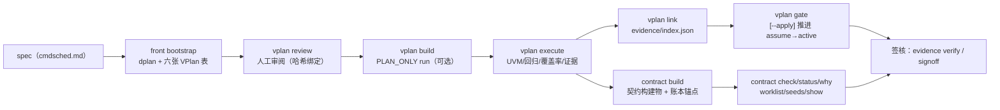

# SignOffAI 契约流程用户指南

> 面向：用 SignOffAI 做 IP / 模块验证的工程师（验证工程师、契约 owner、审阅人、CI 维护者）。
>
> 本文只回答一个问题：**在这个项目里，"契约"是什么、从哪来、怎么被推进、怎么被拿来判定通过与否。**
> 代码结构见 [`ARCHITECTURE.md`](ARCHITECTURE.md)，命令全表见 [`README.md`](README.md)。
>
> 一句话版本：*契约是构建物，不是流程中间件* —— 先固定"该测什么"，
> 再让 EDA 跑出证据，最后由 `gate` 依据证据把 `assume` 推进成 `active`；
> **任何人都不允许通过手改 CSV 状态把契约"改"成通过。**

---

## 0. 三条红线（先读这段）

| # | 红线 | 具体含义 | 违反的后果 |
|---|---|---|---|
| 1 | **状态只由证据推进** | 契约 `assume → active` 只能由 `vagent vplan gate --apply` 依据 run 证据完成；TP 的 `planned → HIT`、case 的 `planned → executed` 同理 | 手改 `data/contract_matrix/*.csv` 的 `status` 列等于**伪造通过**；gate 会重新评估并覆盖，签核也会因缺证据而不认 |
| 2 | **PLAN_ONLY 不可签核** | `vplan build` / `verify <vplan_project>` 只产出规划 IR（TP/Case/契约），不跑 EDA、不产生 `signoff_evidence/` | 拿 PLAN_ONLY 的 run 去签核，会被证据校验直接拒绝 |
| 3 | **没有证据不冒充通过** | 每轮 run 都必须有 `vlog` / `vsim` 证据；`None ≠ False`，"判不了"不能写"判不过"，更不能写成"通过" | 缺证据的契约保持 `assume`；缺资产的组在 Case View 里标黄/红，不会折成绿 |

---

## 1. "契约"在这个项目里指四种不同的东西

同一个词在四个载体上出现，**不是同一个实体**，混用是新人最常见的错误：

| 载体 | 内容 | 谁产生 | 落在哪 | 回答的问题 |
|---|---|---|---|---|
| **① dplan**（设计/模型契约） | `design_name / interfaces / registers / features / model_contract` | `front` executor 从 spec 抽取（确定性解析打底，LLM 覆盖） | `<run>/inputs/dplan/`（CSV/HTML/MD 为主，JSON 只作 sidecar）+ `<run>/contract/dplan_map.json` | **RTL 与参考模型怎么实现** |
| **② VPlan spec 契约矩阵（`C-*`）** | 13 列固定表：`contract_id / class / object / description / source_ref / owner / p_level / check_method / check_artifact / gate / status / assumption / remark` | 人工维护 + LLM bootstrap 草稿 + 人工审阅 | `specs/<module>/data/contract_matrix/*.csv`（权威源）；抽取候选在 `docs/specs/*_contracts.csv` | **该验证什么、验收依据是什么** |
| **③ Case IR 四集合契约** | `groups / sva / scb / constraints`（空集合也必须显式写 `not_applicable` 原因） | 由 **TP IR 反聚合**（`case_ir/contract.py`），**不手写** | `<run>/coverage/case_ir.json`；`C-*` 引用保存在 `feats` 字段 | **这条用例用什么证明自己** |
| **④ 契约构建物（OS v3）** | `contract.yaml`（L1）+ `obligations.json`（L2，一条义务 = 一个必须清偿的证明）+ `contract_manifest.json`（哈希/生成器/输入 sha） | `vagent contract build`（或 `verify` 内自动编译） | `<run>/contract/` | **每一条义务现在是什么状态、还差什么** |

另外还有 **⑤ IP 发布契约（`ip_release_v1`）**：IP 团队与 SoC 团队之间的供应方/消费方契约，
不属于单模块验证流程，详见 `ARCHITECTURE.md` §1.3。本文只在第 9 节提边界。

> ② 与 ③ 的关系：`C-*` 是**计划层**的契约（人要证明什么），Case IR 是**执行层**的契约
> （用例实际带了哪些组/断言/比对）。两者通过 `feats` → `contract/vplan_map.json` 对齐，
> 不互相复制字段。

---

## 2. 状态机：一页读懂

### 2.1 spec 契约（`C-*`）

```text
                 ┌────────────── 人工/LLM 抽取，未验证 ──────────────┐
                 ▼                                                  │
   [assume] ──gate 依据证据全部满足──► [active] ──证据缺失/漂移──► 仍在 blocked 列表（gate 只升不降）
      │                                                              │
      └────────── 显式豁免（data/exemption.csv + 审批）──► [exempt] ─┘
```

> **gate 只升不降**：`apply_active` 只会写 `active`，不会把已 active 的行改回 `assume`。
> 如果某条契约已是 active、但新 run 证据对不上，它照旧是 active —— 所以要盯
> `gate` 输出里的 `blocked` 列表与 `contract status` 的影子对账，而不是只看状态列。
> 需要降级时属于人工决定（附 remark 与理由），门禁不代替人做这件事。

| 状态 | 含义 | 进入条件 | 注意 |
|---|---|---|---|
| `assume` | 已评审、未验证 | bootstrap 默认；`assumption` 字段必填 | 不是"不测"，是"还没有证据" |
| `active` | 已验证 | 见第 6 节 gate 判据（TP 命中 + 回归 PASS + sv 资产声明 / 环境义务 PROVEN） | 只有 `--apply` 能写，且要求项目先过人工审阅 |
| `exempt` | 豁免 | `data/exemption.csv` + 理由 + 审批人 + 有效期 | gate **不会**自动写 exempt，豁免是人的决定 |

### 2.2 测试点（TP）与用例（case）

| 对象 | 状态词汇 | 来源 |
|---|---|---|
| TP | `planned`（计划）→ `HIT` / `OBSERVED` / `BACKDOOR_HIT`（有证据） | `specs/<module>/docs/specs/*_testpoints.csv`；run 里落 `coverage/tp_matrix.json` |
| case | `planned` → `executed` | `cases/TC_*.yaml`；run 里落 `coverage/case_ir.json` 与逐用例证据 |

**"planned ≠ covered"**：VPlan 计划里的 `planned` 永远只是计划；只有 run 产出了
同一条用例 + 同一次 seed 的完整证据，TP 才算命中、case 才算执行过。

### 2.3 契约构建物（OS v3）的状态词汇

义务状态（`derive()` 推导，词表与 `case_cov` 一致）：

| 状态 | 含义 |
|---|---|
| `PROVEN` | 义务要求的证据全部到位 |
| `PARTIAL` | 只有部分 bin 命中 |
| `MISSING` | 有记录但不满足判据（如 mismatch > 0） |
| `PENDING_BACKEND` | 后端未接（路径证据等），**不是**失败 |
| `NOT_APPLICABLE` | 该证据层不适用于此组（如行为型组无 path 层） |
| `NOT_EXECUTED` | 有契约但没有执行记录 |

清理口径：`{"PROVEN", "NOT_APPLICABLE"}` 才算**清偿**（gate 与 worklist 共用）。

---

## 3. 端到端流程（标准路径）



### Step 0 — 准备一个 spec-first 项目

```text
specs/<module>/
├── cmdsched.md                 # 源 spec（或 docs/specs/cmdsched.md）
├── docs/specs/                 # 人审抽取表（LLM bootstrap 产出，必须人工看）
│   ├── <module>_requirements.csv  <module>_features.csv  <module>_topics.csv
│   ├── <module>_contracts.csv     <module>_testpoints.csv  <module>_cases.csv
│   ├── <module>_interface_ports.csv  <module>_spec_meta.json
├── data/
│   ├── contract_matrix/*.csv   # 权威契约矩阵（C-*，13 列）
│   └── *.csv                   # 执行资产：dimensions/behavior/assertions/scoreboards/
│                               #   config_space/cross_matrix/sub_objects/execution_meta
├── cases/TC_*.yaml             # case 契约（contract_refs 只引用 C-*，不复制字段）
└── rtl/*.sv                    # DUT（执行层必需；`--from-spec` 可让 LLM 生成）
```

只放一个 `cmdsched.md` 也能起步：第一次执行 `vplan build` / `vplan status` 时，
`front` 会自动 bootstrap（`--rebootstrap` 强制重写，覆盖草稿表，但**不会**把任何行标成 active）。

### Step 1 — 从 spec 生成规划输入（bootstrap）

```bash
vagent vplan status specs/npu_sched          # 自动触发 bootstrap 并打印计数/审阅状态
vagent vplan status specs/npu_sched --json   # 机读（含 review 块）
```

bootstrap 做的事（`src/executors/front/vplan/`）：

```text
spec → dplan 契约（design_name / interfaces / registers / features / model_contract）
    → requirements / features / topics / contracts / testpoints / cases 六张表
    → docs/specs/*.csv + data/*.csv + cases/TC_*.yaml（全部 assume / planned）
    → 格式/引用校验（引用悬空、ID 重复、spec 哈希）
```

**产物仍是 `assume` / `planned`**：LLM 抽的模块/接口表如果抽错一个，后面 RTL、UVM、
回归、覆盖率全错 —— 所以必须先进 Step 2。

### Step 2 — 人工审阅（硬门禁）

```bash
# 审阅 docs/specs、data、cases 三块输入，记录三块目录的 sha256
vagent vplan review specs/npu_sched --by <你的名字> [--note "接口表已核对"]

# CI：未审阅/已过期 → 退出码 1
vagent vplan review specs/npu_sched --check
```

纪律：

- 审阅记录写入 `specs/<module>/docs/specs/<module>_review.json`，内容是**哈希**；
- 审阅后**任何一处文件被改**（哪怕只改一个注释）→ 审阅自动过期，必须重新 review；
- `vplan execute`（非 dry-run）与 `vplan gate --apply` 都会拒绝未审阅/过期的项目；
- 开发调试有逃生口：`vplan execute --allow-unreviewed` 或环境变量
  `SIGNOFFAI_ALLOW_UNREVIEWED=1`（会打 warning，**不要用在正式签核**）。

### Step 3 — 规划 run（可选，`PLAN_ONLY`）

```bash
vagent vplan build specs/npu_sched -o output_vplan_npu_sched
# 等价：vagent verify specs/npu_sched -o output_vplan_npu_sched
```

产出与正常 run 同位置的 IR：

```text
<run>/coverage/testpoints.yaml|json      # TP IR（planned）
<run>/coverage/case_ir.json              # Case IR（四集合；C-* 在 feats）
<run>/coverage/methodology.json          # 阶段/计数/输入/IR sha256
<run>/contract/contract.yaml             # 契约构建物（L1）
<run>/contract/obligations.json          # 义务（L2）
<run>/contract/contract_manifest.json    # 契约哈希 + 输入 sha
<run>/contract/plan_link.yaml            # C-* ↔ TP ↔ case 的 sidecar
<run>/docs/manifest.json                 # origin=vplan / status=PLANNED / execution=PLAN_ONLY
```

**没有** `report.json` / `signoff_evidence/`，**不可签核**。

### Step 4 — 执行（唯一产生真实证据的步骤）

```bash
# 先看输入与等价命令，不跑 EDA
vagent vplan execute specs/npu_sched --dry-run

# 实跑（需要 QuestaSim 在 PATH）
vagent vplan execute specs/npu_sched -o output_vplan_npu_sched \
  --max-rounds 1 --sim-mode cov [--low-memory]

# 从 spec 生成 RTL（无现成 rtl/ 时）
vagent vplan execute specs/npu_sched --from-spec ...
```

执行层做的事：

1. 把项目挂到 `<run>/inputs/vplan/`（run 的唯一输入，不再依赖项目目录的临时产物）；
2. 用 `rtl/` + `data/*.csv` + `cases/TC_*.yaml` 在内存里投影运行期模型；
3. 走现有 verify 内核（UVM 生成 → 回归 → 覆盖率 → TP 矩阵 → Case 证据）；
4. 生成期同时落 `<run>/sv/`（VPlan UVM 布局，`--uvm-layout legacy` 可关）；
5. 收尾写 `contract/plan_link.yaml`（C-* ↔ TP ↔ case）与 `docs/vplan_source.json`。

补整理 / 核对已有 run：

```bash
vagent vplan package-assets <run>          # 按 sv/ 布局整理资产并登记 asset_registry.csv
vagent vplan scan-assets <run> --check     # 锚点扫描与登记表核对，不一致 exit 1
vagent vplan clean-layout <run> --apply    # 清理顶层 legacy 目录（默认 dry-run）
```

> **执行完不会自动把 `assume` 改成 `active`。** 状态推进只发生在 Step 6 的 gate。

### Step 5 — 链接证据索引

```bash
vagent vplan link specs/npu_sched <run>
```

- 把 run 记进 `specs/<module>/evidence/index.json`（同 run_id 覆盖旧条目）；
- 为老 run 补写 `contract/vplan_map.json`（确定性投影，不改契约哈希）；
- 同时把 VPlan 契约结构物化到 `<run>/inputs/vplan/`。

这是 gate 的输入来源：**没 link 的 run，gate 看不见**。

### Step 6 — 契约推进（gate）

```bash
# 只看评估结果（不改文件；不要求审阅）
vagent vplan gate specs/npu_sched

# 按证据把 eligible 的 assume 写成 active（要求项目已人工审阅）
vagent vplan gate specs/npu_sched --apply

vagent vplan gate specs/npu_sched --json   # 机读摘要（CI 用）
```

gate 只看 run 产物、不跑 EDA。**全部条件满足才 eligible**，任一条缺都保持 `assume`：

**口径 A（TP/case 证据，未映射 `vplan_map.json` 的 run 走这条）**

1. run 已 link，且 `regression_stages.json` 为 `PASS`；
2. 契约映射到的 TP 全部 `HIT` / `OBSERVED` / `BACKDOOR_HIT`；
3. `sv/asset_registry.csv` 至少有一个资产声明了该 `C-*`。

**口径 B（环境契约义务，run 里有 `contract/vplan_map.json` 时优先）**

1. 映射到的 `OBL-*` 全部 `PROVEN` / `NOT_APPLICABLE`（由 `contract.derive` 从账本推导）；
2. 回归 `PASS`；
3. `sv/asset_registry.csv` 声明了该 `C-*`。

注意：

- 投影映射粒度是 **case**：一个 `C-*` 被 case 引用，就要求该 case 的**全部**义务清偿
  （宁严勿宽，不拿一个组的命中替整条契约背书）；
- `--apply` 只改 `status`，并在 `remark` 追加 `gate: active from <run_id>`；
  **不会**自动 `exempt`，也不会新增/删除契约行；
- 只要还有任何一条契约不是 `active`，命令以 **exit 1** 结束（CI 可把"还有 assume"当失败）。

### Step 7 — 契约构建物与账本锚点

`vplan execute` / `verify` 会写 Case IR；如果 run 里还没有契约构建物（或你换了
case 模型想重建），用：

```bash
# 从 run 里的 coverage/case_ir.json 编译（推荐先跑过 verify / execute）
vagent contract build --run output_xxx

# 没有 case_ir 时，用 --vplan 现场从项目投影 case_ir
vagent contract build --run output_xxx --vplan specs/npu_sched
```

产出（`<run>/contract/`）：

| 文件 | 内容 |
|---|---|
| `contract.yaml` | L1 契约（`contract_v2`，带规范哈希 `hash`） |
| `obligations.json` | L2 义务（`obligation_v1`），一条义务 = 一个必须清偿的证明 |
| `contract_manifest.json` | `contract_hash` + 生成器版本 + `case_ir` sha256（漂移检测锚点） |
| `vplan_map.json` | `C-*` → case / `OBL-*` / 资产的映射（sidecar，不参与契约哈希） |

**两条硬约束在类型层就钉住**：

1. 义务的谓词只能引用 `FACT_TYPES` 里登记过的事实类型（规则不能凭空造事实）；
2. 每条事实都带 `contract_hash` —— 事实只对**产生它的那一版契约**有效。

`contract build` 还会在**证据产生之前**把契约版本冻结进账本（`evidence/ledger.jsonl`
里的 `contract_anchor` 事实）。之后 AI 再改 case 模型/重建契约，旧事实不会静默对上新版：
它们被标为 stale，不参与推导。

### Step 8 — 核对、解释、重跑清单

```bash
# 契约自洽：文件在、哈希对得上、账本锚点一致、义务数与清单一致
vagent contract check --run <run>

# OS 视图：契约 / 账本 head / case 对账 / TP 对账 / 未清偿义务
vagent contract status --run <run>

# 一条义务为什么是这个状态：谓词 → 事实 → 状态 → 还差什么（含建议的 test@seed）
vagent contract why OBL-GROUP-CASE-<...>-FUNCTIONAL --run <run>

# 未清偿义务 → 需要重跑的回归 test 清单（义务驱动执行，不跑全量）
vagent contract worklist --run <run>

# 哪个 seed 清偿了哪些义务（可复现证据）
vagent contract seeds --run <run>

# 按 case 归并查看契约与义务
vagent contract show --run <run>
```

纪律：

- **算不出来就跑全量**：契约缺失、`regression.yaml` 缺失、账本为空时，`worklist`
  返回 `available: false`，绝不静默缩小范围；映射不到回归 test 的义务进
  `skipped_no_test`，不静默丢；
- `status` 里的 `case_shadow` / `tp_shadow` 是**影子对账**：新链路（契约→义务→事实
  →推导）与旧链路（`case_cov` / `tp_cov_evidence`）必须一致，`mismatched` 应为 0；
- `stale_facts` 是契约换版前采集的事实条数 —— 它们只作历史，不参与推导。

### Step 9 — 签核

```bash
vagent evidence verify  <run>/signoff_evidence
vagent evidence replay  <run>/signoff_evidence
vagent evidence compare <pkg-a> <pkg-b>
```

判据（详见 `ARCHITECTURE.md` §9.12）：

- 证据包必须含 `contract/contract_manifest.json`、账本锚点、Case View 证据段；
- TP 签核要求"同一条用例 + 同一次 seed"的完整证据；CELL 绿要求
  functional + timing + data（路径型再 + path）逐层 `PROVEN`；
- `PASS_WITH_CAVEAT` 的 caveat 码在 `caveats.json`/`report.json` 里，CI 用
  `--strict-semantic` 一键当失败处理。

---

## 4. 命令与产物速查

| 命令 | 作用 | 主要产物 / 判据 |
|---|---|---|
| `vagent vplan status <project>` | 只读计数 + 审阅状态 | counts / `review` 块 |
| `vagent vplan review <project> --by <n>` | 人工审阅（哈希绑定） | `docs/specs/<module>_review.json` |
| `vagent vplan review <project> --check` | CI 检查审阅 | 未审阅 → exit 1 |
| `vagent vplan build <project> -o <run>` | PLAN_ONLY 规划 run | `coverage/*IR` + `contract/*`，不可签核 |
| `vagent vplan execute <project> -o <run>` | 执行（需 EDA） | UVM/回归/覆盖率/证据 + `plan_link.yaml` |
| `vagent vplan package-assets <run>` | 整理 sv/ 布局 | `sv/asset_registry.csv`（全 candidate） |
| `vagent vplan scan-assets <run> --check` | 锚点与登记核对 | 不一致 exit 1 |
| `vagent vplan link <project> <run>` | 证据索引 | `evidence/index.json` |
| `vagent vplan gate <project> [--apply]` | 契约推进 | 写 `data/contract_matrix/*.csv` 的 `status` |
| `vagent contract build --run <run>` | 编译契约构建物 | `contract/` 三件套 + 账本锚点 |
| `vagent contract check --run <run>` | 契约自洽校验 | exit 1 on failure |
| `vagent contract status --run <run>` | OS 视图 | 契约/账本/影子对账/义务 |
| `vagent contract why <OBL> --run <run>` | 单条义务解释 | 谓词/事实/缺口/建议 test@seed |
| `vagent contract worklist --run <run>` | 未清偿义务 → test 清单 | `status/worklist.json` |
| `vagent contract seeds --run <run>` | 种子索引 | `status/seed_index.json` |
| `vagent contract show --run <run>` | 按 case 归并 | 契约 + 义务摘要 |
| `vagent evidence verify <pkg>` | 证据包离线校验 | exit 1 on failure |

---

## 5. 契约变更与漂移管理

| 场景 | 会发生什么 | 正确做法 |
|---|---|---|
| 改了 case 模型 / `data/*.csv`，重建契约 | `contract_hash` 变；旧事实标 stale；旧证据对不上 | 重新 `vplan execute` 采集证据，再 `gate --apply` |
| 直接改 `contract_matrix/*.csv` 的 `status=active` | gate 会按证据重新评估并**覆盖**；签核不认 | 不要手改；用 `gate --apply` |
| 审阅后改了 docs/specs / data / cases | 审阅哈希变化 → `stale`，执行被拒 | 重新 `vplan review` |
| 改了 spec 但没改 spec_meta 哈希 | `spec_hash` 不匹配，项目加载失败 | 更新 `docs/specs/*_spec_meta.json` 的哈希后重跑 bootstrap/校验 |
| 契约锚点与当前契约不一致（`contract_anchor_mismatch`） | `contract check` 失败 | 契约在证据产生后被改过：重新 build + 重跑，或开新 run |
| 影子对账有差异（`mismatched > 0`） | `contract status` 显示"有差异" | 不能签核；先查 `status/shadow_report.json` 定位哪条义务/证据不一致 |

关键不变量：

- **契约是构建物**：契约生成后不再随流程漂；`ops` 先校验契约存在且哈希自洽才开跑；
- **事实带版本**：每条事实记 `contract_hash`，`derive` 只采信当前版本的 OBSERVED /
  HUMAN_DECISION / DERIVED 事实（HYPOTHESIS / TOOL_RECEIPT 不参与判定）；
- **账本是只追加的哈希链**：`verify_chain` 可离线验证，篡改会断链。

---

## 6. 常见问题排查

| 现象 | 原因 | 处理 |
|---|---|---|
| `没有 case IR：先跑 verify，或用 --vplan 给项目根` | run 里没有 `coverage/case_ir.json`，也没给项目 | 先 `verify`/`vplan execute`，或 `contract build --vplan specs/<m>` |
| `契约不可用: contract_missing` | 还没编译契约 | `vagent contract build --run <run>` |
| `契约不可用: contract_hash_mismatch` | `contract.yaml` 被手改/被重写 | 用 `contract build` 重建，别手改构建物 |
| `契约不可用: contract_anchor_mismatch` | 契约在锚定后被改 | 见上表"契约变更" |
| `契约不可用: contract_unreadable` | `contract.yaml` 损坏 | 重建 |
| gate 显示 `regression=...` 不是 PASS | 回归没通过 / 没有回归结果 | 看 `<run>/regression_stages.json`，修用例或重跑 |
| gate 显示 `TP not hit: ...` | 映射的 TP 没有命中 | 补用例/补激励后重跑；观测型 TP 需由其他用例 checkpoint 观测 |
| gate 显示 `no sv/ asset declares this contract` | `sv/asset_registry.csv` 没声明该 C-* | `vplan package-assets` 后核对锚点，或补资产 |
| gate 显示 `vplan map has no environment obligations` | `vplan_map.json` 里该 C-* 没有可映射义务 | 检查 case 的 `feats` 是否引用了该 C-* |
| gate 显示 `obligation not proven: OBL-...=MISSING` | 义务缺证据 | `contract why <OBL>` 看缺口，按建议补跑 |
| `VPlan 项目未通过人工审阅` | 没 review / 改过文件 | `vplan review <project> --by <n>`（或开发期 `--allow-unreviewed`） |
| `worklist` 返回 `available: false` | 契约/回归 YAML 缺失或账本为空 | 跑全量回归；补齐契约构建物 |
| `evidence/index.json` 为空 | 没 link 过 run | `vplan link <project> <run>` |
| `vplan gate --apply` 后仍有 assume | 有契约不满足条件 | 看 `gate --json` 的 `blocked_examples` 逐条修 |

---

## 7. 判据词汇表（供 CI 与人工对齐）

| 词汇 | 值 | 含义 |
|---|---|---|
| 契约状态 | `assume` / `active` / `exempt` | 未验证 / 已验证 / 显式豁免 |
| TP 命中态 | `HIT` / `OBSERVED` / `BACKDOOR_HIT` | 激励命中 / 观测命中 / 后门命中 |
| 义务状态 | `PROVEN` / `PARTIAL` / `MISSING` / `PENDING_BACKEND` / `NOT_APPLICABLE` / `NOT_EXECUTED` | 见 §2.3 |
| 清偿口径 | `PROVEN` + `NOT_APPLICABLE` | gate 与 worklist 共用 |
| 事实类别 | `OBSERVED` / `HUMAN_DECISION` / `DERIVED`（参与判定）| `HYPOTHESIS` / `TOOL_RECEIPT` 不参与 |
| 证据层 | `functional` / `timing` / `data` / `path` | 由该组 TP 的实现类型决定 `required_layers` |
| 影子对账 | `case_shadow.mismatched` / `tp_shadow.mismatched` | 应为 0；非 0 不能签核 |

---

## 8. 边界与"不做"清单

- **不手写 SV**：验证资产由内核生成后经 `vplan package-assets` 整理布局，不在
  `specs/` 里手写（布局规范见 `specs/npu_sched_vlan/docs/appendix/X01_asset_layout.md`）；
- **PLAN_ONLY 不产生 `report.json` / `signoff_evidence/`**：不可签核，`status` 也不会自动升级；
- **不拿 SoC 覆盖率冒充 IP 覆盖率**：两条业务线覆盖率分账；IP 发布包
  （`ip_release_v1`）的 `coverage` 在独立 IP TB 落地前是
  `{measured: false, functional_pct: null}` —— `None ≠ 0`；
- **异常/缺失一律显式**：没有 EDA 证据的 stage 标 `BLOCKED_EDA_MISSING` /
  `EDA_MISSING`，不冒充 pass；
- **LLM 只做点状抽取**：所有模型调用走 `llm_call.call_llm`，抽取结果一律
  `assume`/`planned`，必须人工审阅后才能进执行。

---

## 9. 代码落点索引（想改/想查时用）

| 关注点 | 文件 |
|---|---|
| VPlan 契约/证据门禁 | `src/layers/l3_decision/vplan/evidence.py`（`evaluate` / `apply_active` / `link_run`） |
| 人工审阅门 | `src/layers/l3_decision/vplan/review.py` |
| VPlan → 内核 IR 投影 | `src/layers/l3_decision/vplan/build.py`、`runner.py` |
| spec → dplan / VPlan bootstrap | `src/executors/front/vplan/`、`src/executors/front/dplan/` |
| dplan ↔ VPlan 对齐 | `src/layers/l3_decision/dplan.py` |
| Case IR 四集合（由 TP 反聚合） | `src/layers/l3_decision/case_ir/contract.py` |
| 契约模型 / 义务编译器 | `src/layers/l3_decision/contract/contract_model.py`、`compiler.py` |
| 契约构建物与清单 | `src/layers/l3_decision/contract/build.py` |
| 推导（唯一判定实现） | `src/layers/l3_decision/contract/derive.py` |
| 账本（追加 / 哈希链 / 锚点） | `src/layers/l3_decision/contract/ledger.py` |
| 影子对账（M0） | `src/layers/l3_decision/contract/shadow.py`、`tp_shadow.py` |
| 解释 / 状态视图 | `src/layers/l3_decision/contract/explain.py` |
| 重跑清单 / 种子索引 | `src/layers/l3_decision/contract/worklist.py`、`seeds.py` |
| CLI（`vplan` / `contract`） | `src/cli/cmd_vplan.py`、`src/cli/cmd_contract.py` |
| 方法学（Stage 契约 / 注册表 / 流水线） | `src/layers/l3_decision/vplan/runtime/framework/README.md` |
| 规划层/执行层边界说明 | `specs/npu_sched_vlan/README.md`（示例项目） |
