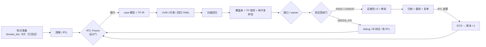

# SignOffAI 工程落地流程

> **思想来源**：`domain_doc/` —— 共用四域 + 两翼、两张出档门、五层知识、
> 一个知识点一个家、卡片状态机。
>
> **本文把这套方法学落到本仓库的工程动作上**：每一步谁做、产出什么、
> 哪道门放行、用哪个命令、证据落在哪。

---

## 0. 一句话

> **先用知识卡把“怎么做”定下来，再用测试点 IR 把“测什么”定下来，
> 最后用证据包把“凭什么签”定下来。**
>
> 三段都遵守同一条铁律：**一个事实只有一个家**（`domain_doc` 叫“一个知识点一个家”，
> 代码里叫 `tp_id` / 单一 manifest / 主库）。

---

## 1. 从知识库继承的五条原则

| 知识库原则 | 工程落点 |
|---|---|
| **两张出档门**：RTL Freeze（基线） + 验证签核（结论） | 设计门看 RTL 基线/静态检查/可综合；验证门看覆盖率/回归/证据包 |
| **一个知识点一个家** | `tp_id` 是测试点唯一主键；主库是 `database/ic_verification.db`；签核结论只在 `signoff_evidence/manifest.json` |
| **五层**：资源/知识/方法/实践/洞察 | 规格 → case 模型 → 测试点 IR → 回归实践 → 复盘/经验库 |
| **十种卡 + frontmatter 契约** | YAML/JSON schema + `signoff_policy.yaml` + `signoff_evidence_v2` |
| **状态机**：草稿→评审中→已验证→过期 | 模型 `draft→generated→verified`；RTL `baseline→ECO`；签核 `READY/PASS_WITH_CAVEAT/NEEDS_FIX` |

---

### 1.1 两种 profile（先选口径，再谈门禁）

同一套方法学，**个人级**与**流片级**不能共用一张阈值表。口径写在
`specs/<module>/signoff_policy.yaml` 的 `profile:` 字段。

| 判据 | `personal`（本仓库默认） | `tapeout`（团队/流片） |
|---|---|---|
| 回归 | 零失败，日志 `mismatched=0` | 同左 |
| 计划覆盖率 | ≥ 项目 target（如 95%） | ≥ 项目 target，通常 100% 功能口径 |
| TP 矩阵 | 可激励/后门 100%，`UNMAPPED=0` | 同左 + 不可达必须有证明 |
| 断言 | **不要求**（当前流水线不生成 SVA） | Assertion=100%，且每条 pass/fail 都出现过 |
| 形式验证 | 不要求 | 全部属性 PROVEN |
| Lint / CDC / 综合 / DFT / UPF | 只要求 `vlog` + `precheck` | 全部要求，waiver 逐条审批 |
| 证据包 | `verify` + `replay` 通过 | 同左 + 独立环境复核 |
| 审批 | 自审批也要记录 approver + 理由 | 验证负责人 + 设计负责人会签 |
| Waiver | 必须逐条列出并说明理由 | **≤ 2%** 硬阈值 |

> **不要用 tapeout 的 100% 去卡 personal 的 95.23%**，也不要用 personal 的
> “不要求断言”去放行 tapeout —— 两种 profile 的结论不能互相冒充。

### 1.2 知识卡 bootstrap

`domain_doc` 的核心卡当前多为 `草稿`。首轮允许引用草稿卡，但必须：

- 在证据包里记 `knowledge_status: draft`；
- 至少挑 4 张核心卡（RTL Freeze / 验证签核 / 覆盖率收敛 / 种子管理）
  在实际跑过一轮 E2E 后升为 `已验证`；
- **草稿卡不能当作“已证明的方法”**，只能作为“本次选择的依据”。

---

## 2. 总流程



**两道门之间不能反序**：RTL 没冻就签核，签的是移动靶；签核结论只对
`rtl_version_hash` 指向的那一版成立。

---

## 3. 两张门

### 3.1 设计门：RTL Freeze

**触发**：功能开发完成，准备交给验证做正式回归。

| 检查项 | 判据 | 工程证据 |
|---|---|---|
| RTL 完成度 | 无 stub/TODO，模块可 elaborate | `rtl/*.sv`、`vlog` 通过 |
| 结构预检 | 端口/时钟复位/寄存器偏移无阻断 | `design_arch.precheck` |
| 可综合性 | 无 latch/组合环（按工具能力） | 综合/lint 报告（当前人工补） |
| 基线身份 | 内容哈希 + 版本号 | `database/lineage.db` 的 `rtl_versions` |
| 验证可启动 | TB 能编译、冒烟通过 | `regression_run/loopback/report.json` |
| 文档一致 | 寄存器/接口文档与 RTL 对齐 | `spec.json` / 寄存器表 |

### Freeze 制品（`freeze.json`）

```json
{
  "schema": "rtl_freeze_v1",
  "module": "npu_sched",
  "profile": "personal",
  "rtl_version": {"version_no": 1, "content_hash": "..."},
  "checks": {
    "vlog": {"passed": true},
    "precheck": {"ok": true},
    "loopback_smoke": {"passed": true}
  },
  "waivers": [],
  "approved_by": "human:...",
  "approved_at": "2026-10-24T..."
}
```

`tapeout` profile 还要追加 `lint` / `cdc` / `synthesis` / `dft` / `upf` 段，
每段带报告哈希与 waiver 列表。

**当前代码状态**：
- 已有：`vlog` 门禁、`design_precheck`、`lineage` 自动版本、loopback。
- 待补：显式 `freeze.json` 落盘与门禁（见第 10 节 Phase 1）。在此之前，
  **用 `lineage` 的 `version_no` + `rtl_version_hash` 作为事实基线**，
  并在证据包里标 `freeze_artifact: missing`（不能假装这道门已经走过）。

**放行**：设计负责人；冻结后任何 RTL 改动走 ECO，版本 +1，不覆盖原版本。

### 3.2 验证门：签核

**触发**：回归零失败、覆盖率趋势收敛、种子数达标、未覆盖 bin 有 waiver 或已覆盖。

| 检查项 | `personal` 判据 | `tapeout` 判据 | 工程证据 |
|---|---|---|---|
| 回归 | 所有分级 PASS，日志 `mismatched=0` | 同左 | `regression_stages.json`、`sim_vsim.log` |
| 计划覆盖率 | `plan_pct >= target` | 同左（通常 100% 功能口径） | `sim/coverage/coverage_result.json` |
| TP 矩阵 | 可激励/后门 100%，`UNMAPPED=0` | 同左 + 观测型缺口有证明/waiver | `coverage/tp_matrix.json` |
| 种子多样性 | 分析过即可（`analyzed=true`） | 达到项目规定种子数并收敛 | `coverage/seed_diversity.json` |
| 约束 | 逐条 `backed` + 原因 | 未 backed 必须 waiver | `coverage/constraint_status.json` |
| 参考模型 | `verified` 或显式 `MODEL_UNAVAILABLE` | 必须 `verified` | `models.yaml`、`reference_models` |
| 断言/形式 | 不要求 | Assertion=100%、形式 PROVEN | 断言报告 / 形式报告 |
| 基线 | 引用 `lineage` 基线 | 同左 + Freeze 制品 | `signoff_evidence/manifest.json` |
| 审批 | 审批绑定 evidence 哈希（可自审批） | 双人会签 | `approvals.jsonl` |
| 证据完整性 | `verify` + `replay` 通过 | 同左 + 独立环境复核 | `vagent evidence verify/replay` |

**放行**：验证负责人；设计负责人会签缺口与 waiver。

---

## 4. 八步工程流程

| # | 步骤 | 谁 | 输入 | 输出 / 证据 | 命令 |
|---|---|---|---|---|---|
| 0 | **知识准备** | 方法学组 | `domain_doc` 已验证卡 | 规格约束、方法选择、坑清单 | — |
| 1 | **规格/RTL 基线** | 设计 + DV | spec 或 `--rtl` | `spec.json`、`rtl/*.sv`、`precheck`、lineage 版本 | `vagent verify --rtl <dir>` |
| 2 | **测试点建模** | DV | `casemodel.yaml` | `coverage/testpoints.yaml`、`methodology.json` | `vagent case-model check/analyze` |
| 3 | **激励与约束** | DV | TP IR + 覆盖率模型 | `constraint.yaml`、`env/cons/*`、`regression.yaml` | `vagent verify` 内部 |
| 4 | **分级回归** | DV / CI | regression.yaml | `regression_run/`、`regression_stages.json` | `--no-manual-gate` 或人工门 |
| 5 | **覆盖率归因** | DV | 回归库 | `plan_merged.ucdb`、`tp_matrix.json`、`seed_diversity.json` | 覆盖率阶段 |
| 6 | **签核** | 验证负责人 | 上述证据 | `signoff_evidence/`（v2） | `vagent evidence verify/replay` |
| 7 | **审批/归档** | 经理 | 证据包 | `approvals.jsonl`、基线引用、报告 | `vagent approve` |
| 8 | **复审/ECO** | 设计 + DV | 过期/变更触发 | RTL 版本 +1、卡状态更新 | `vagent lineage` |

---

## 5. 产物与知识卡的对应

| 工程产物 | 对应知识库位置 | 说明 |
|---|---|---|
| `spec.json` / 寄存器表 | `design/01_微架构与RTL编码/` | RTL 该怎么写 |
| `design_arch.precheck` | `design/02_综合_时序_PPA/` | 结构/时序前置判断 |
| `casemodel.yaml` / TP IR | `verify/02_验证方法学/` | 测什么、怎么分解 |
| `constraint.yaml` | `verify/06_项目案例/` 或方法卡 | 本项目的约束取舍 |
| `regression.yaml` / `sim_modes` | `verify/04_工具与脚本/` | 工具怎么跑 |
| `tp_matrix.json` | `verify/07_度量与报告/覆盖率收敛/` | 缺口归因 |
| `seed_diversity.json` | `verify/07_度量与报告/覆盖率收敛/种子管理` | 种子是否有效 |
| `signoff_evidence/` | `verify/07_度量与报告/报告模板/` | 签核证据包 |
| `approvals.jsonl` | `04_治理运营/评审流程.md` | 谁拍的板 |
| `database/lineage.db` | `02_流程与签核/RTL_Freeze.md` | 签的是哪版 RTL |

**跨翼话题按面拆卡**：例如 CDC 设计侧卡在 `design/04_DFT_CDC_安全/`，
验证侧卡在 `verify/02` 或 `verify/04`，互相链接，不互相抄。

---

## 6. 角色与 RACI

| 活动 | 设计负责人 | DV 工程师 | 验证负责人 | 经理 | 方法学组 |
|---|---|---|---|---|---|
| RTL Freeze | **A** | C | C | I | I |
| 测试点建模 | C | **R** | A | I | C |
| 回归执行 | I | **R** | A | I | I |
| 覆盖率归因 | C | **R** | A | I | C |
| Waiver | **A**（设计不可达） | R | **A**（验证侧） | I | I |
| 签核 | C | R | **A** | I | I |
| 知识卡评审 | I | C | C | I | **A** |
| ECO | **A** | C | C | I | I |

`R` 执行、`A` 最终负责、`C` 咨询、`I` 知会。

### 个人 profile 的角色映射

| 团队角色 | personal profile |
|---|---|
| 设计负责人 | 同一人的“设计视角”审批（`approver` 照实记录） |
| 验证负责人 | 同一人的“验证视角”审批 |
| 经理 | 同一人的最终放行 |
| 方法学组 | 知识卡维护者（仍需 `approver` + 理由） |

**不是取消审批，而是把“同一人”显式记录**：`approvals.jsonl` 里 approver 相同
没关系，关键是有记录、有理由、绑定证据哈希。`tapeout` profile 才强制双人会签。

---

## 7. 状态机

| 对象 | 状态 |
|---|---|
| **知识卡** | 草稿 → 评审中 → 已验证 → 过期（不删卡；保留“以前为什么这么做”） |
| **RTL 基线** | 开发 → Freeze → ECO（版本 +1） |
| **参考模型** | `draft` → `generated` → `verified`（只有 verified 可自动选中） |
| **签核** | `READY` / `PASS_WITH_CAVEAT` / `NEEDS_FIX` → `APPROVED` / `CONDITIONAL` / `REJECTED` |

**状态不是标签，是门禁**：`verified` 才可被选为 expected；`verified` 知识卡才可作为流程依据；
`PASS_WITH_CAVEAT` 必须带可接受的 caveat 与审批人。

---

## 8. Waiver 与 caveat

### 8.1 覆盖率 waiver

统一落在证据包 `verdict/waivers.json`：

```json
{
  "schema": "coverage_waiver_v1",
  "profile": "personal",
  "total_bins": 4360,
  "waived_bins": 12,
  "waiver_ratio": 0.00275,
  "entries": [
    {
      "id": "W-001",
      "bin": "cg_fifo::bin_dead_code",
      "reason": "架构不可达",
      "evidence": "freeze.json#dft.unreachable 或形式报告",
      "approved_by": "human:...",
      "approved_at": "2026-10-24T..."
    }
  ]
}
```

- `personal`：waiver 必须逐条列出并说明理由；比例只做提示，不做硬阈值；
- `tapeout`：**≤ 2% 硬阈值**，超过即 `NEEDS_FIX`；
- “架构不可达”必须有可达性证据（形式/结构分析），不能写“测了很久没测到”；
- waiver 的 `approved_by` 要进 `approvals.jsonl`，与证据哈希绑定。

### 8.2 签核 caveat

代码里的 caveat 码（`CONSTRAINT_PARTIAL`、`TP_MISSED`、`MODEL_UNAVAILABLE` 等）
必须有：

1. 机器码；
2. 人类可读原因；
3. 建议动作；
4. 若接受：审批人 + 理由（`signoff_policy.yaml`）。

**未接受的 caveat 参与判定；已接受的只记录，不参与判定。**

---

## 9. 一个事实只有一个家

| 事实 | 唯一家 | 不允许 |
|---|---|---|
| 一条测试点是什么 | `coverage/testpoints.yaml`（`tp_id`） | 从 test 名反推、从报告里猜 |
| 覆盖仓是否命中 | `coverage/tp_matrix.json` | 从百分比反推单条状态 |
| 签核结论 | `signoff_evidence/manifest.json` | 只看 `report.json` 的一句 verdict |
| RTL 是哪一版 | `database/lineage.db` + `rtl_version_hash` | 用目录名/日期当版本 |
| 回归历史 | 主库 `runs` / `task_details` | 再维护一份 `regression_trend.db` |
| 审批记录 | `approvals.jsonl`（append-only） | 覆盖写单文件 |
| 模块签核策略 | `specs/<module>/signoff_policy.yaml` | 把策略写死在代码/报告文案里 |

### 9.1 流程度量（判断“这套方法学有没有真的在跑”）

| 指标 | 目标 | 数据源 |
|---|---|---|
| Freeze 制品覆盖率 | 100% 签核 run 有 `freeze.json` 或显式 `missing` | 证据包 |
| 证据自校验通过率 | 100% | `vagent evidence verify` |
| TP `UNMAPPED` | 0 | `tp_matrix.json` |
| Waiver 比例 | personal：仅记录；tapeout：≤2% | `waivers.json` |
| Caveat 接受率 | 有审批人 + 理由的才计数 | `signoff_policy.yaml` / `approvals.jsonl` |
| 签核周期 | 回归完成 → 签核完成的时间 | `report.json` 时间戳 |
| 已验证知识卡占比 | 逐季度上升 | `domain_doc` frontmatter |

---

## 10. 落地路线

### Phase 1：把“门”变成制品（当前优先）

1. **显式 `RTL Freeze` 制品**：`freeze.json`（版本、hash、lint/CDC/综合报告引用、会签）。
2. **Waiver 表进证据包**：`verdict/waivers.json` + 2% 阈值校验。
3. **知识卡状态门槛**：流程引用的卡必须是 `已验证`；`草稿` 只能作参考。
4. **模型 verified 化**：至少一个真实 TLM 1.0 模型走完 `draft→verified`。

### Phase 2：把“知识”接进生成

5. `domain_doc` 的卡 → spec/constraint 的**引用**（不复制正文）。
6. 缺口归因输出“该看哪张卡”，而不是只给一个 bin 名。
7. 复盘自动生成 `verify/06_项目案例/` 的草稿卡（人评审后才算数）。

### Phase 3：把“治理”变成默认

8. 知识卡过期触发签核复审（工具/标准/方法变更）。
9. 签核证据包按 knowledge id 列出“本次依据的已验证卡”。
10. 跨项目基线对比：同一模块不同 RTL 版本的证据包 diff。

---

## 11. 反模式（来自知识库，落到代码）

| 反模式 | 工程表现 | 正确做法 |
|---|---|---|
| 覆盖率 100% 就签 | waiver 换来的 100% | 看 TP 矩阵 + waiver 表 + 断言 pass/fail |
| 平台期当收敛 | 激励打不到，不是覆盖完了 | 看 `seed_diversity` 与缺口归因 |
| Waiver 无上限 | 把“没测到”改成“不用测” | ≤2% + 可达性证据 |
| 没冻 RTL 就签 | 签的是移动靶 | 先过 RTL Freeze，记录 `rtl_version_hash` |
| 两处各说一套 | 报告/证据/DB 漂移 | 单一 `tp_id` / 单一 manifest / 单一主库 |
| 知识卡“已验证”但没人用过 | 读完能判断 ≠ 照着能做 | 状态按“有人按它做过一遍”升级 |

---

## 12. 验收清单

一次完整工程闭环应能回答：

- [ ] 本次用的是 `personal` 还是 `tapeout` profile？阈值与它一致吗？
- [ ] 有 `freeze.json` 吗？没有的话，证据包里是否显式标了 `freeze_artifact: missing`？
- [ ] waiver 是否落在 `verdict/waivers.json`？tapeout 是否 ≤2%？
- [ ] 这次依据的是哪几条**已验证**知识卡？草稿卡是否标了 `knowledge_status: draft`？
- [ ] RTL 的 baseline 版本/hash 是什么？有没有 Freeze 制品？
- [ ] 每条 TP 的 `tp_id`、覆盖仓、命中状态在哪？
- [ ] 计划覆盖率与单测覆盖率分别是多少？
- [ ] 未命中/未观测的 bin 有哪些？waiver 理由与审批人是谁？
- [ ] 约束是否逐条有 `backed` 与原因？
- [ ] 种子是否真的改变了分布？
- [ ] 参考模型是否 `verified`？缺模型是否已显式记 `MODEL_UNAVAILABLE`？
- [ ] 证据包 `package_hash` 是否能离线校验/回放？
- [ ] 审批是否绑定证据哈希？谁、何时、为什么？
- [ ] RTL 变更是否走 ECO 并升版本？

> 这 11 条都能答上来，才配叫“可复现、可审计、可治理的签核”；
> 否则只是“跑完了”。
