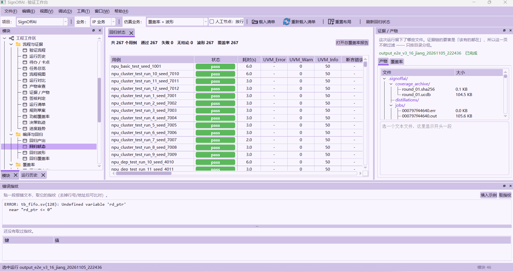

# SignOffAI

[](https://github.com/jiangqingliu88/langchaingraph_cdv/actions/workflows/ci.yml)
[](LICENSE)
[](pyproject.toml)
[](CONTRIBUTING.md)

**An AI-native, auditable IC functional verification and sign-off platform.**
Spec → RTL → UVM → regression → coverage → evidence-backed sign-off, orchestrated
as a deterministic LangGraph closed loop. CLI-first, with an optional PySide6
desktop workbench.

**[简体中文](#signoffai--ic-验证垂直领域智能体) · [Architecture](ARCHITECTURE.md) · [Contributing](CONTRIBUTING.md) · [Security](SECURITY.md) · [Changelog](CHANGELOG.md)**

---

## Overview

SignOffAI turns functional verification from a pile of manual steps into a
reproducible, auditable engineering pipeline. LLMs are used sparingly and only
where they add value (drafting small RTL blocks, triaging failures); process
control, tool selection, and pass/fail decisions stay deterministic and
EDA-verified.

**Three non-negotiable rules**

1. **The EDA tool is the source of truth.** Generated RTL must compile with
   `vlog` (exit 0/1). Failures are loud and are never silently downgraded to a
   "pass".
2. **Coverage databases are version-pinned.** Each round's UCDB is hashed and
   archived so results can be reproduced and compared.
3. **LLMs never read raw simulation databases.** Gap analysis consumes a small
   semantic summary instead of gigabytes of UCDB.

### Highlights

- **LangGraph closed loop** — 24-node verification graph on a five-layer engine
  (L1 infrastructure → L5 evolution), with human approval gates.
- **Test-point IR** — a stable `tp_id` axis that links case models, stimulus,
  constraints, coverage, regression levels, and sign-off evidence.
- **UVM generation** — interfaces, loopbacks, drivers, monitors, sequencers,
  scoreboards, and tests generated from templates, gated by the compiler.
- **Staged regression** — p0–p3 filtering, coverage merge/archive, and
  reproducible seeds.
- **Evidence chain v2** — contract-level sign-off artifacts with manifests and
  hashes for audit.
- **Reference SoC** — `examples/open_npu_soc/` runs NICE → DMA → banked SRAM →
  INT8 GEMM → IRQ → Python golden comparison on real RTL.
- **Desktop workbench** — a PySide6 shell over run artifacts: regression status,
  evidence/artifact browser, waveform and coverage drill-down, error
  fingerprinting, and the human-approval gate. See
  [可视化](#可视化可选pyside6-桌面工作台).
- **VPlan planning layer** — spec-first projects (`docs/specs` extraction CSVs +
  authoritative `C-*` contract matrix) feed the kernel directly, without a
  case-model YAML. Plan-only runs are explicitly marked `PLAN_ONLY`.

## Quick start

```bash
python -m venv venv && source venv/bin/activate   # Windows: venv\Scripts\activate
pip install -e ".[dev]"                            # add ",gui" for the workbench
cp .env.example .env                               # optional; add your LLM key

# Full closed loop on the bundled APB UART spec
python -m src.cli.commands verify specs/apb_uart/apb_uart_spec.md --json

# Optional: compile/simulate the reference SoC (requires QuestaSim on PATH)
python -m src.cli.commands soc check examples/open_npu_soc
python -m src.cli.commands soc run examples/open_npu_soc --output output_soc_v01
```

Without an LLM key, deterministic/template paths still run and LLM-dependent
steps fail honestly. Without QuestaSim, EDA-dependent stages report
`BLOCKED_EDA_MISSING` instead of a fake pass.

## Repository layout

| Path | Purpose |
|---|---|
| `src/executors/` | Eight stage executors (front, design, model, verify, ops, coverage, debug, audit) |
| `src/layers/` | Five-layer engine (L1 infrastructure → L5 evolution) |
| `src/tools/` | Domain tools: generation, checking, humanview, common, … |
| `src/cli/` | The `vagent` command-line interface |
| `src/workbench/` | Optional PySide6 desktop workbench |
| `config/` | YAML configuration, schemas, and architecture guards |
| `specs/`, `examples/` | Sample specs and the Open NPU SoC reference project |
| `tests/` | pytest suites |

## Documentation

- [ARCHITECTURE.md](ARCHITECTURE.md) — five layers, 24-node graph, executors, evidence chain
- [docs/design/](docs/design/) — design notes and implementation plans
- [docs/notes/](docs/notes/) — working notes (data model, optimization, differentiation)
- [examples/open_npu_soc/README.md](examples/open_npu_soc/README.md) — end-to-end reference SoC
- `src/layers/l3_decision/vplan/runtime/framework/README.md` — methodology framework (stage contracts, test-point IR)
- `src/layers/l3_decision/vplan/runtime/readme.md` — functional coverage methodology

## Contributing

Issues and pull requests are welcome. Please read [CONTRIBUTING.md](CONTRIBUTING.md)
and [CODE_OF_CONDUCT.md](CODE_OF_CONDUCT.md) first. Report security issues
privately as described in [SECURITY.md](SECURITY.md).

## License

Apache License 2.0 — see [LICENSE](LICENSE). Third-party components retain their
own licenses; see [NOTICE](NOTICE).

---

# SignOffAI — IC 验证垂直领域智能体

**规格 → RTL → UVM → 回归 → 覆盖率 → 签核** 的 AI 验证闭环工具。个人级 CLI，**无 Web 前端**（`python -m src.cli.commands` 交付全部功能）。

> **架构**：**8 个阶段执行器（executor）** 编排在 **LangGraph 闭环图**（24 节点）上，
> 坐落在**五层引擎**（L1 基础设施 / L2 编排 / L3 决策 / L4 记忆 / L5 进化）之上。
>
> 关键文档：
> - **[`ARCHITECTURE.md`](ARCHITECTURE.md)** —— **当前代码架构**（五层 / 24 节点 / 执行器 / 工具协议 / 证据链 / 扩展点）
> - **[`docs/design/`](docs/design/)** —— 设计文档与实施计划（架构迁移 / 契约 / 覆盖率 / 证据链）
> - **[`docs/notes/`](docs/notes/)** —— 工作笔记（数据模型 / 优化 / 差异化 / 新架构草案）
> - **[`CONTRIBUTING.md`](CONTRIBUTING.md)** —— 开发流程、代码规范、DCO 与 PR 检查
> - **[`SECURITY.md`](SECURITY.md)** —— 漏洞报告与密钥处理
> - `src/layers/l3_decision/vplan/runtime/framework/README.md` —— **方法学框架**（Stage 契约 / 注册表 / 流水线 / 测试点 IR）
> - `src/layers/l3_decision/vplan/runtime/readme.md` —— **功能覆盖率方法学**（case 模型 → covergroup → 种子 → 回归）
> - `src/layers/l3_decision/vplan/runtime/plan.py` —— 测试点 IR 的公开门面
> - `src/layers/l3_decision/vplan/runtime/framework/` —— `contracts / model / naming / realization / stages / pipeline / constraints`

---

## 三条铁律（不可放松）

| 铁律 | 含义 | 代码落点 |
|------|------|---------|
| **EDA 是唯一真理** | LLM 生成的代码必须经 `vlog` 编译返回 0/1，不通过即丢弃/回退；**失败必须响亮**，禁止静默降级为假通过 | `executors/design/main.py:_verify_ip_rtl`、`executors/verify/steps/gap.py:_verify_compilation` |
| **覆盖率库版本固化** | 每轮 ucdb 算 SHA256 归档，复现时回滚比对 | `l1_infrastructure/infrastructure.py:archive_coverage` |
| **LLM 只读降采样文本** | 空洞分析只读 <1KB 语义汇总，绝不读几十 GB 的 ucdb | `executors/coverage` |

**"失败响亮"的几处具体落地**（都是实测踩出来的，不是设计口号）：

| 坑 | 症状 | 落点 |
|---|---|---|
| **仿真根本没起来被记成 pass** | `sim_vsim.log` 不存在时 `! grep …` 反而成立 —— 整轮回归全绿而覆盖率 0% | 判据先要 `[ -s sim_vsim.log ]` 再谈里面有没有错 |
| **vsim 崩了但没日志** | `vsim-3772` 加载 DPI 失败，日志里一条 `UVM_ERROR :` 都没有 | 判据补 `FATAL ERROR\|Errors: *[1-9]`（与 vsim 自己的结算行同源） |
| **组合模式不使能编译侧** | `cov+wave` 只设 `cov+wave_enabled`，build 判的是 `cov_enabled` → `vlog` 少 `+cover` | `apply_modes` 把组合词按 `+` 展开 |
| **产物写了但从没被编译** | `coverage/<module>_cg.sv` 全仓没有一处加进 filelist | 改走**已跑通**的 `env_cov` 通道 + 探针进 filelist |

---

## 测试点 IR —— 整条链的主键（方法学框架）

以前各段是**文件接力**：case 模型、覆盖率、约束、回归各自推导，靠"命名恰好一致"
对齐；一旦漂了，没有任何一处报错。现在中间立了一根轴：

```text
case 模型 ──framework 流水线──► TestPoint IR ──► 属性 test / 约束 / 覆盖 / 回归 / 签核
                                coverage/testpoints.yaml
                                coverage/methodology.json   （阶段 + 计数 + 输入 + IR sha256）
```

流水线只有四段（`src/layers/l3_decision/vplan/runtime/framework/`）：

| 阶段 | 回答什么 | 产出 |
|---|---|---|
| `decompose` | 一个取值点对应哪条测试点 | `tp_id` / 维度 / 取值 / 专题 / 优先级 |
| `trace` | 它观测哪个覆盖仓 | `coverpoint.bin` |
| `realize` | 取值**怎么进仿真** | `stimulus` / `sequence` / `observe`（可注册扩展） |
| `execute` | 跑哪个 test、哪一级、哪些种子 | test 类名 / `p0..p3` / 种子 / 判据 |

**realization 四分类**（最重要的一刀）：

| 类型 | 判据 | 下游 |
|---|---|---|
| `stimulus` | 取值能落到 `seq_item` 的 rand 字段 | 属性 test + 事务约束 |
| `sequence` | 取值是多条事务的组合/时序 | 场景序列（待实现） |
| `observe` | DUT 内部/输出/派生量，没有输入引脚 | 只采覆盖，报告按 `OBSERVE_ONLY` 统计 |
| **`backdoor`** | 观测型维度，但内部状态可**强制写入** | 属性 test 用 `uvm_hdl_force(path, value)` → 采覆盖 → release；签核单列 `BACKDOOR_HIT` |

`queue_level` 这种内部寄存器**没有输入引脚**，硬凑一个激励就是造假；标成 `observe`
是**诚实状态**，不是缺陷。而 `backdoor` 是"确定到达"的手段：模型里写

```yaml
realization:
  kind: backdoor
  path: npu_sched_bench_tb_top.u_npu_sched.queue_level
```

生成的属性 test 会把内部状态摆到目标值，覆盖探针采样后 release —— **但签核里
永远单列，不冒充激励覆盖**。

**扩展方式（核心阶段零改动）**：

```python
@REALIZATIONS.register("formal")
class FormalRealization: ...

pipeline.insert(MyStage(), after="trace")
CONSTRAINT_COMPILERS.register("cross-illegal", MyCompiler())
```

产物与消费方：

| 产物 | 谁读 |
|---|---|
| `coverage/testpoints.yaml` / `.json` | 属性 test（注释带 `tp_id`）、回归编排（每条可激励 TP 一个任务） |
| `coverage/methodology.json` | 签核 / 复现（阶段、计数、输入、IR sha256；写入时**固定 LF**） |
| `coverage/tp_matrix.json` | 覆盖率阶段（TP × bin：HIT / MISS / OBSERVED / UNOBSERVED / UNMAPPED） |
| `coverage/constraint_status.json` | audit（约束是真实赋值还是空骨架） |

---

## 快速开始

```powershell
# 依赖
.\venv\Scripts\activate
pip install -r requirements.txt

# 配置（可选；不配则走确定性/模板路径，LLM 环节如实失败）
# .env: LLM_PROVIDER=deepseek / LLM_API_KEY=... / LLM_MODEL=deepseek-chat

# 一键闭环
python -m src.cli.commands verify specs\apb_uart\apb_uart_spec.md --json
```

**参考 SoC 工程（Open NPU SoC v0.1）**：

`examples/open_npu_soc/` 是端到端样板：NICE 命令 → DMA → Banked SRAM →
INT8 GEMM → IRQ → Python golden 比较。v0.1 用确定性命令时序替代 E203 本体，
先把数据通路和 SignOffAI 的 run/回归/证据链接通。

```bash
python -m src.cli.commands soc check examples/open_npu_soc
python -m src.cli.commands soc golden examples/open_npu_soc
python -m src.cli.commands soc run examples/open_npu_soc --output output_soc_v01
```

`run` 复用现有 `InfrastructureManager.run_regression`，不是新引擎；需要
`vlog`/`vsim` 在 PATH。详见 `examples/open_npu_soc/README.md`。

**行为约定（失败响亮 —— 这是全项目最一致的一条纪律）**：

| 情形 | 行为 |
|------|------|
| 无 EDA 工具（vlog/vsim 不在 PATH） | `BLOCKED_EDA_MISSING` + 安装指引，**不进入假通过路径** |
| debug 无仿真/编译日志 | `NO_EVIDENCE`（score 0）—— **"没有日志"绝不等于"没有错误"** |
| debug / ops 无 EDA | `EDA_MISSING`（score 0） |
| audit 四道门禁任一不过 | `NEEDS_FIX` 且阶段 FAIL |
| 无 spec 也没 RTL | `front` 直接拒绝往下走 —— 不静默填一个 `design_name: dut` |

---

## 8 个阶段执行器

代码在 `src/executors/`。它们**不是"会自己思考的 agent"** —— 8 个里**只有 `design` 与
`debug` 直接调 LLM**（前者写小 IP、后者兜底重写），其余 6 个是确定性管线；
LLM 只在具体位置被**点状**调用（符合"LLM 只做完形填空"的定位）。

> 「点状」的含义：**流程、决策、工具选择都是确定性的**，LLM 只在"该写一段代码/该给一个
> 判断"的那个点上被叫一次。全部调用走唯一漏斗 `src/tools/common/lib/llm_call.py:call_llm`
> （token 预算 / 缓存 / 重试+回退 / 审计一处实现）；每次调用落
> `<run>/docs/llm_audit.jsonl`（`site` / `node_id` / `round` / `prompt_hash`）。

| 执行器 | 职责 | 产出 |
|-------|------|------|
| `front` | 前置分析：读 spec / RTL，解出模块名与端口 | spec 摘要 + case 模型草稿 |
| `design` | spec 分析 → IP 拆解 → RTL 生成（LLM 写小 IP + `vlog` 门禁）→ 顶层集成 | `rtl/*.sv` + design_arch |
| `model` | 参考模型（模板 + 版本管理 + 回滚） | `model/` |
| `verify` | UVM 环境（Jinja2 模板）+ 用例 YAML + gap 定向激励<br>**+ 测试点 IR**（框架流水线）+ **功能覆盖率四件套**（覆盖率计划 / DUT 探针 / 批次 test 类 / **约束模型**）<br>注：SVA 生成已于 2026-10 撤掉 —— 规则由 env 检查组件逐拍求值、收口成 `mismatched=…` | `env/ agents/ coverage/ env/cons/` |
| `ops` | 编译 + 仿真 + 回归 | `regression_stages.json`（分级状态；回归结果本身是内存数据） |
| `coverage` | 覆盖率收集（`vsim -coverage` → ucdb）+ gap 归因 | `sim/coverage/coverage_result.json` + `coverage/coverage_points.json` + gaps |
| `debug` | 日志收集 → 分类 → 指纹去重 → 模板修复 → LLM 兜底重写 → EDA 重验 | debug report |
| `audit` | 签核门禁 + 签核报告 | `report.json` + 证据链 |

**8 个执行器只占 24 个图节点中的 10 个**：`verify` 与 `coverage` 各服务
**2 个阶段**（`verify` 也管 `env_arch_check`，`coverage` 也管 `decide`），其余各 1 个；
另外 14 个是框架控制节点（初始化 / 轮次 / 治理 / 审批 / 收敛动作 / 收尾）。
所以"节点"和"执行器"是两个**正交**的概念，见 `l2_orchestration/stages.py`。

---

## 闭环流程（coverage-driven）

```
design → model → verify → [ops → coverage → decide]×N → audit
                              ↑          ↓
                              └── debug 修复 / 决策动作 ──┘
```

决策动作：`FIX_COMPILE` / `FIX_*_bug`（功能/复位/协议/CDC/死代码）/ `FIX_MODEL` /
`GENERATE_DIRECTED_TEST` / `RELAX_CONSTRAINT` / `EXPAND_SEEDS` / `CONVERGE`。

EDA 缺失时在首个 `ops` 轮终止（`BLOCKED_EDA_MISSING`），不空转。

**决策是确定性的**：硬失败动作（`FIX_COMPILE` / `FIX_MODEL`）**永远走规则**，RL 不参与；
RL 只管 4 个软动作，且经验统计只做"降级建议"不直接拍板（`decision_engine.py`）。

---

## 功能覆盖率方法学（case 模型 → covergroup → 种子 → 回归）

**这条链是本项目"可度量、可追溯、可签核"那条主张的落点。** 规则只此一份：
`src/layers/l3_decision/vplan/runtime/coverage.py`（模块头 = 方法学），细节见
`src/layers/l3_decision/vplan/runtime/readme.md`。

### 一、模型里的东西变成 SystemVerilog

| case 模型 | 变成 | 为什么 |
|---|---|---|
| `Dimension` | 一组 coverpoint | 维度只归类，不承载取值 |
| `Field` | `coverpoint <字段名>` | 字段名就是接口信号名 |
| `ValuePoint` | 一个 `bins` | 取值点就是覆盖分母的刻度 |
| `Field.cover_bins` | bin 名 / **显式仓（含区间）** | 值域划分（`{[1:7]}`）表达不出来于取值点 |
| `Field.cover_illegal` | `illegal_bins` | 命中即报错 |
| `CrossPair` | `cross` / **`binsof` 过滤交叉 + 非法交叉** | 全交叉是乘积；非法组合不声明就会被当成正常状态统计 |
| `Field.cover_id` / `.requirement` | （不进 SV） | 追溯矩阵的两端 |

两条纪律：**生成的 SV 必须能编译**（中文取值投影成整型字面量、bin 名 ASCII 化去重）；
**算不出来就说出来**（空字段 / 解不出的交叉 / 超量取值点都进 `notes`，不静默少生成）。

### 二、两条采样通道 —— 先问"这个信号从哪看得见"

| | `sample: stimulus`（默认） | `sample: dut` |
|---|---|---|
| 信号在哪 | agent 的**事务对象** | DUT 里**按名字可见**：输入端口 / 输出端口 / **内部寄存器** |
| 谁采 | `env_cov.sv.j2` 的 `cg_<agent>`（monitor 每笔事务 → `sample()`） | `env_cov.sv.j2` 的 `cg_dut`（`coverpoint vif.<信号>`，时钟沿 + 复位屏蔽） |
| 看得到什么 | **只有激励侧** | 内部状态、输出端口 —— monitor 一个都采不到 |

**分不清这一点，就会给一堆采不到的信号生成一份永远不命中的覆盖率模型。**

DUT 那条先走 `bind`（挂**模块**上、端口表达式在目标模块作用域求值 → 内部名直接连得
过去），把信号引成一个**接口**；`env` 的覆盖率组件持 `virtual <接口>` 采样，覆盖率
因此与事务通道在**同一份报告**里（实测：`cg_dut` 41.5%，内部 `queue_level` 真采到）。
两个名字（接口类型名 / bind 实例名）只有**一处出处**，写进 `env_cov_bins.yaml` 的
`dut_if`，env_cov 与 tb_top 都读那一份 —— 漂了就是**句柄为空、覆盖率恒 0%，而编译
与加载都不报错**。接口文件被 `build_filelist_for_tb` 收进编译清单（排在 RTL 之后）。

### 二·五、激励绑定 —— 属性 test 不能是"死标签"

`fields[].name` 说的是**从哪儿观测**（多为 DUT 内部量 / 输出端口），不是**往哪儿驱动**。
两者的名字经常不相等，甚至根本没有对应物（`queue_level` 没有输入引脚）。所以模型允许
在每个维度上显式写：

```yaml
- id: D_type
  fields: [...]
  stimulus: {field: instr_type}     # 这个维度的取值由事务字段 instr_type 承载
```

链路：

```text
模型 stimulus.field
  → 属性 test 额外 set("<field>_int", <取值>)
  → master sequence 在 pre_body 读回
  → randomize() with { has_<field> -> <field> == attr_<field> }
```

没声明 `stimulus` 的维度保持**观测型**：生成物里明确写"本 test 不建立取值差异"，
而不是假装有区分度。生成期还会对照 agent 的 **master 事务字段**校验 —— 绑了一个不存在
的字段会**出声**，不会等到回归里才发现"set 了一个没人读的键"。

> 实测：同一 seed 下 `d_type_pMAC` 与 `d_type_pDMA` 的 DUT `instr_type` 分别是 `0` / `3`；
> 改之前 61 个属性 test 的激励一模一样。

### 三、功能覆盖率计划：一份 yaml，摆四张表

与 case 模型**同批生成**，落在 `<run>/coverage/coverage_plan.yaml`：

| | 内容 | 谁读 |
|---|---|---|
| §3 覆盖点 | 谁在采、采什么、bin / 非法仓 | 生成 covergroup 的人 |
| §5 批次 | 这批打哪个专题、跑哪个 **test** | 回归 |
| §6 种子管理 | 这批跑几条才算数（`base`/`count`/`explore`） | 回归 |
| §8 需求追溯 | `REQ ↔ CP/X ↔ 批次` | 签核的人 |

**为什么一起生成**：四张表同源，分散在三四个文件里对账很痛苦 —— 「声明了 12 个覆盖点、
回归里只跑 8 条」这种事，只有把两边摆在一张表上才看得出来。

### 四、种子管理 → 回归

种子声明在**专题（= 批次）**上 —— 它不是"怎么跑"的细节，是「**这一批要跑够几条才算数**」
的完备性声明。回归侧只把它铺开成 runtime 参数：

```yaml
- name: npu_type_test
  count: 18                      # 15 基线 + 3 探索
  variables: {SEED: 2001}        # count 展开成 base + i - 1
  run_cmd: 'vsim … +UVM_TESTNAME=npu_type_test +ntb_random_seed={{ SEED }} …'
  tags: ["p0", "batch", "TH-B02"]
```

批次还要有**同名的 UVM test 类**（`environment.batches` → `{env}_batch_test.sv`）：
没有它，`+UVM_TESTNAME=npu_type_test` 会撞 `UVM_FATAL (INVTST)`，而 **vsim 仍然 exit 0**
—— 跑不起来反而看不出来。类体里**不铺激励**（传参数不传行为），把"这一批打哪几个维度、
用什么方法、**用哪条约束策略**"挂上 config_db。

**约束策略名走全局通道**（`set(null, "*", "batch_policy", …)`，与 tb_top 挂 vif 同一个
写法）：sequence 的父链未必挂在 test 底下（`seq.start(sqr)` 建出来的可以不挂 parent），
用 `this` 作上下文会取不到 —— 而**取不到的表现是"约束静默没生效、回归照样全绿"**。
名字与 `constraint.yaml` 的 `policies[].name` **同一出处**（`theme_policy_map`），
两份各推一次就会漂。

### 五、命令

```powershell
# VPlan 执行资产就是唯一输入：覆盖率点 / 测试点 / 覆盖率计划都从它投影
vagent vplan status specs/npu_sched
vagent vplan execute specs/npu_sched -o output_vplan_npu_sched --sim-mode cov
```

`vplan execute` 会生成 TP IR、`environment.tests/batches`、覆盖率点与 DUT 覆盖率
接口、DUT checker、`coverage_plan.yaml`，再交给现有 verify 内核跑 UVM/回归/证据。

### 六、三层模型（case / 覆盖率 / 约束）靠名字关联

三份 yaml 各答一个问题，**关联靠名字不靠位置** —— 也不加第四个"关联表"文件，
那是第四份真相，改了名没人报。

| 文件 | 答什么 | 它的引用字段 |
|---|---|---|
| `cases.yaml` | **该测什么**（取值空间 / 专题 / 组合矩阵） | `cover_bins`、`cross_matrix`、`themes[].method`、`themes[].dimensions` |
| `coverage.yaml` | **怎么量**（coverpoint + bins + cross） | `bins[].name`、`crosses[].matrix_ref`、`dimension` |
| `constraint.yaml` | **怎么驱动**（policies + combinator） | `transactions[].name`、`policies[].applies_to`、`policies[].dimensions` |

**五条边**，连成一个闭合的三角形（前四条只连成 "V"）：

```
① case.field.cover_bins  ──bin 名──►  coverage.coverpoints[].bins[].name
② case.cross_matrix 键   ──矩阵键──►  coverage.crosses[].matrix_ref
③ 约束.policies[].applies_to ──端口──► 约束.transactions[].name
④ case.themes[].method   ──映射──►   约束.combinator / policies
⑤ 约束.policies[].dimensions ──维度 ID──► coverage.coverpoints[].dimension
```

**①② 是硬边**（`error` —— "声明的测试点没落成覆盖仓"/"组合关系没被覆盖"）；
**③④⑤ 是软边**（`warning`）。有 error 就不许渲染 SV：取值投影不出来时给个 0 让 bin 照
生成，收的是**错的数**，比生成不了更坏。

**边 ⑤ 补的是三角形缺的那一边。** "这条策略驱动的维度到底有没有人量它" —— ③ 查不了
（端口名↔信号名的对应没有建模，代码里如实记着这条），⑤ 改追 **dimension ID**：
`dimensions[].id` 是两边共用的命名空间（覆盖率侧 `coverpoint.dimension`、约束侧
`policy.dimensions`）。两处必须归一，都是实测踩出来的：专题的 `dimensions` 写的是
**原始引用**（`指令类型` 这种 name 也行）而覆盖率侧是 `D_type`，得归到 canonical key；
`dimensions: ["*"]` 的语义是**全部维度**，得展开 —— 否则所有维度都被报成"没人驱动"。

```powershell
```

- **`associate`** 只**报**断点，五条边各自报自己的。
- **`constraints`** 把 `themes[].method`（`D/G/SPCL/RND/RPLY`）**生成**成策略 + 组合器，
  产物正好是 `gen_uvm` 认的约束模型形状 —— 边 ④ 从"事后报断"变成"从一开始就接上"。
  端口要显式给（case 说字段名、约束说 agent 名 + seq_item 类型，两边推不出来），
  **没给端口就不生成**（空 `transactions` 渲染出来是个空壳协调序列）。

**流水线里它是自动生成的**：verify 阶段在 `find_spec_yaml` 之后、`jinja_render` 之前落
`inputs/yaml/uvm/constraint.yaml`（早一步会被 `find_spec_yaml` 清空，晚一步这一轮渲染
不到 —— 两种都是"文件没生成、日志一片正常"），与 `env.yaml` 在同一次 `run()` 里被读到，
`default_env` 才回填得上。端口从 env.yaml 的 agents 推，**从 `type` 推不是从 `name`**
（`npu_sched_in_master_agent` → `npu_sched_in_master_seq_item`；照 name 拼出来的类
不存在，而那个错要到 vlog 才报）。产物渲染出 `env/cons/` 五个文件。

**约束层现在是真的在约束（部分）**，不再是整片空骨架：

- `build_constraint` 把声明了 `stimulus.field` 的维度编译成 `assignments`
  （`trans / field / values / mode`），模板渲染进 `apply()`；
- `env/cons/*` **真的进了 `env_pkg` 编译**（以前生成了却从没被 include），
  批次 test 读到 `batch_policy` 时启动**协调序列**，逐迭代应用策略；
- 用 `backed_policy_count / unbacked_policy_count` 如实报告：NPU 模型是 **6/11**，
  其余 5 条专题的维度是观测型（没有输入引脚），按定义编不出字段约束。

> 剩下的是**业务缺口**，不是管道缺口：`sequence` 型维度（`D_seq` / `D_pipeline`）
> 还没有场景序列生成器；非法交叉（需要两侧都可驱动）尚未编译；协议参数（对齐/握手）
> 模型里没有。`constraint_policy_applied=false` 时 audit 会挂
> **`PASS_WITH_CAVEAT`**，并在报告里写清"6/11 条有真实赋值"。

> 约束层的另一条实测坑：`vsim`/`vlog` 从没编译过的那几个 `env_cons_*` 文件里有一串
> 语法错误（`priority` / `disable` / `end` 是 SV 关键字、语句后声明、`string.index()`
> 不存在、`uvm_virtual_sequence` 不存在、`while(1)` 永不退出、`start_item(item, sqr)`
> 实参类型错）。这些是在**第一次把它们接进编译**时一次性暴露并修掉的 ——
> "生成了"与"编译过"之间隔着这一整串。

### 七、一份能跑的样板：`specs/npu_sched/`

`npu_sched.sv` 是《NPU 指令调度器功能覆盖率计划文档》§2.2 接口表的实现（12 个采样信号
+ 5 个内部信号），执行资产 CSV 是它的覆盖点模型（12 覆盖点 / 7 交叉 / 11 批次 / 195 次运行）。

```powershell
python -m src.cli.commands verify --rtl specs\npu_sched -o output_npu
```

> **`vsim` 是好用的 —— "起不来"曾经是一次误判。** 当时把 `Error loading design` 读成
> "仿真器起不来"，真相是**设计侧**的 load 失败（`vsim-8451 Virtual interface resolution
> cannot find a matching instance` / `vopt-13130 Failed to find design unit`）。
> 本机 Questa 2024.1 的 `vlog` / `vopt` / `vsim` / `vcover` 全都能跑，不需要额外
> license 配置。别再用"验不了"当理由把仿真侧停在生成侧。

### 八、一轮完整的端到端实测（2026-10-24，历史基线）

命令（无人值守：关掉分级回归的人工节点）：

```powershell
python -m src.cli.commands verify --rtl specs\npu_sched -o output_e2e_final `
  --target 95 --max-rounds 1 --no-manual-gate --summary
```

Run：`output_e2e_final_jiang_20261023_223108`（默认 `cov+wave`，含 backdoor + sequence 测试点）

| 验到的 | 证据 |
|---|---|
| **五级回归全过** | `regression_stages.json`：loopback 2/2、p0 51/51、p1 85/85、p2 34/34、p3 98/98，**270/270 PASS** |
| **测试点 IR 落盘** | `coverage/testpoints.yaml` 63 条；`tp_matrix.json`：**可激励 37/37（100%）**、**backdoor 10/10（100%）**、**sequence 11/11 命中**、观测 14/16、UNMAPPED 0 |
| **sequence 场景真的进了回归** | `D_seq` / `D_pipeline` 的 11 条 TP 由 `{{ PLUSARGS }}` 之前的场景序列驱动；TP 矩阵逐条 `HIT` |
| **backdoor 真到位** | 10 条 D_queue 属性 test 用 `uvm_hdl_force(...queue_level, value)` → 采覆盖 → release；签核单列 `BACKDOOR_HIT` |
| **计划覆盖率（签核口径）** | **95.23%**（265 条回归用例库合并）；单条 coverage test 只有 68.57% |
| **种子多样性（逐 bin 实测）** | `seed_diversity.json`：`DIVERSE`，5 颗种子、稳定 12 bin / 种子敏感 57 bin / 并集 69 bin |
| **签核判定** | **`PASS_WITH_CAVEAT` / `CONDITIONAL`**：硬门禁全过（270/270、覆盖率 95.23 ≥ 95、RTL 真实、基线存在）；3 条软缺口见下 |
| **可交换证据包 v2** | `signoff_evidence/`：目录布局 + `package_hash` + `manifest_hash` + 离线 `replay.py`；`vagent evidence verify/replay` 均通过 |

**剩余缺口（软 caveat，不是硬门禁）**：

- 11 条约束策略里 6 条有真实赋值，5 条仍是骨架（对应不可驱动维度）—— `CONSTRAINT_PARTIAL`；
- 2 条观测型测试点仍 0 命中（`D_dep=WAR`、`D_decision=BLOCKED`）—— `TP_MISSED`，证据包里标为 `SUSPECT`；
- 本轮没有 verified 参考模型（`ModelRegistry` 里 `apb_uart` 仍是 draft）—— `MODEL_UNAVAILABLE`；策略 `require_ref_model: false`，因此不阻断签核。

---

## 主要命令

```powershell
# 闭环
python -m src.cli.commands verify <spec.md> [--target 80] [--max-rounds 5] [--json]
python -m src.cli.commands multi ...                 # 多模块并发
python -m src.cli.commands ci verify                 # CI 入口

# 执行器 / 运行
python -m src.cli.commands agent list
python -m src.cli.commands runs                      # 运行历史
python -m src.cli.commands prune --keep-last 20      # 清理旧 run（默认 dry-run，保护已签核）
python -m src.cli.commands show <run_id>
python -m src.cli.commands dump <session_id>         # 复现 / 导出证据包（session 不是 run_id）

# 人工介入（可治理）—— run_id 走 --run（不是位置参数）
python -m src.cli.commands approve --run <run_id> --reason "..."   # 记审计 + 推图
python -m src.cli.commands reject  --run <run_id> --reason "..."   # 记审计 + 按驳回继续
python -m src.cli.commands resume  --run <run_id> --decision {approve,reject,skip}

# 分组命令
python -m src.cli.commands signoff  {generate,export,verify,checklist,diff}
python -m src.cli.commands coverage {report,gaps,exclude,trend,merge}
python -m src.cli.commands env      {generate,validate,compile,template}
python -m src.cli.commands regression {stages,approve,run,report,trend,compare,reference-finder}
python -m src.cli.commands case-model {check,lint,analyze,generate,tree,rules,uvm-tests,
                                       covergroups,coverage-plan,associate,constraints,
                                       gui,import-xlsx,verify-import}
python -m src.cli.commands distill  {run,list,rollback}      # 经验蒸馏（L5）
python -m src.cli.commands govern   {status,override,reset}  # 治理
python -m src.cli.commands evidence {record,log,check,verify,replay,compare}
python -m src.cli.commands contract {build,check,why,worklist,seeds,status,show}  # 契约 / 义务
python -m src.cli.commands lineage  {versions,baseline,bugs,compare,bind-modules,prune}  # 血缘：RTL 版本 / 基准
```

### VPlan 规划层（spec-first 项目）

`specs/<module>/` 可以按 AI VPlan 的目录组织：`docs/specs/` 放人审抽取表，
`data/contract_matrix/` 放权威契约矩阵，`docs/verification/` 放生成物。
SignOffAI 直接读它，**不再需要 case-model YAML**：

```bash
vagent vplan status specs/npu_sched      # 只读：计数与契约/TP/case 状态
vagent vplan build  specs/npu_sched -o output_vplan_npu_sched
vagent verify       specs/npu_sched -o output_vplan_npu_sched   # 同一个规划层

# 执行层：VPlan 执行资产 + 现有 verify 内核（UVM/回归/证据）
vagent vplan execute specs/npu_sched --dry-run
vagent vplan execute specs/npu_sched -o output_vplan_npu_sched --max-rounds 1 --sim-mode cov
# verify 默认在生成期落 <run>/sv/（SIGNOFFAI_UVM_LAYOUT=legacy 可关闭）
# 默认即清掉顶层 agents/bench/env/build；要保留用 --keep-legacy

# 生成后按 VPlan sv/ 布局整理内核产出的 UVM 资产（不手写 SV）
vagent vplan package-assets <run>
vagent vplan scan-assets <run> --check

# 证据索引与契约推进：只有 TP 全命中、回归 PASS、sv/ 资产声明齐全才可能 active
vagent vplan link specs/npu_sched <run>
vagent vplan gate specs/npu_sched [--apply]
```

产物与正常 run 同位置：`coverage/testpoints.{yaml,json}`、
`coverage/case_ir.json`、`contract/contract.yaml` + `obligations.json`；
另写 `contract/plan_link.yaml` 保留 `C-*` ↔ TP ↔ case 映射。

`vplan build` / `verify <project>` 是 **`PLAN_ONLY`**：不跑 EDA、不产生
`signoff_evidence/`，不可签核。

`vplan execute` 是执行层入口：用 `rtl/` + `data/*.csv`（维度/字段/
断言/SCB）+ `cases/TC_*.yaml` 在**临时目录**里合成运行期模型（run 的
`inputs/vplan/` 是唯一输入），再走现有 verify 内核跑 UVM/回归/覆盖率。验证资产由内核生成，`vplan package-assets` 再按 VPlan 的
`sv/{interface,agents,env,seq,test,tb,vc,checkers,scbs,svas,covgs}` 布局整理并登记锚点；
**不在 `specs/` 里手写 SV**（布局规范见
`specs/npu_sched/docs/appendix/X01_asset_layout.md`）。执行跑完仍不会自动把
`assume` 升成 `active` —— 状态推进必须由 gate 依据真实证据完成。

### 血缘（`vagent lineage`）

把**跨 run 的四个实体**记下来（`database/lineage.db`）—— 没有它们，"这一轮比
上一轮差在哪"只能靠人肉记目录名：

| 实体 | 是什么 |
|---|---|
| **RTL 版本** | 由**目录内容哈希**自动派生（机器算、不依赖 git，`--rtl <dir>` 也能用）。同哈希幂等（跑一百轮还是 v1），改一字节就是新版 |
| **run 基准** | 每个模块的**第一次 run**，写下就不再改 —— "相对最初那版偏了多少"是单调的，"上一轮"会随跑的次数漂 |
| **bug ↔ 版本** | debug 记下的 bug 挂在"发现于哪版"，可查"这版还有哪些没修" |
| **用例 ↔ 模块/版本** | `testcase_registry` 的 `module` + `rtl_version_no` 两列（不再是 `name` 里的文本） |

```powershell
python -m src.cli.commands lineage versions            # 有哪些版本、哈希、首次 run
python -m src.cli.commands lineage baseline npu_sched  # 基准锚在哪一次
python -m src.cli.commands lineage bugs npu_sched -v 2 # 哪一版发现/修好了什么
python -m src.cli.commands lineage compare out_x       # 与**基准**比（自动找锚点）
```

`verify` 收尾时自动落版本与基准；拿不到就说拿不到（空 RTL 目录 → 整条跳过，
不写一个对应空目录的假 v1）。

**`verify` 的常用开关**（`--help` 里有全部）：

| 开关 | 作用 |
|---|---|
| `--rtl <dir>` | 拿现成 RTL 当 DUT，**自动跳过 design**（验开源 IP 用）；可与 spec 同时给（spec 继续用于分析与参考模型，RTL 优先做 DUT） |
| `--sim-mode <mode>` | 仿真业务，可重复（`--sim-mode cov --sim-mode wave`），**默认 `cov+wave`**（覆盖率是闭环主指标，波形是唯一现场） |
| `--no-manual-gate` | 关掉分级回归的人工节点（loopback 全过也不停车等人放行） |
| `--approval {interactive,auto,threshold}` | 审批模式；无人值守请显式 `auto` |
| `--strict-semantic` | 把签核判的 `PASS_WITH_CAVEAT` 当失败（exit 5）—— CI 用 |
| `--checkpoint / --no-checkpoint` | **默认开**：落检查点（`docs/checkpoints.sqlite`），高危动作的审批从"进程内阻塞等答案"变成"停下来、关掉进程、过后来答"（`vagent resume`）。关掉就只能守着终端 |

**审批：挂起不是失败。** 图停在人工节点上时 `verify` 打印一张面板（含 run_id 与继续命令）
并以 **exit code 3** 退出 —— 不是 0 也不是失败。JSON 模式同理（`interrupted: true`）——
CI 不会把"等人答话"读成"跑完了"。

---

### 可视化（可选，PySide6 桌面工作台）



工作台是 CLI 的**桌面外壳**：页面上的数字全部来自流水线落盘的 `<run>/` 目录。
它只读产物、生成计划、打开模块，**不产生独立的签核结论** —— 正式入口始终是 CLI。

```powershell
python -m src.workbench          # 或 run_gui.bat / vagent gui run
```

**业务怎么分**（左窗格导航树）：

| 业务线 | 给谁用 | 典型路径 |
|---|---|---|
| **IP 业务**（供应方） | IP Owner / 负责人 | IP 目录 → IP 工作区（IP 回归）→ 生成发布包 → 发布检查 |
| **SoC 业务**（消费方） | SoC 验证 / 集成 | SoC 总览 → 验证工作区（SoC 回归 / C 用例）→ SoC 签核 |
| **工程服务** | 所有人 | UVM 自动化验证 / 回归效率优化 / Coverage Closure（只编排，跳到专业模块） |

IP 与 SoC 的覆盖率**分账**：IP 看内部覆盖点，SoC 看集成场景，两个数字不相加；
两者之间的契约是 IP 发布包（`ip_release_v1`）—— SoC 每次 run 都会记录消费了哪个
版本、绑定是否还对得上。

**截图里的关键业务**：

1. **一次运行、全局联动** ——「运行历史」选中一个 run，回归状态 / 波形 / 覆盖率 /
   证据 / 签核一起切过去；顶部工具栏固定显示 项目 · 业务线 · 仿真业务
   （默认 `覆盖率+波形`）· 人工节点开关 · 清单重载与布局。
2. **回归状态** —— 逐条用例的 pass/fail、耗时、`UVM_ERROR/WARN/INFO` 计数与断言
   错误；顶部汇总「共 N / 通过 N / 失败 N / 无结论 N / 波形 N / 覆盖率 N」，
   并可一键打开总覆盖率报告。判据锚定 `[SCB_DUT] ... mismatched=0` 且没有
   `UVM_ERROR` —— 某条干净的 `[SCB <id>]` 不能单独满足判据。
3. **证据 / 产物** —— 右侧按目录列出本次 run 留下的全部文件（覆盖率归档
   `round_01.ucdb` + sha256、蒸馏任务日志等），选中文本文件即时预览开头，
   回答「该有的都在吗」；证据包缺失或哈希对不上就是 ✗，不算 pass。
4. **错误指纹** —— 粘贴一段编译/仿真报错（如 `ERROR: tb_fifo.sv(128): Undefined
   variable 'rd_ptr'`），去掉行号/地址压成可比较的指纹，配合调试经验库做失败归类。
5. **人工节点** —— 分级回归在 loopback 全过之后默认停车等人放行
   （`WAITING_APPROVAL`，CLI 以 exit code 3 退出）；工具栏的
   「人工节点：放行 / 拦截」就是这个开关，不是跳过门禁。

导航树按 **流程与证据**（验证流程、运行历史、待办/卡点、任务总览、流程视图、
运行对比、产物审查、证据/产物、签核判定、运行清单、规则草案、功能覆盖率、
决策轨迹、进度趋势）、**编译与回归**（回归产出、回归状态、回归波形、回归覆盖率）
和**覆盖率**组织。界面清单是 YAML（`config/workbench.yaml`）：加一个模块只需写插件
并在清单里登记，不改平台代码。

| 视图 | 行为 |
|---|---|
| **回归波形** | 点一行 → Questa Visualizer（`-designfile design.db -wavefile waves/x.db`）。`design.db` 按需由 `vopt` 生成、同一 build 共用 —— 有模块 hier、点信号能跳源码。只开了 `cov` 的 run 没有 qwavedb，回退 `vsim -view … -do "add wave -r /*"` 并说明原因 |
| **回归覆盖率** | 逐条用例：`questa.db`（coverstore）先 `vcover merge` 成 UCDB，再进 HTML 报告 / Visualizer —— 直接读 `questa.db` 会**静默丢掉功能覆盖率** |
| **测试点** | Case 建模模块第 12 页：`tp_id / 维度=取值 / realization / 覆盖仓 / 回归级`；选中运行后叠加 `tp_matrix.json` 的命中状态 |

---

## 目录结构（实际）

```
src/
├── executors/          # 8 个阶段执行器（见上表）
│   ├── front/ design/ model/ verify/ ops/ coverage/ debug/ audit/
├── layers/
│   ├── l1_infrastructure/         # 零 AI 确定性层：EDA 后端 / 编译自愈 / 覆盖率 / Git / 文件
│   ├── l2_orchestration/          # 编排
│   │   ├── graph.py               #   建图（~220 行 —— 只回答"节点怎么连起来"）
│   │   ├── runtime.py             #   Runtime / hydrate_runtime / _run_agent
│   │   ├── routers.py             #   条件边："下一步走哪"只在这里回答
│   │   ├── nodes/
│   │   │   ├── pure/              #   12 个纯函数节点（决策/治理/审批/轮次/收尾）
│   │   │   └── agent/             #   12 个调 executor 的节点
│   │   ├── stages.py              #   24 个节点的元数据（唯一来源）
│   │   ├── governance/            #   审批 / 治理 / 质量守护 / 策略包
│   │   ├── evidence/              #   证据链（五层证据 / manifest / 文件审计）
│   │   ├── regression_tools/      #   回归框架（Questa）+ 仿真业务模式表（sim_modes.py）
│   │   └── communication/         #   工具总线（ToolHub）
│   ├── l3_decision/               # 覆盖率驱动决策引擎 + 知识图 + RL
│   │   └── vplan/                 #   VPlan 引擎（runtime/ = 方法学框架 + 覆盖率）
│   ├── l4_memory/                 # 持久化 / IP 库 / 用例状态库 / exclude 库 / 调试经验
│   └── l5_evolution/              # 经验蒸馏
├── tools/             # 领域工具：checking / generation / humanview / common …
│   ├── generation/uvm_tools/      # UVM 渲染与模板
│   ├── generation/isa_gen_tools/  # NPU ISA 事务序列生成器（见下节）
│   └── checking/                  # coverage / debug / spec / assertion 工具
├── cli/               # vagent CLI（commands.py + cmd_*.py 命令组）
└── workbench/         # PySide6 桌面工作台（可选，不是 Web —— 见 CLAUDE.md）
specs/<模块>/data/*.csv            # VPlan 执行资产（取代 case 模型 YAML）
specs/                 # 规格库（apb_uart / apb_slave / **npu_sched**）
tests/                 # pytest 套件
```

**"用哪份 case 模型"只有一个判据**（`l1_infrastructure/layout.py:find_case_model`）——
唯一来源：`<run>/inputs/vplan/`（由 `materialize_project_inputs` 从项目挂载）；
历史 run 仍可只读其 `inputs/` 下的旧模型。
这条判据原来散在四个读点（verify 分解测试点、覆盖率生成、DUT 探针、工作台那页各一份），
于是同一个 run 里两件事拿的是**两份不同的模型**而都不报错 —— 已收成一处，并有测试钉住"所有读点都走它"。

### 分层与依赖方向

五层**不是线性链**：L2（编排）是**装配者**，它必须调 L3（决策）、用 L4（记忆）、读 L5（蒸馏权重）
—— 那 50 多处 `L2 → L3/L4/L5` 是结构必需，不是债。

**被测试钉住的是这几条**（`tests/test_layer_direction.py`，用 AST 扫，不会被字符串骗到）：

| 规则 | 依据 |
|---|---|
| **L1 不得向上 import 任何层** | L1 是零 AI 确定性层，反了就没法脱离编排/记忆层单独跑（有子进程测试证明它能） |
| **L4（记忆）不得 import L2 / L3 / L5** | 它是被全员依赖的底座 |
| **L3（决策）不得 import L5（进化）** | 越级；经验查询是**注入**的（`ExperienceProvider`） |
| **L5（进化）不得 import L2 / L3** | 它读记忆、产权重，不驱动编排 |

被依赖的东西一律走**注入**（`GuardianAgent(run_tool=...)` / `InfrastructureManager(case_library=...)`
/ `CoverageDrivenDecisionEngine(experience=...)`）—— 而不是在函数体里延迟 import 把违规藏起来。

---

## NPU ISA 激励生成器（`src/tools/generation/isa_gen_tools/`）

独立工具：吃**场景 DSL**（YAML），吐**ISA 事务层 IR** + 二进制编码 + 张量数据。

```powershell
python -m src.tools.generation.isa_gen_tools.cli validate config/isa_gen/examples/npu_gemm.yaml
python -m src.tools.generation.isa_gen_tools.cli compile  config/isa_gen/examples/npu_gemm.yaml -o out/
python -m src.tools.generation.isa_gen_tools.cli explain  --txn gemm_txn     # 编码表疑点解读
python -m src.tools.generation.isa_gen_tools.cli ops                          # 列 122 条 op
```

`compile -o <dir>` 一次产齐**六件套**（文档 §3.6）：

| 文件 | 谁产 | 说明 |
|---|---|---|
| `case.json` / `seq.ir.json` / `preload.json` / `expect.json` | 生成器（L1→L2） | |
| `seq.hex` + `reg-init.txt` + `seq.lst` | **L3 编码器** | `seq.lst` 是 NICE/VNICE 指令流的**人可读视图**（与 `seq.hex` 逐行对应） |
| `tensors/*.hex` + `manifest/*.json` + `registry.json` | **tensor_gen** | `registry.json` 是四方共用的唯一枢纽 |

**它把"哪些数字对不上"当一等公民**：编码表里的同码碰撞、前缀不符、文档与实现不一致，
由 `explain` 原样端出来，工具**不替编码表做判断**。

---

## 优势与劣势（诚实评估）

### 牛逼之处（真正稀缺的组合）

| 优势 | 为什么稀缺 | 证据 |
|---|---|---|
| **测试点 IR 是整条链的主键** | 多数 AI 验证工具停在"生成测试/报告"，没有一条从建模到签核的**可追溯主键** | `tp_id` 贯穿属性 test / 约束 / 回归级 / `tp_matrix` / audit；`methodology.json` 带阶段 + 计数 + IR sha256 |
| **失败响亮 + 三态签核** | 行业工具擅长报"50x 快"，很少把"没证据"当失败 | `NEEDS_FIX` / `PASS_WITH_CAVEAT` / `READY`；`None ≠ False`；X 记 `unverified`；`mismatched=0` 才算真 pass |
| **真实 EDA 闭环，不是 demo** | 通用 AI 编程工具进不了 VCS/Questa；多数"Agent 生成 RTL"项目停在生成 | 最新一轮 **273/273** 分级回归、267 条覆盖率库合并、TP 矩阵、`signoff_evidence_v1` 在同一 run 里落地；**计划覆盖率 95.23%，签核 PASS_WITH_CAVEAT** |
| **确定性编排 + 点状 LLM** | 长链路里 LLM 每步自由发挥 = 不可复现；这里只有 design/debug 调 LLM | `call_llm` 唯一漏斗；`docs/llm_audit.jsonl` 记 site/node/round/prompt_hash |
| **领域深度** | 不是"套个 LLM 壳"：UVM 模板、bind 探针、双采样通道、种子管理、分级回归、约束编译 | `src/tools/generation/uvm_tools` / `src/layers/l3_decision/vplan` / `regression_framework` |
| **可扩展框架** | 新增 realization / 阶段 / 约束编译器**核心零改动**，且有测试钉住 | `REALIZATIONS` / `MethodologyPipeline.insert` / `CONSTRAINT_COMPILERS`；`test_framework.py` |
| **个人级治理** | 巨头服务企业客户，个人/小团队的"可审计签核"是空白 | 项目隔离、token 预算、人工审批、检查点、血缘、证据包 `dump` |

### 劣势（当前真实的天花板）

| 劣势 | 具体表现 | 影响 |
|---|---|---|
| **观测型覆盖的最后一公里** | 计划覆盖率已 95.23%，但 2 条观测型 TP（`D_dep=WAR` / `D_decision=BLOCKED`）仍 0 命中 | 签核 `PASS_WITH_CAVEAT`（可签、带条件），不是 `READY`；需要补状态到达或模型声明不可达 |
| **约束只部分生效** | 6/11 条策略有真实赋值；`sequence` 型维度（`D_seq`/`D_pipeline`）没有场景序列生成器；非法交叉未编译 | 随机批次仍可能"打不到该打的状态" |
| **参考模型层重构中** | bundled golden 兼容层已恢复（模型相关 17 项已收敛）；SQL `ModelRegistry` 仍只有 draft，缺真实 verified 模型 | 签核会如实挂 `MODEL_UNAVAILABLE`，`reference_model_available=false` |
| **模型依赖人工** | 高质量 case 模型要人写；front 的草稿弱；spec→model 的桥不健全 | 换一个模块，方法学收益取决于建模质量 |
| **LLM 作用面窄** | 只有 design/debug 调 LLM；不做 LLM 覆盖率归因（**有意**） | "AI 验证"叙事要收敛成"确定性验证 + 点状 AI" |
| **规模** | 本地串行回归；273 条 sims 约 15 分钟（实测 877.66 s）；单用户；依赖 Questa/license | 不适合大团队/大规模并行；个人级定位要守住 |
| **界面** | PySide6 桌面工作台，非 Web；部分页面仍是通用产出视图 | 不是核心卖点，但"可视化"体验会拖后腿 |
| **竞争** | 三大 EDA 已把 agentic verification 做进原生工具（Questa One / ChipStack / AgentEngineer） | 不能拼"AI 更聪明/覆盖率更快"，只能拼**可复现·可审计·可治理**的签核 |

### 一句话定位

> **不和巨头拼"AI 覆盖率收敛速度"；把「可复现 · 可审计 · 可治理的签核证据链」做成个人/小团队的默认答案。**
> 测试点 IR（`tp_id`）是这条链的主键，`methodology.json` / `tp_matrix.json` / 三态签核是它的证据面。

---

## 签核证据 v2（合同级）

v1 的 `signoff_evidence.json` 回答"结论是什么"；v2 额外回答**"凭什么、谁签的、能不能离线复核"**。

### 目录即契约

```
<run>/signoff_evidence/
├─ manifest.json      # 结论 + 版本绑定 + 每个文件的 sha256 + package_hash
├─ inputs/            # spec / case 模型 / 约束 / 覆盖计划 / 模型装配单 / 签核策略
├─ execution/         # 回归报告 / 覆盖率结果 / TP 矩阵 / 合并清单 / 种子多样性 / 回执
├─ verdict/           # signoff_evidence.json / caveats.json / 文件审计链
└─ replay/
   ├─ replay.py       # **不 import SignOffAI**，只用标准库
   └─ recipe.json     # Tier A / Tier B 的边界
```

### 三条命令

```bash
vagent evidence verify  <run>/signoff_evidence   # 逐文件哈希 + package_hash
vagent evidence replay  <run>/signoff_evidence   # Tier A：不跑 EDA，重算三态判定
vagent evidence compare <pkg-a> <pkg-b>          # 双环境判定一致性
```

也可以直接跑包里的脚本（收件人不需要装本项目）：

```bash
python <run>/signoff_evidence/replay/replay.py
```

### 治理闭环

| 机制 | 落点 | 作用 |
|---|---|---|
| **模块签核策略** | `specs/<module>/signoff_policy.yaml` | 决定是否要求 verified 参考模型 / 血缘基线，以及哪些 caveat 可被**署名接受** |
| **caveat 机器码** | `caveats.json` / `report.json` | 结论按"未被接受的码"计算，不再按文案 |
| **审批绑定证据哈希** | `<run>/approval.json` | `vagent approval --run <id>` 会重算哈希，证据被换即报错 |
| **基线强制** | `lineage.db` + 证据包 | 缺 baseline 时 `NEEDS_FIX`，不是 caveat |
| **参考模型门禁** | `models.yaml` 的 `source.status == verified` | 缺 verified 模型 → `MODEL_UNAVAILABLE`；策略要求时可阻断 |
| **种子多样性** | `coverage/seed_diversity.json` | 按 seed 分组合并覆盖率库，逐 bin 比较；`None`/`False`/`True` 三态分开 |
| **覆盖率合并清单** | `coverage/plan_merge_manifest.json` | 回答"这个百分比由哪些用例库算出来" |

### 当前边界（诚实标注）

- **不可达声明**（模型声明某取值永远到不了）**本轮未实现**：0 命中仍是 `SUSPECT`，不从分母剔除。
- **参考模型**：磁盘/内置 golden 兼容层已恢复（未验证状态恒为 `verified=False`）；SQL TLM 1.0 库仍需一个真实 verified 模型才能让 `reference_model_available` 为真。
- **Tier B 回放**（有 EDA 时重跑）只记录 recipe，不自动执行。

---

## 回归 YAML：后端方言 vs 测试语义

`regression.yaml` 是**后端特定**的生成物；但用户参数只有两类，不能一刀切：

| 类别 | 例子 | 落点 |
|---|---|---|
| **后端方言** | `+UVM_TESTNAME`、`+ntb_random_seed`、`-cm`、`-qwavedb` | 由 `test` / `seeds` / `modes` 生成，**不许手写** |
| **测试语义** | `+preload=`、`+tensor_manifest=`、`+cfg_mode=` | `plusargs:` 原样透传 |
| **逃生口** | `-voptargs=+acc` 等 | `backend_args:`；非空时 audit 记 caveat |

```yaml
simulator: questa
tests:
  - name: npu_type_test
    test: npu_type_test
    seeds: {base: 2001, count: 18}
    modes: [cov, wave]
    plusargs:
      - "+preload=preload.hex"
      - "+cfg_mode=perf"
    backend_args: []
    run_cmd: 'vsim ... {{ MODE_OPTS | default("") }} {{ PLUSARGS }} ; ...'
```

关键规则：

- **`{{ PLUSARGS }}` 是唯一注入点**，必须在判据链 `;` 之前；有用户参数却没有占位符 → 生成期报错。
- `plusargs` 是**整组透传**；旧的“每个 plusarg 一条用例”改名为 `plusarg_matrix`（旧配置会被识别并告警）。
- 后端保留键由 `src/layers/l2_orchestration/regression_tools/backend_profiles.py` 的**数据表**维护；命中即 `ConfigError`。
- `plusargs` 里不允许 `{{ SEED }}` —— 种子只从 `seeds` 出。
- 新增 EDA = 在 `backend_profiles.py` 加一个字典条目（保留键 + `run_cmd_template`），不改框架类。

### 旧 `run_cmd` 怎么迁移

| 旧 `run_cmd` 片段 | 新落点 |
|---|---|
| `+UVM_TESTNAME=<name>` | `test: <name>` |
| `+ntb_random_seed={{ SEED }}` | `seeds: {base, count}` |
| `+cover=...` / `+wave` | `modes: [cov, wave]` |
| `+preload=...` / `+tensor_manifest=...` / `+cfg_mode=...` | `plusargs:` |
| `-sv` / `-timescale` / `+define+...` | 后端 `build_args` / `backend_args` |
| `+voptargs=...` | `backend_args:`（audit 记 caveat） |

`plusarg_matrix:` 保留旧“每个 plusarg 一条用例”的行为；旧配置若仍用
`plusargs` + `{{ plusarg }}`，加载时会**自动识别并告警**，不会静默改变语义。

### 校验发生在哪

| 阶段 | 守卫 |
|---|---|
| `ConfigBuilder.build()` | 保留键、`{{ SEED }}`、重复键、`seeds` 展开 |
| `ShellGenerator.generate()` | `{{ PLUSARGS }}` 注入点存在性、顺序（后端 → plusargs → backend_args） |
| `audit` | `backend_args` 非空 → `BACKEND_ARGS_USED` caveat；统计写进 `signoff_evidence` |

### 后端支持状态

| 后端 | 保留键表 | `run_cmd_template` |
|---|---|---|
| Questa | ✅ | ✅ |
| VCS / Verilator / Icarus | ✅ | ⏳ 留空；调用时明确报错，不退回 Questa |

**当前边界**：schema/透传/校验已通，但生成器还没有“测试语义 plusargs 的来源”
（等 ISA/场景生成侧产出 `+preload` / `+tensor_manifest` 时直接写进 `plusargs`）。

---

## 已知问题与路线

### 参考模型层（兼容层已恢复，SQL 库仍待 verified 模型）

原先的 18 个已知失败里，**17 个是 `model_library/` 删除后的连带断链**
（`match_golden()` 恒 None → `build_ref_model_config()` 恒 None →
`_ref_mirror_gate()` 恒 None → env.yaml 不写 `scoreboards`）。

现在 `golden_library.py` 带一层**内置兼容层**（`apb_slave / uart_tx / uart_rx /
fifo16 / irq_gen` 的 bundled 模板），磁盘库存在时仍优先。它只恢复"函数能返回
确定结果"，**不冒充已验证**：`verify_manifest()` 对内置层恒返回 `verified=False`，
`ModelExecutor` 也只把 `verified=True` 的命中写成真实模型。

原先剩的最后 1 项 `test_sim_modes.py::test_common_base_builds_have_no_tests_declared`
是 **fixture 过时**（`common_base.yaml` 的 builds 已被注释掉，fixture 仍要求
include 带出外部 build）；fixture 已改为自带一个 `build_foreign_vcs` 的临时
include，测试恢复其原意。**这 82 个测试当时恢复全绿。**

方向仍是**参考模型改为 TLM1.0 + SQL 库**；在库里有真实 `verified` 模型之前，
签核证据会如实写 `reference_models.available=false` 并挂 `MODEL_UNAVAILABLE`。

> 顺带修掉的一个**真口子**：`generate_utils`（`gen_uvm.py`）的 ctx 里有 `ref_model`
> 却**没有 `body`** —— 于是模板里 `` 那个分支永远不进，SQL 库里存的
> TLM 1.0 语义一路白存、渲染出来还是 TODO 空壳。模板单测**直接喂 ctx**，所以它测不到
> 生成器（那组测试全绿）。已补，并加了走真生成器的回归测试。

### 其他

- [x] MCP 工具层断链：`tool_worker.py` 已无 `regression_tool` 引用（ops/coverage 直接调 L1）。
- [x] `env_arch_check` 无 EDA：返回 `EDA_MISSING`（不再 `[WinError 2]`）。
- [x] **点状 LLM 收敛到唯一漏斗**：`src/tools/common/lib/llm_call.py:call_llm`（token 预算 / 缓存 /
  重试+回退 / 审计一处实现）；可用性探测换成便宜探针（`llm_factory.is_available`），
  **不再为了"能不能用"真发一次请求**。
- [x] **CLI 的人工审批断链已修**：`verify` 改走 `run_closed_loop_streaming`（落检查点，
      `thread_id = run_id`），`interrupt()` 因此真会触发；新增 `vagent resume`，
      `approve`/`reject` 除记审计外**真的把图推下去**（恢复走 `Command(resume=…)`，
      不是 `update_state` —— 那个全仓库零调用且语义不对）。
      原先 `approval.json` 是**只写不读**的，现在它是审计记录、图由检查点恢复。
      没有检查点时 `approve` 仍然只记审计（**那不是错误** —— 审批记录是"人何时为何签了"
      的凭证，与"这次签核有没有推着图走"是两件事）。
- [x] **工具白名单的角色对上了**：`ToolHub.EXECUTOR_TOOL_MODULES` 是一张
      `executor → 模块` 的映射表（一处维护），替换了两处"对不上就回退到**全部**工具"
      的逻辑 —— 那个回退让白名单形同虚设（一个只该读 spec 的 `design` 手里握着
      `write_file` 与 `regression.run`）。表**建在实测用量上**（各 executor 里
      `call_tool(...)` 的名字落在哪个模块），并由 `tests/test_tool_roles.py` 从
      `executors/` 目录读角色反查"有没有漏登记"。
      **空元组 = 声明不用工具**（`_get_tools()` 返回 `[]`），与"没查到"分得开 ——
      混成一个的话前者会拿到全部工具。注：`ops` 那条是**同名巧合**撑着
      （模块角色里也有个 `ops`），迁移时按"名字一样所以不用映射"归零会把它的
      `regression.run` 拿走，有测试钉住。
- [x] **token 上限已提到 16384**（`config/settings.py`；原 8192/4096 会截断长端口表）。
      `async_fifo` 这条历史失败**需要复测**，不再用旧上限当理由。
- [x] **批次 test 类跑起来了**（原来这条写的是"要等 `vsim` 可用" —— 那是**误判**，
      仿真器一直是好的，`Error loading design` 是设计侧 load 失败）：
      分级回归五级全 PASS（最新一轮 **273/273**），`npu_basic_test` 真执行
      （`Errors: 0`、`mismatched=0`、覆盖率落库），用例目录按种子逐条展开，
      `sim.sh` 里 `+UVM_TESTNAME=<批次名> +ntb_random_seed=<base+i-1>`。
      证据见最新 run 的 `regression_stages.json`（loopback 4/4、p0 52/52、
      p1 85/85、p2 34/34、p3 98/98）。
- [x] **种子确实改变激励分布**：最新 `coverage/seed_diversity.json` 判 `DIVERSE`
      （5 颗种子，稳定 12 bin / 种子敏感 65 bin / 并集 77 bin）—— 不是"种子进了
      命令行"就算数，而是按 seed 分组合并 UCDB 后逐 bin 比出来的。
- [x] **批次约束已从 sequence 收回到模型**：`theme_policy_map` 是策略名的**唯一出处**
      （`build_constraint` 的 `policies[].name` 与 `batches[].policy` 同名，实测 11/11
      逐字一致 —— 两份各推一次就会漂，而漂了的表现是"约束没生效但回归全绿"）；
      批次 test 类挂全局 `batch_policy`，协调序列按 `create_from_batch()` 建策略
      （plusargs 保留为回退）。**且已接进 verify**（见上一节）。
- [x] **约束层已接通并部分生效**：`env/cons/*` 真进编译；批次 test 触发协调序列；
      `stimulus` 维度编译成 `apply()` 里的真实赋值（NPU：6/11 条）。
- [ ] **约束仍有一半是骨架**：5/11 条对应观测型维度（没有 `stimulus.field`），
      `sequence` 型维度（`D_seq` / `D_pipeline`）还没有场景序列生成器；非法交叉
      （需要两侧都可驱动）尚未编译成排除约束。
- [x] **覆盖率硬门禁已过（计划口径）**：签核改用**回归全量用例库合并**的计划覆盖率，
      最新一轮 **95.23% ≥ 95%**（267 条用例库）；单条 coverage test 的 69.52% 不再
      作为签核数字。可激励 TP 37/37 命中、backdoor TP 10/10 到位。
- [ ] **观测型仍有两个缺口**：`D_dep=WAR`、`D_decision=BLOCKED` 在计划覆盖率里 0 命中，
      证据包标为 `SUSPECT`；需要补状态到达手段，或在模型里显式声明不可达/降级分母。
- [x] **种子多样性已进证据包**：`coverage/seed_diversity.json` 按 seed 分组合并
      UCDB 后逐 bin 比较，三态如实记录（未分析才是 `null`，不是"没差异"）。

---

## 让「半生效状态无处躲藏」

架构已经把最危险的静默路径堵死了（失败响亮 / 覆盖率库固化 / 审批驱动图）。
剩下的风险换了形态：**管道通了 ≠ 语义生效** —— 每一处都是"看着绿、其实空"。

| 半成品态 | 谁看得见 |
|---|---|
| `env/cons/` 生成了，但一部分策略仍落在 `default:` 分支、不做任何事 | `coverage/constraint_status.json` 的 `backed_policy_count / unbacked_policy_count`；`constraint_policy_applied=false` → audit 判 **`PASS_WITH_CAVEAT`** |
| ucdb 落了库，4360 个 bin 一个没命中 | `semantic_validations.ucdb_nonzero_bins=false` → 同上 |
| `cg_dut` 零命中（bind 探针没挂上） | `semantic_validations.cg_dut_hit_gt_zero=false` → 同上 |
| 三模型关联的**硬边**断了（声明要测的没落成覆盖仓） | `coverage/association_report.json` 的 `hard_edge_broken` → 同上 |
| 测试点与覆盖仓漂了（模型改了、覆盖率模型没跟上） | `coverage/tp_matrix.json` 的 `UNMAPPED`（**不冒充"没命中"**）；`testpoints_traced=false` |
| 可激励测试点的大量仓没命中 | `tp_matrix.drivable_pct` + `missed[]`（逐条带 `tp_id` / 需求 / 回归级） |
| 单条 coverage test 的漂亮数字 ≠ 回归计划的覆盖率 | `coverage_result.json` 同时记 `plan_coverage.functional_pct`（签核口径）与 `single_test_pct`；**签核门禁用前者** |
| 证据散在七八个文件里，无法对外交换 | `<run>/signoff_evidence.json`（`signoff_evidence_v1`）：RTL 哈希 / TP IR sha256 / 计划覆盖率 / TP 矩阵 / caveat + 建议动作 / 不可达嫌疑 / LLM 审计摘要 |

**签核从两态变三态**：`READY` / **`PASS_WITH_CAVEAT`**（硬门禁全过、但有软缺口 ——
能签，报告里写清保留了什么）/ `NEEDS_FIX`。`signoff_status` 相应是
`APPROVED` / `CONDITIONAL` / `REJECTED`（`NEEDS_FIX` 原来也标 `CONDITIONAL`，
读起来像"可以签、带条件"，与"根本不能签"是两回事）。

`vagent verify --strict-semantic` 把 `PASS_WITH_CAVEAT` 升格为失败（exit 5）——
**人看报告时那几行是提示，上了 CI 就得当失败**。

**一条纪律：只有显式的 `False` 才算缺口。** `None` 是"判不了"（这一轮没跑覆盖率 /
没生成约束），而"判不了"到处都是 —— 把它也算进来的话几乎每个 run 都挂 caveat，
三态就贬值成"反正总有一条"，没人再去看那几行。

### 另外两处"溯源"

- **启动期分层守卫**（`src/layers/_bootstrap.py`）：`python -m src.cli.commands …`
  冷启动就扫一遍 `src/layers` 的 import 方向，违规即 `exit 4`。规则与
  `tests/test_layer_direction.py` **同一份**（那个测试 import 它）。拆模块时本地
  立刻炸，不必等 CI 跑完全量。**函数体内的延迟 import 照样算违规**（AST 走整棵树）。
- **LLM 点状调用的出处**（`<run>/docs/llm_audit.jsonl`）：每次 `call_llm` 记一条，
  带 `site`（调用点，`inspect` 自动取，不手写）+ `node_id` / `round`（由
  `_run_agent` 经 contextvar 钉进来，那是唯一同时看得见 `state` 与 `task` 的地方）
  + `prompt_hash`。**内存只留最近 500 条，磁盘是权威** —— 出处是**事后**才问的
  问题，进程一退就没了的那种记录等于没有。

---

## 测试

```powershell
python -m pytest tests/ -q                            # 2026-11-07：1165 passed / 8 failed / 2 skipped
python -m pytest src/workbench/tests -q               # 工作台：758 项（需要 PySide6）
python -m pytest src/layers/l3_decision/vplan tests/test_vplan_integration.py -q
python -m pytest src/tools/generation/isa_gen_tools/tests -q     # ISA 工具：290 passed / 1 skipped
```

若干 **守卫型**测试值得单独提 —— 它们防的都是"**不会自动发现的退化**"：

| 测试 | 防什么 |
|---|---|
| `tests/test_layer_direction.py` | 分层依赖方向 + 「L1 能脱离上层单独 import」（AST 扫，不被字符串骗到） |
| `tests/test_tool_risk.py` | 每个 `@tool` 的风险分级完备；有副作用的工具不许被标成 SAFE |
| `tests/test_no_undefined_names.py` | 拆文件后**漏 import** —— 单元测试构造图不碰函数体，要等图真跑到那个节点才 `NameError` |
| `tests/test_checkpoint.py` | 检查点 + `Command(resume=…)` 重入；**CLI 的 `approve`/`resume` 真把图推下去**（拿 journal 里出现 `run.finished` 当判据，不是"文件写没写"） |
| `tests/test_manifest.py` | 覆盖率库 / 波形**带哈希进证据包**（不是文件表里的一行匿名记录）；相对 `output_root` 不许把路径拼两次 |
| `tests/test_ref_model_wiring.py` | predictor **不是空壳** —— 且**走真生成器**（直接喂 ctx 的测试测不到"生成器把键丢了"） |
| `tests/test_stage_filtered_generation.py` | 分级回归只生成**本级 tag** 的用例目录；非分级调用保持全量树 |
| `tests/test_coverage_coverstore.py` | `questa.db`（coverstore）必须走 `vcover merge "<store>:<test>"`，否则功能覆盖率静默丢失；`(null).data` 走无 test 名的形式 |
| `tests/test_audit_evidence.py` | `signoff_evidence_v1`：RTL/IR 哈希、计划覆盖率口径；`seed_diversity` 三态（没分析才 `null`）；不可达只标 `SUSPECT` |
| `tests/test_audit_evidence.py` + `signoff_package` 冒烟 | v2：目录布局、逐文件 sha256、`package_hash`、离线 `replay.py`、双环境 `compare` |

**"跑测试"在这里的定位**：计数会随迁移漂动，README 不把它写成"永远全绿"。
最近一次实测（2026-11-07）：主测试集 **1165 passed / 8 failed / 2 skipped**。
VPlan 迁移删除了依赖旧 `specs/apb_*` 与 case 模型夹具的测试；剩余 8 项是
迁移前就存在的契约/工具板/状态测试（caveat 码、case view 语义、mutation、
分级回归审批、state 契约、tools boards/skills），不是 EDA 缺失导致的假失败。
守卫型测试的价值不在通过率，而在**把本次踩过的坑固化成断言** ——
每一条失败信息里都写着"当时是怎么错的"。

---

## EDA 机器一键验收（有 QuestaSim 时）

```powershell
python scripts\eda_verify_all.py
# 1. 环境报告  2. 黄金模型入库验证（PASS 自动盖章+入索引）  3. 真实闭环 e2e
# exit: 0=全部 PASS  1=有 FAIL  2=EDA 缺失（如实报告，不假通过）
```

## 环境要求

Python 3.10–3.12 · **langchain-core 1.6.6 + langchain-openai 1.6.7 + langgraph 1.2.12**
（不再依赖 `langchain` 元包与 `langchain-community`）·
QuestaSim（可选，编译仿真+覆盖率；缺失时失败响亮）· LLM API key（可选；
支持 DeepSeek / Anthropic / 兼容 OpenAI 协议的自定义端点，见 `.env.example`）·
PySide6（可选，仅工作台需要）

**关于 EDA 工具的可用性探测**：`vlog` 不需要 license、`vsim` 需要 —— 所以"工具在不在"
和"能不能跑"是两件事。代码里两处都是**先探测、再决定**，不靠"跑一下看看"：

| 探测 | 落点 | 缺失时 |
|---|---|---|
| `vlog` / `vsim` 在不在 PATH | `shutil.which` | `EDA_MISSING` / `BLOCKED_EDA_MISSING`，**不进入假通过路径** |
| LLM 能不能用 | `llm_factory.is_available`（**静态**探针，不发请求） | 确定性/模板路径，LLM 环节如实失败 |

---

## 产品定位：不拼什么，拼什么

### 不拼 AI 聪明度

不比较“谁的 LLM 更会写 RTL、更会归因覆盖率缺口、更会自主决策”。

巨头的路线是让 agent 越来越自主 —— Cadence ChipStack 宣称 Level-5 自主性，
目标是“给一段自然语言需求，自己把验证跑完”。它们的护城河是模型 + 海量内部
验证数据 + 与自家 EDA 的深度耦合；在这条路上拼“更自主”，是用短板打优势。

SignOffAI 是**反着设计**的：流程、决策、工具选择都是确定性的，LLM 只在
“该写一段代码 / 该给一个判断”的点上被叫一次。8 个执行器里只有 `design` 与
`debug` 调 LLM；决策硬动作永远走规则，RL 只做降级建议、不拍板。

**这不是能力不足的妥协，而是刻意的产品选择。** 卖点是“可复现” —— 同一个 spec
跑两遍结果一样；LLM 每步自由发挥的长链路不可复现。把确定性编排换成“更多 LLM
自主”，会毁掉这条链路最稀缺的性质。

### 不拼吞吐量

也不是“不做并发”。个人级 CLI 不存在多用户并发请求：一次一个用户在本地跑，
没有服务端、没有多租户 —— 与商用 SaaS 的并发是两回事。

这里针对的是巨头叙事里的**规模指标**：Cadence 宣传的“40x 验证加速”“五周压到
一天”，靠的是 Xcelium 大规模并行 + 云资源。去比“谁能更快跑完一万条回归”，
比的是机器和 license，不是代码。

但这不等于反对性能优化。值得做的是：同 build 的 sims 合并成一次 `vsim` 会话、
`vsim -batch` 按核数并行 —— 当前 273 条串行约 15 分钟，压到 3–5 分钟不破坏
个人级定位。**“个人级”不等于“串行低效”。**

区别在于：优化是为了让本地闭环转得更快（跑更多轮、更快看到覆盖率轨迹），
而不是在“吞吐量”指标上跟巨头比高低。前者是工具体验，后者是军备竞赛。

### 那到底拼什么

拼**“同一个 run 的证据，半年后别人能逐条验证”**。这个维度上，快 40 倍没用 ——
如果 `sim_vsim.log` 不存在被记成 pass、ucdb 落了 4360 个 bin 零命中还报绿，
快就是负资产。

一句话：把工程精力放在**证据链的完整性和诚实度**上，而不是“让 agent 更自主”和
“跑得更快更多”。后者赢不了，也不需要赢；前者巨头不做 —— 它们的客户有流程和
签字兜底，而个人/小团队没有，只能靠工具本身诚实。