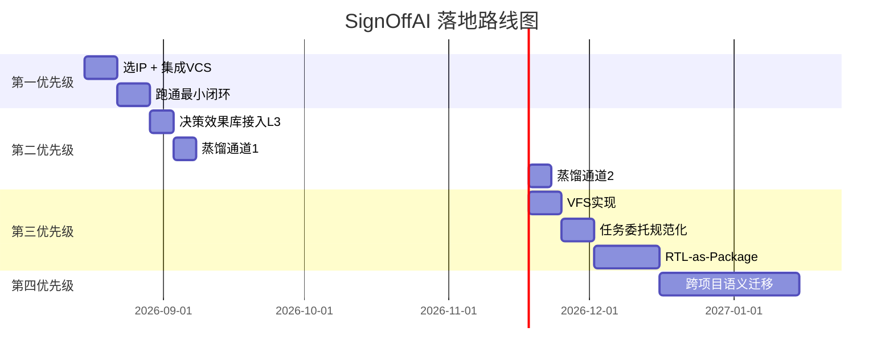

基于我们所有的讨论，你的 SignOffAI 已经具备了非常完整的架构蓝图。现在我们来聚焦**接下来具体要做什么**，从最紧迫到最前瞻，按优先级排个序。

---

## 🎯 核心判断：你现在处于"从蓝图到落地"的关键节点

你的状态总结：

| 维度 | 状态 | 说明 |
| :--- | :--- | :--- |
| **架构设计** | ✅ 完整 | L1/L2/L3 + 七 Agent + 决策层 + 证据链 |
| **L4/L5 设计** | ✅ 完整 | 经验库 + 蒸馏流水线 + 语义检索 |
| **核心代码** | 🟡 部分完成 | `core/` 模块已实现，Agent 骨架存在，但 Agent 间集成度不够 |
| **EDA 真实集成** | 🔴 待验证 | Mock 较多，真实 VCS/Questa 调用未充分验证 |
| **闭环端到端** | 🔴 待验证 | 从 Spec → RTL → 仿真 → 覆盖率 → 决策 → 迭代的完整流程未实际跑通 |
| **部署与治理** | 🟡 有雏形 | RBAC/审批/Token 预算已设计，但需验证 |

**结论**：你最大的差距不是"想得不够"，而是**"连起来的端到端闭环还没跑通过"**。接下来的一切工作，都应该围绕**"让闭环真正转起来"**展开。

---

## 📋 接下来要做的 10 件事（优先级排序）

### 🔴 第一优先级：端到端闭环跑通（1-2 周）

| 序号 | 任务 | 说明 | 产出 |
| :--- | :--- | :--- | :--- |
| **1** | **选择一个简单 IP 作为端到端测试** | 选一个极小模块（如 UART、I2C、ALU），不要选 AXI，降低复杂度 | 目标模块 + 验证 Spec |
| **2** | **真实 EDA 工具链集成** | 把 `ops` Agent 的 Mock VCS 调用替换为真实 `subprocess.run("vcs ...")` | VCS 可被 `ops` Agent 真实调用 |
| **3** | **跑通最小闭环** | 输入 Spec → 生成 RTL → 生成 TB → 仿真 → 覆盖率收集 → 决策 → 下次迭代 | 完整端到端日志 + 证据链 |

**这三步是"从 0 到 1"的关键——任何架构设计在没跑通过之前，都只是想象。**

---

### 🟠 第二优先级：L4/L5 蒸馏闭环补齐（2-4 周）

| 序号 | 任务 | 说明 | 产出 |
| :--- | :--- | :--- | :--- |
| **4** | **接上 L4 决策效果库** | 把 `action_effectiveness()` 接到 L3 的 `decide()` | 决策层按历史效果调整优先级 |
| **5** | **接上 L5 蒸馏通道1** | `distill_candidates()` → 自动追加到 `FIX_TEMPLATES` | 同类错误第二次出现时直接命中模板 |
| **6** | **接上 L5 蒸馏通道2** | 覆盖率 gap 归因 → 自动追加到策略包 | 策略包随经验自动进化 |

**这三步是"从 0 到 1"到"从 1 到 N"的跨越——让系统越用越聪明。**

---

### 🟡 第三优先级：工程化与治理增强（3-6 周）

| 序号 | 任务 | 说明 | 产出 |
| :--- | :--- | :--- | :--- |
| **7** | **虚拟文件系统（VFS）实现** | 把 Agent 文件操作封装到 VFS 沙盒中 | 可审计、可隔离、可快照的文件访问 |
| **8** | **任务委托机制规范化** | 把七 Agent 间的委托从"函数调用"升级为标准化 `AgentRequest/Response` | 可追踪、可重试、可回滚的任务委托 |
| **9** | **RTL-as-Package 抽象层（Python 双轨）** | 用 Picker + pyuvm 搭建快速迭代轨道 | 10-100x 迭代加速 |

---

### 🔵 第四优先级：前瞻性能力（3-6 个月）

| 序号 | 任务 | 说明 | 产出 |
| :--- | :--- | :--- | :--- |
| **10** | **跨项目语义迁移** | 经验库从 fingerprint 升级到向量化 + 语义标签 | 项目 A（NoC）经验迁移到项目 B（GPU） |

---

## 📊 实施路线图

---

## 💎 总结：一句话说清接下来要做什么

> **把 "端到端闭环跑通" 作为唯一的短期目标。选一个最简单 IP（UART），用真实 VCS 跑通 Spec→RTL→TB→仿真→覆盖率→决策→迭代 的完整闭环。其他一切（L4/L5蒸馏、VFS、RTL-as-Package）都是在这个闭环上的锦上添花，而不是前提。**

**核心原则**：先跑通，再优化，再进化。你现在需要的是"第一性原理"的验证——证明这套架构真的能在一个真实 IP 上工作。有了这个"1"，后面所有的"0"才有意义。

你要先从哪一步开始？我建议从**选一个简单 IP 并集成真实 VCS**开始。如果你需要，我可以帮你设计 UART 验证的端到端脚本骨架。

● 覆盖地图落地了，语法 + 验证通过。补上了自动驾驶类比里最关键的"定位层"。

  落地的东西

  src/core/coverage_map.py —— bin 级覆盖地图（对应自动驾驶的"GPS + 高精地图定位"）：

  CoverageMap().build(nested_cov, toggle_details, functional_detail)                                                    
    → {bins, covered, total, coverage, uncovered_bins, uncovered_by_purpose}

  每个 bin 带精确的语义坐标：type（code/toggle/functional）+ location（opcode[31:16] 这种）+ purpose（functional/protocol/corner）+
  hit/misses。

  接入 coverage agent：生成覆盖地图，写进返回 data 的 coverage_map 字段。

  验证（从"模糊感知"到"精确定位"）

  覆盖地图: 9 个 bin，6 个未覆盖

  未覆盖 bin 精确坐标：
    code.condition      protocol  misses=5
    code.toggle         corner    misses=65
    code.fsm            corner    misses=10
    opcode[31:16]       corner    misses=32   ← signal 级 bit 范围
    result[31:0]        corner    misses=2
    functional.covergroup functional

  对比：
  - 之前：overall_pct=87.6 + gap 向量（"constraint 缺口"）→ 模糊
  - 现在：opcode[31:16] 的 toggle 未命中 32 个 → 精确坐标

  补上了类比里"精确定位"这一环

  自动驾驶的完整链现在是：

  感知（Coverage/Debug Agent：识别 unreachable/unstimulated）
    → 定位（CoverageMap：bin 级精确坐标）← 这轮补上
    → 预测（predict_convergence + action_effectiveness）
    → 规划（decision_engine：选动作）
    → 执行（verify/ops：生成用例/编译）
    → 安全（Harness/证据链/黄金基线）

  两个诚实的边界

  1. bin 粒度是"metric 级 + signal 级"，还不是"coverpoint/bin 级"（vcover -cvg -details 的每个 coverpoint 每个 bin 的命中状态）。要真正的
  bin 级，需要解析 vcover -cvg -details 的输出（coverpoint → bin → hits/misses）。
  2. functional 目前是一个整体 bin（functional.covergroup），还没拆成"每个 coverpoint 的每个 bin"（如 cp_opcode.add 命中与否）。这依赖
  env_cov + FunctionalCoveragePointGenerator 生成的 covergroup 被采样后，vcover -cvg -details 给出 bin 明细。

  这两个边界，等真实 IP 跑起来、有真实的 covergroup 采样数据后，能自然地补上（解析 vcover -cvg -details 的 bin 明细）。

  至此，你自动驾驶类比里的"感知-定位-预测-规划-执行-安全"完整闭环，在 SignOffAI 里都有了对应。剩下的，还是文档里那句话——选一个真实
  IP，用真实 EDA 跑通，用实战验证这套"自动驾驶式的验证收敛"架构。