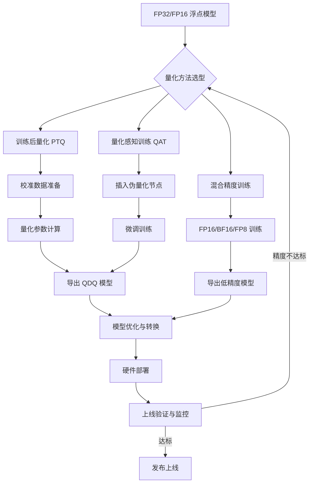

下面是一份根据业界主流实践整理的**量化全流程工业级文档**。它涵盖了从模型准备到最终部署上线的完整链路，你可以直接将其作为项目规范或知识库的参考。

---

# 工业级模型量化部署全流程指南

> **文档版本**: v1.0
> **面向对象**: 算法工程师、端侧部署工程师、AI工程化从业者
> **目标**: 系统化、标准化的模型量化与部署流程

---

## 一、总体目标

**模型量化**是指将连续取值的浮点型权重（通常是 FP32/FP16）转化为有限个离散值（通常是 INT8/INT4）的过程。

一个完整的工业级量化流程需达成以下核心目标：

| 目标 | 指标 |
| :--- | :--- |
| **模型压缩** | 体积减少 75% 以上 |
| **推理加速** | 速度提升 2-4 倍 |
| **精度保障** | 量化后准确率损失控制在 1% 以内 |
| **显存优化** | 显存占用降低 50% 以上 |

---

## 二、量化全流程架构图



---

## 三、量化方案选型

### 3.1 量化方法的本质区别

| 方法 | 核心原理 | 精度 | 成本 | 适用场景 |
| :--- | :--- | :--- | :--- | :--- |
| **训练后量化 PTQ** | 训练完成后，用校准数据计算量化参数 | 中等 | 低 | 快速部署、资源受限 |
| **量化感知训练 QAT** | 训练中模拟量化效果，反向传播补偿误差 | **高** | 高 | 对精度要求严格的场景 |
| **混合精度训练** | 训练中不同算子使用 FP16/BF16 | 高 | 中 | 大模型训练加速 |

### 3.2 选型决策树

```
模型是否对量化敏感？
    ├── 否 → 优先选择 PTQ（快速、低成本）
    └── 是 → 
        ├── 是否有完整训练数据？
        │   ├── 是 → 优先选择 QAT（精度最优）
        │   └── 否 → 混合精度训练 / 敏感层排除
        └── 是否可接受精度损失？
            ├── 可接受 → PTQ + 精度验证
            └── 不可接受 → QAT
```

### 3.3 量化粒度选择

| 粒度 | 说明 | 适用场景 |
| :--- | :--- | :--- |
| **Per-tensor** | 整个张量共享一个 Scale | 硬件友好，精度一般 |
| **Per-channel** | 每个通道独立 Scale | 精度更高，硬件支持有限 |
| **Per-group** | 分组共享 Scale | 平衡精度与性能 |

### 3.4 量化目标

工业级量化通常需要同时考虑：

- **权重量化**：减少模型大小和存储占用
- **激活量化**：减少推理时的内存占用
- **KV Cache 量化**：节省显存，支持更大批次

---

## 四、PTQ 标准流程（最常用）

PTQ 是工业界应用最广泛的量化方式。

### Step 1: 模型准备与基线验证

```python
# 1. 加载训练好的浮点模型
model = load_model("model_fp32.pth")
model.eval()

# 2. 验证浮点模型精度（建立基线）
baseline_accuracy = evaluate(model, test_dataset)
print(f"Baseline FP32 Accuracy: {baseline_accuracy:.4f}")
```

### Step 2: 准备校准数据集

校准数据用于统计激活值的分布，**不需要标注**。

```python
# 校准数据要求：
# - 100-500 张代表性样本
# - 覆盖实际部署场景的数据分布
# - 不需要标签

calibration_loader = DataLoader(calibration_dataset, batch_size=32)
```

### Step 3: 配置量化参数

```python
# 典型量化配置（PyTorch）
quantization_config = {
    "quant_mode": "static",      # 静态量化
    "bit_width": 8,              # INT8
    "scheme": "symmetric",       # 对称量化
    "granularity": "per_tensor", # 量化粒度
    "dtype": torch.qint8,
    "observer": "MovingAverageMinMaxObserver"
}
```

### Step 4: 执行量化并导出

```python
# 1. 插入量化观察器
model.qconfig = torch.quantization.get_default_qconfig('fbgemm')
torch.quantization.prepare(model, inplace=True)

# 2. 运行校准
with torch.no_grad():
    for data in calibration_loader:
        model(data)

# 3. 转换为量化模型
torch.quantization.convert(model, inplace=True)

# 4. 导出为 QDQ 格式（带 Quantize/Dequantize 节点）
torch.onnx.export(model, dummy_input, "model_quantized.onnx")
```

> **QDQ 模型**：包含 `QuantizeLinear` 和 `DequantizeLinear` 节点的 ONNX 模型，量化参数已编码在图中。

### Step 5: 精度验证与迭代

```python
# 验证量化模型精度
quantized_accuracy = evaluate(quantized_model, test_dataset)
accuracy_drop = baseline_accuracy - quantized_accuracy

if accuracy_drop > 0.01:  # 精度损失超过 1%
    # 需要优化：尝试不同量化配置或切换到 QAT
    print("Accuracy drop too large, need optimization")
```

---

## 五、高级量化算法（LLM 场景）

对于大语言模型（LLM），需要采用更先进的量化算法：

| 算法 | 原理 | 适用场景 |
| :--- | :--- | :--- |
| **GPTQ** | 逐列量化权重，最小化二阶近似误差 | 低比特权重-only 量化（W4/W3） |
| **AWQ** | 网格搜索确定最优缩放因子 | 低比特权重-only 量化（W4） |
| **SmoothQuant** | 将激活值中的离群值转移到权重 | INT8 权重量化 + 激活量化 |
| **FP8** | 8 位浮点格式量化 | Hopper/Ada 架构 GPU |
| **Marlin** | 高性能 4-bit 量化内核 | Ampere/Hopper GPU |

---

## 六、量化感知训练 QAT 流程

当 PTQ 精度不达标时，应使用 QAT。

### Step 1: 插入伪量化节点

在训练图中插入 `Quantize` 和 `Dequantize` 节点。

```python
# PyTorch QAT 示例
model.qconfig = torch.quantization.get_default_qat_qconfig('fbgemm')
model = torch.quantization.prepare_qat(model, inplace=True)
```

### Step 2: 微调训练

```python
# 使用较小学习率微调
optimizer = torch.optim.Adam(model.parameters(), lr=1e-5)
for epoch in range(3):  # 通常 2-5 个 epoch
    for batch in train_loader:
        loss = train_step(model, batch)
        loss.backward()
        optimizer.step()
```

### Step 3: 转换并导出

```python
# 转换为量化模型
model.eval()
model = torch.quantization.convert(model, inplace=True)
torch.onnx.export(model, dummy_input, "model_qat.onnx")
```

---

## 七、混合精度训练

混合精度训练与量化是互补的。

| 精度格式 | 适用场景 | 优势 |
| :--- | :--- | :--- |
| **FP16** | 通用训练加速 | 速度提升 2-3 倍 |
| **BF16** | 大模型训练 | 数值范围与 FP32 相同 |
| **FP8** | 最新 GPU（Hopper/Ada） | 更高效率 |

```python
# AMP 自动混合精度（PyTorch）
scaler = torch.cuda.amp.GradScaler()
with torch.cuda.amp.autocast():
    output = model(input)
    loss = criterion(output, target)
scaler.scale(loss).backward()
scaler.step(optimizer)
scaler.update()
```

---

## 八、部署工具链选型

### 8.1 主流工具链对比

| 工具 | 支持格式 | 适用硬件 |
| :--- | :--- | :--- |
| **TensorRT** | ONNX, PyTorch | NVIDIA GPU |
| **ONNX Runtime** | ONNX | 跨平台 |
| **OpenVINO** | ONNX, TensorFlow | Intel CPU/VPU |
| **Quark (AMD)** | PyTorch, ONNX | AMD NPU |
| **AIMET (Qualcomm)** | ONNX | Qualcomm 平台 |

### 8.2 典型工作流（以 TensorRT 为例）

```bash
# 1. PTQ 校准
python calibrate.py --model model.onnx --calib_data ./calib_images

# 2. 构建 TensorRT 引擎
trtexec --onnx=model.onnx \
        --int8 \
        --calib=calibration.cache \
        --saveEngine=model.engine

# 3. 精度验证
python evaluate.py --engine model.engine --test_data ./test_images
```

---

## 九、精度验证标准

### 9.1 评估指标

| 任务类型 | 推荐指标 | 通过标准 |
| :--- | :--- | :--- |
| 分类 | Top-1/Top-5 Accuracy | 下降 < 1% |
| 检测 | mAP / mIOU | 下降 < 1.5% |
| NLP | Perplexity / MMLU | 视具体任务而定 |

### 9.2 量化敏感层排查（AIMET 推荐流程）

| 量化格式 | 结果 | 结论 |
| :--- | :--- | :--- |
| **w8a8** | 精度良好 | 可直接部署 |
| **w8a8** 差，**w8a16** 好 | 激活值对 INT8 敏感 | 保持激活 FP16 |
| **w8a16** 差，**w16a16** 好 | 权重对 INT8 敏感 | 保持权重 FP16 |
| **仅 FP16** 可接受 | 存在高度敏感层 | 排除这些层，改用混合精度 |

### 9.3 精度验证检查清单

- [ ] 浮点模型基线精度已记录
- [ ] 量化模型精度已验证（测试集）
- [ ] 多批次/多种子结果一致性检查
- [ ] 端到端端侧实测精度验证
- [ ] 精度下降已记录并评估风险

---

## 十、常见陷阱与避坑指南

### 陷阱 1：模型拆分时量化被割裂

**问题**：每个子模型独立校准，导致同一份特征被多次重新量化，误差累积。

**正确做法**：**整体量化一次，分段导出**。子模型之间复用同一套量化语义（Scale / Zero-Point），不重新统计、不重新量化。

### 陷阱 2：离群值未被处理

离群值（Outlier）会显著影响量化精度。应识别并排除或特殊处理这些层。

### 陷阱 3：校准数据不具代表性

校准数据应与实际部署场景的数据分布一致，否则量化参数会偏离最优值。

### 陷阱 4：精度验证不充分

仅在单一批次/单一种子上验证不足，应进行多轮测试确保稳定性。

---

## 十一、可交付物清单

| 交付物 | 格式 | 说明 |
| :--- | :--- | :--- |
| 量化模型 | `.onnx` / `.engine` / `.tflite` | 可直接部署的量化模型文件 |
| 量化配置文件 | `.yaml` / `.json` | 量化参数、校准配置 |
| 精度验证报告 | `.pdf` / `.html` | 基线 vs 量化精度对比 |
| 部署脚本 | `.sh` / `.py` | 模型加载、推理、测试脚本 |
| 性能测试报告 | `.csv` / `.html` | 延迟、吞吐、内存占用数据 |

---

## 十二、总结

工业级量化部署是一个系统性工程，需要遵循“**诊断 → 选型 → 校准 → 验证 → 部署 → 监控**”的完整闭环。核心原则是：

1. **选对方法**：根据精度要求选择 PTQ / QAT / 混合精度
2. **数据驱动**：校准数据必须具有代表性
3. **闭环验证**：精度不达标时迭代优化
4. **整体量化**：模块拆分不割裂量化语义
5. **工具链适配**：根据部署硬件选择合适的量化工具链