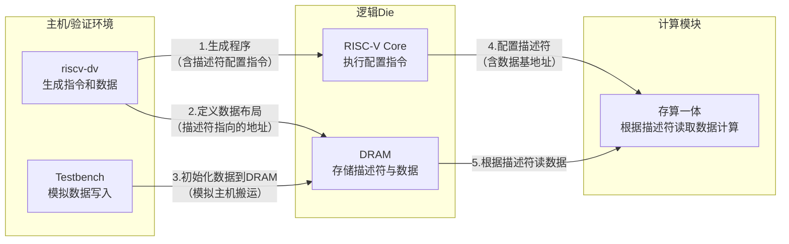

“描述符对应的数据”如何在验证环境中处理，确实是整个流程的关键一环。从你之前的描述来看，数据是由主机（Host）预先加载到逻辑Die的DRAM上的，这与验证环境的构建思路是契合的。

我们可以把这个流程拆解为三个核心步骤：**主机初始化数据、RISC-V核通过描述符搬运数据、验证环境监控结果**。

### 🧩 流程概览：如何让验证“跑起来”

整体来看，为了在验证环境中处理描述符对应的数据，通常需要完成以下工作：

1.  **使用 `riscv-dv` 生成数据和指令**：你需要在生成测试程序时，通过内存区域（`mem_region`）配置和链接脚本（Linker Script），将**描述符**和它指向的**真实数据**映射到不同的、你知道的地址空间。同时，生成包含配置描述符指令的RISC-V程序。

2.  **RTL仿真环境实现“主机搬运”**：在你的RTL仿真环境（如UVM Testbench）中，需要实现一个模型来模拟“主机”。在仿真开始前，或者仿真过程中，这个模型会根据描述符中的信息，将数据写入DRAM的对应地址，模拟实际芯片中主机搬运数据的过程。

3.  **执行程序并监控**：你的RISC-V核执行`riscv-dv`生成的程序，通过多条指令配置描述符。**关键在于：描述符中会包含张量数据在DRAM中的基地址和形状信息**。配置完成后，存算一体模块根据描述符的信息，从DRAM的指定地址读取数据进行计算。验证环境需要监控描述符的写入以及存算一体模块最终计算结果的正确性。

### 🔗 关键机制：描述符与数据如何在验证中绑定

在具体的验证环境搭建中，这个“绑定”关系是通过内存地址来实现的。

*   **描述符是“地址+形状”的封装**：一个张量描述符（Tensor Descriptor）本质上是一个数据结构，它告诉硬件数据在哪（基地址）、数据长什么样（维度、步长）。你的RISC-V程序会通过多条指令，将这个描述符的内容写入存算一体模块的配置寄存器中。

*   **数据是“主机”预置的Payload**：你在用`riscv-dv`生成测试时，会在`.data`段或通过`gen_data_page()`生成一些初始数据。但在存算一体的场景下，更真实的验证是，你的UVM Testbench会像一个“主机”一样，在仿真开始前，直接调用后门访问或使用DPI（Direct Programming Interface）等机制，将**已知的、特定的测试向量**写入DRAM的特定地址。这个地址，正是你配置到描述符中的那个“基地址”。

*   **验证环境的“眼睛”**：验证正确性的关键在于，你的Testbench需要有能力去“窥探”DRAM。在仿真结束后，它需要从存算一体模块写回DRAM的地址读取计算结果，并与一个软件参考模型（比如你自己用Python/C++写的纯数学函数）的计算结果进行比对。这个过程，就是存算一体验证中最核心的**数据比对（Data Check）**流程。

### 💎 总结

1.  **用 `riscv-dv` 定义好地址布局**：确保你的描述符和它指向的数据段地址是已知的、可控的。
2.  **用 Testbench 模拟主机搬数**：在仿真开始前，由Testbench将测试数据预先写入DRAM的指定位置，模拟真实系统的数据加载过程。
3.  **用监控和比对完成闭环**：验证环境需要监控描述符的配置过程，并在仿真结束后，从DRAM读取最终结果并进行比对。

这样，就形成了一个完整的闭环：**Testbench模拟主机准备数据 → RISC-V程序配置描述符 → 存算一体模块根据描述符读取数据计算 → Testbench比对结果**。