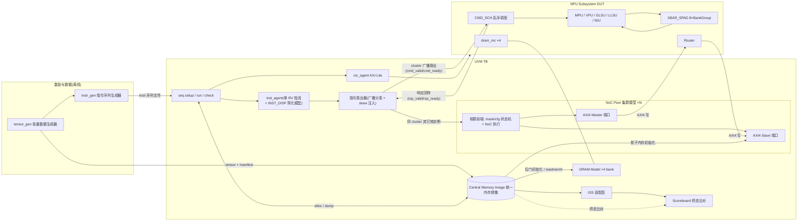
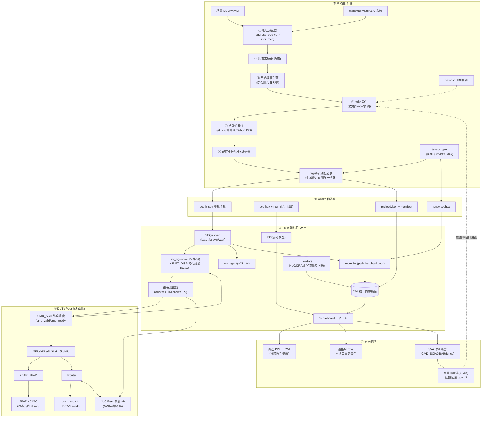
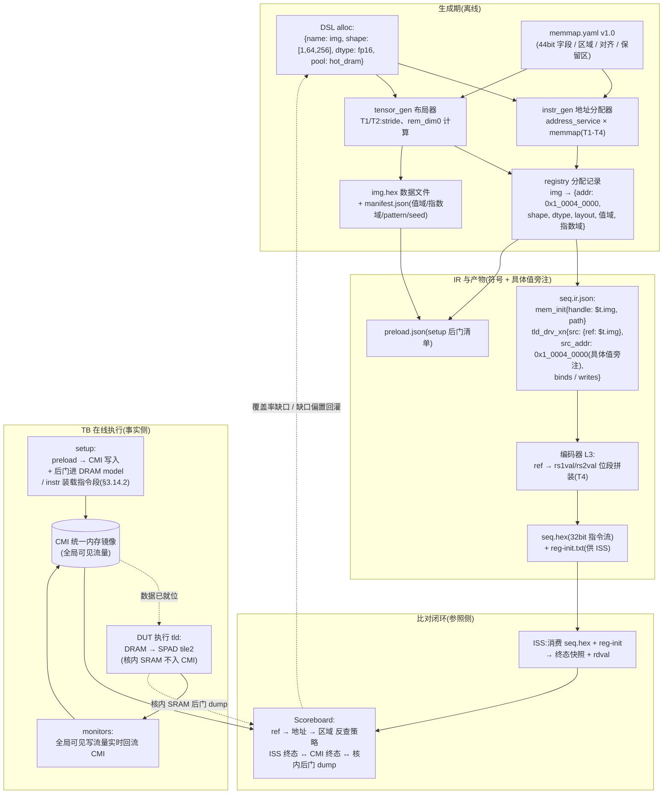
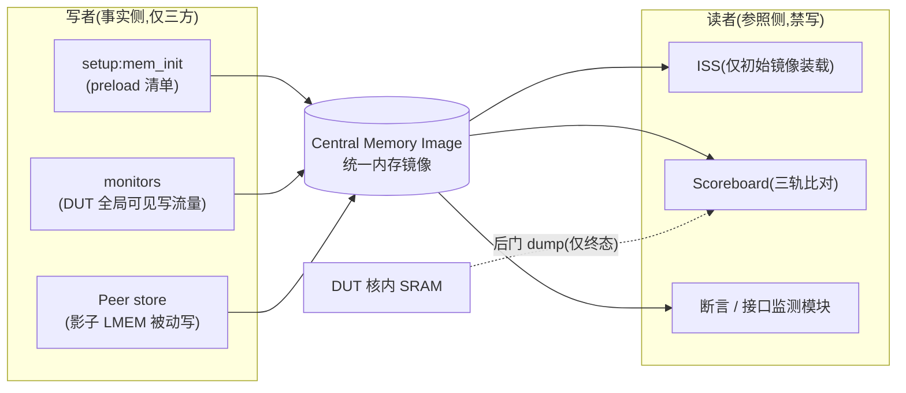
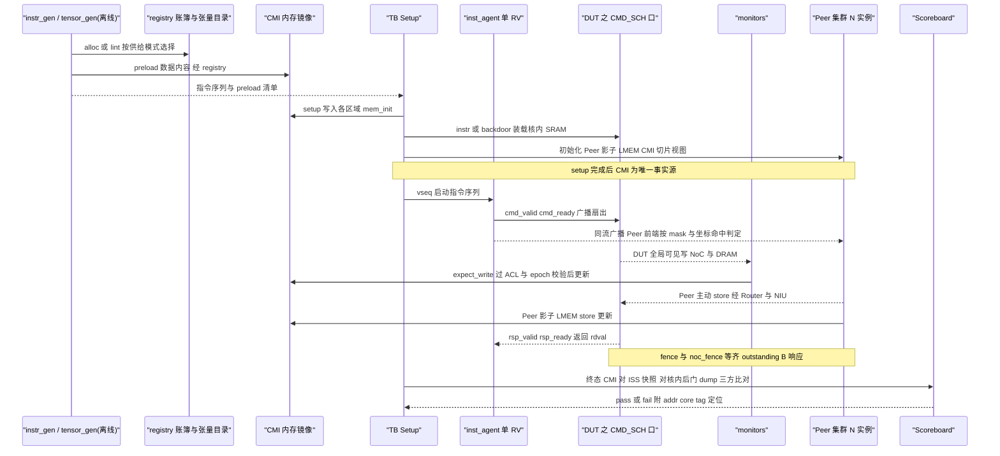

# HM057 NPU Subsystem 顶层验证策略

## 文档信息

| 项 | 内容 |
|---|---|
| 文档版本 | v4.3(2026-10-04,§1.3 迁入 tb_todo A0 三层边界完整版,含 reduce/barrier、多核 PTE 抢占、多核并发中断;MMU 列第一层"预留") |
| 适用范围 | HM057 NPU Subsystem 顶层验证(NPU Core + Router + DRAM Macro Controller) |
| 验证方法学 | UVM + SystemVerilog;参考模型复用现有 ISS/C Model |
| 状态 | 待评审 |
| 参考文档 | HM056_V2 指令 ISA(V0.8)、HM057 NPU Arch Spec、10 份模块 CDD、5 份 ISA 配套表 |

## 修订记录

| 版本 | 日期 | 修订内容 |
|---|---|---|
| v0.1 | 2026-10-01 | 初版:NoC Peer 接口规范与数据预布置机制 |
| v0.2 | 2026-10-01 | 重组为验证策略文档,新增概述与顶层框架 |
| v0.3 | 2026-10-01 | 新增激励层协议(IR 单轨模型、batch/spawn/wait/expect 原语) |
| v0.4 | 2026-10-01 | 新增定向测试与随机测试的分层模型 |
| v0.5 | 2026-10-01 | 新增 DSL 规范与示例、L1 事务原子清单;往期讨论结论入库(张量生成、初始化路径) |
| v1.0 | 2026-10-01 | 文字规范化定稿,作为评审基线 |
| v1.1 | 2026-10-01 | 新增 §3.12 张量生成器与地址转换服务 |
| v1.2 | 2026-10-01 | 新增地址定义文件 memmap.yaml 及其与 IR/DSL 的联动钩子 |
| v1.3 | 2026-10-01 | memmap.yaml 实例化完成并冻结(`verification/memmap.yaml` v1.0) |
| v1.4 | 2026-10-01 | 补齐 NoC Peer 章节在正式化改写中丢失的 4 块内容(指令覆盖矩阵/必做功能/被动接收注意事项/接口监测点),恢复章节编号 |
| v1.5 | 2026-10-01 | 新增 §4.9 Peer Program(后被 v1.6 取代) |
| v1.6 | 2026-10-01 | §4.9 改方案:对端行为并入单轨 IR 的 noc 指令族(后被 v1.7 取代) |
| v1.7 | 2026-10-01 | 架构级修订:引入指令分发模型与 Peer 轻量核前端(mask/cfg 状态机 + NoC 执行),取消 IR 伪指令族,指令按 RV/cluster 归属分路 |
| v1.8 | 2026-10-01 | 定稿 Peer 前端译码范围(Control+NoC 支持,其余显式拒绝);明确 IR 激励跨 subsystem/cluster/chip 三级复用机制 |
| v1.9 | 2026-10-01 | 新增 §4.9.10 Peer 前端模块接口定义(模块分解 / 端口清单 / 寄存器映射 / 主状态机 / TB 协同点) |
| v2.0 | 2026-10-01 | 边界澄清:INST_DISP 属 Cluster 级不在 DUT 内;指令分发模型改为广播扇出+本地过滤;新增 §3.13 inst_agent 对 INST_DISP 的行为建模范围 |
| v2.1 | 2026-10-04 | 移除 DUT 内 inst_router 占位节点;TB 驱动边界落在 CMD_SCH 命令/响应口 |
| v2.2 | 2026-10-04 | 新增 §3.2.1 指令操作数注入模型(rs1val/rs2val 显式值;寄存器分配器供 ISS);登记 A13(cmd_data_out 位级打包待澄清) |
| v2.3 | 2026-10-04 | 新增 §3.14 张量数据进场通路与 CMI 读写归属,IR 激励层闭环 |
| v2.4 | 2026-10-04 | 新增 §3.0 IR 激励层总览图(mermaid);高配渲染版另存为 HTML 评审材料 |
| v2.5 | 2026-10-04 | 新增 §2.1.1 模块功能速览表(评审 overview) |
| v2.6 | 2026-10-04 | 纠错:统一为单 RV + 单 INST_DISP 模型;删除 inst_agent_A/B 与 IR 的 rv 归属字段,目标核一律由 mask(NICE 全局 group_mask / VNICE 指令 6b_grp_mask)决定;§2.1/§2.1.1/§3.0/§3.2/§3.2.1/§4.9.7 同步修正 |
| v2.7 | 2026-10-04 | 新增 §3.0.1 离线生成期模块功能速览表(评审 overview) |
| v2.8 | 2026-10-04 | 展开 §3.4.1 spawn_async 语义、典型应用场景表、约束与示例 |
| v2.9 | 2026-10-04 | 新增 §3.0.2 落盘产物格式速览(seq.ir.json / preload.json / manifest.json / seq.hex+reg-init 迷你 schema) |
| v3.0 | 2026-10-04 | C6a 定稿 §3.12.9:tensor_gen CLI(单次/批量两入口)、manifest schema v1.1、八条工程约束(E1-E8);FP 特殊值策略定为默认允许+比例旋钮+期望强制交 ISS |
| v3.1 | 2026-10-04 | §3.12.5 新增分配器故障注入通道(fault_inject: prob/modes/budget;模式白名单两级化;IR fault 标记;无防护时由 CMI 意外写检测判错) |
| v3.2 | 2026-10-04 | §3.12.6 新增地址钩子全闭环流程图(mermaid):DSL alloc → 分配器/布局器 → registry → IR ref+具体值旁注 → L3 编码 → preload/CMI → DUT 执行/monitors 回流 → ISS/scoreboard 三轨终态比对;"侧车"统一更名为"具体值旁注" |
| v3.3 | 2026-10-04 | §4.9.1/§4.9.5 清除 RV_A/RV_B 残余表述,与单 RV 模型对齐(跨核协同改为"单 RV 广播 + mask/坐标角色判定";复用层级表第一行同步改写) |
| v3.4 | 2026-10-04 | 第 5 章整体重写:对齐 §3.14 读写归属(写者白名单/禁写纪律)、§3.14.2 双通路装载(path 字段)、registry 登记表结构、比对接口索引、reserved/EXP Shadow 通道、SV 实现要点;修正旧版"ISS↔CMI 双向同步""DUT SPAD 后门为主方式"两处与后文冲突 |
| v3.5 | 2026-10-04 | 地址供给双模定稿:§3.12.6 declared(IR 字面量+lint+复用观测点纪律)/ solved(ref+具体值旁注+账簿);§5.5 拆为张量目录(常驻)与分配账簿(仅随机模式),新增 ACL/provenance 与 epoch 键 |
| v3.6 | 2026-10-04 | 第 6 章重写为单 RV 广播模型下的交互协议:时序图补 inst_agent/monitors/rsp/fence 路径;API 表加 lint/mark_epoch/ACL 校验/translate_va 预留;新增 §6.4 与 Peer 前端协作契约 |
| v3.7 | 2026-10-04 | 落回 §3.12.6.1:overlap / 跨 boundary 为合法定向意图(非违例),lint 分级(WARN/ERROR),与 fault_inject 的分界线,时间复用强制中间观测点;§6.2 sequenceDiagram 中 ASCII 括号统一改全角修复渲染 |
| v3.8 | 2026-10-04 | 第 6 章整体扩写为 inst_agent 功能规格:职责总览(IR 消费者/运行时翻译器/IDU 角色/节奏控制器/激励协作者)、内部结构九模块、IR op→驱动动作映射、对外接口清单、并发时序执行语义;原时序图/API/契约顺延为 §6.6/6.7/6.8 |
| v3.9 | 2026-10-04 | IR op 全集补足:§3.2 改按七类组织(指令/逃生口/配置/数据/时序/观测期望/并发+预留电源复位);寄存 expect_rd、expect_write、expect_region、raw_cmd、mem_scrub、peer_cfg、dram_cfg、intr_ack、nop、watchdog、perf_window、checkpoint、expect_idle;§6.3 映射表同步;ISS 清单追加 A10 中途快照能力;tb_todo 加 B7/A14 |
| v4.0 | 2026-10-04 | §3.2 指令类 op 按 ISA 六组 funct7 展开实名清单(Control/NoC/GLSU/TMV/MPU/VPU),与《04_指令编码总表》对齐,含 XL-02/06/08/09 风险标注 |
| v4.1 | 2026-10-04 | 新增 §3.15 覆盖率反馈与约束偏置闭环(偏置仅落 L2 意图层、防过拟合护栏、双代自动化、双指标验收);§8 扩为"实现要点 + 可观测性与 Debug 规范"(trace 三层 schema、FATAL 六元组、失败现场转储 bundle、调试 SOP) |
| v4.2 | 2026-10-04 | §1.3 验证边界改三层结构(单 IP 闭环 / Peer 顶替对端 / 第三期 SOC 环境),补 Peer 判定限度、被动接收方向、mcast 拓扑要求;同步 tb_todo A0.1 补遗 |
| v4.3 | 2026-10-04 | §1.3 迁入 tb_todo A0 三层边界完整版(reduce/barrier、多核 PTE 抢占、多核并发中断;MMU 列第一层"策略预留") |

---

## 1. 概述与验证范围

### 1.1 文档目的
本文定义 HM057 NPU Subsystem 顶层验证的整体策略,包括验证环境架构、激励生成方案、比对与检查策略、数据预置机制及各部件交互协议。逐模块测试计划见《ISA 层验证计划》(对应文档 05)与《微架构级覆盖计划》(对应文档 06),不在本文范围内。

### 1.2 验证对象
单 NPU Subsystem 顶层,包含:

- NPU Core:CMD_SCH、MPU、VPU、GLSU、LLSU、NIU、TMU、XBAR_SPAD、SPAD、CORE_REG;
- 注:INST_DISP(IDU)位于 Cluster 级,不在 DUT 内,其行为由 TB 的 inst_agent 简化建模(见 §3.13);CMD_SCH CDD 中 DUT 指令上口即 IDU→CMD 握手(cmd_valid/cmd_ready + rsp_valid/rsp_ready,指令本体 64bit),CMD_SCH 与 IDU 之间未定义独立的核内 inst_router 模块——若 RTL 顶层文件存在同名 wrapper 则以 RTL 为准(挂 ISS-33 一并核对);
- Router(NoC 路由);
- DRAM Macro Controller(dram_mc × 4 bank)。

### 1.3 验证边界(三层)

**前提**:ISA 作用域 = 单个 Cluster(16 核);DUT = 单 Subsystem(1 核 + Router + DRAM Macro Controller)。"边界" = 指令数据通路是否出本 Subsystem。

**第一层:单 IP 内闭环可验(本期覆盖)**
- 计算族:VPU / MPU 全套;
- 核内搬运:TMV 全套(bc/vbc/tvbc/tmov/ttmov/setCIMExp/getCIMExp);
- 控制族:group_mask / npu_cfg / wr_lmem / rd_lmem / rd_csr 中本核的行为;
- 同步族:sync / fast_sync 各核本地完成的行为(暂不包含聚合语义);
- 本核 DRAM:GLSU local(tld/ttld/tst 的 local 形态,经 dram_mc / axi2to1);
- 本核 csr registers、中断异常;
- 本核 perfcnt、debug(low priority);
- 本核 reset、上下电;
- MMU / 页表(暂未引入,策略方案已预留,T5 层)。

**第二层:必须 NoC Peer 顶替对端(本期覆盖)**
- NoC 全族:noc_drv_xn(同 Cluster 1:1)、noc_drv_vn01/vn11(同/跨 group 多核)、noc_drv_dst_xn + noc_drv_src_xn(跨 Cluster 强配对)、noc_fence_drv / fast_noc_fence_drv(完成定义待 ISS-35);
- GLSU global(gtld/gttld/gtst 系列,经 Router 出 DUT);含多播/广播形态,要求 Peer 实例数与坐标覆盖 mcast 组;
- Gather 全族(gat_d2s/gat_d2d/ggat,一律经 Router);
- tdram 的跨核跨 Cluster 变体(同核两端可本核闭环);
- DUT 作为被动接收方(NIU store in / Peer 主动写 DUT,叠加 ISS-36)。

> 第二层判定限度:此类用例仅能证明"DUT 侧发送/接收行为正确",不能证明对端核的功能正确;对端真实核的正确性属第三层。

**第三层:必须真实多 NPU Core + INST_DISP + NoC(不在本期,划归 SOC / 多 Cluster 环境)**
- 真实多核并发运算、reduce、gather、barrier 功能等;
- NoC 行为:死锁、传输路径、流量控制等;
- INST_DISP 跨时钟域检查(本地 700MHz 定频;ROB 乱序聚合、异步 FIFO);
- 系统级配置功能:多核并发 PTE(MMU 上层虚实地址转换)抢占、多核并发 interrupt 等;
- sync 跨核聚合语义(ISS-34);跨 die/cluster 的 44bit 全局地址译码与路由。

**判定规则**:凡 Pass/Fail 依赖"真实多核时序或异步时钟域"的,一律归第三层;DUT 视角主动/被动同权;group_mask/npu_cfg 属全局状态,单核 DUT 只验"本核更新与使用",跨核 mask 语义归第三层。

依据与讨论记录见 tb_todo.list A0/A0.1。

---

## 2. 顶层验证框架

### 2.1 环境架构



### 2.1.1 模块功能速览

**离线生成侧(产出可落盘复现的用例产物)**

| 组件 | 职责 | 关键输出 | 依据 |
|---|---|---|---|
| instr_gen 指令序列生成器 | 从场景 DSL 出发,经六步流水线(地址分配→约束求解→模板引擎→策略插件→期望值标注→编码)产出单轨 IR | seq.ir.json / seq.hex / reg-init 清单 | §3.5, §3.2.1 |
| tensor_gen 张量数据生成器 | 按 shape/dtype/模式库/指数安全域生成张量数据与 manifest,写 registry 分配记录 | tensors/*.hex / manifest.json / registry | §3.10, §3.12, C6 |

**UVM TB(在线执行)**

| 组件 | 职责 | 关键接口 | 依据 |
|---|---|---|---|
| SEQ(vseq) | 消费 IR 单轨序列,编排 batch/spawn/wait/expect;驱动各 agent;处理跨 RV 事件 | IR op 分发 | §3.2, §3.4 |
| inst_agent(单 RV) | 以唯一 RV 身份驱动指令流;承担 INST_DISP 简化建模(广播扇出、NICE/VNICE 两 lane 独立、反压/outstanding);编程模型为单 RV,目标核由 group_mask/指令 mask 决定 | cmd_valid/cmd_ready、rsp_valid/rsp_ready | §3.13, 第 6 章 |
| 指令扇出器 | 将每条指令广播分发至 cluster 全部核(DUT + Peer),注入 per-instance skew;命中判定由核内 mask 匹配完成 | IDIR → CMD_SCH / Peer | §3.2, §3.13 |
| csr_agent | AXI-Lite 读写 CORE_REG;dword 对齐;W1C 语义监测 | AXI4-Lite | §3.2, ISS-08 |
| NoC Peer 集群模型 ×N | 扮演同 cluster 其它核:核群前端(mask/cfg 状态机+译码)识别 Co/DEC 指令,影子 LMEM 支持主动/被动 store | AXI4 Master/Slave | §4.9 |
| DRAM Model ×4 | Share DRAM 4 bank 的行为级模型;延迟/冲突注入 | dram_mc 接口 | §1.2, §6 |
| CMI 统一内存镜像 | 事实侧唯一枢纽:setup preload + 运行时写流量镜像;终态比对基底 | 全组件读写 | §3.14 |
| ISS 适配层 | 复用现有 ISS:消费 seq.hex + reg-init,产出终态快照与 rdval | 文件 + DPI | §D, ISS-01/04 |
| Scoreboard | 三轨比对:ISS 终态等价 + 逐指令 rdval + 端口事务集合;值域预检 | 全组件数据流 | §3.14, §D2 |

**DUT(NPU Subsystem)**

| 组件 | 职责 |
|---|---|
| CMD_SCH | 指令乱序调度(cRF/dRF、scoreboard 依赖公式、三种访存模式) |
| MPU/VPU/GLSU/LLSU/NIU | 计算与访存执行器簇 |
| XBAR_SPAD | SPAD 8×BankGroup 访问仲裁,写闭环(wr_complete) |
| Router / dram_mc ×4 | NoC 路由与 Share DRAM 控制器 |

### 2.2 三条主线原则

| 主线 | 原则 |
|---|---|
| 激励 | 两段式:离线生成器产出指令序列与数据并可落盘复现,TB 在线执行;指令采用 ISA 事务级抽象,不生成裸位 |
| 比对 | 三轨制:ISS 终态一致性 + 逐指令 rdval + 端口事务集合比对;时序语义由 SVA 承担,不乱序环境不做逐拍比对 |
| 数据 | 统一内存镜像 CMI 为唯一事实源:激励、初始化、参考模型、比对模块均经由 CMI 读写 |

---

## 3. 激励生成:指令序列生成器(instr_gen)与 IR 协议

### 3.0 总览:IR 激励层工作原理

下图给出本章所有机制的整体视图:离线生成器产出可复现的用例产物,TB 在线执行单轨 IR,执行的并行性由 DUT 乱序调度天然产生;实测流量经 monitor 回流 CMI,与 ISS 终态三轨比对,覆盖率缺口反馈回下一轮生成(高配渲染版另见 `D:\ISA\IR_激励层工作原理图.html`)。



四条贯穿契约(跨泳道不变量,违反任一即实现缺陷):

1. **标量走指令字段**(`operands`),**张量走内存**(`binds/writes` + `ref`),两条数据通路互不交叉(§3.14.1);
2. `ref` 解析失败 = 生成器**编译期失败**,不允许静默越界(§3.12.6);
3. **scoreboard / ISS 禁写 CMI**——期望侧不污染事实侧(§3.14.3);
4. DUT 核内 SRAM 不进入 CMI 实时镜像,终态走后门 dump 与 ISS 比对(§3.14.3)。

#### 3.0.1 离线生成期模块功能速览

**输入侧(四本法典 + 配置)**

| 组件 | 职责 | 依据 |
|---|---|---|
| 场景 DSL(YAML) | 测试意图的唯一人工输入:可用池 resources、驻留对象 alloc、意图旋钮 intent(hazard 密度/争抢/mcast 比例/负例比例) | §3.7 |
| memmap.yaml(v1.0 冻结) | 拓扑与地址规则的唯一事实源:44bit 字段布局、regions、对齐、保留区;生成/TB 两侧共用同一份 | §3.12.5 |
| 四本法典 | 《指令编码总表》/ Cfg 总表 / 精度矩阵 / 指令组合白名单——编码、配置、精度、组合的唯一合法来源 | §3.5 |
| harness 用例配置 | 节奏与压力(gap/throttle)、mem_init path 开关;时序敏感场景不在此表达,进 IR | §3.3 |

**instr_gen 流水线(六步,模块独立实现)**

| 模块 | 职责 | 失败语义 |
|---|---|---|
| ① 地址分配器(address_service) | 解 memmap × DSL 可玩池交集,产出分配记录;支撑 T1–T5 转换 | 找不到合法分配即编译期失败 |
| ② 约束求解 | 解指令合法域:L0 编码/对齐/配对硬合法 → L1 精度/地址/mask 子集 → L2 意图引导 | 无可行解即失败 |
| ③ 组合模板引擎 | 消费指令组合白名单状态机,保证 mask→cfg→pre→drv 的事务级合法链 | 白名单外组合不生成 |
| ④ 策略插件 | 依赖注入 / fence 插入 / 并行窗口 / 负例注入;随机强度独立调节 | 纯添加式,不影响主链 |
| ⑤ 期望值标注 | 确定性运算直接算值并标注;浮点类标记"待 ISS";生成 binds/writes 供 scoreboard 索引 | — |
| ⑥ 寄存器分配器+编码器 | rsXval 符号值分配 5bit 物理索引,产出 reg-init(供 ISS);按《编码总表》IR→32bit | 寄存器冲突生成期静态杜绝 |

**张量与枢纽**

| 组件 | 职责 |
|---|---|
| tensor_gen | 按 manifest 契约生成张量数据文件;模式库(规则格/高斯/饱和角/安全域);指数安全域超限先自动缩放 |
| registry 分配记录 | name → {addr, shape, dtype, layout, 值域, 指数域};tensor_gen 写,instr_gen/CMI preload/scoreboard 读——四方之间不得再传数据文件 |

**产物侧**

| 产物 | 用途 |
|---|---|
| seq.ir.json | TB 主轨:单轨串行 + tag + ref 符号 + operands 值 |
| seq.hex + reg-init | ISS 侧输入:32bit 指令流 + 寄存器初值 |
| tensors/*.hex / preload.json / manifest.json | CMI preload 与装载指令段的素材;值域/指数域供 scoreboard 预检 |

#### 3.0.2 落盘产物格式速览

**seq.ir.json** —— IR 中间层(L2)激励文件本体,JSON 数组,一行一个动作。这是 TB 执行的主轨输入;`tag` 提供观测锚点,`ref` 为地址符号引用,operands 是显式数值(§3.2.1):

```json
[
  {"op": "csr_write", "reg": "creg_cmd_spad_excl_en", "value": "0x1FFF"},
  {"op": "mem_init", "handle": "$t.img", "region": "dram.share", "path": "backdoor"},
  {"tag": "L10", "op": "group_mask_drv_xn", "mask": "0x0003",
   "flags": {"xd": 0, "xs1": 1, "xs2": 0}, "operands": {"rs1val": "0x0003", "rs2val": "0x0"}},
  {"tag": "L11", "op": "npu_cfg_drv_xn", "cfg": "tld_cfg",
   "operands": {"rs1val": "0x0120_0001", "rs2val": "0x0"}},
  {"tag": "L12", "op": "tld_drv_xn", "mask": "0x0003",
   "src": {"ref": "$t.img"}, "src_addr": "0x1_0004_0000",
   "dst": {"ref": "$t.out", "core": 0, "tile": 2},
   "binds": ["$t.img"], "writes": [{"ref": "$t.out", "range": "[0,64KB)"}]},
  {"op": "wait_done", "tag": "L12"},
  {"op": "expect_rd", "tag": "L12", "value": "0x1"},
  {"op": "spawn_async", "id": "bg_poll", "agent": "csr_agent",
   "body": [{"op": "csr_read", "reg": "perf_mpu_busy"},
            {"op": "wait_cycles", "n": 25}],
   "until": "L12"}
]
```

**preload.json** —— setup 后门装载清单,一条对应一个内存区域:

```json
[
  {"handle": "$t.img", "region": "dram.share.bank0",
   "addr": "0x1_0004_0000", "file": "tensors/img.hex",
   "align": 4096, "path": "backdoor"},
  {"handle": "$t.baseline", "region": "peer1.core3.spad2",
   "addr": "0x0_0012_4000", "file": "tensors/baseline.hex",
   "align": 32, "path": "backdoor"}
]
```

**manifest.json** —— 每个张量一份,布局与值域的完整自述(CMI 入库前的合法性预检与 scoreboard 期望生成共用):

```json
{
  "name": "$t.img",
  "shape": [1, 64, 256],
  "dtype": "fp16",
  "layout": {"storage": "dram.share", "stride_dim1": 8192, "stride_dim2": 0,
             "rem_dim0": 0, "base_addr": "0x1_0004_0000"},
  "value_range": [-6.0, 6.0],
  "exp_range": [-6, 6],
  "pattern": "gauss",
  "seed": 4271
}
```

**seq.hex + reg-init.txt** —— L3 编码层,专供 ISS:seq.hex 为 32bit 指令字逐行文本(hex);reg-init.txt 为寄存器初值映射,由寄存器分配器生成(§3.2.1 第 4 条),TB/DUT 侧不消费:

```
# reg-init.txt
x5  = 0x1_0004_0000   # $t.img 基址 → rs1val
x6  = 0x0_0012_4000   # $t.out 基址 → rs2val
x10 = 0x0003          # group_mask 值
```

### 3.1 三层结构

| 层 | 名称 | 使用者 | 形态 |
|---|---|---|---|
| L1 | 场景 DSL | 测试作者 | YAML,描述测试意图,不涉及指令位 |
| L2 | ISA 事务层 IR | TB 执行器 / 分析工具 | JSON,符号化地址与语义标注 |
| L3 | 二进制编码 | ISS / RTL 激励 | 32bit 指令流(seq.hex),编码规则唯一来源为《指令编码总表》 |

分层理由:IR 层具备可读性与语义标注(每条指令携带 binds/writes 信息,供比对模块索引);编码表变更只影响编码器模块;TB 执行器消费 IR(需逐条握手与反压处理),ISS 消费二进制流,两者由同一生成过程产出。

### 3.2 单轨协议

IR 采用**单轨串行**形态。依据:RISC-V 程序本身为串行指令流,串行下发不等于串行执行——执行的并行由硬件乱序调度天然产生,无需在激励层表达并行。

格式约定为一行一个动作。op 全集按七类组织(v3.9 补齐后):

| 类 | op | 驱动 / 落点 | 说明 |
|---|---|---|---|
| 指令 · Control(000) | `group_mask_drv_xn` / `npu_cfg_drv_xn` / `wr_lmem_drv_xn/vn01/vn11` / `rd_lmem_drv_xn/vn01/vn11` / `rd_csr_drv_xn` / `sync`/`fast_sync_drv_xn` | inst_agent(单 RV)→ 扇出器 → DUT 与全部 Peer | 命中判定由核内 mask 匹配完成;`set_CIMCmode_drv_xn` 存疑(见 XL-06) |
| 指令 · NoC(001) | `noc_drv_dst/src_xn` / `noc_drv_xn` / `noc_fence`/`fast_noc_fence_drv_xn` / `noc_drv_vn01/vn11` | 同上 | 跨核/跨 Cluster 传输;角色判定 src_dst_flag |
| 指令 · GLSU(010) | `die_cluster_pre_xn` / `tld/ttld/tst_drv_xn` / `gtld/gttld/gtst_drv_xn` / `gat_d2s/d2d_drv_xn` / `gtld_dram` / `gtst_dram` / `tld_dram_drv_xn` 及 vn01/vn11 变体 | 同上 | 本核与全局 load/store/gather;地址段区分 local/global(⚠ XL-02 同码碰撞) |
| 指令 · TMV(011) | `bc_drv_xn` / `vbc_drv_xn` / `trans_vbc_drv_xn` / `setCIMExp_xn` / `getCIMExp_xn`;gather 编码也在 011_11xx(语义属 GLSU) | 同上 | 广播/转置广播/CIMC 指数通道(⚠ XL-09 funct7 疑复制) |
| 指令 · MPU(100) | pre:`gemm_out_org/out_sc/mx_sc_pre_xn`;drv:`gemm_drv_xn` / `gemm_acc_drv_xn` / `gemm_dq_drv_xn` / `gemm_dq_acc_drv_xn` | 同上 | GEMM 全族;MX pre 形态 funct7 未定(待设计) |
| 指令 · VPU(101 等) | 向量运算族(vs_v/vss_v/vvs_v/vssv_v 等,vn01/vn11 交叉合法) | 同上 | funct7 两代并存,"一码多指令"靠 xd/xs1/xs2 区分(⚠ XL-08);明细见《指令编码总表》与 XLSX 分析第 1 节 |
| 指令逃生口 | `raw_cmd {data64}` | inst_agent 直驱 CMD_SCH 口 | **仅用于负例**(非法 funct7、非法 xd/xs1/xs2 组合、越界 mask);必须同轨配 `expect_intr cmd_int0`;禁止用于表达合法功能 |
| 配置 | `csr_write` / `csr_read` | csr_agent(AXI-Lite) | dword 对齐;W1C 语义由 csr_agent 监测 |
| 配置 | `intr_ack {source}` | csr_agent | 表达 W1C 清中断,语义独立于普通写 |
| 配置 | `peer_cfg {target, field, value}` | NoC Peer 前端 | bresp_policy / err_inject 窗口 / skew 参数,运行期可调 |
| 配置 | `dram_cfg {pattern, latency, contention}` | DRAM model ×4 | 延迟与拥塞注入参数,运行期可调 |
| 数据 | `mem_init`(path: instr / backdoor) | preload_engine / CMI | 装载双通路(§3.14.2) |
| 数据 | `mem_scrub {region, pattern}` | preload_engine / CMI | 强制 SRAM 清零或 pattern 填充,防 X 传播(A7);用例前缀必须存在 |
| 时序 | `wait_done` / `wait_cycles` / `wait_event` / `signal_event` | timer_engine / vseq 事件池 | 时序锚点 |
| 时序 | `nop` | 无 | 序列级占位/对齐;与 wait_cycles(时间推进)不等价 |
| 时序 | `watchdog {max_cycles}` | vseq | 分段超时,后随直至标签;超时判失败 |
| 观测/期望 | `expect_rd {tag, value}` | scoreboard | xd=1 返回值检查(rsp 口) |
| 观测/期望 | `expect_write {ref}` | scoreboard / monitors | binds/writes 允许写集合的在线核对 |
| 观测/期望 | `expect_region {ref, policy}` | scoreboard + ISS | 区域级中间态比对;**依赖 ISS 中途快照能力**(ISS 清单 A10);epoch 观测点纪律的实现载体 |
| 观测/期望 | `expect_intr {source, window, count}` | 监视器 | 中断断言:来源、时间窗、次数;超时未至判失败 |
| 观测/期望 | `expect_perf {reg, predicate}` / `perf_window {start, stop}` | 监视器 | 性能断言与统计窗口 |
| 观测/期望 | `checkpoint {label}` | scoreboard + ISS | 显式中态对拍点(与 expect_region 的区别:checkpoint 是快照动作,expect_region 是判定) |
| 观测/期望 | `expect_idle` | scoreboard | teardown 门禁:DUT 全部 master/通道空闲,防止在飞事务被用例结束掩盖 |
| 并发 | `batch_begin` / `batch_end` | concurrent_rt | 同拍竞争(§3.4) |
| 并发 | `spawn_async` | 后台线程 | 长窗口背景活动(§3.4.1) |
| 预留(电源/复位) | `reset {domain, cycles}` | TB | 中程复位恢复测试;行为依赖 ISS-01(clock/reset 规格缺失) |
| 预留(电源/复位) | `pwr_ctl {domain, state}` | TB | 上下电/ICG 场景;**规格缺失(A14),语义挂起待设计澄清**,现阶段不允许进入回归 |

格式示例:

```yaml
seq:
  - {op: csr_write, reg: creg_cmd_spad_excl_en, value: 0x1FFF}
  - {op: mem_init,  target: dram.share.bank0,   data: $t.img}
  - {op: mem_init,  target: peer1.core3.spad2,  data: $t.baseline}
  - {tag: L10, op: group_mask_drv_xn, mask: 0x0001}
  - {tag: L11, op: npu_cfg_drv_xn,  cfg: tld_cfg, fields: {…}}
  - {tag: L12, op: tld_drv_xn,      src: …, dst: …}
  - {op: wait_done,  tag: L12}
  - {op: csr_read,   reg: perf_mpu_busy, expect: ">0"}
  - {op: wait_cycles, n: 40}
  - {op: expect_intr, source: cmd_int0}
```

### 3.2.1 指令操作数注入模型(rs1val/rs2val 的来源)

真实系统中 rs1/rs2/rd 的寄存器语义在 IP 边界之外就已终结,链路为三段式:

| 段 | 动作 | 证据 |
|---|---|---|
| RV 核 | 执行 Custom-0/1 指令,读出 rs1/rs2 寄存器值,连同指令字送 INST_DISP 的 `i_inst` + `i_vnice_rs1[23:0]` / `i_vnice_vs1`(N×32bit)端口 | INST_DISP CDD §2 |
| INST_DISP decode | **删除** opcode/rd/rs1/rs2 字段,**保留** funct7/xd/xs1/xs2/rs1val/rs2val;按 mask 广播到目标 NPU | INST_DISP CDD §3 |
| CMD_SCH 命令口 | 收到 64bit `cmd_data_out` = {funct7, inst_flag, xd, xs1, xs2, rs1val, rs2val} 的纯值包 | CMD_SCH CDD §2.1, 4.1.4.3 |

由此推出 subsystem 级 TB 的操作数模型:

1. **DUT 内无 RV register file**:inst_agent 直接驱动数值;rd 寄存器号在 IP 级无意义,xd=1 指令的返回值经 CMD→IDU 的 rsp 口以 `rsp_data` 观察,比对走 `expect_rd`(tag + 期望值)。
2. **IR 指令条目强制字段**:`{op, tag?, mask, flags:{xd, xs1, xs2}, operands:{rs1val, rs2val}}`;funct7/inst_flag 由 op 名经《指令编码总表》唯一推出,不允许在 IR 中手填。`mask` 即本条指令的最终目标核集合:NICE 以全局 group_mask 寄存器为当前值(编码器在 mask 变化时自动生成 group_mask_drv_xn 更新),VNICE 由指令自带 6b_grp_mask 表达;两者在 IR 写法上统一为显式 mask,由编码器负责具体装配。
3. **VNICE rs1 双形态**(已定稿:auto 按 mask 展开):
   - `vn_rs1_mode: scalar` — 全目标共用 24bit rs1val(对应 `i_vnice_rs1[23:0]`);
   - `vn_rs1_mode: vector` — IR 只携带稀疏映射 `{core_id: lane_val, …}`,扇出器/inst_agent 按每条指令的目标 mask 自动向各核拆出对应 32bit 段(对应 INST_DISP 对 `i_vnice_vs1` 的逐目标取段行为);未选核的段由硬件补零,IR 无需显式写出;`verbose` 调试模式下允许手工指定全 lane 值做定向 corner。
4. **寄存器分配器(编码器内部新增模块)**:IR 符号值 → 分配 5bit rs1/rs2 物理索引 → 生成 reg-init 寄存器初值清单,与 seq.hex 一并落盘,**专供 ISS 侧**消费;TB/DUT 侧只消费数值、不消费寄存器号。寄存器号冲突由分配器在生成期静态保证。
5. **负例钩子**:flags 与 operands 的一致性可被显式打破——xs1/xs2 置位但对应 rsXval 缺失、非法 funct7 等,期望 `cmd_int[0]`(对应 SVA 项 A_INT_FIELDS)。

挂起项(与设计澄清,见 tb_todo A13):`cmd_data_out[63:0]` 内 funct7/inst_flag/xd/xs1/xs2/rs1val/rs2val 的位级打包表在 CMD_SCH CDD §3.3.5 为空,inst_agent 驱动器与编码器实现前必须取得。

### 3.3 时序控制三要素

| 内容类别 | 存放位置 | 示例 |
|---|---|---|
| 指令内容 | IR 序列 | group_mask → cfg → drv |
| 节奏与压力 | 用例配置的 harness 段 | `inst_agent:{gap_mode: burst, ready_throttle: 0.2}` |
| 精确时序 | IR 显式 wait 操作 | `{op: wait_cycles, n: 40}` |

指令路径延迟属于环境属性,归于 harness 配置:inst_agent 的 gap 策略;VIP 侧对 `inst_ready` 的 pattern 化反压仅用于白盒压力测试。时序敏感场景(fence 等待、中断响应窗口)在 IR 中使用显式 `wait_cycles`。

### 3.4 并发原语

单轨模型无法表达多主机同一拍驱动的精确竞争,引入两个原语:

| 原语 | 语义 | 用途 |
|---|---|---|
| `batch_begin … batch_end` | 组内成员同一时钟沿并行驱动 | 同拍竞争,如 noc_cfg_slave 配置翻转与对侧访问同时发生 |
| `spawn_async` | 启动后持续运行至指定 tag 完成的后台活动 | 长窗口背景行为,如主机持续轮询性能计数器 |

batch 的约束规则:

1. 同一 agent 在一个 batch 内只允许一个成员;
2. batch 内禁止 wait 类与 expect 类操作;
3. 经共享 barrier 同步,带超时看门狗,任一成员未就位判全局失败;
4. batch 不允许嵌套。

实现约定:vseq 将 batch 成员广播至各 agent 的 sequencer;各 driver 将 batch 项停于共享 `uvm_event_pool` 的 barrier;vseq 统一触发后,各 agent 于同一拍并行驱动。

#### 3.4.1 spawn_async 语义与典型应用场景

主轨是单线程串行的,但有一类行为"必须存在、与时序无关、只与时长有关"——它只需要在主流程的某个长窗口内持续出现。spawn_async 为此设计:在后台独立线程起一个活动循环,持续运行至主轨某个 tag 完成(`wait_done`)时停车。

典型应用场景:

| 场景 | spawn 体内容 | 验证目的 |
|---|---|---|
| 性能/中断寄存器背景轮询 | csr_agent 周期读 `perf_mpu_busy` 等计数器 | 主机轮询不阻塞计算;不打断主轨 pre/drv 强配对 |
| Peer 背景干扰流 | Peer 前端周期性写无关影子 LMEM/DRAM 区域 | 制造 XBAR/Router 仲裁压力,观测争抢下正确性与性能 |
| DRAM 带宽占用流 | 对无关 bank 循环读写 | 给 GLSU/NIU 制造拥塞,观察乱序返回与超时行为 |
| 配置抖动 | 周期翻转 `noc_cfg_slave` 等配置位 | 长窗口重复翻转(同拍精确竞争仍归 batch) |
| 监测心跳/周期 dump | 定时触发状态导出 | 长用例中的 debug 辅助 |

约束(不约束即会被误用):

1. spawn 体只能走不与主轨冲突的后台 agent(csr_agent / Peer / DRAM 背景);指令流唯一主线归 inst_agent,单 RV 模型下禁止 spawn 指令流;
2. spawn 体内禁止嵌套 batch/spawn;允许被动观测类(expect_perf/expect_intr),禁止 expect_rd(时序断言语义属主轨);
3. 终止:until 指向的 tag 完成即停车,须在一个循环迭代边界内响应;until tag 永不完成 → 用例超时判失败(看门狗);用例结束时仍有存活 spawn 即判错。

示例:

```yaml
- {op: spawn_async, id: bg_poll, agent: csr_agent,
   body: [{op: csr_read, reg: perf_mpu_busy}, {op: wait_cycles, n: 25}],
   until: L40}
...
- {tag: L40, op: mma_drv_xn, ...}
- {op: wait_done, tag: L40}        # bg_poll 在此停车
```

### 3.5 生成器内部流水线

```
场景 DSL → 地址分配(与 CMI 共享 memmap 定义)
        → 约束求解(指令合法域)
        → 组合模板引擎(指令组合白名单状态机)
        → 策略插件(依赖注入 / fence 插入 / 并行窗口 / 负例注入)
        → 期望值标注(确定性运算直接计算,浮点标记由 ISS 产生)
        → 编码器(IR → 32bit)
        → 落盘
```

其中地址分配器、组合模板引擎、策略插件、编码器四个模块独立实现,分别对应:与 CMI 共享地址定义、组合表可独立演进、随机强度独立调节、编码表唯一来源四个意图。

### 3.6 落盘格式

每个测试用例对应一个目录:

```
tests/cases/<case_name>/
├── case.json        # seed、策略、旋钮参数
├── seq.ir.json      # IR(含语义标注)
├── seq.hex          # 32bit 指令流
├── tensors/*.hex    # 张量数据(按区域命名)
├── preload.json     # setup 后门清单
└── expect.json      # 比对锚点(ISS 就绪后由其覆盖)
```

### 3.7 对外接口

| 消费方 | 消费内容 |
|---|---|
| TB 执行器 | seq.ir.json(逐条驱动,支持握手与反压) |
| ISS | seq.hex |
| CMI | tensors/*.hex 与 preload 段 |
| scoreboard | IR 语义标注(binds/writes 区间) |

### 3.8 v0 落地范围

1. IR schema 固定字段:op / tag / fields / src_addr / dst_addr / binds / writes;
2. 预置 8 条链路模板:tld / tst / noc_drv_xn / gemm / vpu_vv / sync 等;
3. 编码器先支持对应 funct7 子集;
4. 暂不接入约束随机,优先打通 TB 执行器与 ISS 比对闭环,随后按 OKR 里程碑演进。

### 3.9 定向测试与随机测试的分工

DSL 与 IR 为声明与实例的关系,而非同层级的两种等价表达:

| 层 | 角色 | 产出方式 |
|---|---|---|
| DSL | 随机场景空间的声明(约束/分布/策略) | 生成器作者维护 |
| IR | 定向 corner 的测试模板,以及随机的实例化产物 | DV 手写为定向;生成器产出为随机实例 |

约定:手写 IR 与生成 IR 共用同一 schema 与执行器,TB 执行器与 ISS 无需区分来源,审计、回归与复现流程统一。

#### 随机化的最小单元
本 ISA 具有事务结构特征(group_mask → cfg → [pre] → drv 强配对),并叠加地址对齐、tile 占用、精度矩阵、mask 拓扑与配置状态依赖。以单条指令为随机单元将高概率产出非法序列,故随机化必须以**事务**为最小单元。

#### 随机场景组合的四层机制

| 层 | 内容 | 本项目落点 |
|---|---|---|
| L1 事务原子化 | 各 Primitive 封装为带约束的事务描述符(合法字段、前置条件、后置效应) | pre/drv 配对与 cfg 前置在结构上不可违例 |
| L2 约束分层 | L0 硬合法性 → L1 场景约束 → L2 意图引导 | L0:编码/对齐/配对/地址合法;L1:精度子集、地址子集、mask 子集;L2:hazard 密度、tile 争抢、负例占比 |
| L3 场景基元与窗口编排 | 复杂场景由基元库拼接:按 epoch 划分时间窗,窗内抽取基元,边界插入同步点 | 组合前查询资源状态表(SPAD tile / CIMC page / DRAM 区域),有意构造或规避依赖关系 |
| L4 corner 导向随机 | 人工锁定 corner 核心,上下文随机化;手写 corner 同时作为随机种子模板 | 罕见场景的上下文多样化 |

负例处理原则:非法输入的期望响应属于规格语义,误报代价高,故**负例采用定向方式构建,不纳入随机空间**。

#### 手写 IR 工程规范

1. tag 按流水位顺序编号,不允许重复;跨场景可加类型前缀;
2. 被 wait_done 或 batch 引用的指令必须设置 tag;
3. 每个 corner 需注明预期现象(expect 字段或独立注释行),说明该用例的目的;
4. 用例按 Primitive 分目录组织,文件名携带序号;
5. setup 段的 mem_init 一律引用 tensor manifest,不直接内嵌数据。

### 3.10 DSL 定义与示例

DSL 描述随机空间的形状,具体数值由求解器随机填充后产出 IR 实例。一个 DSL 文件对应一族测试用例。

#### 3.10.1 骨架

| 段 | 职责 | 对应分层 |
|---|---|---|
| meta | 名称、seed、ISA 版本、目标 | — |
| resources | 参与随机的核、SPAD tile、CIMC page、DRAM 区域 | 资源模型 |
| txn_pool | 启用的事务原子及权重 | L1 |
| shape_space / precision_mix | 形状与精度的合法域及分布 | L1 |
| intent | hazard 密度、tile 争抢、mcast 比例、fence 频率、负例比例 | L2 |
| orchestration | epoch 数量、同步点策略 | L3 |
| harness | 节奏参数(可选) | 环境 |

#### 3.10.2 示例

```yaml
meta:
  name: rand_gemm_mix_001
  seed: 12345
  isa_rev: V0.8
  target: npu_subsystem_top

resources:
  cores: [0..3]
  spad_tiles: 8
  cimc_pages: 4
  dram: {share: ["0x1_0000_0000..0x1_0FFF_FFFF"], common: auto}

txn_pool:
  include: [tld_txn, tst_txn, gemm_txn, vpu_vv_txn, noc_xn_txn, sync_txn]
  weights: {tld_txn: 3, tst_txn: 2, gemm_txn: 4, vpu_vv_txn: 2, noc_xn_txn: 1, sync_txn: 1}

shape_space:
  dim0: [64, 128, 256, 512]
  dim1: [4..64]
  dim2: [1..4]
precision_mix: {fp16: 0.5, bf16: 0.3, mxfp8: 0.2}

intent:
  hazard_density: 0.35
  tile_contention: 0.2
  mcast_mix: {unicast: 0.7, mcast4: 0.2, bcast: 0.1}
  fence_every_n_epochs: 4
  illegal_ratio: 0.0

orchestration:
  epochs: 16
  epoch_boundary_sync: random

harness:
  inst_agent: {gap_mode: random, gap_range: [0, 8], ready_throttle: 0.15}
```

字段约定:

- seed 缺省取值时间戳;落盘的 case.json 回填实际 seed 以保证可复现;
- cores 限定 6b_grp_mask 的随机域;
- shape_space 采用离散枚举,保证每个取值均可映射至合法 tile 边界;
- illegal_ratio 默认为 0,负例不属于 DSL 范围;
- harness 段仅支持单文件独立运行,回归时以 nightly 的 harness 配置为准。

#### 3.10.3 DSL 与 IR 的关系

```
DSL 文件 ──求解器──► IR 实例 × N(每个 seed 一份)
                     └── 与手写定向 IR 同构,TB 与 ISS 无需区分来源
```

### 3.11 L1 事务原子清单 v0.1

事务描述符包含前置条件(pre)、硬约束(hard)、效应(effects)三类字段。字段级参数域的权威来源为 Cfg 总表与《指令编码总表》。

#### Control 组

| 事务 | ISA 指令 | 前置条件 | 硬约束 | 效应 |
|---|---|---|---|---|
| mask_txn | group_mask_drv_xn | 无 | core_mask ≠ 0(全零的异常语义待定) | 设置全局 NICE mask,决定后续指令路由 |
| cfg_txn | npu_cfg_drv_xn | mask 已设置 | rs1val[31:16] 为合法 cfg_reg 地址 | 被选核更新配置;形状不变时可复用 |
| wr_lmem_txn | wr_lmem_drv_xn/vn01/vn11 | mask | 32bit 对齐,仅 SPAD | 32bit 覆盖写 |
| rd_lmem_txn | rd_lmem_drv_xn/vn01/vn11 | mask | 32bit 对齐,仅 SPAD;xn 形式仅选 1 核 | rdval |
| rd_csr_txn | rd_csr_drv_xn | mask | csr_addr 合法 | rdval |
| sync_txn | sync_drv_xn / fast_sync_drv_xn | 无 | fast 变体无返回、不阻塞 | 本核全部 Master 等齐 |

#### NoC 组

| 事务 | ISA 指令 | 前置条件 | 硬约束 | 效应 |
|---|---|---|---|---|
| noc_1to1_txn | noc_drv_xn | 两侧核均已完成 mask 与配置 | 恰好选中 2 核,4b_src_core_id 命中其一;同 Cluster;256bit 对齐 | src 至 dst 的 LMEM 搬运 |
| noc_pair_txn | noc_drv_dst_xn + noc_drv_src_xn | 双侧核完成 mask 与配置 | 强配对,中途不允许插入其他指令 | 跨 Cluster 传输;多播经配置实现 |
| noc_vn_txn | noc_drv_vn01 / vn11 | mask 与配置 | 6b_grp_mask 与 1b_src_dst_flag;合法组合为全 src/全 dst/2+2;禁用 1+1 | 多核互传 |
| noc_fence_txn | noc_fence_drv_xn / fast_noc_fence_drv_xn | 存在在飞 NoC 事务 | 完成语义待定(E1/E2/E3) | 等齐;标准 fence 返回 rd=1 |

#### GLSU 组

| 事务 | ISA 指令 | 前置条件 | 硬约束 | 效应 |
|---|---|---|---|---|
| tld_txn | tld_drv_xn / vn01 / vn11(全局为 gtld 变体) | mask 与 TLD 配置 | 单条指令地址域须为纯 Share 或纯 Common;256bit 对齐 | DRAM 至 SPAD/CIMC 搬运,支持多播 |
| ttld_txn | ttld_drv_xn | 同上 | 必经 TMU 转置,配置按转置规则换算 | 读取并转置 |
| tst_txn | tst_drv_xn / vn01 / vn11 | mask 与 TST 配置 | 不支持转置,输入输出维度一致 | LMEM 至 DRAM |
| tdram_txn | tdram_pre_xn + tdram_drv_xn | mask 与配置 | pre/drv 强配对 | DRAM 至 DRAM |
| gather_txn | gat_d2s / gat_d2d(各形态) | index 向量已位于 Common DRAM;embedding 基地址已配置 | index 为 INT32,偏移 = index×32B;输出域为 SPAD/本核 DRAM/全局 Share DRAM 之一 | Embedding 查表 |

#### TMV 组

| 事务 | ISA 指令 | 前置条件 | 硬约束 | 效应 |
|---|---|---|---|---|
| bc_txn | bc_drv_xn / vn01 / vn11 | mask 与配置 | 写 CIMC 且为浮点时自动浮点对齐 | 标量广播为 3D 张量 |
| vbc_txn | vbc_drv_xn | 同上 | 经 TMU | 向量广播 |
| tvbc_txn | trans_vbc_drv_xn | 同上 | 经 TMU,先转置后广播 | 重排与广播 |
| tmov_txn | tmov_drv_xn | 同上 | 非 256bit 对齐搬运仅限 SPAD 之间;写 CIMC 且为浮点时触发对齐 | 本地数据搬移 |
| ttmov_txn | ttmov_drv_xn | 同上 | 转置;输出维度由输入推导 | 转置搬移 |
| setcimexp_txn | setCIMExp_xn | mask 与配置 | 整页覆盖 Shadow;MXFP4/8 装载前必须执行 | SPAD 至 CIMC 指数区 |
| getcimexp_txn | getCIMExp_xn | 同上 | — | 指数区至 SPAD(用于跨核转移 MX 权重) |

#### MPU 组(权重位于 CIMC,输入/输出/scale 位于 SPAD,OST=2)

| 事务 | ISA 指令 | 前置条件 | 硬约束 |
|---|---|---|---|
| gemm_txn | gemm_out_org_pre_xn + gemm_drv_xn | mask 与配置;权重 page 已装配并激活 | 输出精度 FP16/BF16/FP32 可配 |
| gemm_acc_txn | gemm_out_org_pre_xn + gemm_acc_drv_xn | 同上,origin 位于 SPAD | 输出 = 输入×权重 + origin |
| gemm_dq_txn | gemm_out_sc_pre_xn + gemm_dq_drv_xn | scale 向量已位于 SPAD | 输出 = scale ×(输入×权重),按列分组 |
| gemm_dq_acc_txn | gemm_out_sc_pre_xn + gemm_dq_acc_drv_xn | 两者同时具备 | 输出 = scale ×(输入×权重)+ origin |

MX 形态(mx_in/mx_wt/mx_wt_o 的 pre 组合)funct7 未定,暂列为 excluded。

#### VPU 组

| 事务 | ISA 指令 | 前置条件 | 硬约束 | 效应 |
|---|---|---|---|---|
| vvv_txn | vvv_pre + vvv_drv(各形态) | mask 与配置(op_mode/funct_sel) | 2 或 3 个等长向量 | 逐元素 SIMD |
| vsv_txn | vsv_pre + vsv_drv(含 vs_v/vss_v/vvs_v/vssv_v) | 同上 | 标量来自 rs2 | 向量与标量组合 |
| vs_reduce_txn | v_s 系列 | 同上 | 归约输出标量 | rdval 返回 |
| vv_txn | v_v 系列 | 同上 | 单向量 | 逐元素运算 |
| mv_txn | m_v 系列 | 同上 | 矩阵沿指定维归约 | 输出向量 |
| mv_m_txn | mv_m(两种模式) | cfg_mv_v_type 已配置 | 模式 A 为按行 vs_v;模式 B 为先向量运算再逐行 | 矩阵×向量广播 |
| f2m_txn | F2M 转换 | mx_block_size=32(定值) | 每组选取最大指数(UE8M0),组内元素按组指数缩放 | FP 至 MX 转换 |

#### 通用规则(全部事务适用)

- 地址对齐:全局/局部存储默认 256bit,仅 tmov 的 SPAD 间搬运例外;
- pre/drv 配对遵循指令组合白名单;
- 每条事务必须作用于 mask 选中的核;mask 全零属非法激励;
- 精度与操作的合法组合以 ISA_Prec 表为准。

### 3.12 张量数据生成器(tensor_gen)与地址转换服务

tensor_gen 的详细数据模式、分布模型及指数安全域定义见 §5.4,本节不重复。本节聚焦 ISA 层面最复杂的一环:**地址转换**。地址转换贯穿激励生成的全链路,任何一级出错都会以"数据搬错位置"的形式体现,必须在架构上独立成模块处理。

#### 3.12.1 地址转换的五个环节

| 级 | 名称 | 输入 → 输出 | 定义来源 |
|---|---|---|---|
| T1 | 逻辑坐标 → 张量内线性偏移 | (dim2, dim1, dim0) → 偏移 | ISA §2.7 REM/SIZE/STRIDE |
| T2 | 张量 → 物理存储位置 | 偏移 + 存储体选择 → 分区地址 | ISA §2.8 Layout |
| T3 | 分区地址 → 44bit 全局地址 | 分区地址 + 拓扑坐标 → 全局地址 | ISA §2.5 全局地址编码 |
| T4 | 全局地址 → 指令字段拼装 | 全局地址 → rs1val/rs2val 各字段 | ISA §4.3 TLD_TST 地址解析 |
| T5 | 虚拟地址 → 物理地址(MMU) | GLSU 侧虚拟地址 → DRAM 物理地址 | Arch Spec MMU 模块 |

#### 3.12.2 各级规则要点

**T1 逻辑坐标 → 张量内线性偏移**

dim0 维度按 256bit 原子打包:

```
cfg_dim0b_size = ceil(cfg_num_dim0 << cfg_wd / 256)   -- 整块数
cfg_dim0b_rem  =      (cfg_num_dim0 << cfg_wd) % 256   -- 余数部分(仅 BC 指令允许非零)
```

张量内任意 256bit 行的地址:

```
offset(i2, i1, i0b) = (i2 × stride_dim2 + i1 × stride_dim1 + i0b) << 5    -- 小端
size_dim0b = ceil(size_dim0 / size_dim0a);   rem_dim0 = mod(size_dim0, size_dim0a)
   当 rem_dim0 = 0:  size_dim0 = size_dim0a × size_dim0b
   当 rem_dim0 > 0:  size_dim0 = size_dim0a ×(size_dim0b − 1)+ rem_dim0  -- 仅 BC 指令支持
```

生成器在这一级必须同时输出"形状参数"和"布局参数",供后续 cfg 字段与物理装载共用。

**T2 张量 → 物理存储位置**

- **SPAD**:基地址 32B(=256bit)对齐;
- **CIMC**:基地址须满足 `row_eff × col_eff/256` 对齐,且占据连续 page;dim0 沿列、dim1 沿行、溢出沿 page;
- **Share DRAM**:4KB 粒度跨 16 个 bank 轮转交织,bank 号即地址 [15:12];生成器产出线性段后,需按交织规则推导物理落点;
- **Common DRAM**:bank 级顺序映射,不交织;真实空间 384MB + 伪 128MB(伪空间不得用于生成分配)。

**T3 分区地址 → 44bit 全局地址**

```
global_addr[43:0] = { Die_ID[43:42], Cluster_ID[41:40], Mcast_mode[39:36],
                      Mem_Flag[35:33], 保留[32:22], Core_ID[21:18],
                      CIMC_flag[17], Page_num[16:13], 区内偏移 }
```

各字段含义:Mem_Flag = 0 LMEM / 1 Share DRAM / 2 Common DRAM;Mcast_mode 决定单播/多播/广播。

**T4 全局地址 → 指令字段拼装(GLSU 侧示例)**

```
base_addr_lmem[37:0] = { rs1val[21:18], 12'd0, rs1val[17:1], 5'd0 }
base_addr_gmem[37:0] = { rs2val[31:0],  rs1val[0],  5'd0 }
```

tdram、gather 类双源指令必须由 pre 指令预装高位地址(Die_ID、Cluster_ID),与 drv 指令强配对。

**NoC 侧的 44bit 拼装**:

```
src_addr[44:0] = { rs1val[22:19], 1'd0, rs1val[18:17], 1'd0,
                   cfg_mcast_mode, 12'd0, rs1val[16:0], 5'd0 }
```

**T5 MMU 虚拟地址 → 物理地址**

GLSU 发出的 DRAM 访问经 IU 内 MMU 转换。该机制对生成器的影响:tensor 在 DRAM 侧的"软件视图地址"与"物理地址"可能不一致——生成器分配 DRAM 区域时以虚拟地址为准,一致性检查在 DRAM 模型侧按物理地址进行。

#### 3.12.3 address_service 模块设计

为保证一致性,地址转换独立成库,供三处共用:

| 使用者 | 调用接口 |
|---|---|
| instr_gen(T4) | `encode_for_instr(global_addr, inst_class) → 字段 dict` |
| tensor_gen(T1/T2) | `layout_tensor(shape, dtype, target) → 布局 + manifest` |
| CMI / TB setup | `to_global_addr(segment)` / `check_legal(addr)` |

共用的地址空间定义集中在 `memmap.yaml`:区域划分、对齐约束、保留区间、各 Peer 坐标表。该文件在生成侧与 TB 侧是同一份,是地址规则的唯一来源。

#### 3.12.4 验证相关注意点

1. 地址位宽演进(36 → 38 → 40 → 44bit)在 ISA 文档与表格中并存,生成器仅支持最新 44bit,更早版本的编码不得进入用例;
2. gather 指令的 index 向量位于 DRAM 而非指令字段,其基地址经 cfg 寄存器下发,该两级关系必须在 setup 阶段一致完成;
3. MX 数据的共享指数存于 CIMC Shadow,**不在软件可见地址空间**,地址服务不为其分配地址,但仍需保留专用接口(setCIMExp/getCIMExp 路径);
4. 多播地址由 cfg_mcast_mode 参与拼接,**不是**地址位本身能表达的——生成器需把"分发方式"(unicast/mcast4/mcast8/bcast)作为独立意图参数,而不只是地址。

#### 3.12.5 地址定义文件 memmap.yaml

memmap.yaml 是地址规则的唯一来源,生成侧(instr_gen/tensor_gen)与 TB 侧(CMI 校验、setup)共用同一份文件。**正式文件已实例化冻结,位于 `verification/memmap.yaml`(v1.0)**;此处保留结构说明与挂起项,字段细节以该文件为准。

```yaml
version: 1
chip:
  dies: 4
  clusters_per_die: 4
  cores_per_cluster: 16

peers:                            # Peer 模型实例的可寻址坐标
  - {id: peer0, die: 0, cluster: 1}
  - {id: peer1, die: 1, cluster: 2}

regions:                          # 全局地址空间的合法区域
  - { name: lmem.core.spad,       # 每核局部 SPAD
      domain: lmem, per: core,
      base: 0x0_0000_0000, size: 128KB, align: 32 }
  - { name: lmem.core.cimc,
      domain: lmem, per: core,
      size: 128KB, align: "row_eff*col_eff/256" }
  - { name: dram.share, domain: dram_share,
      base: 0x1_0000_0000, size: 2GB, granule: 4KB, banks: 16 }
  - { name: dram.common, domain: dram_common, per: bank,
      base: 0x2_0000_0000, size: 512MB,
      real_size: 384MB }          # 最后 128MB 为伪映射,禁止分配

reserved:                         # 禁止分配区(负例用它做越界)
  - [0x2_1800_0000, 0x2_1FFF_FFFF]

aliases:                          # 同一物理资源的不同视图
  - { name: local_common_dram, maps_to: dram.common, view: local }
```

**合法性检查规则**:生成器在"找不到合法分配"时**编译期失败**,不允许静默产出越界地址;分配器默认不回退到非对齐地址。

**例外:故障注入通道(fault_inject)**。严格规则是生成器自身质量的防线,不能用于覆盖 RTL 的越界防护;RTL 越界防护必须靠显式的故障注入激励。分配器提供受控通道,DSL resources 下声明:

```yaml
resources:
  fault_inject:
    prob: 0.02                      # 每个分配决策点的触发概率(伯努利)
    modes: [align, reserved_touch]  # 只允许期望行为已定义的违例模式
    budget: 3                       # 单 case 注入总次数上限
```

规则:

1. 默认 `prob: 0`(关闭);定向负例用例显式开启;随机回归可用低开概率常开;
2. 注入时分配器故意违反所选模式的一条约束,IR 条目打 `fault:{kind, ref}` 标记;scoreboard 按 kind 查期望硬件响应进行判定;
3. 模式白名单分两级:**直接开放**(对齐违例、reserved/伪区触碰、mcast 模式不一致——期望行为已有规格)与**门控待澄清**(上界越界、region 跨界、gather index 越界——挂 A4/A11 同批提交设计,答复后解锁);未定义期望的模式一律不允许注入;
4. seed 链路保证可复现;budget 防止注入淹没主场景;
5. 无防护的发现路径:若硬件对某类非法地址无防护而静默写穿,CMI 记录到未注册区域的写,由 §4.9.9"意外写检测"判错——这是该机制要暴露的真实 bug,不是误报。

#### 3.12.6 IR 层的地址钩子

IR 中的地址支持**两种供给模式**,schema 不分裂:

| 模式 | 地址写法 | 适用 | 一致性机制 |
|---|---|---|---|
| declared(定向) | 地址为显式字面量,name 仅为标签 | 定向用例(A–E 种子等) | lint 依据 memmap.yaml 与目录校验合法性;复用观测点纪律(见下) |
| solved(随机) | `ref` 符号引用 + 具体值旁注 | 随机回归 | `ref` 由分配账簿(registry,/solved 模式)解析,失败即编译期失败 |

定向模式示例:

```yaml
- {op: mem_init, handle: $t.img, region: dram.share, addr: "0x1_0004_0000",
   data: $f.img.hex, align: 4096}
- {tag: L12, op: tld_drv_xn,
    src: "0x1_0004_0000",
    dst: {ref: $t.out, core: 0, tile: 2},
    binds: [$t.img],
    writes: [{ref: $t.out, range: "[0,64KB)"}]}
```

随机模式示例(沿用本节首段图):`src: {ref: $t.img}` 为主语义,`src_addr` 为具体值旁注,编码器解析失败即编译期失败。

两种模式的共同规则:

1. **合法性检查不可绕开**:declared 模式的显式地址同样过 memmap lint(越界/对齐/reserved);fault_inject 用例显式关闭对应规则(§3.12.5 末段);
2. **复用观测点纪律**:同一地址被时间复用时,两段使用之间必须至少有一个观测点(`expect_write` / `expect_rd`),否则前段错误被复用掩盖——linter/生成器编译期强制;
3. **观测类 op(expect_\*)统一用 `ref`**——即使是 declared 模式也需要可对齐到目录,才能取到 shape/dtype/比对策略;
4. **ref 未解析(随机模式)= 编译期失败**,lint 失败(declared 模式)= 编译期失败,两个失败语义相同,避免模式切换导致仿真行为漂移。

##### 3.12.6.1 合法意图:overlap 与跨 boundary(2026-10-04 讨论结论)

overlap(地址重叠)与跨 boundary(跨 bank/page/region 布局)**不是违例,而是定向测试必须能显式书写的合法意图**:

1. **overlap**:同一地址在时间或空间维度复用,是真实应用的常态(矩阵 A/B 用完释放空间,新矩阵 C/D 落同址)。declared 模式下直接书写,lint 不拦截;solved 模式下分配器默认不产 overlap,需经 DSL `overlap_ratio` 旋钮显式开(此时语义为 RAW 依赖注入,见 §3.12.7);
2. **跨 boundary**:一张量跨越多个合法子区域天然存在——Share DRAM 本身按 4KB×16 bank 轮转交织,任何张量必然跨 bank;CIMC 大张量跨 page。lint 的规则:张量的每一段都必须落在 memmap 的合法区内,**跨合法区通过,跨出 memmap 全域即编译期失败**;
3. **意图声明消警**:为区分"故意构造"与"笔误",用例元数据可声明 `intent: [overlap, cross_boundary]`(可选);未声明但出现重叠/跨界时 lint 出 WARN,声明过则不告警——避免回归噪声掩盖真错;
4. **与 fault_inject 的分界线**:overlap/跨界是合法意图,fault_inject 是硬违例(对齐违例、reserved 触碰等,§3.12.5 末段);前者检验正确性,后者检验硬件防护——不允许借 overlap 通道注入非法地址,反之亦然;
5. **时间复用必须配观测点**(承接共同规则第 2 条):同址多代使用时,每代结束前至少一个 `expect_write`/`expect_rd`,把中间态冻结;这一条对 declared 模式与 solved 模式同样强制。

下图以张量 `$t.img`(shape [1,64,256]、fp16、落 dram.share)为例,给出一个对象从声明到比对判定的完整闭环:



闭环的三处裁判点:① 生成期——REG 聚合地址与布局,blacklist `ref` 无法解析即编译期失败;② 执行期——monitors 把每笔全局可见写回流 CMI,IR 的 binds/writes 是允许的写集合,超集合即意外写判错(§4.9.9);③ 终态——ISS 快照、CMI 终态、核内 SRAM 后门 dump 三方按 ref 反查的区域策略比对。

#### 3.12.7 DSL 层的地址约束

DSL 通过两级钩子控制地址:

```yaml
resources:
  region_pools:                        # 定义本 case 的可玩池
    hot_dram:  {regions: [dram.share], size: 16MB}
    spad_pool: {domains: [lmem], tiles: 8}
  exclude: [dram.common.bank3]         # 从可用池整块排除
  overlap_ratio: 0.2                   # 故意允许地址重叠的比例(RAW 注入)

alloc:                                 # 声明本 case 必须驻留的对象
  - {name: img, pool: hot_dram, shape: [1,64,256], dtype: fp16, pattern: gauss, exp_range: [-6,6]}
  - {name: wgt, pool: hot_dram, shape: [1,64,256], dtype: fp16}
  - {name: out, pool: spad_pool, ...}
```

三者关系:

```
最终合法地址集 = memmap.yaml(全局合法性)
              ∩ DSL.resources(本 case 可玩池)
              ∩ 事务的硬约束(对齐/区域类型)
```

- `resources` 决定"随机可以在哪些区域/核心上玩";
- `alloc` 决定"本 case 必须存在哪些驻留对象";
- 负例通过 `reserved` 区显式定向构建,不进入随机的可玩池。

#### 3.12.8 联动时序

```
memmap.yaml ──┬─► instr_gen 的分配器(求解时)
              ├─► tensor_gen 的布局器(T1/T2)
              └─► TB setup 的合法性校验(二次防护)

DSL.resources / alloc ──► 缩小可玩池 ──► 与 memmap 求交 ──► 具体分配记录

IR(ref + 具体值旁注) ──► mem_init op 在 setup 阶段把"ref→区域→地址"写进 CMI
                     ──► inst/*_drv op 在 RTL 执行期间将真实流量与 CMI 对照
```

该时序保证了:生成期分配的正确性有 memmap 把关;运行期每笔写都以 CMI 为准复核;终态比对以分配记录为索引,不会出现"地址写对了但忘了是谁的区域"的歧义。

#### 3.12.9 tensor_gen 工程化:CLI 与 manifest schema(C6a 定稿)

**边界定位**:tensor_gen 是离线确定性数据工厂,产出"物理装载值 + manifest + registry 记录"三件套;布局公式(T1/T2)与 address_service 共享同一份实现,不原创;期望值一律不经本工具产出(确定运算归流水线第⑤步,浮点归 ISS)。

**八条工程约束**:

| # | 约束 | 落点 |
|---|---|---|
| E1 | 指数安全域是硬约束:超限自动缩放并重生成,并在 manifest 留痕;规则:add→max+1,mul→和,MAC→和+⌈log2 N⌉;MXFP4/8 先压 1 指数位 | manifest.exp_range |
| E2 | FP 特殊值(NaN/Inf/denormal)**默认允许**(2026-10-04 定),靠 ISS 对齐;缓解:注入比例旋钮默认低位、含特殊值的指令期望强制交 ISS、manifest 标注 ratio | manifest.special_values |
| E3 | CIMC FP 分区须同时产出尾数数据与 EXP Shadow 内容(Shadow 走 setCIMExp/getCIMExp 专用通道);manifest 必须保存分离编码前的原始 FP 值作比对基准 | manifest.fp_split |
| E4 | rem_dim0≠0 的张量打 `bc_only` 标记,仅 BC 类指令可引用 | manifest.layout |
| E5 | 可复现链:case_seed → 派生 seed = hash(case_seed ⊕ name);新增张量不得改变既有张量的比特值 | manifest.seed |
| E6 | gather 的 index 向量单独成 pattern,带 `index_of:{dim, bound}` 约束 | manifest.index_of |
| E7 | 内容寻址缓存:hash 命中直接复用文件,不重复生成;支持分块落盘 | content_hash |
| E8 | dtype×目标区域×指令类的合法组合以 Prec 总表为准,非法组合生成期失败 | 生成器约束求解 |

**CLI(两入口等价,批量模式由 DSL alloc 翻译而来)**:

```
# 单次模式(调试/手工造数据)
tensor_gen --shape 1x64x256 --dtype fp16 --target dram.share \
    --pattern gauss --exp-range -6 +6 --seed 4271 \
    --out tensors/img.hex --manifest manifest/img.json --registry registry.json

# 批量模式(回归主路径)
tensor_gen --spec tensors.spec.yaml --out-dir tests/cases/<case>/ \
    --memmap memmap.yaml --registry registry.json --seed <case_seed>
```

**manifest schema v1.1**(黑体字段为相对 §3.0.2 示例新增):

| 字段块 | 字段 | 说明 |
|---|---|---|
| 身份 | name / **content_hash** | 符号名 + 数据哈希(缓存命中检测) |
| 形状 | shape[dim2,dim1,dim0] / dtype | 与 T1 定义一致 |
| 布局 | storage / base_addr / stride_dim1 / stride_dim2 / rem_dim0 / align / **bc_only** | rem_dim0≠0 时 bc_only=true |
| 编码 | **fp_split:{mantissa_file, exp_shadow_file}** | 仅 CIMC FP 分区;保存原始 FP 值基准 |
| 值域 | pattern / value_range / exp_range / **special_values:{mode, ratio}** | mode: none\|allow;ratio 默认 ≤1% |
| 索引语义 | **index_of:{dim, bound}** | 仅 gather index 张量 |
| 溯源 | seed / **parent_case_seed / tool_version / memmap_version** | 可复现链 |

### 3.13 inst_agent 对 INST_DISP(指令分发)的行为建模

INST_DISP 位于 Cluster 级、不在 DUT 内。因此 inst_agent 除产生 RV 指令流外,还必须**承担 INST_DISP 的简化建模**,并在握手协议上充当 IDU 的角色:它与 DUT 的交互边界就是 CMD_SCH 的命令口(cmd_valid/cmd_ready)与响应口(rsp_valid/rsp_ready),否则 DUT 指令输入口的协议与节奏就不完整。

CMD_SCH ↔ INST_DISP 的接口语义(以 CDD 为据):

| 通道 | 行为 | 依据 |
|---|---|---|
| 指令下行 | cmd_valid/cmd_ready 握手;valid 拉高后数据保持至 ready | CMD_SCH CDD §3.3.5 |
| 响应上行 | rsp_valid/rsp_ready 握手;同样保持规则 | 同上 |
| 响应乱序 | 支持 16 路乱序;lane mod-4 固定映射;xd=0 直接回全零;xd=1 需等齐响应 | INST_DISP CDD |
| fence/sync | INST_DISP 内实现阻塞与解除;解除不等 ROB 提交存在竞态窗口(ISS-13) | INST_DISP CDD |
| 时钟域 | CPU/NPU 双异步时钟域,经 async FIFO 跨域 | INST_DISP CDD |

INST_DISP 行为子集 → inst_agent 的承担方式:

| INST_DISP 行为(CDD 描述) | inst_agent 承担方式 |
|---|---|
| 广播扇出(可分批) | 输出复制至 DUT 与同 cluster 全部 Peer 实例 |
| 两路队首独立分发、不可绕过 | TB 侧同 lane 保序约束 |
| 每 NPU 二选一 RR | 作为监测覆盖点,不在 agent 内实现仲裁 |
| ROB(8 slot)与反压 | inst_agent 加 outstanding 参数,用于拥塞定向测试 |
| fence/sync 阻塞与解除 | 定向覆盖 ISS-13 场景(解除竞态) |
| CPU/NPU 双异步时钟域 | 不在本期(CDC 属 chip-top 范畴),DUT 侧单时钟简化 |
| RV 节奏(gap/throttle) | 纳入 harness 配置(见 §3.3) |

范围申明:INST_DISP 内部结构(ROB、跨域 FIFO 等)本身的正确性验证不在本期;本期仅保证其**对外行为**在 TB 中被准确模拟。

### 3.14 张量数据进场通路与 CMI 读写归属(IR 闭环)

本节把张量数据 → CMI → mem_init → cmd_data(rsXval) → MPU/VPU 执行 → 期望生成 的整条通路收拢,明确各环节的责任归属。

#### 3.14.1 两类数据的通路分野

IR 中只有两类数据,通路互不交叉:

| 数据类 | 载体 | IR 表达 | 进场通路 |
|---|---|---|---|
| 标量/控制量 | cmd_data 指令字段(rs1val/rs2val) | `operands:{rs1val, rs2val}` 字面量 | 无(随指令直接驱动) |
| 张量/批量数据 | 存储区域(SPAD/CIMC/DRAM/Peer 影子) | `ref` 符号引用 + 具体值旁注 | setup 阶段 mem_init |

契约:**标量走指令字段,张量走内存;二者在 IR 中分别以 operands 与 binds/writes 表达**。vsv/vvv 类指令的标量源来自 rs2val,与指令字段契约一致;张量数据绝不进入指令字段。

#### 3.14.2 张量进场通路:mem_init 的 path 字段

每个 mem_init op 携带 `path: backdoor | instr`,规则:

| 目标区域 | 默认 path | 原因 |
|---|---|---|
| DRAM model(4 bank) | backdoor | 数据源唯一正确姿态是"已就位的输入";DRAM 装载通路不由本 IP 负责 |
| Peer 影子 LMEM(SPAD×8 + CIMC 抽象) | backdoor | Peer 存储本身即 CMI 托管资源,无实体 SRAM |
| DUT 核内 SPAD/CIMC | **instr**(经 wr_lmem/tld 真实指令流) | 顺带覆盖装载通路与搬运模块;装载行为计入功能覆盖 |
| DUT 核内 SPAD/CIMC(长压力序列) | backdoor(harness 开关) | 节省 setup 时间;harness 声明后 mem_init 空转指令流 |

`path: instr` 时,生成器必须同时产出装载指令段(LMEM 装载用 wr_lmem/tld 组合),装载指令与普通指令统一编号进入 C1 训练集;`path: backdoor` 时,mem_init 只写 CMI,不落指令流。harness 开关在使用 backdoor 替代 instr 的用例中必须显式声明,避免默认路径被静默绕过。

#### 3.14.3 CMI 读写归属表

| 写者 | 时机 | 写入内容 | 依据 |
|---|---|---|---|
| setup(mem_init) | 仿真零时刻 | 全部 preload 区域(DRAM/Peer 影子/LMEM 影子基线) | §3.12.8 联动时序 |
| DUT→NoC/DRAM 写 monitor | 执行期 | 每笔 DUT 写事务实时更新 CMI | §4.8,mon.noc_txn |
| Peer→DUT/DRAM 写 | 执行期 | Peer 主动 store 落地影子 LMEM | §4.9 |
| **禁止** | 执行期 | scoreboard/ISS 不写 CMI | CMI 只反映"真实可见流量",防止期望侧污染事实侧 |

读者:scoreboard(终态/逐指令)、ISS 适配层(初始内存镜像装载)、断言模块。读路径不加锁,由 UVM 阶段调度保证写者不并发。

**作用域边界**:CMI 只跟踪 NoC/DRAM/Peer 等全局可见流量;DUT 核内 SPAD/CIMC 的最终值经后门 dump 后与 ISS 终态比对,不在 CMI 运行时镜像中维护。

#### 3.14.4 与张量生成器的联动契约

1. **registry 为唯一枢纽**:tensor_gen 布局时把 name → {addr, shape, dtype, layout, 值域, 指数域} 写进分配记录(registry);instr_gen 的 ref 解析、CMI preload、scoreboard 期望生成全部消费同一份记录——三者之间不允许再传数据文件。
2. **MPU/VPU 计算类 IR 必须携带 binds/writes**:`binds` 列出读的张量,`writes` 列出写的张量及范围;`binds` 中每个 ref 必须能在 registry 中找到 name,否则生成器编译期失败。
3. **期望值生成策略**:确定性运算由生成器直接计算并标注在 IR(可与 rdval 逐指令比对);浮点类在 IR 中标记为待 ISS 计算,由 ISS 输出补全后进入终态比对。
4. **指数安全域联动**:DSL alloc 声明 `exp_range`,`tensor_gen` 据此约束浮点张量的指数域;超限先自动缩放并重生成,不允许在写入 registry 后再人工修补(C6 待定稿的默认安全域:FP16 [-6,+6] / FP32 [-20,+20];MXFP4/8 先压 1 指数位)。
5. **manifest 中记值域**:manifest.json 必须携带 [min,max] 与指数域,scoreboard 在入住 CMI 前对所有 preload 区做一次值域合法性校验,防止生成器 bug 直接漏进比对面。

### 3.15 覆盖率反馈与约束偏置(前反馈闭环)

随机回归不是开环:覆盖率缺口必须能回灌为下一轮的生成偏置。闭环规则:

1. **覆盖率模型**来源《06_微架构级覆盖计划》(F1-F6:指令组×精度×mask×mcast×时序×并发);回归合并用 URG/IMC 的 covergroup merge,不混入 coverpoint 之外的临时统计;
2. **缺口 → 偏置映射表**:每类缺口只允许落到 L2 意图层旋钮(hazard 密度、mcast 比例、fence 频率、负例占比、skew 参数……),**不允许触碰 L0/L1**(编码合法性、配对、对齐永远是硬约束);偏置生效方式是修改 DSL intent 字段或 seed 库的旋钮,不是改约束求解器;
3. **偏置可复现**:偏置参数写进 case.json(含来源 coverage 报告版本),禁止"调参调绿了但没人记得怎么绿的";
4. **防过拟合护栏**:周期性抽查分布均匀性(如 mask/mcast/精度子集的经验分布与期望熵差),偏移超过阈值回退到基线;偏置每季度随覆盖率评审一并评审;
5. **自动化分两代**:v0 手工(评审会定偏置)→ v2 半自动(coverage report → 建议偏置 diff → 人工确认落盘)。全自动(在线 RL 调约束)明确不做,根因是不可审计;
6. **验收口径**:每轮回归新增覆盖值与 bug 率双指标——偏置涨覆盖不涨 bug 就是过拟合信号。

---

## 4. NoC Peer 模型

### 4.1 定位与职责(NoC Peer 必须承担的 ISA 功能)

依据 ISA 边界分析(tb_todo.list A0),以下指令族的数据通路超出单 Subsystem 边界,其"对端行为"由 Peer 模型承担:

| ISA 族 | 指令 | Peer 承担的对端行为 |
|---|---|---|
| NoC 同 Cluster | noc_drv_xn | 接收写,落影子 LMEM;回应 B 响应 |
| NoC 同/跨 group | noc_drv_vn01 / vn11 | 按 6b_grp_mask + src_dst_flag 分别收/发 |
| NoC 跨 Cluster | noc_drv_dst_xn + noc_drv_src_xn | 强配对,两侧顺序可换,对端先收后回 |
| NoC 同步 | noc_fence_drv_xn / fast_noc_fence_drv_xn | 提供完成语义(见 4.7) |
| GLSU 全局 | gtld/gttld/gtst 系列 | 作为远端 DRAM/Share 区落点 |
| Gather 全族 | gat_d2s / gat_d2d / ggat | 一律经 router,由 Peer 承担远端数据源与落点 |
| TDRAM 跨核变体 | tdram(地址带目标 core_id) | 作为远端 DRAM 落点 |

其余指令族(TMV、GLSU 本核、计算、控制、同步)在 DUT 内闭环,不经 Peer。

### 4.2 必做功能清单(五项)

| # | 功能 | 目的 |
|---|---|---|
| 1 | AXI4 Slave:接收 DUT 的 NoC/global 写,落影子 LMEM | 承接 DUT 主动方向 |
| 2 | AXI4 Master:主动向 DUT 发起 NoC store 写 | 验证 DUT 被动接收路径 |
| 3 | 多 Peer 拓扑参数化(按 Die_ID × Cluster_ID 实例化) | 覆盖 44bit 全局地址组合 |
| 4 | noc_fence 完成回传 | 支撑 fence 语义验证(4.7) |
| 5 | 故障注入:应答延迟、半 burst 截断、SLVERR/DECERR 注入 | 接口健壮性负例 |

### 4.3 拓扑
每个 Peer 实例对应一个 (Die_ID, Cluster_ID) 坐标,含一个 AXI4 Slave(接收 DUT 发起的 NoC/全局写)与一个 AXI4 Master(主动向 DUT 发起写入)。同一验证环境可实例化多个 Peer,以覆盖 44bit 全局地址编码组合。影子内存为 CMI 切片视图,不维护私有存储;作为远端 DRAM 落点时挂 DRAM 后端(见 §5.5)。

### 4.4 通道信号

| 通道 | 关键信号 | 本项目规则 |
|---|---|---|
| AW | AWID/AWADDR/AWLEN/AWSIZE/AWBURST/AWVALID/AWREADY | ID 恒 0;地址 44bit(存在 48bit 疑点,待 ISS-08 澄清);AWSIZE=6(64B/拍);INCR 类型;禁止跨 4KB;64B 对齐 |
| W | WDATA[511:0]/WSTRB[63:0]/WLAST/WVALID/WREADY | 无 WID;WSTRB 以 256bit 为粒度 |
| B | BID/BRESP/BVALID/BREADY | BVALID 表示对端已接收;BRESP 默认 OKAY,负例可注入 SLVERR/DECERR |
| AR/R | 同构 | 读 outstanding 与乱序策略未冻结,Peer 默认全保序并保留参数位 |
| 自定义 | awuser.noc_exp_flag | MX 共享指数搬运标记(对应 XBAR exp_flag) |

### 4.5 ID 策略
ID 位宽参数化、默认 1(即固定 ID 0);读乱序保留 `allow_out_of_order_read` 参数;接收非 0 ID 时触发告警断言。

### 4.6 被动接收方向注意事项

- NIU 的 NoC store 为无 ID 被动接收,来源归属依赖软件约束;Peer 主动写 DUT 的场景默认 `cfg_slave=0`(仅 NPU 指令),与 CPU 经 CORE_REG 的访问冲突属未定义行为(关联 ISS-22);
- 与 DUT 自身 load 操作在 NIU 内部的仲裁规则未文档化(A11),并发用例暂不覆盖该组合,待设计澄清后纳入回归;
- NoC 搬运按"源核读自身 + 写入对端"的 push 模型实现:Peer 侧仅被动接收(AXI4 Slave);若后续协议引入 NoC 读(对端主动拉取),AR/R 通道在本模型已预留。

### 4.7 noc_fence 回传语义(候选方案,待设计确认,建议 E2)

| 方案 | 语义 | 评价 |
|---|---|---|
| E1 本核发出即完成 | 仅本地发出完成 | 一致性最弱,可能读到旧数据 |
| E2 B 响应收齐(推荐) | 发出的全部写收到 AXI4 B 响应 | 符合 AXI 可见性惯例,无新增信号 |
| E3 对端落盘才完成 | 对端写入影子内存完成 | 一致性最强,需自定义边带信号 |

### 4.8 接口一致性监测点

Peer 模型内置检查,不仅做数据落点,还承担接口健康度检查:

- **AXI4 协议断言**:valid 保持规则、禁止跨 4KB、64B 对齐、WSTRB 粒度、B 响应时序;
- **拆分行为**:超过 4KB 的传输由多条 burst 组成,检查 DUT 发出流量的拆分点合法性;
- **noc_exp_flag 匹配**:exp_flag 标记与搬运数据类型(MX 共享指数 vs 普通数据)的一致性;
- **CMI 同步**:每笔事务必须落入已注册区域(`cmi.expect_write`),越界立即判错;
- **非 0 ID 告警**:见 4.5。

### 4.9 Peer 模型架构:轻量核前端与指令分发模型

#### 4.9.1 设计原则(定稿)

1. **真指令**:IR 中不存在"对端伪指令"。跨 Cluster/跨核协同由同一条 RV 指令流中的 mask 与地址坐标表达:指令广播至所有核,各核按 group_mask/6b_grp_mask 与目标坐标自行认定 src/dst 角色——物理芯片本来即是如此(单 RV + 单 INST_DISP);
2. **真路由**:指令的分发、选中与角色判定(group_mask / 6b_grp_mask / 1b_src_dst_flag / 4b_src_core_id)**本身是被测点**,必须由分发模型与对端状态机计算得出,不允许 TB 直接越过;
3. **真状态机**:Peer 模型是"能执行 NoC 指令的最小核",必须维护与本核一致的 mask/cfg 寄存器状态,不是哑存储。

前述 `noc_*` 指令族方案(v1.6)作废:它把对端行为伪装成 TB 配置,会绕开路由与角色选择逻辑的验证。

#### 4.9.2 指令扇出器(TB 组件)

| 项 | 说明 |
|---|---|
| 位置 | inst_agent 下游,DUT 与 Peer 上游 |
| 语义 | **广播扇出**:把所属 RV 流复制给本 cluster 全部核(DUT + 相关 Peer 实例),不做内容级筛选;指令是否被某核执行,由核内的 mask/cfg 状态自行判定 |
| 判定 | 不在扇出器内做内容级路由;NICE 由 group_mask 寄存器、VNICE 由指令内 6b_grp_mask,分别在 DUT CMD_SCH 与 Peer 前端本地完成 |
| 附加能力 | per-cluster / per-instance 延迟注入(skew),用于观察 INST_DISP 广播可分批场景的偏差 |
| 输出 | 每个核群一条指令队列 |
| 依据 | INST_DISP CDD:NPU 侧广播、广播可分批、每 NPU 二选一 RR |

#### 4.9.3 Peer 核群前端必须实现的最小特性集

1. **指令接收与译码**:支持 Control(group_mask/cfg/wr_lmem/rd_lmem/sync)与 NoC 全族的 funct7/opcode 识别,不需计算单元;
2. **状态机**:NICE 模式的全局 mask 寄存器;cfg 寄存器堆,字段布局与本核一致;VNICE 模式由指令内 6b_grp_mask 直接判定;
3. **角色判定引擎**:按 src_dst_flag / 4b_src_core_id 得出自身在配对中的角色;
4. **NoC 执行引擎**:源侧时读本核影子 LMEM 并经 AXI4 Master 推至对端;目的侧时经 AXI4 Slave 接收并写入影子 LMEM;
5. **fence 配合**:noc_fence 由在飞事务计数驱动;B 响应时序策略 `bresp_policy` 作为 TB 配置项(非 ISA 指令,经 config 注入);
6. **影子 LMEM**:CMI 切片视图,无私有存储;
7. **异常记录**:mask 全零、配对缺失、非法地址等的本地记录与上报(对应 cmd_int 模型的简化版)。

#### 4.9.4 Peer 核群前端的译码范围(定稿)

**原则**:Peer 只需解释"会落到它身上的指令子集",其余一律按**显式拒绝并报错**处理——不允许静默丢弃,否则路由错误会被掩盖。

| 指令组 | 指令 | Peer 前端行为 |
|---|---|---|
| Control | group_mask_drv_xn | 更新实例的 group_mask 寄存器 |
| Control | npu_cfg_drv_xn | 更新 cfg 寄存器堆(NoC 相关字段),字段布局与本核一致 |
| Control | wr_lmem_drv_xn / vn01 / vn11 | 写本实例影子 LMEM(SPAD) |
| Control | rd_lmem_drv_xn / vn01 / vn11 | 读影子 LMEM 并沿响应通路返回对应 RV 流 |
| Control | rd_csr_drv_xn | 简化返回(暂返 0),标记为待与设计确认 |
| Control | sync_drv_xn / fast_sync_drv_xn | 简化实现:等待/不等待本实例在飞 NoC 事务清空 |
| Control | set_CIMCmode_drv_xn | 按 ISA 演进**不支持**(硬件已删端口,2026-09-20),收到即记录并触发告警断言 |
| NoC | noc_drv_dst_xn + noc_drv_src_xn | 配对执行跨 Cluster 搬数(强配对语义,中间不许插指令) |
| NoC | noc_drv_xn | 同 Cluster 1:1 |
| NoC | noc_drv_vn01 / vn11 | 多核按 6b_grp_mask + 1b_src_dst_flag 分角色 |
| NoC | noc_fence_drv_xn / fast_noc_fence_drv_xn | 等待在飞事务;返回语义由参数化 E1/E2/E3 |
| **GLSU / TMV / MPU / VPU 全组** | 全部 | **显式拒绝**:记入 err_log 并上报 TB(此类不存在于 Peer,出现即路由错误) |
| 非法 funct7 / 未知编码 | 任意 | 报指令异常并记录,与 DUT 侧 cmd_int[0] 语义对应 |

**两点执行细节**:

1. GLSU 全局通路与 Gather 的流量**不需要** Peer 前端译码——这类指令只在发起核内部执行,跨边界的是 AXI4 数据流,由 Peer 的 Slave 端口和影子内存(或 DRAM 后端)直接承接;Peer 前端只处理 Control 与 NoC 两组 ISA 指令。
2. 所有拒绝路径必须先**记录再报错**,不允许吞掉——这是路由/掩码类 bug 的最后一道兜底。

#### 4.9.5 译码范围设计对 IR 激励复用的意义

这套范围定义的直接收益是 **IR 激励可以跨拓扑层级复用**,无需重写:

| 复用层级 | 形式 | 需要的增量 |
|---|---|---|
| 单 Subsystem top(本期) | 单条 RV 流广播至 DUT 与全部 Peer 实例,命中判定由核内 mask 匹配完成 | 当前方案 |
| Cluster top(下一阶段) | 同一份场景 DSL 生成 16 个真实核的流 | 仅替换 cluster 绑定表,场景不动 |
| Chip top(最终) | 4×4 cluster 全网 | memmap.yaml 的 dies/clusters 参数化已预留 |

原因:ISA 的地址与 mask 编码天然携带 Die_ID/Cluster_ID/Core_ID 坐标,场景生成逻辑与坐标解耦;同一段"发 mask→配 cfg→发 noc"在上层对所有 cluster 的语义完全一致,只需在生成期绑定不同坐标即可复用。这条性质的前提正是 **Peer 只承认 Control+NoC 两组、其余显式拒绝**——否则到 cluster top 时无法判断哪些指令本该属于计算通道。

#### 4.9.6 Peer 实例维护的状态表

| 状态 | 位宽/形式 | 说明 |
|---|---|---|
| group_mask | 16bit 寄存器 | NICE 模式选中表,由 group_mask_drv 写入 |
| cfg 寄存器堆 | 与 noc_cfg 相同的字段布局 | noc 传输参数(地址/尺寸/mcast/exp) |
| outstanding_noc_cnt | 计数器 | 在飞 NoC 事务数,驱动 noc_fence 完成判定 |
| bresp_policy | TB 配置 | immediate / delayed / random / hang |
| err_log | 记录缓冲 | mask 全零、配对缺失、非法访址等异常轨迹 |

#### 4.9.7 IR 协同:单 RV 广播与单轨保持

- 编程模型为**单 RV + 单 INST_DISP**;IR 无需任何流归属字段,只有一条串行流;
- 每条指令由扇出器广播至 cluster 内全部核(DUT + Peer 实例),各核依据当前 group_mask(NICE)或指令自带 6b_grp_mask(VNICE)完成命中判定;单轨串行保持不变——RV 看到的本来就是一条串行指令流,执行的并行性由硬件(mask 使能 + 乱序调度)产生;
- batch_begin/end 语义不变:同拍竞争时各 driver 通过共享 barrier 同步;
- 原 noc_* 伪指令族取消;观测与期望统一由 monitor/scoreboard 承担(归 §4.8)。

#### 4.9.8 运行期同步(沿用三级)

1. 配置就绪握手:`wait_event(dst_ready)` ↔ IR 中相应 tag 完成自动 `signal_event`;
2. 同拍竞争:batch_begin/batch_end,经共享 barrier 同步各 driver;
3. fence 窗口:B 响应时序由 Peer 配置项 `bresp_policy` 决定;标准 fence 实际等待时长 = 最后一笔 B 响应返回时刻。

#### 4.9.9 检查点(并入 §4.8)

- fence 完成性断言:fence 返回 rd=1 时,本核所有已发 NoC 写的 B 响应必须已收齐;
- 意外写检测:任何落入 CMI 未注册区域的写一律判错;
- 分发落空检测:一条指令未被任何核声明时,行为必须符合规格(待澄清);
- 角色一致性:src_dst_flag 与 6b_grp_mask 的组合必须合法,错位即负例;
- 双向公平性:Peer 主动写与 DUT 主动发 NoC 并发时,观测 router 仲裁行为。

#### 4.9.10 Peer 前端模块接口定义

##### 4.9.10.1 模块分解

```
peer_frontend(参数化实例,坐标 = {die_id, cluster_id, core_base})
├── instr_rx    指令接收(来自指令分发模型)
├── decode      译码 + 角色判定(role judge)
├── regs        group_mask 寄存器 + cfg 寄存器堆
├── exec_noc    NoC 执行引擎(影子读写 + AXI4 收发)
├── axi_s       AXI4 Slave 端口
├── axi_m       AXI4 Master 端口
├── rsp_tx      返回值通路(rd_lmem / fence / csr 回对应 RV 流)
├── fence       outstanding 计数与 fence 完成判定
├── err         异常记录与上报
└── mon         监测流(instr 轨迹 / noc 事务 / 异常 / 状态快照)
```

##### 4.9.10.2 端口清单

**A. 指令输入口(对指令分发模型)**

| 信号 | 方向 | 位宽 | 说明 |
|---|---|---|---|
| in_valid / in_ready | in / out | 1 / 1 | valid-ready 握手 |
| in_instr | in | 32 | 32bit 编码指令 |
| in_rs1v / in_rs2v | in | 128 / 128 | 源操作数;NICE 场景仅 [31:0] 有效,VNICE 用全 128bit(4 Lane) |

**B. 返回值口(回对应的 RV 流)**

| 信号 | 方向 | 位宽 | 说明 |
|---|---|---|---|
| rsp_valid / rsp_ready | out / in | 1 / 1 | 仅 xd=1 指令使用 |
| rsp_data | out | 128 | rdval 标量或 4 核组合向量 |
| rsp_tag | out | 参数化 | 回指事务标签 |

**C. AXI4 Slave(收 DUT 主动方向)**

| 通道 | 关键信号 | 说明 |
|---|---|---|
| AW | s_awid / s_awaddr[43:0] / s_awlen[7:0] / s_awsize[2:0] / s_awburst / s_awvalid / s_awready | 4KB 不跨界等 AXI4 法规在此断言 |
| W | s_wdata[511:0] / s_wstrb[63:0] / s_wlast / s_wvalid / s_wready | |
| B | s_bid / s_bresp[1:0] / s_bvalid / s_bready | 时序由 bresp_policy 控制 |
| AR/R | s_ar*, s_r* | 预留,当前版本 disable |

**D. AXI4 Master(Peer 主动朝 DUT)**:与 C 对称;仅 NoC src 角色时使能,其余场景 m_*valid 恒 0。

**E. CMI/影子内存口(TB 内部逻辑口,非管脚)**:read_block(id, addr, len) / write_block(id, addr, data, strb) / snapshot_export()。

**F. 配置口(TB,不进指令流)**:bresp_policy、fence_sem(E1/E2/E3)、inst_delay 抖动、错误注入使能。

**G. 监测口(只读事件流)**:
- `instr_trace`:{funct7, role_decision, 目标地址};
- `noc_txn`:{awaddr/awlen/首末拍时间戳等};
- `err_event`:{code, 触发指令, cycle 数}。

##### 4.9.10.3 内部寄存器映射(最小状态集)

| 名称 | 位宽 | 访问方式 | 说明 |
|---|---|---|---|
| group_mask | 16 | 由 group_mask_drv 写 | 全零时收到指令须记录异常,行为与本核一致 |
| cfg_noc 系列 | 依 Noc_cfg 表 | 由 npu_cfg_drv 写 | 字段布局与本核对齐;未映射字段允许写但只记录不生效 |
| outstanding_cnt | 内部计数 | — | 驱动 noc_fence 完成判定 |
| err_status | 32 | W1C | 位定义沿用 int 模型,见 ISA/CORE_REG 规范 |
| bresp_policy | — | 仅 TB config | 不暴露给指令流 |

> 寄存器字段级映射待 Noc_cfg sheet 对齐后冻结(当前引用 `p0_extracts/XLSX汇总分析.md` 第 2 节)。

##### 4.9.10.4 内部主状态机(每条在飞指令)

```
IDLE → DECODE → ROLE_CHECK(mask 匹配? src/dst 角色)
  ├─ src:  READ_SHADOW → AXI_WR_ISSUE → WAIT_BRESP → DONE
  ├─ dst:  本 lane 不主动执行;由 Slave lane 被动承接,前端仅更新 mask/cfg 状态
  ├─ FENCE: FENCE_WAIT(outstanding_cnt==0) → RESPOND(仅标准 fence 回 rd=1)
  └─ ERROR:  写 err_status;行为策略由 TB 配置(hold / continue)
```

两条通路说明:指令 lane(主动)与 AXI Slave lane(被动)在 Peer 内部并行工作、不互锁;同时命中同一影子地址时按最后写者胜,监测层必须可见该并发。

##### 4.9.10.5 与 TB 的协同点

1. 每笔 NoC 写完成产生 `mon.noc_txn` 事件,scoreboard 据此实时更新 CMI;
2. `expect_write` 类检查由 mon/scoreboard 承担,不内嵌于 Peer 行为;
3. batch 同拍场景:Peer 驱动参与全局 barrier;
4. Peer 无真实复位时序需求,其状态清理由 TB setup 完成。

---

## 5. 统一内存镜像(CMI)与数据预置

### 5.1 引入 CMI 的原因

跨核对应用例的数据准备存在四个困难：

1. DUT 侧 SPAD(发起方源数据)与 Peer 侧 SPAD(基线数据,用于覆盖写穿检验)均需预先就位;
2. 指令使用的 44bit 全局地址必须落在合法且可追溯的区域内,否则参考模型与比对模块无法判定正确性;
3. 比对的正确形式为全局镜像比对(以区域为索引),而非单点比对;
4. 执行期存在多个真实写者(DUT 各执行器、Peer 主动 store),若各组件私存状态,两侧必然漂移且无法溯源。

因此把内存镜像抽为 TB 层面的唯一事实源:生成期由生成器与 registry 写,执行期由 setup 与 monitors 写,比对期由 scoreboard/ISS 读;所有组件统一经其读写,不允许旁路。

### 5.2 CMI 功能定位



写者白名单依据 §3.14.3:scoreboard/ISS 永远不写 CMI——期望侧不污染事实侧。DUT 核内 SRAM 不进入 CMI 运行时镜像,其终态经后门 dump 参与比对。

CMI 对每块区域记录属主、张量句柄、写入者、读取者与当前期望值,承担三类角色:

| 角色 | 服务对象 | 功能 |
|---|---|---|
| 地址分配器 | 指令生成器 | 返回合法全局地址,自动避让并对齐;找不到合法分配即编译期失败 |
| 数据仓库 | tensor_gen | 按分布模式生成内容并写入镜像(经 registry 交接,不直传文件) |
| 期望源 | setup / scoreboard / ISS | 提供 preload 清单与终态比对基线 |

### 5.3 数据预置机制(与 §3.14.2 对齐)

mem_init op 携带 `path: backdoor | instr`,逐区域默认值:

| 数据落点 | 默认 path | 说明 |
|---|---|---|
| DRAM model(本核 4 bank) | backdoor | `$readmemh` 或后门写数组;禁止 gld/gst 初始化,避免被测路径自举环境 |
| Peer 影子 LMEM / 非本核全局 DRAM | backdoor | Peer 不维护私有存储,取 CMI 切片视图 |
| DUT 核内 SPAD/CIMC | **instr**(默认) | 经 wr_lmem/tld 真实指令流装载,顺带覆盖搬运通路;装载指令计入功能覆盖 |
| DUT 核内 SPAD/CIMC(长压力序列) | backdoor(harness 开关) | 须显式声明 harness 开关,防止默认装载通路被静默绕过 |

原则不变:setup 阶段走后门,验证路径走前门,结果比对依赖状态导出,三条通道不混用。

### 5.4 读写归属与并发纪律

| 阶段 | 写者 | 读者 | 并发规则 |
|---|---|---|---|
| 生成期 | instr_gen 分配器、tensor_gen(经 registry) | — | 编译期单线程,顺序写入 |
| setup | mem_init(backdoor/instr 两通路) | SVA 合法性校验、ISS 初始镜像装载 | 写完后一次性快照交付读者;setup 结束前禁止 reader 访问 |
| run | monitors(DUT 写)、Peer store | scoreboard(在线检查)、断言模块 | 读路径不加锁,由 UVM 阶段调度保证写者不并发;同拍多写以物理事件为准,逐笔入历史 |
| check | —(写者全部停止) | scoreboard 终态比对、ISS 终态快照、后门 dump | 只读窗口 |

两条硬性纪律:

1. **scoreboard / ISS 禁写 CMI**(§3.14.3,违反即实现缺陷);
2. 任何落入 CMI 未注册区域的写,由"意外写检测"判错(§4.9.9);fault_inject 注入的写若 RTL 无防护,同样经此路径暴露。

### 5.5 张量目录与分配账簿(双模)

#### 5.5.1 张量目录(常驻)

每个张量在目录中只有一条记录(按 `name` 键),与地址供给模式无关:

```yaml
- name: $t.img
  shape: [1, 64, 256]
  dtype: fp16
  layout: {stride_dim1: 8192, stride_dim2: 0, rem_dim0: 0, align: 4096}
  value_range: [-6.0, 6.0]
  exp_range: [-6, 6]
  special_values: allow        # 比例见 manifest
  pattern: gauss
  content_hash: <md5>
  file: tensors/img.hex
```

规则:

- 目录由 tensor_gen 生成,scoreboard/CMI preload/lint 消费;`manifest.json` 存生成参数与值域,目录是其汇总视图;
- `content_hash` 用于缓存命中(E7)与完整性校验;
- fault_inject 注入的违例地址**不登记**目录,只以 IR `fault` 标记存在。

#### 5.5.2 分配账簿(registry,仅随机模式)

仅当指令地址是求解器分配产物时存在。每条记录:

```yaml
- name: $t.img
  epoch: 0                     # 同一名字的时间代际
  addr: "0x1_0004_0000"        # T3 后的 44bit 全局地址
  region: dram.share.bank0
  allowed_writes:              # ACL,来自 IR writes 聚合
    - {instr: gemm_drv, tag_pattern: "L1*", range: "[0,64KB)"}
  writer: [setup]
  readers: [dut.xbar, iss]
```

规则:

- 唯一键为 `(name, epoch)`;同一名字跨时段复用不同时代,各记一条;
- ref 解析规则:按 IR 程序序取"最近前置 mem_init 所建立的 epoch";歧义即编译期失败;
- `allowed_writes` 是运行期 ACL;monitors 每笔写先过 ACL,未命中即意外写判错;命中则回写 `last_writer_tag / dirty / write_count` 等 provenance,便于错位归因到指令级。

### 5.6 比对接口与索引

scoreboard 以 `ref → addr → region` 反查目录(定向模式直接跳过账簿),按区域取出比对策略:

1. **终态比对**:ISS 终态快照 ↔ CMI 终态(全局可见区域)↔ DUT 核内 SRAM 后门 dump(核内区域),三方按 ref 索引;
2. **乱序等价**:顺序不一致时按依赖图判定(§D2),不做逐拍比对;
3. **在线检查**:`expect_write`(binds/writes 允许写集合)、`expect_rd`(rsp 口)、`expect_intr`;
4. **值域预检**:CMI 入库前按 manifest 的 value_range/exp_range 校验,生成器 bug 不允许漏进比对面。

### 5.7 reserved 区域与 EXP Shadow 专用通道

- **reserved 区**(伪 Common DRAM 128MB、CIMC EXP Shadow 行)不进入 DSL 可玩池,仅供负例定向使用;意外写检测对其同样生效;
- **CIMC EXP Shadow** 不在软件可见地址空间,数据经专用接口 setCIMExp/getCIMExp 进出(对应 memmap.yaml `reserved`),tensor_gen 在生成 CIMC FP 张量时同步产出 Shadow 内容(§3.12.9 E3),比对基准为 manifest 保存的原始 FP 值。

### 5.8 实现要点(SV 侧)

- **存储结构**:字节使能的稀疏关联数组(`bit[7:0] mem[longint]`),不为 2GB 空间预分配;DUT 可寻址区域与 Peer 影子区域共表,以 core 坐标隔离;
- **访问接口**:DPI-C 导出 write/read/query 三组原语供生成期工具与 monitors 调用;SV 侧仅供 setup/scoreboard 直接访问;
- **性能**:以页(4KB)为粒度惰性分配;mem_init 批量写;历史轨迹(ring buffer)供 debug;
- **调试导出**:`cmi.dump(region)` 输出区间内容与生成清单对照,失败用例自动落盘。

### 5.9 tensor_gen 要点

tensor_gen 产出数据内容与布局元数据,不直接写入硬件载体,实际写入由 setup 阶段完成。要点已集中到 C6a 定稿(§3.12.9):CLI 两入口、manifest schema v1.1、八条工程约束(E1-E8)。本节保留模式库与指数域模型的历史脉络:

1. 数据模式库:规则格、均匀分布 [-1,1]、高斯分布、对数均匀、全 0/全 1/交替符号、饱和边界包、安全域模式;
2. 指数范围安全模型:加法 max(Ea,Eb)+1;乘法 Ea+Eb;乘加(N 项) Ea+Eb+⌈log2 N⌉;默认安全域 FP16 [-6,+6]、FP32 [-20,+20],MXFP4/8 预留 1 个指数位余量;
3. 溢出、下溢与饱和场景单独成组,期望值即饱和行为,不与长链回归混合。

### 5.10 DRAM 模型与 Peer 的初始化路径

| 数据落点 | 初始化方式 | 说明 |
|---|---|---|
| DUT 本核 SPAD | 默认 instr(经 wr_lmem/tld),长压力序列可 harness 切后门 | 装载路径纳入覆盖 |
| Peer 影子 LMEM | CMI 切片视图 | Peer 不维护私有存储 |
| DRAM 模型(本核 4 bank) | CMI 后门直接写模型内存数组,或 `$readmemh` | 禁止使用 gld/gst 指令初始化,避免被测路径自举环境 |
| 非本核全局 DRAM | Peer 承担远端 DRAM 落点,内容同样取自 CMI | Peer 侧配置 DRAM 后端 |

gld/gst 指令的用途限定为:run 阶段的被测数据搬运,以及装载路径自验证用例组;setup 阶段不使用。

---

## 6. inst_agent(指令执行代理)功能规格与对外接口

### 6.1 职责总览

inst_agent 是 TB 里唯一的指令驱动实体,承担五类职责:

| 角色 | 职责 | 说明 |
|---|---|---|
| IR 消费者 | 逐条读取 seq.ir.json 单轨序列 | 严格按文件顺序,不得重排 |
| 运行时翻译器 | 把每条 IR op 翻译成目标组件的信号级事务 | 编译落盘在生成期(编码器),inst_agent 只做运行时 IR → pin 级翻译,两者不得合一 |
| IDU 角色 | 承担 INST_DISP 简化建模:NICE/VNICE 两 lane 独立、广播扇出可分批、outstanding/ROB 反压、fence/sync 阻塞解除 | 接口语义与建模深度见 §3.13 |
| 节奏控制器 | 按 harness 的 gap_mode / ready_throttle 注入下发节奏与反压 | 指令路径延迟属于环境属性(§3.3) |
| 激励协作者 | 与 CMI / DRAM model / NoC Peer 交互完成端到端激励:mem_init 双通路装载、wait/expect 事件驱动、batch/spawn 并发 | 数据本身不属于 inst_agent,它只搬运"装载动作" |

非职责边界:inst_agent **不持有数据、不做比对、不预测时序**;比对在 scoreboard,数据在 CMI,时序断言在 SVA。

### 6.2 内部结构

```
inst_agent
├── ir_loader       读取 seq.ir.json;维护程序计数器与 tag → 指令索引
├── translator      op 类型译码 → 目标 agent 动作(见 6.3 映射表)
├── cmd_driver      CMD_SCH 命令口 FSM:cmd_valid/cmd_ready 握手,数据保持至 ready
├── rsp_handler     rsp_valid/rsp_ready 返回接收;xd=0 不回、xd=1 等齐(§3.13)
├── out_tracker     outstanding/ROB 8 slot 反压模型(§3.13)
├── timer_engine    wait_cycles / wait_done / wait_event / signal_event;超时看门狗
├── concurrent_rt   batch_begin/end 共享 barrier;spawn_async 后台线程管理(§3.4)
├── preload_engine  mem_init 执行器:path=instr 时生成 wr_lmem/tld 装载流,path=backdoor 时走 CMI/后门
└── trace_log       指令执行日志(IR 行号 → 信号级事务),供问题定位
```

### 6.3 IR op → 驱动动作映射

| op 类别 | 动作 | 落点 |
|---|---|---|
| `*_pre` / `*_drv` 指令系列 | translator 拼装 64bit `cmd_data_out`(位级打包表定稿前挂 A13),cmd_driver 握手驱动 | 扇出器 → DUT+Peer |
| `csr_write` / `csr_read` | 透传 csr_agent(AXI-Lite) | CORE_REG |
| `mem_init`(path=instr) | preload_engine 生成装载指令流并注入主流 | wr_lmem / tld |
| `mem_init`(path=backdoor) | 经 CMI 后门直写目标存储 | DRAM model / Peer 影子 / 可选 DUT SRAM |
| `wait_done` / `wait_cycles` / `wait_event` / `signal_event` | timer_engine 挂起/vseq 事件池 | 时序锚点 |
| `expect_intr` / `expect_perf` / `expect_rd` | 向 scoreboard/监视器注册期望,不阻塞主轨 | 比对/断言模块 |
| `batch_begin` / `batch_end` | concurrent_rt 广播 barrier,同拍驱动 | 各 driver |
| `spawn_async` | 拉起后台线程至 until tag | csr / Peer / DRAM 背景 agent |
| `raw_cmd {data64}` | translator 透传 64bit 字面量,cmd_driver 握手驱动;强制同行登记 `expect_intr` | 扇出器(仅负例) |
| `mem_scrub` | preload_engine 生成清/pattern 流(instr)或直写(backdoor) | CMI / SRAM(A7 前缀) |
| `expect_rd` / `expect_write` / `expect_region` / `checkpoint` / `expect_idle` / `expect_perf` / `perf_window` | 向 scoreboard / ISS 注册期望与窗口;expect_region/checkpoint 依赖 ISS 中途快照(ISS 清单 A10) | 比对模块 |
| `peer_cfg` / `dram_cfg` / `intr_ack` | 运行期改 Peer 策略 / DRAM 注入 / W1C 清中断 | 对应 agent |
| `nop` / `watchdog` | 占位 / 分段超时 | vseq |
| `reset` / `pwr_ctl`(预留) | 行为待 ISS-01 / A14;现阶段禁入回归 | TB |

单轨串行贯穿所有 op;命令口的"数据保持至 ready"规则由 cmd_driver 强制(对应 CMD_SCH CDD 握手约束)。

### 6.4 对外接口清单

| 对端 | 通道 | 说明 |
|---|---|---|
| CMD_SCH(DUT) | cmd_valid/cmd_data_out/cmd_ready;rsp_valid/rsp_data/rsp_ready | 命令 64bit(打包待定 A13)、响应 32bit;握手保持规则 |
| 指令扇出器 | 单条广播流 + per-instance skew | 同流分发至同 cluster 全部 Peer(§4.9.2) |
| CMI | 读:操作数/目录查询;写:仅 preload 阶段 | 运行期不写 CMI(§5.4 纪律) |
| DRAM model | 后门 write 接口 / `$readmemh` 文件名 | 仅 mem_init(backdoor 路径) |
| NoC Peer ×N | 与 DUT 同一条广播流;Peer store 回流经 Router/NIU | 见 §6.8 契约 |
| harness 配置 | gap_mode / ready_throttle / mem_init path 开关 | 用例级旋钮(§3.3) |

### 6.5 并发与时序执行语义

1. **main 轨**：串行，先前 op 未完成(根据 op 类型：握手完成 / 等待点满足）不进入下一条;
2. **batch**：成员停在共享 barrier,vseq 触发后同拍释放；带超时看门狗，任一成员未就位判全局失败(§3.4);
3. **spawn_async**：独立线程运行至 until tag,只允许被动观测类 expect;用例结束仍存活即判错(§3.4.1);
4. **rsp 乱序**:rsp_handler 按 tag 缓存乱序返回，不强制按发射顺序匹配(对应 INST_DISP 16 路乱序);
5. **时钟域**:DUT 侧单时钟简化,CPU 500MHz/NPU 域不同频率的 CDC 不在本期(§3.13 范围申明)。

### 6.6 端到端交互时序(单 RV 广播模型)



### 6.7 公共 API(写入 TB 公共基类)

| API | 调用方 | 语义 |
|---|---|---|
| `cmi.alloc(...)` / `cmi.lint(...)` | instr_gen | solved:求解并返回地址;declared:按 memmap 与目录校验显式地址,失败即编译期失败 |
| `cmi.preload(...)` / `cmi.backdoor_write(...)` | setup | 按 preload 清单批量写入;DRAM 走 `$readmemh` 或后门数组 |
| `cmi.mark_epoch(name)` | vseq | mem_init 触发 epoch 翻页;ACL 切换 |
| `cmi.expect_write(addr, data, src)` | monitors / Peer | 先过当前 epoch 的 ACL,命中才更新;未注册区域立即判错(意外写检测,fault_inject 路径外出错即真 bug) |
| `cmi.snapshot()` / `cmi.diff(ref)` | scoreboard | 终态比对并输出 (addr, core, tag) 差异报告 |
| `cmi.translate_va(va, ctx) → pa` | (预留) | MMU 引入后,monitors 收 VA 时先翻译再校验;本期不启 |

### 6.8 与 Peer 前端的协作契约

1. 指令到达方式与 DUT 相同:同一条广播流,Peer 前端按 group_mask/6b_grp_mask + 坐标自判 src/dst 角色(§4.9.7);
2. Peer 主动 store 只写两类落点:自己的影子 LMEM(经 CMI)或经 Router 写入 DUT(由 NIU 承接);对 DUT 核内 SRAM 的被动写**不实时入 CMI**,由终态后门 dump 参与比对(§3.14.3 边界);
3. B 响应时序由 Peer 配置 `bresp_policy` 控制,fence 完成度依赖该策略(§4.9.8);
4. Peer 的异常(mask 全零、配对缺失、非法访址)记入 err_log 并上报 TB,与 DUT 侧 cmd_int[0] 语义对应(§4.9.9);
5. 任何组件如果需要"知道 Peer 此刻存了什么",唯一合法的问法是查 CMI——**禁止互相 peek 内部状态**。

---

## 7. 用例生命周期(以 NoC 用例为例)

| 阶段 | 动作 | 产物 |
|---|---|---|
| 生成 | 分配两块区域(DUT 源与 Peer 目的),产出指令序列、preload 清单与 ISS 输入包 | 用例目录 |
| 建立 | 后门写入源数据;Peer 侧写入非零基线;DRAM 载入 | CMI 就绪 |
| 运行 | 指令注入;监视器记录每笔 AXI4 写并更新镜像 | 流量日志 |
| 校验 | 导出双端终态并比对;SVA 检查配对与 fence 时序 | 差异报告 |

---

## 8. 实现要点

### 8.1 结构实现

1. CMI 采用纯 SV 关联数组实现(key = {peer_idx, core_id, space, addr}),预留导出接口供 ISS 同步;
2. 后门路径统一维护于 `bk_paths.svh`,与 RTL 层次结构对齐;
3. Peer 影子内存不维护私有存储,直接采用 CMI 切片视图;
4. noc_fence 完成语义参数化(`fence_sem = E1/E2/E3`),默认 E2,设计确认后锁定;
5. 越界负例:故意写入 alloc 保护区以外区域,验证 `cmi.expect_write` 的检出能力。

### 8.2 可观测性与 Debug 规范

#### 8.2.1 trace 三层结构(统一 schema,机器可解析)

| 层 | 产生者 | 必备字段 | 说明 |
|---|---|---|---|
| 指令级 trace | inst_agent (trace_log) | time, ir_line, tag, op, mask, operands(hash), rsp | IR 行号能直跳源 |
| 事务级 trace | monitors / Peer | time, kind(noc/axi), id, addr, len, src→dst, 时延 | 与 CMI 更新一一对应 |
| 判定 trace | scoreboard | time, expect 种类, ref/tag, verdict, 定位三元组(addr, core, tag) | 首错必须能在 O(1) 内查到 |

格式:单文件 key=value 行,UTF-8;级别 INFO/WARN/ERROR/FATAL;每条 FATAL 必须附 `(case_dir, seed, ir_line, addr, core, tag)` 六元组。

#### 8.2.2 首错定位与失败现场转储

任一 FATAL 触发自动转储 bundle 至 `tests/cases/<case>/debug/<timestamp>/`:

- case.json(种业重放)、seq.ir.json 截断至首错点;
- trace 三层切片(首错点 ±200 拍);
- `cmi.dump()`(涉事区域)+ ISS 状态快照 diff;
- Peer err_log、DUT 中断寄存器快照;
- 波形自动开关:默认只在首个 FATAL 前 N 拍起 dump(由 harness `wave_on_fail: true` 控制,回归常态关波形保吞吐)。

调试 SOP:fail → 查判定 trace 首错 → 六元组定位 → 按 seed 回归单例 → 最小复现(把 seq.ir.json 二分截断) → 归类(E_GEN 生成器 / E_DRV 激励 / E_DUT 硬件 / E_CMP 比对 / E_ENV 环境)。归类必须记录到 issue 索引,不允许长期停留在"未归类"。

#### 8.2.3 覆盖率与性能回归的落盘

- 每次回归产出 `coverage.rpt`(F1-F6 合并视图)与 `perf.csv`(perf_window 统计);
- 文件与对应 case 目录同级,供 §3.15 的偏置闭环直接消费。

---

## 9. 依赖与待澄清事项

| 项 | 状态 | 影响 |
|---|---|---|
| sync 多核聚合语义(A9) | 待澄清 | 无直接耦合,暂不阻塞 |
| noc_fence 完成定义(A10) | 待澄清 | 决定 Peer 的 B 响应时序模型 |
| NIU 被动接收仲裁(A11) | 待澄清 | 影响 Peer 主动写并发约束与 batch 场景 |
| 地址位宽 ISS-08(44/48bit) | 待澄清 | AWADDR 采用参数化兜底 |

---

*术语**:CMI = Central Memory Image(统一内存镜像);IR = Intermediate Representation(指令事务中间表示);ISS = Instruction Set Simulator。*
